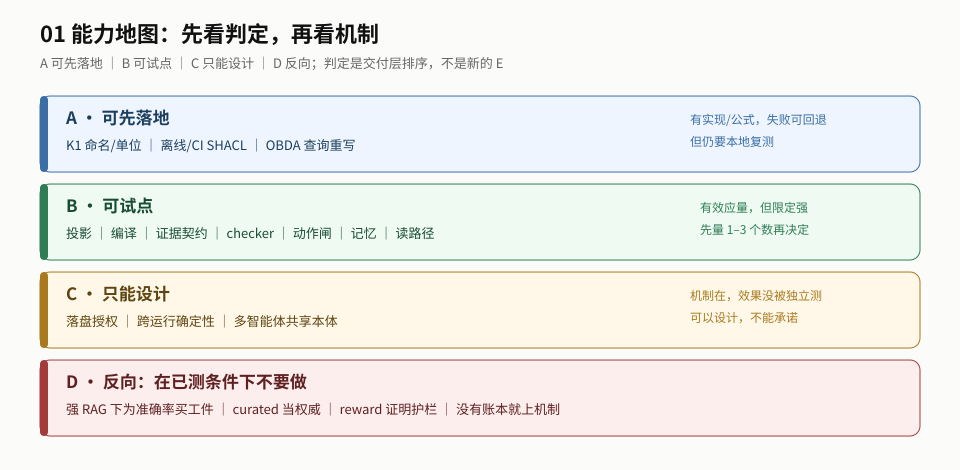

# 01 导读：先判断值不值得做

> **读者**：决策者 / 工程负责人 ｜ **读完你能**：给一项能力判 A/B/C/D，说出它离落地还差什么。

## 最短路径（10 分钟）

1. 读 [README §0 一页结论](./README.md#0-一页结论)：先知道 A 可先落地、B 可试点、C 只能设计、D 反向。
2. 读 [地图 §2](./sections/map.md)：看能力矩阵与 E1–E9 verdict；不要一开始就翻逐项。
3. 记住一句话：**最确定的是 K1（名字/单位），其余都要先量 1–3 个数。**

## 推荐顺序

| 步 | 读什么 | 读完你能 |
|---|---|---|
| 0 | [README §0](./README.md#0-一页结论) | 知道这份东西给谁、最重要三句 |
| 1 | [sections/map.md](./sections/map.md) | 看懂 A/B/C/D 与每项判定从哪来 |
| 2 | [capabilities/README.md](./capabilities/README.md) | 按 A→B→C→D 找到你关心的能力 |
| 3 | [sections/boundaries.md](./sections/boundaries.md) | 说出哪些不能当工作前提、哪些是反向 |
| 4 | [sections/acceptance.md](./sections/acceptance.md) | 知道立项前还要量什么 |
| 5 | [sections/relations.md](./sections/relations.md) | 需要时跳 02/03 |

## 按目的

| 你要做什么 | 先读 | 再读 |
|---|---|---|
| 判断「要不要做本体」 | README §0 + 地图 | 能力 A/B + 边界 |
| 选第一个可落地的能力 | 地图的 A 行 | `capabilities/knowledge.md` |
| 判断某能力能不能试点 | 地图的 B 行 | 对应 capability 文件 + 验收 |
| 评审「这个承诺靠不靠谱」 | 边界 | 验收 + 03 的 evidence |
| 只想知道「还差多远」 | 验收 | 地图的 E1–E9 verdict |

## 三种读法

| 时间 | 读什么 | 得到什么 |
|---|---|---|
| 10 分钟 | README §0 + 地图 | 知道结论、A/B/C/D 与最大风险 |
| 1 小时 | 0 + 地图 + 能力（先 A/B） | 能指到具体能力与证据 |
| 深读 | 0–6 全部 | 能复述条件、边界、验收与缺口 |

## 如果只做一件事

**先做 K1，再建账本。** K1 是已测最大增益、最便宜、最可回退；账本是所有 go/no-go 的前提。

## 不要先读

- 不要先读 `data/`：那是工作底稿，先看结论与地图。
- 不要先读 03 附录：那是长版论证，等你要审边界时再看。
- 不要从「本体越全越好」开始：先看 D 反向清单。
