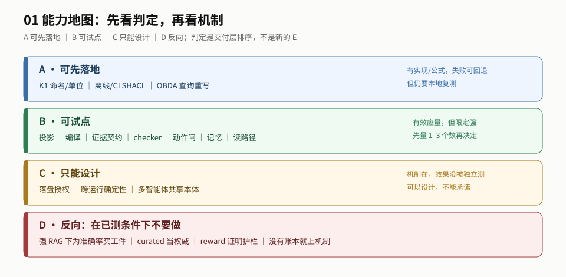

# 2. 地图：能力矩阵

> 本章回答：能力矩阵怎么读、X1–X9 verdict 从哪来。 ｜ 读完你应该能：给一项能力判 A/B/C/D，并说出它的证据边界。
>
> **2026-11-11 证据重置**：E-02/E-03/E-04/E-13/E-16 的原锚已撤回；依赖它们的 4 行（#4/#5/#6/#11）移入 [§2.2b gap/待新源](#22b-gap待新源4-行)，不再计入 A/B/C。**当前计数：A=3 / B=4 / C=2 / 非本体=1 / gap=4。** 撤回清单见 [审计](../../../meta/audits/2026-11-11-source-purge.md)。

### 2.1 判定口径

| 判定 | 含义 | 不等于 |
|---|---|---|
| **A 可先落地** | 有可运行实现 / 可复算公式 / 已测且可回退的操作；边界能写成一条你能执行的验收；失败可回退 | 已证 / 跨域有效 |
| **B 可试点** | 有一手证据（效应量或代码级阻断证据），且该证据的源仍是 admitted，但边界不能完全写进验收（未测方向 / 单实现 / 单域） | 可以直接上线 |
| **C 只能设计** | 有机制或设计、且证据源仍 admitted，但只有模拟 / 概念架构 / 无实现 | 不值得研究 |
| **D 反向** | 在已测且源仍 admitted 的条件下会得出错误结论或负收益 | 永远不能用 |
| **gap / 待新源** | 原锚已撤回或没有 admitted 源；不判 A/B/C/D，只记“缺什么、等什么源” | 「无效」或「只能设计」 |

**按顺序判定（命中即停）：**

0. **先查源位阶**：这一行的一手证据是否已被撤回（`withdrawn`）？是 → **gap / 待新源**，不进 A/B/C/D。没有 admitted 源，成熟度判断不成立。
1. **再排除 D**：在已测且源仍 admitted 的条件下会不会得出错误结论或负收益？会 → **D**。
2. **再问是不是本体机制**：机器拿本体做的事，是不是「本体在回路里被执行」？不是 → **非本体（参照）**，不进 A/B/C/D。
3. **问 A**：有可运行实现 / 可复算公式 / 已测且可回退的操作？**且**边界能写成一条你能执行的验收？**且**失败可回退？→ **A**。
4. **问 C**：有机制或设计，但只有模拟 / 概念架构 / 无实现？→ **C**。
5. **问 B**：有一手证据（效应量或代码级阻断证据），但边界不能完全写进验收？→ **B**。
6. **都不命中** → **`undetermined`**，写清缺哪一条，不进 A/B/C/D。

> **为什么把“源撤回”放在最前**：D/A/B/C 都是“对证据强弱/方向的判断”；源撤回后，判断的对象不存在了。把它降成 B 或 C 会把“没有证据”伪装成“有证据但弱”。

> **为什么这个顺序**：D 先排，因为反向项不该被成熟度掩盖；非本体先排，因为 A/B/C 衡量的是「本体被执行」的成熟度；A 在 C 前，因为「有实现且边界可验收」比「只有模拟」强；B 是剩余档——有证据但边界写不死。

| 案例 | 判定 | 规则怎么走 |
|---|---|---|
| #1 点位语义（K1） | A | 有已测操作 + 边界（单工厂/本地复测）能写成验收 + 可回退 |
| #9 OBDA | A | 有实现 + 边界（只支持 OWL 2 QL）能写成验收 |
| #8 读路径 | B | 有代码级证据，但 fail-open / object 未测 → 边界写不成验收 |
| #6 动作闸 | **gap** | 原锚 E-04/E-13 已撤回；只剩 CASEL（非本体）→ 不进 B |
| #11 推理期 | **gap** | 原锚 E-16 已撤回；没有 admitted 源 → 不进 C |
| #12 审批/分配 | 非本体 | CASEL（审批/分配模拟）是 harness 的分配策略，不是本体被执行 |
| 多智能体共享本体 | undetermined | 只有方向，没有机制/设计/一手证据（§5.1「空白」） |

> **`undetermined` 不是 C**：C 还有机制/设计；undetermined 连可判的机制都没有。保留这一档，是为了不把「没想过」伪装成「只能设计」。

> **本体自动生成/精化不在本表**：它是 source（[05 生产](../../../topics/05-produce/README.md)），不是「本体在哪个时刻被执行」；有派内机制/案例但没有形成 E（下游可消费未测），所以既不是 C 也不是 undetermined，而是**非本表范围**。

> **没有 A+。** 本仓库没有独立复现，任何一项都升不到「已证」。A 是「工程上可以先做、失败也能回退」，不是「肯定没问题」。

> **K0–K4 是论文条件代号，不是行业标准。** 本表第 1–2 行用「点位语义 / 知识投影文本」；K 只在括号里回查。谁定义的、K3/K4 是什么、为什么只到 K2，见 [K 页](./k-ladder.md)。

### 2.2 一张表（只列有 admitted 源的 10 行）

| # | 能力 | 接在哪 | 机器做什么 | 一手证据 | 等级 | 判定 | 主要距离 |
|---|---|---|---|---|---|---|---|
| 1 | 点位语义：tag 名/单位/质量码（K1） | 供给 | context | E-12：+54.6pp | **已核** | **A** | 单工厂；先做这个 |
| 2 | 知识投影文本（K2） | 供给 | context | E-12：+19.8pp；0.777 | **已核** | **B** | 单工厂/9 任务/45k 字符；不含推导量；顺序敏感 |
| 3 | 证据编译（claim–leaf） | 供给 | compiled | E-08/E-14：平均 −38%，条件性 | **已核** | **B** | 先量 `p_h`；时延约 3× |
| 7 | 跨轮身份/记忆 | 跨轮 | compiled | E-05/E-17：CMR/Acc@complete 提升 | **已核** | **B** | 专有数据/文本 only/需训练信号 |
| 8 | 读路径过滤 | 检索返回前 | engine | E-20：trustgraph 代码级 | **已核（代码）** | **B** | fail-open；只删 subject 侧；单实现 |
| 9 | 查询重写/OBDA | 供给 | engine | E-20：ontop 代码级 | **已核（代码）** | **A** | 只支持 OWL 2 QL；不是闸 |
| 10 | 离线/CI 的 SHACL 校验 | 离线/CI | engine/compiled | E-20：semantica/open-ontologies | **已核（代码）** | **A** | 不在回路内；派生 shapes 未测 |
| 12 | 审批/多模式分配 | 动作前 | 非本体 | E-15：模拟 | **已核（模拟）** | **非本体** | 无本体变量；`γ_m` 是假设；只作参照，不进 A/B/C |
| 13 | 落盘前授权 | 落盘前 | 无实现 | E-20：否定性证据 | **gap** | **C** | 无实现；false-defer 未测 |
| 14 | 跨运行确定性 | 跨运行 | 无实现 | 设计提案（未升 E） | **设计** | **C** | 无实现、无度量 |

> **计数**：A=3（#1/#9/#10）、B=4（#2/#3/#7/#8）、C=2（#13/#14）、非本体=1（#12）。**#4/#5/#6/#11 不在本表**，见 §2.2b。

### 2.2b gap / 待新源（4 行）

> 这 4 行保留编号与旧锚，**只用于回查，不作为结论**。原 E 已 withdrawn；没有 admitted 源之前，不判 A/B/C/D，也不说「可试点」。

| # | 能力 | 原锚 | 状态 | 缺什么 / 下一步 |
|---|---|---|---|---|
| 4 | 输出证据契约（grounding） | E-03（OA-RAG） | **withdrawn** | 需要新的 grounding/校准来源；不要复用「+10–15pp」「等级是模型自评」的旧数字 |
| 5 | 输出后 checker | E-02（Ontology Catch） | **withdrawn** | 需要新的 checker 漏检/误报来源；空结果重试基线也随 E-02 撤回，不能当既有结论 |
| 6 | 动作前可逆性闸 | E-04/E-13（POLAR） | **withdrawn** | 需要新的本体闸/误拦来源；CASEL（E-15）只是非本体参照，不能补这一行 |
| 11 | 推理期条件验证 | E-16（OntoAct） | **withdrawn** | 需要新的推理期条件验证来源；没有 admitted 源，不能判 C |

> **为什么不是 C**：C 的前提是「有机制或设计」；这 4 行的机制描述还在 `topics/` 里，但唯一一手锚已撤回。把它们放 gap，是为了不把「没有 admitted 证据」伪装成「只能设计」。
>
> **旧数字怎么处理**：正文不再复述 E-02/E-03/E-04/E-13/E-16 的效应量；要追溯为什么删，见 [来源清除审计](../../../meta/audits/2026-11-11-source-purge.md)。

> 表中 #1/#2/#3/#7/#8/#9 是「本体在回路里被执行」；#10 是离线/CI（不在回路内，但本体被执行，所以仍在表里）；#12 是「非本体参照」；#13–14 是「还没有实现」。**不要把 #12 的数字当成本体增益**——E-15 没有本体变量。
>
> **14 行（含 4 个 gap）是「本体能做的事」，不是「六个位置」。** `read-path` / `supply` 是轴外位置，仍可作为能力行；不要把「轴外」读成「不该进矩阵」。

> **#8 的 2026-11-11 复查**：read-path 有三个执行点（post-filter / rewrite / scan）。sparql-guard（rewrite）76/76 tests 复跑通过；10 用例实跑 7 pass、1 alias leak、0 false-block（EXP-002，本仓 read-path 复跑）。holosdb（scan）是 predicate 级、不能表达 node-level。但两者各只有 1 个 GitHub star、无 harness 调用点、无泄漏率，所以 #8 仍是 **B**，不升 A。见 [read-path §3](../../../topics/01-constraint/commit-gate/read-path.md)。

**为什么 #10 仍是 A、#11 变成 gap**：#10 的边界（三态/派生 shapes/CI）能写成验收，且有代码级实现；#11 的唯一一手锚 E-16 已撤回，没有 admitted 源，不能判 C。C 的前提是「有机制/设计且源仍在」，不是「没有证据但听起来合理」。

**为什么 #12 是非本体**：CASEL（审批/分配模拟）是 harness 的分配策略，没有本体变量；它不是 A/B/C 的成熟度问题，是「本体不在环里」。
>
> `context` / `compiled` / `engine` 是执行形态（机器拿本体做了什么），定义见 [02 §3](../../02-engineering-playbook/sections/map.md#24-选形态五种别把-context-当低配-engine)；不要把 `context` 当 `engine` 的低配。

### 2.3 怎么读这张表

- **A 不是「更好」，是「更可验收」。** 离线 SHACL 校验不会让 agent 变准，但它能在 CI 里给出一个可复算的通过/违反/未检查完；OBDA 不会拦动作，但它能把本体+映射编译成 SQL。
- **B 的共同点是「有效应量，但限定强」。** 它们都值得做一次 shadow，而不是直接上线。
- **C 的共同点是「机制在，效果没被独立测」。** 可以设计，不能承诺。

### 2.4 X1–X9 verdict（2026-11-09 第一轮；2026-11-11 证据重置后修订）

> **verdict 四档**：`supported` = 至少一条一手证据、在已测域成立；`supported（限定）` = 只在限定条件下成立；`conditional` = 公式/机制成立、关键输入未量；`unknown` = 没有一手证据（不是「无效」）。它只用于这 9 条期待，不是 E 的等级。这一轮只做 desk research 与代码阅读；数据表在 [`data/`](../data)。

| 期待 | verdict | 证据/数据表 | 边界 |
|---|---|---|---|
| X1 点位语义（K1） | `supported（限定）` | E-12；单工厂 +54.6pp | 跨域未知 |
| X2 知识投影文本（K2） | `supported（限定）` | E-12；单工厂 +19.8pp | 跨域/多设备/顺序迁移未知 |
| X3 编译 | `conditional` | E-08/E-14；[e3 数据表](../data/e3-compilation.md) | 公式成立；自己的 `p_h`/`c`/`Q` 未量 |
| X4 checker | **`unknown` / 待新源** | E-02 已撤回；[e4 数据表](../data/e4-checker.md) 只作历史 | 需要新的 checker 漏检/误报来源；空结果重试基线也待新源 |
| X5 动作闸 | **`unknown` / 待新源** | E-04/E-13 已撤回；E-15（CASEL）仅非本体参照；[e5 数据表](../data/e5-false-veto.md) 只作历史 | 需要新的本体闸来源；false-veto 仍无标签 |
| X6 记忆 | `supported（限定）` | E-05/E-17；[e6 数据表](../data/e6-memory.md) | 非全部设置过 +10pp/90%；跨域未知 |
| X7 读路径 | `supported（限定）`（存在）/ **`unknown`**（object 方向） | E-20；[e7/e8 代码](../data/e7-e8-code.md) | 单实现；fail-open；只删 subject |
| X8 写路径 | **`unknown`/无实现** | E-20；[e7/e8 代码](../data/e7-e8-code.md) | 四个开源项目都无单次写授权 |
| X9 确定性 | **`unknown`** | 设计提案；[P1/P2 扫描](../data/p1-p2-source-scan.md)（Suite v0 是 harness 级候选，未落盘） | 无本体锚点实现、无度量 |

**读法**：`supported（限定）` 只表示「在已测域里有证据」，不表示跨域有效；`unknown` 不是「无效」，是「还没有一手证据」。9 条里没有一条 `supported`（无限定）。
>
> **2026-11-11 证据重置**：E-02/E-04/E-13 已撤回，X4/X5 改 `unknown/待新源`；`data/` 里的 e4/e5 表只作历史底稿，不再作为结论。
