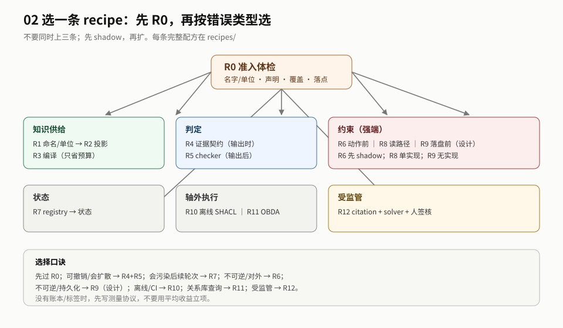

# 02 导读：先定错，再选一条 recipe

> **读者**：工程负责人 / 架构师 ｜ **读完你能**：选一条接缝/recipe，写出接口、验收和 stop。

## 最短路径（10 分钟）

1. 读 [README §0 一页结论](../02-sections/00-overview.md#0-一页结论)：这份只回答「怎么做」。
2. 读 [地图 §2](02-map.md)：五步法、定错、选位置/形态。
3. 记住一句话：**先过 R0，再按错误类型选一条 recipe；不要同时上三条。**

## 30 分钟：跟一份填好的产物包

> 目标不是选 recipe，是**看懂「做完长什么样」**。只读，不跑。

1. [附录 D §0 交接表](../05-appendices/04-artifact-pack.md#0-一页交接)：先看 7 件产物。
2. [R0 体检](../05-appendices/04-artifact-pack.md#1-r0-体检表已核-来自-case-2)：四项有 pass/flag/unknown。
3. [接口契约](../05-appendices/04-artifact-pack.md#2-接口契约r4)：三原语 + 观察类型 + 预算。
4. [账本行](../05-appendices/04-artifact-pack.md#5-账本行) + [停线记录](../05-appendices/04-artifact-pack.md#6-停线记录)：哪些是 `untested`。
5. [未测清单](../05-appendices/04-artifact-pack.md#7-未测清单交稿必填)：填不出这张表，说明你还不知道边界。

**做完你能回答**：一条 recipe 做完手上有什么；哪些格必须自己补。

## 连续读法（5 页，约 40 分钟）

按顺序读，不要先翻 recipe 索引：

1. [README §0 一页结论](../02-sections/00-overview.md#0-一页结论)：这份只回答「怎么做」。
2. [地图 §2.1 五步法](02-map.md#21-五步法与决策树)：定错 → 准入 → 选位置 → 选形态 → 定尺子。
3. [R0 体检](../03-recipes/00-readiness.md)：四项检查不过，后面都是沙上。
4. 按你的错误类型选**一条** recipe（[索引](../03-recipes/README.md)），只读这一条。
5. [附录 D 产物包](../05-appendices/04-artifact-pack.md)：看「做完长什么样」。

这五页回答：**先定什么错、选哪条 recipe、做完手上有什么。** 其余 recipe 是查阅，不是必读。

## 推荐顺序

| 步 | 读什么 | 读完你能 |
|---|---|---|
| 0 | [README §0](../02-sections/00-overview.md#0-一页结论) | 知道这份交付物回答/不回答什么 |
| 1 | [02-map.md](02-map.md) | 选一个接缝/形态，而不是先选工具 |
| 2 | [03-approach.md](03-approach.md) | 先读 R0，再按错误类型选一条 recipe |
| 3 | [对应 recipe](../03-recipes/README.md) | 写出接口、步骤、验收、stop |
| 4 | [04-boundaries.md](04-boundaries.md) | 知道哪些是反模式、不能证明什么 |
| 5 | [05-acceptance.md](05-acceptance.md) | 知道怎么验收、什么时候停 |
| 6 | [关系与维护](../../README.md#关系与维护) | 需要时跳 01/03 |
| 7 | [91-canonical.md](91-canonical.md) + [glossary](90-glossary.md) | 查阈值/内码，不再翻三页 |

## 按目的

| 你要做什么 | 先读 | 再读 |
|---|---|---|
| 判断该选哪个接缝 | 地图 | 位置表 + 选形态 |
| 先做最小的一步 | 地图的 R0 | `recipes/readiness.md` |
| 选一条 recipe | approach 的 R 索引 | 对应 recipe |
| 设计验收 | 验收 | `operations/ledger.md` + `operations/evaluation.md` |
| 做预算/上线 | `operations/cost.md` / `operations/rollout.md` | 对应 recipe 的成本节 |

## 三种读法

| 时间 | 读什么 | 得到什么 |
|---|---|---|
| 10 分钟 | README §0 + 地图 | 知道该选哪个接缝/形态 |
| 1 小时 | 0 + 地图 + approach（R0 + 一条 recipe） | 能写出接口/字段/验收 |
| 深读 | 0–6 + `recipes/` + `operations/` | 能跑一个 shadow 并做 go/no-go |

## 如果只做一件事

**R0 + 账本 + K1。** 先确认本体能被执行，再建账本，再选一条 recipe 做 shadow。

## 不要先读

- 不要从 R1 读到 R12：先读 R0，再选一条。
- 不要先读 `operations/cost.md`：没有接口和验收，成本表没有分母。
- 不要先读 03 附录：那是依据层，等你要审边界时再看。
