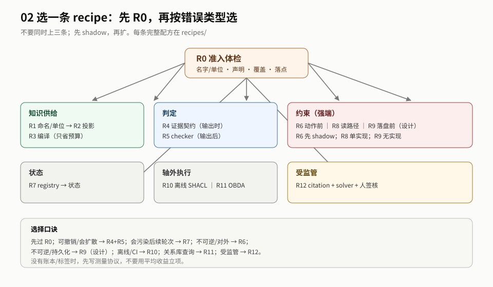

# 2. 地图：先定错、再选位置/形态

> 本章回答：先定什么错、选哪个位置/形态。 ｜ 读完你应该能：选一条接缝，而不是同时上三条。
>
> **2026-11-11 证据重置**：R4/R5/R6/R12 的原锚已撤回/移出；下文把它们当“问题定位”可以，但当“可执行配方”不行。今天可执行的是 R1/R2/R3/R7/R8/R10/R11，R9 只有设计。



### 2.1 五步法与决策树

**本体的工程问题不是「建什么本体」，而是「把哪条判据放在哪个时刻、以什么形态执行、用什么尺子验收」。**

五步：

1. **定错**：你要防的是什么错？可逆吗？会扩散吗？
2. **准入**：本体能被执行吗？先过 R0。
3. **选位置**：动作前 / 输出时 / 输出后 / 落盘前 / 跨轮 / 跨运行；或者轴外的读路径/供给。
4. **选形态 + 定接口**：engine / compiled / context / label；这个位置拿得到什么事实？输出什么字段？三态怎么表示？
5. **定尺子**：按机制选指标；先建账本，再谈效果。

**先看你要做什么：**

```
你要让本体帮你做什么？
├─ 还没确认本体能不能用 ──────────▶ R0（准入体检）
├─ 让模型知道得对 ──────────────▶ R1（K1）/ R2（投影）/ R3（编译）
├─ 让产出可审计 ────────────────▶ R4（gap：原锚撤回）
├─ 让错误被抓住 ────────────────▶ R5（gap：原锚撤回）
├─ 让不该做的动作做不了 ────────▶ R6（gap：原锚撤回）
├─ 让跨轮记得对 ────────────────▶ R7（身份/记忆）
├─ 让检索结果可见/不可见 ───────▶ R8（读路径）
├─ 让落盘有授权 ────────────────▶ R9（只能设计，无实现）
├─ 做离线/CI 校验 ──────────────▶ R10（SHACL）
├─ 用本体编译查询 ──────────────▶ R11（OBDA）
└─ 受监管、要引用/solver/签核 ──▶ R12（gap：源已移出）
```


<a id="1-先定错五个问题"></a>
### 2.2 先定错：五个问题

| 问题 | 如果答案是 | 去哪 |
|---|---|---|
| 错误可逆吗？ | 可撤销 | R5 已 gap；先找新 checker 源，不要按旧配方做 |
| 错误会扩散到下游吗？ | 会 | 加 evidence/checker；不要只做事后审计 |
| 错误会污染后续轮次吗？ | 会 | memory/身份（R7） |
| 错误不可逆且代价高吗？ | 是 | R6 已 gap；R9 只有设计，不能声称落地 |
| 判定所需事实拿得到吗？ | 拿不到 | 先补状态/观测；不要做硬闸 |

> 这五个问题不是评分卡，是**排除法**：答不出「错误是什么/可逆吗」，就不要选机制。组织建议（非 E）。

#### 2.2.1 分诊表（组织建议，非 E）

> **原依据 E-06 已撤回**；分诊表只作组织建议，待新源。五角色/七变量不再作为 admitted 结论。

| 失败表现 | 更像哪类问题 | 先看 | 不要先做 |
|---|---|---|---|
| 叫错名字、单位混、槽位对不上 | 词汇/数据契约（`N: ODCS v3.1.0` 只定 contract 字段；点位语义本身是 `local`） | R1 | R2/R3 |
| 答案对但没依据、无法审计 | 输出契约 | R4 | R5（不能补检索） |
| 类型/关系/模式错 | 结构判据 | R5 | R4（不检查语义） |
| 不可逆动作被执行 | 动作授权 | R6 | R8（只读） |
| 同一实体跨期碎裂/错并 | 身份/状态 | R7 | R3（检索） |
| 检索结果越权可见 | 读路径 | R8 | R6（动作前） |
| 错误变更落盘 | 写授权 | R9（设计） | R6（动作前） |
| 产物需要法规引用/solver/签核 | 受监管工作流 | R12 | 只做 R2 |

**分诊的出口**：一条错误只能落到一个「先看」；落不下，说明还没定义错误，不要选机制。

#### 2.2.2 两行同时命中时的优先级（组织建议，非 E）

> 注：R4/R6/R12 现为 gap（原锚撤回）；本优先级是「新源到位后」的选型参考，不是现在可上线的配方。

| 场景 | 同时命中 | 先选 | 为什么 |
|---|---|---|---|
| 答案无引用 + 受监管/要签核 | R4 / R12 | **R12** | R12 已含证据 + solver + 人；R4 的引用字段作为 R12 的子项 |
| 写外部系统 | R6 / R9 | **看时刻** | 动作前副作用 → R6；落盘/merge → R9（设计） |
| checker 误报 | R5 内分支 | **先判数据源** | curated vs data-derived 由数据源定；判不了 → `undetermined` |

**判不了怎么办**：写下「两行 + 缺哪个问题才能分开」，标 `undetermined`；不要「两条都上」。例如：

```text
undetermined: R4 vs R12
缺：这个产物是否必须带法规引用/签核？
若是 → R12；若否 → R4。先问 owner，不先写代码。
```

> 优先级不是效应量；它是**减少并行**的工程规则。改优先级要说明「哪条错误被分错了」。


<a id="2-选位置六个时刻--四个轴外位置"></a>
### 2.3 选位置：六个时刻 + 四个轴外位置

| 位置 | 问什么 | 本体角色 | 能阻断 | 主要代价 | 主证据 |
|---|---|---|---|---|---|
| 动作前 | 动作能不能做 | 可逆性/前置条件 | 是 | 审批/误拦 | E-04/E-13/E-16 撤回；E-15 仅参照 → **gap** |
| 输出时 | 产出带什么依据 | 证据契约/接地等级 | 否（只约束） | token/集成 | E-03 撤回 → **gap** |
| 输出后 | 产出对不对 | 外部判据 | 是 | 每条判定/维护 | E-02 撤回；E-20 代码级（读路径/三态） |
| 落盘前 | 证据够不够授权 | 授权判据 | 是（设计） | 无实现 | E-20 + gap |
| 跨轮 | 下一轮还记得对吗 | 状态结构/对齐 | 否（只改状态） | 维护/训练信号 | E-05/E-17 |
| 跨运行 | 同一输入能复现吗 | 一致性锚点 | 设计 | 无实现 | 设计提案 |
| 读路径（轴外） | 检索结果能不能看 | 策略过滤 | 是（best-effort） | 每批×每节点查询 | E-20 |
| 供给（轴外） | 查询怎么编译 | TBox/映射/重写 | 否 | 映射维护 | E-20 |
| 推理期（轴外） | 条件成不成立 | 条件公理/三值 | 是（条件） | 覆盖率 | E-16 撤回 → **gap** |
| 训练（轴外） | 训练数据怎么筛 | 规则 | 否 | 离线 | 无 E |

**选择规则**（组织建议，非 E）：

- 可撤销、会扩散 → R4 + R5（**均 gap，待新源**；先补观测/证据字段设计，不按旧配方上线）。
- 会污染后续轮次 → R7。
- 不可逆、对外 → R6（**gap，待新源**；不要按旧可逆性闸做）。
- 不可逆、持久化 → R9（先看：没有实现）。
- 要求可复现 → determinism（没有实现）。
- 离线/CI 数据质量 → R10；关系库查询 → R11。

**R0 不是位置**：它是准入；四项检查不过，位置选了也白选。

**R10/R11 不新增时刻**：R10 是输出后/离线的 CI 校验；R11 是供给/查询编译。它们改变「在哪跑」，不改变六时刻分类。


<a id="3-选形态五种别把-context-当低配-engine"></a>
### 2.4 选形态：五种，别把 context 当低配 engine

| 形态 | 机器做什么 | 什么时候用 | 不代表 |
|---|---|---|---|
| `engine` | 推理器/引擎直接求值：DL、SHACL、查询重写 | 需要「本体一变，输出就变」的求值 | 不等于会拦/有授权 |
| `compiled` | 本体→SHACL/规则/状态结构，再由代码执行 | 需要把本体变成可测试的约束 | 不等于编译正确 |
| `context` | 进入 prompt/上下文，模型自行使用 | 知识供给、可读性优先 | 不是弱执行，是不执行 |
| `label` | 只当标签表/schema/分类 | 命名、类型、路由 | 不参与判定 |
| `none` | 没有执行，或本体不是被测变量 | 概念/生成/评测 | 不能当「执行了但无效」 |

**一个反直觉的结论**：`engine` 内部至少四种语义（E-20）；「有引擎」不是强度刻度。选型时先问「机器到底做了什么」，再问「它能不能改变走向」。

> 回 [02 目录](../README.md) ｜ 下一节 [approach](03-approach.md)
