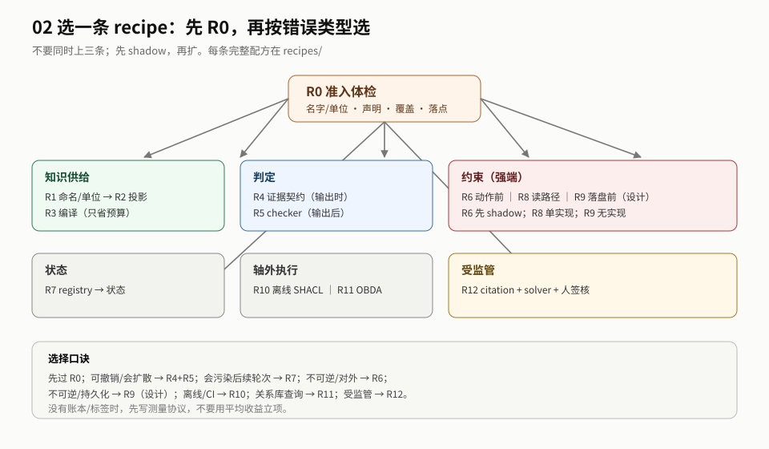

# 02 导读：先定错，再选一条 recipe

> **读者**：工程负责人 / 架构师 ｜ **读完你能**：选一条接缝/recipe，写出接口、验收和 stop。

## 最短路径（10 分钟）

1. 读 [README §0 一页结论](./README.md#0-一页结论)：这份只回答「怎么做」。
2. 读 [地图 §2](./sections/map.md)：五步法、定错、选位置/形态。
3. 记住一句话：**先过 R0，再按错误类型选一条 recipe；不要同时上三条。**

## 推荐顺序

| 步 | 读什么 | 读完你能 |
|---|---|---|
| 0 | [README §0](./README.md#0-一页结论) | 知道这份交付物回答/不回答什么 |
| 1 | [sections/map.md](./sections/map.md) | 选一个接缝/形态，而不是先选工具 |
| 2 | [sections/approach.md](./sections/approach.md) | 先读 R0，再按错误类型选一条 recipe |
| 3 | [对应 recipe](./recipes/README.md) | 写出接口、步骤、验收、stop |
| 4 | [sections/boundaries.md](./sections/boundaries.md) | 知道哪些是反模式、不能证明什么 |
| 5 | [sections/acceptance.md](./sections/acceptance.md) | 知道怎么验收、什么时候停 |
| 6 | [sections/relations.md](./sections/relations.md) | 需要时跳 01/03 |

## 按目的

| 你要做什么 | 先读 | 再读 |
|---|---|---|
| 判断该选哪个接缝 | 地图 | 位置表 + 选形态 |
| 先做最小的一步 | 地图的 R0 | `recipes/readiness.md` |
| 选一条 recipe | approach 的 R 索引 | 对应 recipe |
| 设计验收 | 验收 | `operations/ledger.md` + `operations/evaluation.md` |
| 做预算/上线 | `operations/cost.md` / `operations/rollout.md` | 对应 recipe 的成本节 |

## 三种读法

| 时间 | 读什么 | 得到什么 |
|---|---|---|
| 10 分钟 | README §0 + 地图 | 知道该选哪个接缝/形态 |
| 1 小时 | 0 + 地图 + approach（R0 + 一条 recipe） | 能写出接口/字段/验收 |
| 深读 | 0–6 + `recipes/` + `operations/` | 能跑一个 shadow 并做 go/no-go |

## 如果只做一件事

**R0 + 账本 + K1。** 先确认本体能被执行，再建账本，再选一条 recipe 做 shadow。

## 不要先读

- 不要从 R1 读到 R12：先读 R0，再选一条。
- 不要先读 `operations/cost.md`：没有接口和验收，成本表没有分母。
- 不要先读 03 附录：那是依据层，等你要审边界时再看。
