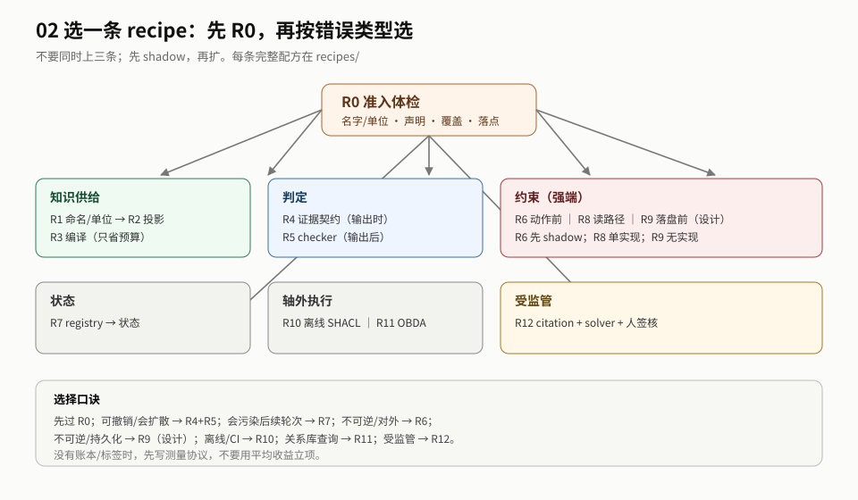

# 02 · 工程实施：把本体接进 harness 的做法

> **读者**：工程负责人 / 架构师 ｜ **回答**：拿本体做某件事，具体怎么做 ｜ **不回答**：值不值得做（去 01）、为什么是这些位置（去 03）。

> 这份交付物回答：**本体拿进来之后，到底能帮什么；如果我要做某件事，工程上从哪一步开始、接口长什么样、开源/论文里有没有能照抄的东西。**
>
> 它不建本体，也不评价本体质量；它假设你已经有（或能拿到）一份领域本体，问题是怎么让它被机器执行。
>
> **证据等级**：接口/公式/代码锚点标 `已核` 或 `已核（代码）`；工程配方、阈值、人日估算标 `推测`。交付物只引 E-xx，细节回 `topics/`。
>
> **R0–R12 是从 `topics/` 各派 `mechanism.md` 与代码级核对抽取的工程配方，不是新的 E。** 它们回答「怎么做」，不回答「做了有没有用」；效应量仍以 E-xx 为准。

## 0. 一页结论

**这份交付物只回答「怎么做」，不回答「做了有没有用」。**

1. **先过 R0**：名字/单位、声明、覆盖、执行落点四项检查不过，后面的 recipe 都是沙上。
2. **只选一条主 recipe**：按错误类型选 R1–R12；先 shadow，不要同时上三个。
3. **每条 recipe 十字段**：目标/前提/接口/步骤/证据/成本/验收/失效/锚点；填不满的字段就是上游任务。
4. **证据只到 E-xx**：recipe 是工程配方，不是新结论；效应量仍看 E-xx 的限定。
5. **如果只做一件事**：R0 + 账本 + K1；不要先建整座塔。

## 1. 怎么读

### 1.1 加载集（按需披露）

| 要做 | 只读 | 不读 |
|---|---|---|
| 10 分钟判断要不要做 | §0 + [§3.1 R 索引](./sections/approach.md#31-十二条工程做法r0r12) + [01 §0](../01-capability-status/README.md#0-一页结论) | 全部 recipe |
| 选一条 recipe / 定接口 | §0 + §1 + [§2](./sections/map.md) + [§3](./sections/approach.md) + 对应 recipe + [appendices/interfaces](appendices/interfaces.md) + [execution-forms](../../topics/execution-forms.md) | 24 篇 `paper.md`、`card.md`/`references.md`/`appendix.md`、其他派 |
| 定验收/停线 | [§5](./sections/acceptance.md) + [operations/ledger](operations/ledger.md) + [operations/evaluation](operations/evaluation.md) + 对应 `mechanism.md` | `conclusions` 全表 |
| 做预算 | [§3.5](./sections/approach.md#35-最小落地路线) + [operations/cost](operations/cost.md) + 对应 recipe §7 | 全部论文 |
| 上线/回滚 | [operations/rollout](operations/rollout.md) + [operations/domains](operations/domains.md) | 其他 recipe |

> 反向链：recipe → `mechanism.md` → digest §6.5；见 [meta/loading §从交付物倒查](../../meta/loading.md#从交付物倒查反向加载)。

### 1.2 推荐阅读顺序

1. **0 一页结论**：先知道这份交付物只回答「怎么做」。
2. **2 地图**：看五步法、定错、选位置/形态，先有判断框架。
3. **3 主体**：先读 R0 准入，再按你的错误类型选**一条** recipe；不要从 R1 读到 R12。
4. **4 边界**：看反模式与「不能证明什么」。
5. **5 验收**：看 stop、缺口与期待，决定 shadow 怎么做。
6. **6 关系**：需要时再跳 01/03。

| 时间 | 读什么 | 得到什么 |
|---|---|---|
| 10 分钟 | 0 + [2 地图](./sections/map.md) | 知道该选哪个接缝/形态 |
| 1 小时 | 0 + [2](./sections/map.md) + [3 主体](./sections/approach.md)（R0 + 一条 recipe） | 能写出接口/字段/验收 |
| 深读 | 0–6 + `recipes/` + `operations/` | 能跑一个 shadow 并做 go/no-go |

## 目录

| 节 | 文件 | 内容 |
|---|---|---|
| 2 地图 | [sections/map.md](./sections/map.md) | 五步法、定错、选位置/形态 |
| 3 主体 | [sections/approach.md](./sections/approach.md) | R0–R12 索引、开源、指示分级、架构、路线 |
| 4 边界 | [sections/boundaries.md](./sections/boundaries.md) | 反模式、不能证明什么 |
| 5 验收 | [sections/acceptance.md](./sections/acceptance.md) | stop、缺口、期待 |
| 6 关系 | [sections/relations.md](./sections/relations.md) | 与 01/03 的关系、附录、维护 |
| 配方 | [recipes/README.md](./recipes/README.md) | 13 条完整 recipe |
| 运行 | [operations/README.md](./operations/README.md) | 账本、评测、成本、上线、领域 |
| 附录 | [appendices/README.md](./appendices/README.md) | 接口、追溯、案例 |

## 关注什么 / 需要什么材料

| 项 | 内容 |
|---|---|
| 关心 | 拿本体做某件事时，从哪一步开始、接口长什么样、怎么验收/停 |
| 需要材料 | E-xx、各派 `mechanism.md`、4 个开源 digest、`recipes/` 的十字段 |
| 不做什么 | 不建本体、不评价本体质量、不新增 E；只把已有证据写成可执行配方 |