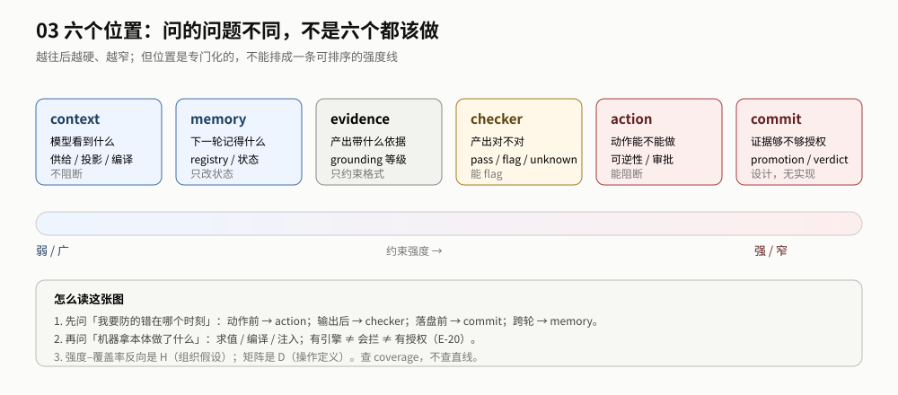

# 03 导读：先看位置，再看边界

> **读者**：架构师 / 研究者 ｜ **读完你能**：把一条判断放到正确的位置上，并说出它不能证明什么。

## 最短路径（10 分钟）

1. 读 [README §0 一页结论](./README.md#0-一页结论)：先知道「强度不是好坏，强端更窄」。
2. 读 [地图 §2.3 六位置表](./sections/map.md#23-六个位置一页表)：知道六个位置问什么。
3. 记住一句话：**位置是专门化的，不能排成一条可排序的强度线；查矩阵，不查直线。**

## 推荐顺序

| 步 | 读什么 | 读完你能 |
|---|---|---|
| 0 | [README §0](./README.md#0-一页结论) | 知道这份参考的立场与承重墙 |
| 1 | [sections/map.md](./sections/map.md) | 看懂主张类型、四轴、六位置 |
| 2 | [positions/README.md](./positions/README.md) | 按 context→memory→evidence→checker→action→commit→outside 读位置卡 |
| 3 | [across-positions/README.md](./across-positions/README.md) | 知道每个位置该量什么、覆盖什么、形态怎么分 |
| 4 | [sections/boundaries.md](./sections/boundaries.md) | 说出 15 条边界 + 12 条反例里最常被越过的部分 |
| 5 | [sections/acceptance.md](./sections/acceptance.md) | 知道 M1–M5 与下一步缺口 |
| 6 | [sections/relations.md](./sections/relations.md) | 需要时跳 01/02 |

## 按目的

| 你要做什么 | 先读 | 再读 |
|---|---|---|
| 找「这个机制能不能用」 | 地图的六位置表 | 对应 position + evidence |
| 判断「为什么是这个位置」 | 地图的四轴 | position 的机制节 |
| 评审「这条判断的边界」 | boundaries | evidence/ledger |
| 设计验收 | across-positions/measurement | acceptance |
| 规划下一步研究 | acceptance + evidence/gaps | 各派 frontier |

## 三种读法

| 时间 | 读什么 | 得到什么 |
|---|---|---|
| 10 分钟 | README §0 + 2.3 六位置表 | 知道六个位置问什么 |
| 1 小时 | 0 + 地图 + positions | 能指到某个位置卡与边界 |
| 深读 | 0–6 + `positions/` + `across-positions/` + `evidence/` | 能复述机制、证据、不能证明什么 |

## 如果只做一件事

**先读地图里的六位置表，再读 `positions/commit.md`。** 前者给你分类，后者告诉你「能推理 ≠ 能授权」这条最容易被越过的边界。

## 不要先读

- 不要先读附录：那是长版论证，位置细节以 `positions/` 为准。
- 不要把六位置当「六个都该做」：它们是六个不同的问题。
- 不要把 H（组织假设）当 E（证据）：强度–覆盖率反向是 H，矩阵是 D。
