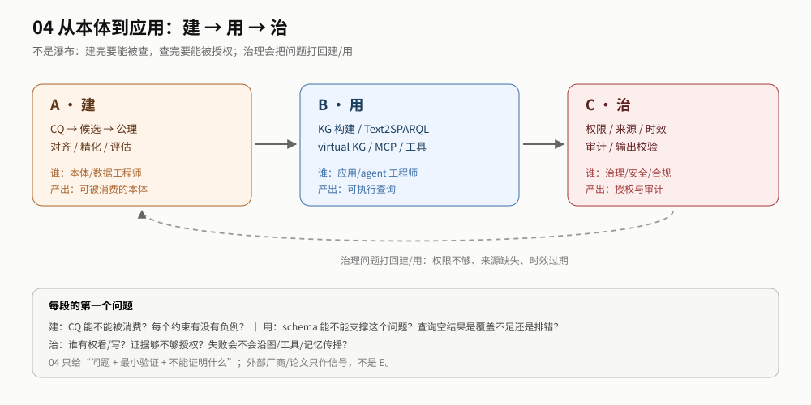

# 04 导读：先建，再用，再治

> **读者**：本体/数据工程师、应用/agent 工程师、治理/安全 ｜ **读完你能**：判断自己卡在“建、用、治”哪一段，并知道下一份该读什么。

## 最短路径（10 分钟）

1. 读 [README §0](./README.md#0-一页结论)：先知道 04 不是“本体导论”，是生命周期。
2. 读 [地图](./sections/map.md)：建 / 用 / 治各自问什么、产出什么。
3. 按你的角色选一段：本体工程师看 [建](./body/build.md)，应用工程师看 [用](./body/consume.md)，治理看 [治](./body/govern.md)。

## 推荐顺序

| 步 | 读什么 | 读完你能 |
|---|---|---|
| 0 | [README §0](./README.md#0-一页结论) | 知道 04 回答/不回答什么 |
| 1 | [sections/map.md](./sections/map.md) | 判断自己卡在建、用、治哪一段 |
| 2 | [body/build.md](./body/build.md) | 用 CQ/负例/评估把本体做到可消费 |
| 3 | [body/consume.md](./body/consume.md) | 选 KG 构建 / Text2SPARQL / 语义层集成 |
| 4 | [body/govern.md](./body/govern.md) | 把权限/来源/时效/审计/输出校验放进接口 |
| 5 | [sections/boundaries.md](./sections/boundaries.md) | 说出哪些是外部信号、哪些不能证明 |
| 6 | [sections/acceptance.md](./sections/acceptance.md) | 给每段写验收与 stop |

## 按角色

| 你是谁 | 先读 | 再读 |
|---|---|---|
| 本体/数据工程师 | [建](./body/build.md) | [地图](./sections/map.md) + [验收](./sections/acceptance.md) |
| 应用/agent 工程师 | [用](./body/consume.md) | [02 的 R0](../02-engineering-playbook/recipes/readiness.md) + [验收](./sections/acceptance.md) |
| 治理/安全/合规 | [治](./body/govern.md) | [边界](./sections/boundaries.md) + [03 的证据边界](../03-mechanism-reference/sections/boundaries.md) |
| 决策者 | [地图](./sections/map.md) + [边界](./sections/boundaries.md) | 需要时回 01 |

## 三种读法

| 时间 | 读什么 | 得到什么 |
|---|---|---|
| 10 分钟 | README §0 + 地图 | 知道 04 的边界与三段 |
| 1 小时 | 0 + 地图 + 你所在的一段 | 能列出下一 sprint 的 3 个问题 |
| 深读 | 0–6 全部 + `evidence/` | 能设计建/用/治的验收与候选来源 |

## 如果只做一件事

**先写 3 个 CQ 和 3 个负例，再决定要不要生成/精化本体。** 没有 CQ 的“建本体”无法验收；没有负例的约束无法测试。

## 不要先读

- 不要先读 `evidence/`：那是来源清单，不是正文。
- 不要先读厂商 ROI：04 不把行业信号当 E。
- 不要把“建 → 用 → 治”当瀑布：治理会打回建/用，见地图的回路。
