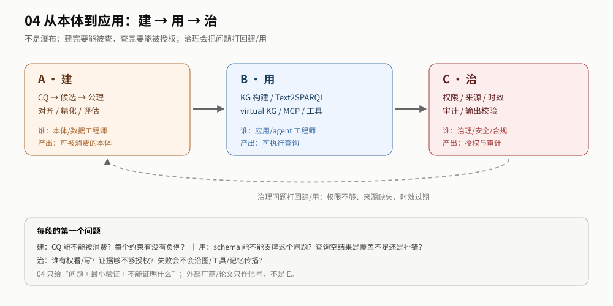

# 2. 地图：建 → 用 → 治

> 本章回答：生命周期分几段、每段问什么、产出什么。 ｜ 读完你应该能：判断自己卡在哪一段，并知道下一份读什么。

## 2.1 三段，不是瀑布

| 段 | 问什么 | 产出 | 主读者 | 主要证据 |
|---|---|---|---|---|
| **建** | 本体能不能被消费？ | CQ、候选本体、负例、`build_report` | 本体/数据工程师 | 05 生产派 + signal（无 in-scope evaluation） |
| **用** | 问题能不能被查？ | KG、schema slice、query/correction、`consume_report` | 应用/agent 工程师 | E-21 + 03 知识派 + 02 R11 |
| **治** | 谁有权看/写？失败会不会传播？ | policy、provenance、audit、`govern_report` | 治理/安全/合规 | E-22 + E-20 + 01 约束派 + 02 R8/R9 |

**不是瀑布**：治理会打回建/用——权限不够、来源缺失、时效过期；用也会打回建——schema 覆盖不足、查询空结果。见 [GUIDE](../GUIDE.md) 的回路图。

## 2.2 三段的交接

| 交接 | 上游必须给什么 | 下游必须验什么 |
|---|---|---|
| 建 → 用 | CQ、本体/映射、版本、消费者契约 | schema 能否支撑问题；空结果是覆盖不足还是排错 |
| 用 → 治 | query/answer、evidence、user_context | 权限、来源、时效、审计、输出校验 |
| 治 → 建/用 | policy、失败样本、审计发现 | 哪些约束/映射/查询要改 |

## 2.3 一张“我卡在哪”表

| 你的表现 | 更像卡在 | 先读 |
|---|---|---|
| 本体建了，但没人用 | 建 | [build](../body/build.md) 的 CQ/消费者 |
| 能查，但经常空结果/答错 | 用 | [consume](../body/consume.md) 的 schema grounding |
| 能答，但不敢上线 | 治 | [govern](../body/govern.md) 的权限/审计 |
| 三样都有，但无法验收 | 验收 | [acceptance](./acceptance.md) |

## 2.4 读完你能

- 把“建本体/查 KG/加权限”拆成三段，而不是一个项目；
- 为每段指定 owner、产出、证据；
- 知道哪些外部材料只是信号，哪些是本仓库的 E。
