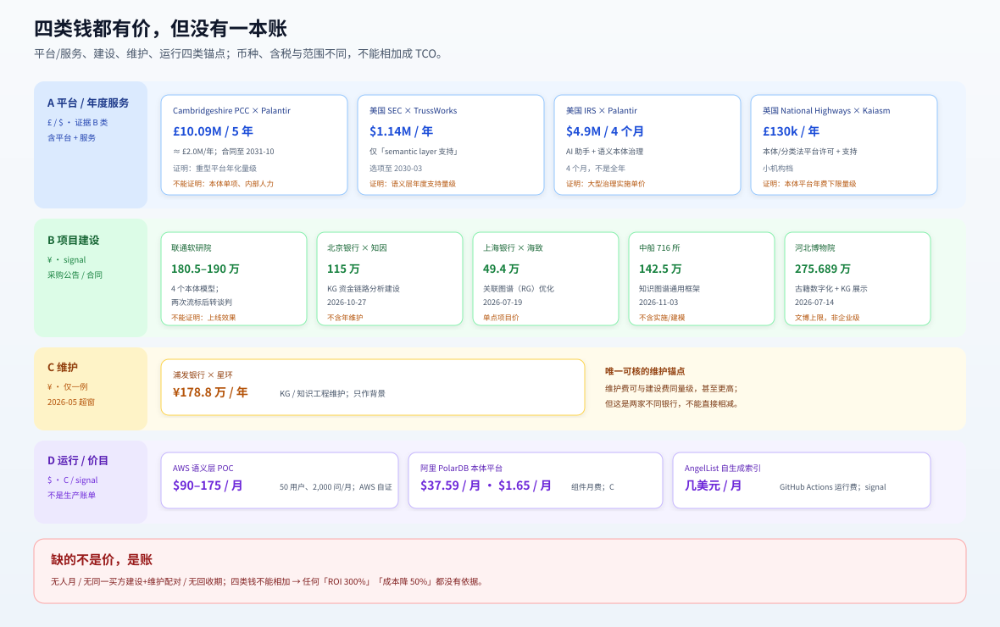

# 5. 成本与收益：贵在哪，省在哪，哪些数现在没有

> 本页回答：本体/语义层的钱到底花在哪；“LLM 让本体变便宜”便宜的是哪一段；build vs buy 的证据支持什么、不支持什么。
> **先给结论**：公开材料能证明“启动成本在降”，不能证明“总成本在降”，更不能证明 ROI。

## 5.1 五项成本：别只算建模

| 成本 | 具体是什么 | 公开案例里的证据 | 现在有没有数 |
|---|---|---|---|
| **建设** | 本体/指标建模、schema 设计、数据映射、应用接入 | 中泰从治理资产起步；阿里 Context0 用样本发现生成候选 schema；联通政企本体、北京银行 KG、中船 KG 给出项目合同额 | 有项目合同额（¥49–276 万；企业级本体约 180–190 万），无人月 |
| **运行** | 查询/推理 token、图查询、物化、平台组件费 | Snowflake 语义视图/物化；Palantir Foundry 5 年合同（≈£2.0M/年）；SEC 语义层支持 $1.14M/年；AWS POC $90–175/月；PolarDB $37.59/月 | 有平台/服务/价目锚点，无生产账单 |
| **维护** | 源表变更、口径修订、同义词、版本、回归 | 中泰 7,000+ 同义词、6,503 指标文档、12 万+ 血缘；Snowflake 版本/CI/eval；Sigma 2,883 模型/63 job；浦发 KG 维护 178.8 万/年（超窗） | 有维护费一例与工作量代理，无工时/金额配对 |
| **人审** | 口径确认、异常解释、权限审批、结果复核 | 中泰“证据不足不交付 SQL”；Snowflake 用 dashboard tile 做 eval | 无审批率/分钟数 |
| **失败** | 影子实体、口径漂移、权限旁路、错误答案的返工/事故 | 中泰三个退役判例；Snowflake 延迟/维护爆炸；Sigma PII/格式 guardrail | 无失败率/事故成本 |

> **一句话**：本体/语义层的成本不是“建一个模型”的一次性费用，是**语义资产长期保鲜**的运营费用。把它当项目预算，十有八九会低估。

**口径提醒**：中泰的“6,000+ 业务指标”出自 QCon 议题摘要，“3,400 余项公司级指标”出自同一页的讲者简介（均 2026-09-02）——两者是不同口径，**不相加、不互相替代**；9,137/6,503/2,622/12 万+ 是知识资产数，不是本体实体数、查询量或用户数。

## 5.2 “LLM 让本体变便宜”便宜在哪

| 环节 | LLM 能帮什么 | 不能帮什么 | 证据 |
|---|---|---|---|
| 候选 schema | 从样本/文档自动发现类型、属性、关系 | 决定“哪个口径才是对的” | 阿里 Context0 样本发现；PolarDB 本体平台 |
| 抽取 | 从文档抽实体/关系、带 evidence | 保证抽取结果符合业务约束 | 阿里 Context0 实例带出处；GraphRAG |
| 解释/别名/问法 | 生成业务摘要、同义词、常见问法 | 维护 7,000+ 同义词的一致性 | 中泰：LLM 只做解释，事实由程序整理 |
| 语义层代码 | 起草 semantic view、生成测试 | 版本/CI/评审/物化策略 | Snowflake 用 CoCo 起草，但仍要版本/测试 |
| 口径治理 | 辅助比对、发现冲突 | 指定 owner、裁决冲突、退役旧口径 | 中泰：口径不明向用户澄清；证据不足停 |

**结论（`推测`）**：LLM 降低的是“从 0 到 1 的建模/抽取成本”，不降低“从 1 到 N 的口径治理/维护成本”。这解释的是机制（建的门槛降了、养的活没少），不是行业趋势——“上本体的团队变多”本份没有数据（E-31）。

### 5.2b 一个可核的维护衰减：Anthropic

Anthropic 2026-06-03 的工程文章（[原文](https://claude.com/resources/articles/how-anthropic-enables-self-service-data-analytics-with-claude)）给了一组少见的维护数：

- 95% 的业务分析查询由 Claude 自动化，聚合准确率 ~95%；**不加 skills 时准确率不超过 21%**。
- **离线准确率一个月内从 ~95% 掉到 ~65%**，直到把 skill 维护当工程问题处理；此后约 90% 的数据模型 PR 在同一个 diff 里带 skill 改动，用 code-review hook 强制。
- 对抗式复核 **+6% 准确率，代价 +32% token、+72% 延迟**。
- 让 LLM 从原始表 + 查询日志**自动生成 metric 定义**，产出的定义“plausible-looking”，但把要消除的歧义又编码回去，相对人工小语义层 **net-negative**。

**怎么读**：单公司工程博客；有 I4（InfoQ 2026-06、AtScale 分析、OntiCards 2026-10 引用该衰减数），但缺 I1–I3，仍未过门——**只作待验证的量级假设，不撑 E-31**。但如果这组数在你的环境里成立，它点出的机制比任何“LLM 让本体变便宜”的口号都更值得先量：**不是建的时候贵，是建完一个月就开始掉**。

### 5.2c 一个回退案例：AngelList

AngelList 2026-08-28 的工程博客（[原文](https://www.angellist.com/blog/the-semantic-layer-nobody-maintains)）说它**放弃** dbt Semantic Layer / Snowflake semantic view，改成 repo 内 markdown（knowledge + skills），由 dbt manifest、上游应用代码、`ACCOUNT_USAGE.ACCESS_HISTORY` 每次 merge 自动重生成：

- 规模：1,400+ mart models / 59 域；索引 13,000 行；约 27,000 列。
- 成本：GitHub Actions runners “a few dollars a month”；对照 dbt Semantic Layer 的 per-seat + 查询时服务 + 厂商运行时。
- 失败机制：每新增模型/改列/改指标，都要记得同步到语义层，否则 drift；“**stale semantics are worse than none. They're confidently wrong.**”

**怎么读**：这是“换实现”，不是“项目失败”；没有准确率数、HN 2 分，未过门。它的价值是**存在性证据**：确实有团队在维护成本 > 收益时退回“自动生成的文档”。只证明“会发生”，不证明“多常见”，不撑 E-31。

## 5.3 Build vs Buy：证据支持“买底座、建薄本体”

| 路线 | 证据 | 适用 | 风险 |
|---|---|---|---|
| **买重型本体平台**（Palantir/Stardog/Ontotext） | Palantir 2026 客户公告；Stardog 客户页 | 高价值、跨系统、愿意付平台费+实施费 | 平台锁定、实施重、总价不透明 |
| **买/租数仓语义层**（Snowflake/dbt/Sigma/AtScale） | Snowflake/Sigma 生产规模；dbt 生态 | 已有数仓/BI，先解决口径/权限 | 语义层不是本体推理；跨源/非结构化弱 |
| **用数据库内嵌本体**（阿里 PolarDB/Context0） | 2026-09/10 产品文档（C） | 已在阿里云，想快速试本体+RAG | 类型≤100/关系≤300；灰度；客户证据缺 |
| **图数据库/GraphRAG**（Neo4j/TuGraph） | 开源/厂商材料 | 多跳、关系查询、知识库 | 图库≠本体；本体/权限/版本要另做 |
| **从零自建** | 未找到公开成功案例 | 极少数有平台能力的组织 | 引擎/版本/权限/生态全自担；证据最弱 |

**证据支持的结论**：
- **默认不要从零建**；先把“已有底座”列出来（数仓/图库/数据库/自研平台），再决定本体放哪。
- **底座买/租，语义内容自己建**：底座是商品，口径/权限/退役是组织能力，买不来。
- **重型平台不是“更高级”**：它是“更窄、更贵、更适合高价值场景”；薄语义层不是“降级”，是“先解决口径/权限”。

**证据不支持的结论**：
- “买平台就一定成功”——没有一条来源给出平台 ROI。
- “薄语义层能替代本体”——薄语义层解决指标/口径，不解决对象/关系/约束推理。
- “LLM 自动建本体，所以不用人”——中泰/阿里都仍要人定 schema、版本、权限、证据。

## 5.4 三个可用的量级判断（不是 TCO）

没有金额时，先用**工作量代理**做量级判断：

1. **语义资产规模**：指标文档数、同义词数、血缘条数。中泰 6,503/7,000+/120k+ 说明“养”的体量；如果你只有 50 个指标，不要照搬它的平台复杂度。
2. **变更频率**：源表/口径/法规多久变一次。Snowflake 的预聚合维护爆炸、Sigma 的 63 个 job 都说明“变更频率×覆盖面”决定维护成本。
3. **消费面数量**：多少 dashboard/agent/用户共用一套语义。Snowflake 5,600 员工/320k 查询说明“共用”才摊得薄；只有一个团队用，语义层可能不如直接写 SQL。

> **不要**把这三个代理乘起来当“成本分”；它们只帮你判断“这事是 2 人月还是 20 人月”的量级。

## 5.5 价格锚点：四类钱都有价，但没有账

先分清四种“钱”：① 平台/多年服务合同；② 年度支持/维护；③ 项目合同（建设/实施）；④ 价目与 POC 运行费。公开材料里四类都有锚点；缺的是**人月**和**同一组织的建设+维护配对**。

图为 §5.5 的图形版：四类锚点分开摆，币种不换算、口径不相加；金额、日期与「能证明/不能证明」以下面 A/B/C 三张表为准。

**A. 平台与年度服务（英美公共采购，B 类）**

| 锚点 | 金额 | 口径 | 日期 / 来源 | 能证明 | 不能证明 |
|---|---|---|---|---|---|
| Cambridgeshire PCC × Palantir Foundry | **£10.09M / 5 年**（≈£2.0M/年） | 平台+服务，至 2031-10；Ontology 是平台核心 | 2026-10-09 授予；UK Contracts Finder | 重型平台的年化量级 | 本体单项、内部人力、效果；含警务场景溢价 |
| 美国 SEC × TrussWorks | **$1.14M / 年**（选项至 2030-03） | 合同描述仅 “Support to the semantic layer” | 2026-09-14；USAspending | 语义层“养”的年费量级 | 许可、实施、内部人力 |
| 美国 IRS × Palantir | **$4.9M / 4 个月** | AI 助手 + 语义本体治理 | 2026-11-05；USAspending | 大型本体治理的实施单价 | 年化运行；4 个月不是全年 |
| 英国 National Highways × Kaiasm | **£130k / 年** | 本体/分类法平台许可+支持 | 2026-08-05；Contracts Finder | 本体平台年费的小机构档 | 建模、集成、人力 |

**B. 中国项目合同（signal）**

| 锚点 | 金额 | 口径 | 日期 | 能证明 | 不能证明 |
|---|---|---|---|---|---|
| 中国联通软研院 政企本体建模 | **预算 190 万 / 限价 180.5 万** | 4 个本体模型，2026–2028 两期；两次流标后转谈判，亚信中标 | 2026-08/09 | 企业级本体项目的预算量级 | 后续年维护、人月、效果 |
| 北京银行 × 知因智慧 | **¥115 万** | KG 资金链路分析建设 | 2026-10-27 | 中等 KG 项目建设价 | 年维护、人月 |
| 上海银行 × 海致星图 | **¥49.4 万** | 关联图谱（RG）优化 | 2026-07-19 | 单点优化项目价 | 平台/长期 |
| 浦发银行 × 星环 | **¥178.8 万 / 年** | KG/知识工程维护（**2026-05 超窗，只作背景**） | 2026-05-19 | 维护费量级；维护可与建设同量级或更高 | 与建设费不能直接相减（不同银行/范围） |
| 中船 716 所 × 中科世通亨奇 | **¥142.5 万** | 知识图谱通用框架软件 | 2026-11-03 | 央企 KG 软件采购价 | 实施/建模/年维护 |
| 河北博物院 | **¥275.689 万** | 古籍数字化 + KG 展示 | 2026-07-14 | 文博类 KG 项目上限 | 企业级；效果 |

**C. 价目与运行费（小钱，C/signal）**

| 锚点 | 金额 | 口径 | 日期 | 能证明 | 不能证明 |
|---|---|---|---|---|---|
| 比利时 Sciensano KG 平台 | **€264k（招标预算，未中标）** | 供货+实施+培训+维护 | 2026-07-31；TED 531122-2026 | 政府 KG 平台预算量级 | 成交价、年维护 |
| AWS 语义层 POC | **$90–175/月** | 整层运行费（50 用户/2,000 问/月） | 2026-10-19；C（AWS 自证） | POC 跑起来很便宜 | 生产规模、人工 |
| 阿里 PolarDB 本体平台 | **$37.59/月、$1.65/月** | 组件月费 | 2026-10-21；C | 底座月费量级 | 客户账单、TCO |
| AngelList 自生成索引 | **“几美元/月”** | GitHub Actions 运行费 | 2026-08-28；signal | 自动生成文档的运行成本极低 | 人力、等价收益 |

**读法（四句话）**：

1. **平台级**：重型平台 5 年 ≈ £2.0M/年；语义层年度支持 ≈ $1.14M/年；本体平台小机构 ≈ £130k/年。
2. **建设级**：中国企业级本体 180–190 万、KG 项目 49–276 万。
3. **维护级**：唯一可核的是浦发 **178.8 万/年**（超窗背景）——**维护费可以与建设费同量级，甚至更高**，与 E-31“成本在养不在建”同向；但两家不同银行，不能直接相减。
4. **运行级**：POC 与组件月费很便宜（$37–175/月），说明“跑起来”不贵，贵的是人和治理。

这四类**不能相加成 TCO**：口径不同（含税/不含税、含实施/不含、obligation/总价），且没有人月、没有同一买方的建设+维护配对。任何“ROI 300%”“成本降 50%”仍然没有依据。

## 5.5b 仍然没有的数（明确 gap）

| 缺什么 | 为什么重要 | 关闭它需要什么 | 现状 |
|---|---|---|---|
| 建模/维护人月 | 决定 build vs buy | 企业复盘里的团队规模 × 月数 | 只有江南农商「3 人核心组」一个 signal；2026-11-12 检索阴性（见 90.3） |
| 同一组织的建设+维护配对 | 决定 3 年 TCO | 同一买方的建设合同 + 续费/维护合同 | 无（北京银行建设与浦发维护是两家） |
| 单次查询/推理成本 | 决定规模化是否划算 | 计费账单 | 无 |
| 错误答案/返工/事故成本 | 决定“靠谱”值多少钱 | 事故复盘/审计记录 | 无 |
| 回收期/ROI | 决定值不值得投 | 12 个月以上的生产账本 | 无 |

**准确说法**：不是“没有任何钱的数据”，而是“平台/服务/建设/维护/运行五类价都有锚点，没有**全生命周期账本**（人月 + 同一买方维护 + 回收期）”。

## 5.6 一句话给预算

**把钱分成两笔**：一笔买/租底座（可比较、可退出），一笔养语义资产（owner、版本、权限、退役）。第二笔通常被低估，也通常决定成败。
