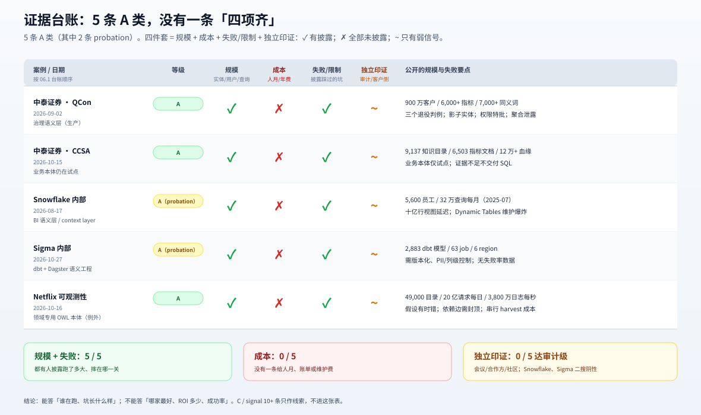
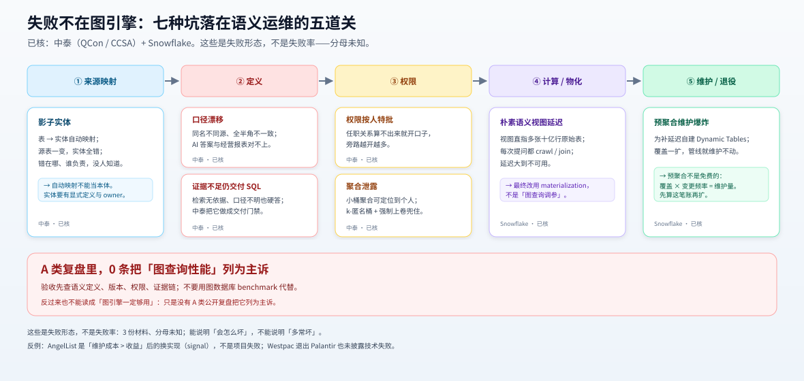

# 6. 案例台账：谁在跑、跑到什么规模、证据到哪

> 本页是 05 的证据主体。**先看等级，再看日期，再看“能证明/不能证明”**；不要把 C 类线索当案例结论。
> 口径：A = 一手生产复盘（规模 + 失败/限制 + 独立信号）；B = 具名采用（有独立信号）；C = 厂商/二手，只作线索。

图为 §6.1 的图形版：拿「规模 / 成本 / 失败·限制 / 独立印证」四件套逐项看；✓/✗/~ 的含义见图内副标题。C/signal 类线索不在图内，只在表后「补充线索」。

## 6.1 主台账

| # | 案例 | 地区 | 形态 | 日期 | 规模 | 失败/限制 | 等级 | 能证明 | 不能证明 |
|---|---|---|---|---|---|---|---|---|---|
| 1 | **中泰证券**（QCon 2026） | 中国 | 指标/本体语义层 + 规则执行 | 2026-09-02 | 900 万客户；6,000+ 指标（另说 3,400+ 公司级口径）；7,000+ 同义词 | 三个退役判例；影子实体；权限按人特批；聚合泄露 | **A** | 券商在核心业务里用语义层统一口径/权限；失败形态真实 | 单券商；摘要级；无成本/失败率/对照 |
| 2 | **中泰证券**（CCSA TC601） | 中国 | 治理知识库 + DataAgent | 2026-10-15 | 9,137 知识目录；6,503 指标文档；2,622 表；12 万+ 血缘 | 业务本体仍在信用业务验证；无依据语义剔除；证据不足不交付 SQL | **A** | “先治理语义层、再业务本体”的路径；知识资产规模 | 知识资产数≠本体覆盖；无成本/准确率；单公司 |
| 3 | **Snowflake** | 美国 | 数仓语义层/context layer | 2026-08-17 | 5,600 员工；320,000 查询/月（2025-07）；400+ 用户/5,400+ 查询 | 十亿行视图延迟；Dynamic Tables 维护爆炸；无成本/准确率 | **A（probation）** | 语义层能在 5,600 人规模跑；延迟/维护是真实坑 | 单公司自述；无外部采用；不是本体推理 |
| 4 | **Sigma** | 美国 | dbt/Dagster 语义工程 | 2026-10-27 | 2,883 dbt 模型；63 job；6 region | 需版本化/PII/列级控制；无成本/失败/准确率 | **A（probation）** | 轻语义层可以版本化、跨 6 region 持续部署 | 供应商自己跑自己的产品；不是客户效果 |
| 5 | **Netflix** | 美国 | 重型 OWL/SHACL/SPARQL + 自建 QuipuDB | 2026-10-16 | 49,000 软件目录条目；>20 亿请求/日；3,800 万日志/秒；约 6,500 万并发流；12 namespace | 假设有时错；依赖边需封顶；串行 harvest 有 wall-clock 成本；无成本/收益数 | **A** | 重型本体在超大规模可观测性生产里跑；自建图存储是例外 | 成本/ROI；before/after 时延；自建平台可复制性 |
| 6 | **Apple Glyph** | 美国 | 数据目录内嵌的**治理标签本体**（275 叶敏感性分类） | 2026-09-09 | 3.4M 列 / 98,000 表 / 4 业务线 / 3 后端（Iceberg/RDBMS/Cassandra）；6 周 ~24,000 条 steward 判定；手工等价 **~30 人年** | 最敏感的表**不许先读值再分类**（权限前置）；documentation debt；标签偏斜（NON_SENSITIVE 约 72%）；三路融合仅 +0.010 F2；无 OOD/P/R/CI；**无强制执行** | **A（probation）** | 企业级目录上的本体驱动标签层可以跑；权限会前置地限制语义生产 | 单企业；无美元成本；标签质量≠策略执行；接受率是 association、对 FN 盲 |
| 7 | **百度 CoeusBI**（VLDB 2026） | 中国 | BI 语义层（从查询自动生成视图） | 2026-06-13 | 百度数据平台服务**数千用户/日**；生产集 BD-Business Line A；公开集 MS-Financial-Views 200 表/7,400 列、MS-Commercial 2,281/65,000 | 90.8% golden SQL 含 JOIN；宽 schema、方言、多轮成本是主诉；生产集只一条业务线；无成本/失败率；EX≠业务正确 | **A** | 语义层可以**从查询里自动生成**并在大厂生产跑；分层 schema linking 把宽 schema 压下来 | 单公司单业务线；无美元成本；不是 OWL 本体；无「自动视图 vs 人工语义层」对照 |
| 8 | **中国联通 UniDataAgent**（ICDM 2026 Demo） | 中国 | 本体接地的问数-报表（OAV + QRE） | 2026-09-23 | 27 张企业表 / 数千指标类型；40 个真实业务问题；本体构建「数小时 vs 约一周」、报表「几分钟 vs 数个工作日」 | 仅单业务域；40 问小样本；工时是定性对比；只对比文档 RAG；无失败率 | **A** | 本体接地把严格准确率从 72.5% 拉到 95.0%；「先语义后执行」可落地 | 单企业；无审计；无自动 vs 人工对照；不是 OWL 本体 |
| 9 | **Palantir** | 美国 | 重型本体平台 | 2026-10-21 | 客户名单：L3Harris、McCarthy、Nvidia、Ondas/Regna、Tampa General 等 | 公告无规模/成本/失败 | **C（新闻稿）** | Foundry/Ontology/AIP 在 2026 仍有具名客户 | 采用深度、效果、成本、失败 |
| 10 | **阿里云 PolarDB 本体知识平台** | 中国 | 数据库内嵌本体 | 2026-10-21 | 产品能力（灰度）；组件价 2核4G $37.59/月、1核1G $1.65/月 | 灰度；仅 PG16；无客户/规模/失败 | **C** | 阿里有产品化本体建模+GraphRAG+Agent skills | 生产采用、效果、TCO |
| 11 | **阿里云 Context0 本体知识库** | 中国 | 知识库级薄本体 | 2026-09-23 | 类型≤100；关系≤300；每类型≤50 属性 | 知识库级；无客户/规模/失败 | **C** | “薄本体”的产品上限与版本/证据设计 | 企业级本体、生产规模 |
| 12 | **蚂蚁 TuGraph** | 中国 | 图数据库/GraphRAG | last push 2026-05-11 | 1,768 stars；42 contributors；Apache-2.0 | G1 超窗；图库≠本体平台 | **C/背景** | 蚂蚁有图底座与金融风控背景 | 2026-06 后生产使用、本体采用 |
| 13 | **腾讯 Topbase** | 中国 | 内部超大规模 KG | 2025-12-02 | 226 类概念；1 亿+实体；22 亿三元组；微信搜一搜/信息流/问答 | G1 超窗；无成本/失败；二手技术文 | **C/背景** | 腾讯内部有超大规模知识图谱 | 2026 现状、本体平台、外部采用 |

> 表里只有 1–8 能进「发现」；9–13 只作线索。**不要把 9–13 的数字/客户名单拼成“行业现状”。**
> **Atlan 的“<15% 过 pilot”已从本表撤下**：追到 Improvado 2025-09-29 的原文，只有一句没有 survey 名/样本/日期的 “industry surveys suggested”，原始统计不可核；只能当“某厂商博客的说法”，不能当分母（见 [08 边界](./08-boundaries.md#83-反例与冲突不要调和)）。

**证据类型**（比等级再细一层，读表先看类型再看等级）：

| 类型 | 是什么 | 能证明 | 不能证明 |
|---|---|---|---|
| `观测` | 作者报告自己系统的运行数据（Snowflake/Netflix/中泰） | 某形态在该规模下跑过、坑长什么样 | 跨组织规律、因果 |
| `主张` | 作者的解释/判断（“这是行业趋势”“默认路线”） | 作者怎么想 | 事实；要另找观测 |
| `采购记录` | 公共采购/合同/中标公告 | 有人在买、预算量级 | 上线成功、效果 |
| `媒体转述` | 第三方报道/转载 | 有人说过 | 原文细节；要回一手 |
| `厂商材料` | 产品页/白皮书/赞助调查 | 产品存在 | 采用、效果、成本 |

### 6.1b 补充线索：维护、回退、成本、采用率

| 线索 | 日期 | 数字 | 失败/限制 | 等级 | 用途 |
|---|---|---|---|---|---|
| [京东 Oxygen AIIC](https://arxiv.org/abs/2606.28070) | 2026-06-26 | 数百亿 SKU 商品本体；精度 94.2%/召回 82.8% | 关系建模“初步、未规模化”；线上失败大量；SFT 灾难性遗忘；公司自报、无独立采用 | signal | 中国大厂唯一同时给规模+失败的线索；不撑结论 |
| [Anthropic 自助分析](https://claude.com/resources/articles/how-anthropic-enables-self-service-data-analytics-with-claude) | 2026-06-03 | 95% 查询自动化/~95% 准确；无 skills ≤21%；离线 95%→65%/月；+6% 准确换 +32% token/+72% 延迟 | LLM 自动生成 metric 定义 net-negative；单公司；有 I4（InfoQ/AtScale/引用）但缺 I1–I3 | signal | 维护税的可核量化；不进结论 |
| [AngelList 放弃语义层](https://www.angellist.com/blog/the-semantic-layer-nobody-maintains) | 2026-08-28 | 1,400+ 模型/59 域/13k 行索引/27k 列；Actions 几美元/月 | “stale semantics worse than none”；无准确率；HN 2 分 | signal | 回退/替代方案的真实样本 |
| [AWS 语义层成本](https://builder.aws.com/content/3KvFN69cxO83mHPPRm71A5I820C/measuring-a-semantic-layer-evidence-cost-and-control-from-an-agentic-analytics-build) | 2026-10-19 | POC 50 用户/2,000 问/月；整层 $90–175/月；5 类 silent failure；live chat paraphrase agreement 4% | 客户匿名；POC；AWS 自证 | C | “运行便宜、定义维护贵”的量级线索 |
| [VB Pulse](https://venturebeat.com/data/companies-are-building-governed-semantic-layers-most-say-their-ai-agents-are-getting-context-somewhere-else) | 2026-10-06（报告 2026-11-06） | n=107/100；39% 生产用语义层；其中 28% 是 agent 主要上下文源（全体 13%）；采用者 78% vs 未采用 37% 报告上下文失败 | 自选样本；41% 顾问；不能推因果 | C（调查） | 采用率≠使用率；失败常见但不给成功率 |
| [农商行客户自述三例](https://www.fintechinchina.com/cases/9863)（贵州/江西/江南） | 2026-09/10 | 贵州：HugeGraph+华为大数据，1,000 日活/TPS 100，2024-06→2025-04；江西：NebulaGraph+OceanBase，全省 86 家，**投入 <50 万（上限）**；江南：Neo4j，2,000+ 页/500 DAU，**3 人核心组 × 12 个月 ≈ 36 人月**，文档整理省 ~1,200 工时/年 | 客户自述+评选，无独立复核；无失败；江西口径未说明 | signal | 中国采用不止中泰；底座不是五家大厂平台；**仅有的两条客户自述成本/人月** |
| [小红书 DIBP（QCon 上海 2026）](https://qcon.infoq.cn/2026/shanghai/presentation/7343) | 2026-10-22/24 | 2026-02 起建；覆盖 **80%+ 员工**、主动会话周活 **8,800+**；Context Layer（数据/指标/业务语义/代码/血缘） | 议题摘要；无成本/失败/准确率；不是 OWL 本体；单一信号 | B（具名采用） | 中国互联网侧有生产语义/上下文层；不改变五平台阴性 |
| [AstraZeneca Research Assistant](https://arxiv.org/abs/2608.12395) | 2026-08-06 | 内部 LLM + 知识图谱 + 文献/临床/表达数据；**15,000 名内部用户/首年**；响应 10–30 秒 | 技术报告（19 作者全属 AstraZeneca）；无规模/失败细节；无独立信号 | signal | 药企内部 KG 系统的规模线索；不撑“效果” |
| [Same Context, Different Agents](https://arxiv.org/abs/2610.20959) | 2026-10-14 | 7 个模型 / 1,514 任务 / 5 benchmark；语义层、编排、压缩三种 context 技术的**受控对照**；语义层收益取决于 agent 行为，对“过早作答”型反而有害 | 学术研究、非生产；无企业部署 | signal（学术对照） | G6 的“同数据集对照”线索；不撑生产效果 |
| [NHS FDP × Palantir](https://www.theguardian.com/technology/2026/nov/02/palantir-unused-nhs-hospital-trusts)（[Register 同日](https://www.theregister.com/public-sector/2026/11/03/nhs-counts-palantir-benefits-at-trusts-that-say-theyre-not-using-it/5307222)） | 2026-11-02/03 | **£330M** 合同；**29 家** trust 的 FOI 回复称未上线/未使用/不用其应用（Register 以 137 家“realising benefits”为分母≈21%；Guardian 称 137 家为“live”）；OSR 介入 | 调查报道 + FOI，不是工程复盘；谈 FDP 使用而非 Ontology 深度；无替代方案成本 | signal（调查） | “平台宣称 vs 客户使用”落差；客户 logo ≠ 在用 |
| [中国联通软研院 政企本体建模](https://bj.zhiliaobiaoxun.com/article/110498214) | 2026-08-25/09-21 | 预算 190 万（限价 180.5 万）；4 个本体模型；两次流标后转谈判，亚信中标 | 采购公告，只到授标前；无上线/效果 | signal | 企业级本体项目的预算量级；供给端投标人不足 3 家 |
| [Westpac 结束 Palantir 合作](https://www.cyberdaily.au/tech/14407-westpac-ditches-palantir-following-activist-push) | 2026-11-05 | 具名银行退出 Foundry；动因是活动人士施压 | 未披露技术失败；无替代方案；无成本 | signal | 客户 logo ≠ 长期采用；退出可能非技术原因 |

> 这张表只作“补充线索”，不进 1–5 的发现；尤其不要拿 VB Pulse 的 78% 当“语义层导致失败”的因果。

### 6.1c 失败形态清单：公开复盘里到底摔在哪

这些是**失败形态**，不是失败率（`已核`，中泰 + Snowflake 的公开复盘；分母未知）：

图为 §6.1c 的图形版：按「来源映射 → 定义 → 权限 → 计算/物化 → 维护/退役」五道关归位；AngelList 的**静默回退**是页末反例，不在七种内。

- **影子实体**：表→实体自动映射，源表一变全错且无人知道（中泰，2026-09-02）。
- **口径漂移**：同名不同源、全半角不一致，AI 答案与经营报表对不上（中泰）。
- **权限按人特批**：组织任职关系算不出来就开口子，旁路越开越多（中泰）。
- **聚合泄露**：小样本聚合结果可定位到个人；靠 k-匿名桶 + 强制上卷兜住（中泰）。
- **朴素语义视图延迟**：视图直指多张十亿行原始事件表，每次提问都爬取/连接（Snowflake，2026-08-17）。
- **预聚合维护爆炸**：自建 Dynamic Tables 补延迟，覆盖一扩维护量失控（Snowflake）。
- **证据不足仍交付 SQL**：检索无依据、口径不明时默认“硬答”；中泰把它做成门禁（2026-10-15）。

> **反例**：AngelList 2026-08-28 放弃 dbt Semantic Layer / Snowflake semantic view，改自生成 markdown；不是“项目失败”，是“维护成本 > 收益”时的换实现。它说明失败也可能是**静默回退**，不一定是大张旗鼓的 postmortem。

## 6.2 六个短案例

### 中泰证券：先把“口径/权限”做成可执行语义层

**它做了什么**：把元数据、指标五要素、数据标准、血缘、质量规则组织成治理知识库；用自研 DataAgent 接私有化大模型，提供 5 项治理 Skill；在信用业务经营分析场景验证业务本体。生产侧先解决“同一个指标不同口径、同一客户不同时点、权限按人特批”。

**规模**：9,137 份知识目录、6,503 个指标文档、2,622 张表、12 万+ 血缘（2026-10-15）；900 万客户、6,000+ 指标、7,000+ 同义词（2026-09-02，议题摘要口径；讲者简介另说 3,400+ 公司级指标）。

**失败/限制**：三个退役判例（指标值顶点、万能组织类、任职承接）；“数据库表一键转实体”产出影子实体；权限按人特批；聚合结果可定位到个人。业务本体仍在验证，不是全公司本体生产系统。

**它证明了什么**：在中国券商这种强口径/强权限场景里，“治理语义层 + 规则执行 + 证据门禁”可以进生产；失败形态是语义/权限，不是图查询。
**它没证明什么**：成本/ROI、跨券商可复制、业务本体已全面上线。

### Snowflake：语义层是“生产软件”，不是一次性建模

**它做了什么**：用 semantic views 把物理表翻译成 facts/dimensions/metrics；版本控制、peer review、CI/CD、eval、materialization；Cortex Agents 做路由。

**规模**：2025-07 单月 5,600+ 员工、320,000+ 查询；产品数据科学 agent 400+ 用户、5,400+ 查询；petabytes 内部 telemetry。

**失败/限制**：早期 semantic view 指向多张十亿行原始事件表，每次提问 crawl/join，延迟巨大；自建 Dynamic Tables 预聚合后，覆盖一扩就维护不动；最终改用 semantic view materializations。

**它证明了什么**：语义层可以在大公司内部跑到 5,600 人/320k 查询；延迟/维护是主要工程坑。
**它没证明什么**：外部客户效果、准确率提升、成本/ROI；这是单公司自述。

### Sigma：2,883 个模型，靠 dbt + Dagster 持续部署

**它做了什么**：把 semantic objects 写成 SQL/Jinja，版本化；用 dbt 包编译成 Sigma data model / Snowflake semantic view / Cortex agent；Dagster 63 个 job 持续 build/deploy 到 6 个 region；列级控制、PII/SQL guardrail、同义词/verified queries。

**它证明了什么**：轻语义层可以当“生产软件”跑，不是 PPT；规模到 2,883 模型/6 region。
**它没证明什么**：客户效果、成本、失败率；Sigma 自己卖语义层，存在利益相关。

### Netflix：超大规模可观测性，自建图存储的例外

**它做了什么**：用 RDF/OWL/SHACL/SPARQL 建可观测性本体，分 12 个 namespace；把应用、服务、事件、部署、事故等实体统一到一个图；持久化到自研 QuipuDB（Rust/redb 四元组存储）；关联引擎读 13 类信号，输出带证据的根因假设。

**规模**：日常 >20 亿请求/日、3,800 万条实时日志/秒、2024-11 拳赛约 6,500 万并发流；软件目录约 49,000 条，每个 `ops:Application` 先过目录校验；调查基线约 4 小时（作者另说“以前拼上下文要一两小时”——两个数不是同一指标：4 小时是整次调查，1–2 小时是其中重建上下文那段）。

**失败/限制**：排序后的假设**有时是错的**（所以每条带证据）；拒绝通用 `Service` 类型（不同工具四种含义）；双向依赖边必须封顶，否则热门服务会主导整张图；串行 harvest 换掉竞态但付出 wall-clock；无成本/收益数。

**它证明了什么**：重型本体（OWL/SHACL/SPARQL）在超大规模生产里仍能跑；它是“平台能力强的组织自建领域专用图”的例外。
**它没证明什么**：本体缩短了事故时间/省了钱（文章只说“以前拼上下文要一两小时”，没有 before/after 数）；自建 QuipuDB 可复制；通用企业本体平台可行。

### Apple Glyph：把 275 叶本体长在 3.4M 列的数据目录上

**它做了什么**：在 Apple 的生产数据目录（Iceberg / RDBMS / Cassandra 三种后端、4 条业务线）上，用两个 LangGraph agent 做两件事——Descriptor 从**生产该列的代码**（企业 GitHub 搜索）生成列描述；Tagger 用 description / 正则 / 元数据三策略并行、RRF(k=60) 融合，从内部 **275 叶 Data Classification Ontology** 出多标签敏感性分类，全程**不读 cell value**，每个标签带 provenance。详见 [digest](../../../src/papers/2609.10430-glyph/digest.md)。

**规模**：~3.4M 列 / ~98,000 表 / 4 业务线 / 3 后端；6 周 ~24,000 条 steward 判定。

**失败/限制**：最敏感的表**不许先读值再分类**（权限前置 → 只能元数据+代码推断）；documentation debt 按「1 列/分钟」算约 **30 人年**（作者称高度乐观）；标签极度偏斜（`NON_SENSITIVE` 约 72%）；三路融合相对最强单策略只 **+0.010 F2**；无 OOD、无 P/R、无 CI、无重复运行；**没有强制执行**——标签质量 ≠ 策略正确。接受率 63.3%→99.8% 是作者自称 association、对漏标盲。

**它证明了什么**：企业级规模上，**本体可以作为治理标签层进生产**；权限不只是执行约束，还会**前置地塑造语义生产**。
**它没证明什么**：美元成本、漏标率、跨企业可复制、标签层能替代策略执行。

### Palantir：重型平台仍有具名客户，但公开材料不够做判断

**它做了什么**：2026-10-21 公告称 Foundry/AIP/Ontology/Apollo 在 L3Harris、McCarthy Building、Nvidia、Ondas/Regna AI、Tampa General Hospital 等落地。

**它证明了什么**：重型本体平台在 2026 仍有具名客户，不是“历史产物”。
**它没证明什么**：规模、成本、失败、效果；公司新闻稿不能当生产证据。要判断 Palantir 路线，需要客户侧工程复盘或带数字的会议 talk。

## 6.3 从案例里能看到的三个模式

1. **先有底座，后有本体**：中泰（治理资产+DataAgent）、Snowflake（数仓）、Sigma（dbt/Dagster）、阿里（PolarDB/Context0，产品文档 C）都是这个顺序；**Netflix 是例外**——它自建 QuipuDB，但那是“平台能力强的组织做领域专用图存储”，不是通用本体平台，且无成本数。所以默认仍是“先找底座”，例外需要证明你有平台团队。
2. **语义层是“运营物”**：版本、CI、eval、materialization、权限、退役——这些词在四个 A 类组织（5 条材料）里反复出现；它们不是“建完就完”。
3. **失败是语义/权限，不是图**：影子实体、口径漂移、权限旁路、延迟/维护——没有一条 A 类案例把“图查询性能”列为主诉。

## 6.4 案例不能回答什么

- **哪家平台最好**：没有同数据集/同场景对照；Palantir 与 Snowflake 不是同一形态。
- **ROI/回本期**：没有成本/收益数；只有价格锚点、两条客户自述投入与工作量代理。
- **成功率**：Atlan 的“<15%”是二手综述，原始统计未核；不能当分母。
- **项目级失败**：没有一条“上线后被关停/废弃”的第一方复盘；中国 7 例采购流标都在授标前，Westpac 退出 Palantir 也不是技术失败。最接近的是 NHS FDP：137 家“realising benefits”里 29 家 FOI 否认使用——那是**宣称 vs 使用**的落差，不是技术复盘。
- **五平台客户**：阿里/蚂蚁/腾讯/华为/京东 2026-06 后没有具名客户；“公开查不到”不等于“没有客户”，只说明没人愿意署名。小红书（B）与三家农商行（signal）不是这五家平台。
- **跨行业可复制**：中泰是券商、Snowflake/Sigma 是数据平台公司、小红书是内容社区；金融/制造/医疗的边界不同。

这些缺口及“什么会改变结论”见 [08 边界](./08-boundaries.md)。
