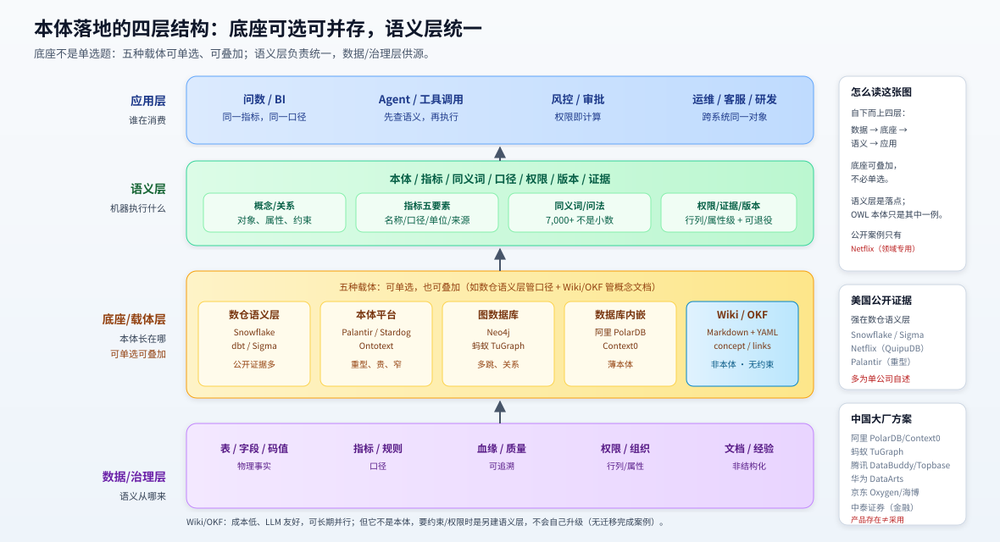
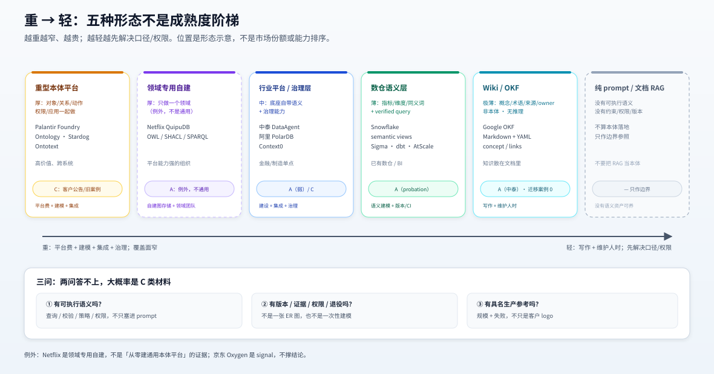

<a id="2-地图"></a>
# 2. 地图：本体落地到底分几种形态

> 本页回答：看到“我们上了本体”这句话，怎么判断它到底上了什么。 ｜ 读完你能：把任何一家厂商/案例放进「底座 × 本体厚度」的格子里。



<sub>图为形态示意，**不按厂商市场份额排序**；图上列出的名字只证明「有这个东西」，C 类产品页**不等于生产采用**。OKF = Google Open Knowledge Format（v0.1 2026-06-12 / v0.2 2026-07-24），受 Karpathy LLM Wiki 启发；**它是知识容器，不是本体**，不会自行升级为语义层；定义、两个方向与迁移缺口见 [4b](./04b-okf-wiki.md)。</sub>

## 2.1 四层结构：底座不是单选题，本体不是悬空的

| 层 | 是什么 | 代表 | 没有它会怎样 |
|---|---|---|---|
| **应用层** | agent、BI、风控、运维、客服 | 问数 agent、报表、审批 | 没人消费，本体是摆设 |
| **语义层** | 概念/指标/同义词/口径/权限/版本/证据 | 本体、semantic model、指标五要素 | 应用各说各话 |
| **平台层** | 承载语义层的底座 | 数仓语义层、本体平台、图库、数据库内嵌、Wiki/OKF | 语义层无法版本化/执行/治理 |
| **数据/治理层** | 表、文档、血缘、质量规则、权限 | 元数据、指标平台、数据标准 | 语义层无源可依 |

**一句话**：本体落地不是“买一个本体”，是“在某一层底座上（可多层并存），把语义层做到能被应用消费、被权限约束、被版本管理”。所以 10 的案例表总要先写“底座是什么”。

**还有一种形态不在底座五选一里**：Apple Glyph 把 275 叶治理标签本体长在**数据目录**上（3.4M 列/98,000 表），做敏感性分类与列描述。它属于「数据/治理层」的用法，不是第六种底座；看图时不要把它读成「又一个平台」。详见 [06.1](./06-cases.md#61-主台账)。

**底座不是单选题**：数仓语义层、本体平台、图数据库、数据库内嵌、Wiki/OKF 是五种常见**载体**，可以单选，也可以同时用几个（例如数仓语义层管指标口径，Wiki/OKF 管概念、术语与文档，两者并存是常态）。Wiki/OKF 只是其中一种；它成本低、对 LLM 友好，可以长期用；出现升级信号时是另建语义层，而不是 OKF 自己长成本体（见 [4b](./04b-okf-wiki.md#4b5-okf-和本体是什么关系两个方向一条缝)）。**「叠加」在公开材料里最接近的两个例子**：中泰用 OKF 做知识载体、同时用指标/元数据/血缘治理资产做底座（[4.4.1](./04-china.md#441-两个来源它报了什么)）；Sigma 的 semantic objects 先编译成 dbt 包、再落到 Snowflake semantic view（[3.4](./03-us.md#34-轻语义层美国公开证据最强的地方)）。严格说这两条是「分层叠加」，不是「同类底座双跑」——**「两个语义层并行」仍没有案例**（`推测`）。

## 2.2 五种可观察形态

| 形态 | 本体厚度 | 典型底座 | 谁适合 | 主要成本 | 公开证据 |
|---|---|---|---|---|---|
| **重型本体平台** | 厚：对象/关系/动作/权限/应用一起做 | Palantir Foundry/Ontology、Stardog、TopQuadrant、Ontotext | 高价值、跨系统、愿意付平台费的组织 | 平台费 + 建模 + 集成 + 治理 | Palantir 客户公告（C）；Stardog/Ontotext 旧案例（C） |
| **数仓/语义层** | 薄：指标/维度/同义词/verified query | Snowflake semantic views、dbt Semantic Layer、Sigma、AtScale、Cube | 已有数仓/BI、想先解决“口径不一致”的团队 | 语义建模 + 版本/CI + 物化 | Snowflake / Sigma（均 A（probation）） |
| **图数据库/GraphRAG** | 中：实体-关系实例，本体可薄可厚 | Neo4j、蚂蚁 TuGraph、阿里 PolarDB GraphRAG | 关系查询/多跳/风控/知识库 | 图建模 + 抽取 + 查询调优 | TuGraph 开源（**G1 时效门失败**：`last_push` 2026-05，早于窗口，只作背景）；GraphRAG 多为厂商材料 |
| **数据库内嵌本体** | 薄：知识库级 schema，类型/关系有上限 | 阿里 PolarDB 本体知识平台、Context0 | 已在阿里云、想快速试本体+RAG 的团队 | 组件费 + 建模 + 维护 | 阿里产品文档（C，2026-09/10） |
| **Wiki/OKF 知识层** | 极薄：概念/术语/来源/owner，无约束与推理 | Google OKF（Markdown+YAML）、Wikibase、内部 Wiki | 知识还散在文档里、先要统一术语与来源的团队 | 写作与维护人时 + 少量结构化 | 中泰（A，OKF 作写模型）、京东海博（京东本地生活的 AI 知识库，signal）；无 OKF→本体迁移案例 |

> **不要把它们排成“成熟度”**。重型不是“更高级”，是“更窄、更贵、更适合高价值场景”；薄语义层不是“降级”，是“先解决口径/权限，再谈推理”。选错形态比选错厂商更贵。

## 2.3 重 → 轻谱系

```
重
├─ Palantir Foundry Ontology：对象-关系-动作-权限-应用一体；客户买平台+实施
├─ Stardog / TopQuadrant / Ontotext：本体/知识图谱平台；客户买 license+建模
├─ 行业平台：阿里 PolarDB/Context0（C）、中泰 DataAgent：底座自带语义/治理能力
├─ 数仓语义层：Snowflake semantic views、dbt Semantic Layer、Sigma、AtScale
├─ Wiki/OKF：概念/术语/来源/owner；无约束推理，可长期用
└─ 轻
   └─ 纯 prompt/文档 RAG：没有可执行语义，不算“本体落地”
```

> **例外**：Netflix 自建 QuipuDB + W3C 栈做可观测性 KG（2026-10-16）；京东自建数百亿 SKU 商品本体（2026-06-26，公司自报/signal）。这是“平台能力强的组织做领域专用本体”，不是通用本体平台，也没有成本数；不要把它们当成“从零建塔也可行”的证据。



<sub>图为 §2.3 谱系的图形版：横轴从重到轻，卡片的证据等级与 [06 台账](./06-cases.md#61-主台账) 一致；最右「纯 prompt/文档 RAG」只作边界，不算本体落地。图不按市场份额或能力排序。</sub>

**判断口诀**：
- 有没有**可执行的语义**（查询/校验/策略/权限），还是只把本体塞进 prompt？
- 有没有**版本/证据/权限**，还是只有一张 ER 图？
- 有没有**具名生产参考**（规模+失败），还是只有客户 logo？

三问里有两问答不上，大概率是 C 类材料。

## 2.4 美国 vs 中国：公开证据对照

| 维度 | 美国（公开证据） | 中国（公开证据） |
|---|---|---|
| 主战场 | 数仓语义层/上下文层、重型本体平台 | 大厂云平台/图底座、金融/制造单点 |
| 代表 | Snowflake、Sigma、dbt、AtScale、Palantir、Stardog、Ontotext | 阿里 PolarDB/Context0、蚂蚁 TuGraph、腾讯 Topbase、中泰证券 |
| 公开规模 | 5,600 员工/320k 查询；2,883 模型/63 job/6 region | 900 万客户/6,000+ 指标（讲者简介另说 3,400+）/7,000+ 同义词；9,137 知识目录/6,503 指标文档/12 万+ 血缘 |
| 公开失败 | 语义视图延迟、预聚合维护爆炸 | 影子实体、三个退役判例、权限旁路/聚合泄露 |
| 证据类型 | 公司工程博客 + 会议 + 客户公告 | 会议议题 + 标准工作组案例 + 厂商文档 |
| 主要缺口 | 缺全生命周期账本（人月/年维护/回收期）、缺跨公司对照 | 缺 2026-06 后大厂外部采用、成本、失败 |

> **重要限定**：这张表是**公开证据**的对照，不是产业能力排名。中国大厂的产品文档很完整，但“产品存在”不等于“生产采用”；美国公司的工程博客很坦诚，但“单公司自述”也不等于“行业规律”。

## 2.5 什么叫“生产落地”：四件套

本份把“做成了”的理想情况定义成四件套：

1. **规模**：多少实体/指标/表/用户/查询（不是一个“大型集团”）。
2. **成本**：建模人月、维护人月/月、平台费、单次查询成本；至少一项是数。
3. **失败**：披露了什么没成、回退过什么、限制是什么。**只有好消息的不是证据，是宣传。**
4. **独立印证**：客户侧、标准组织、社区、独立报道至少一个。

**实际判级**（因为四项齐的案例本份没找到）：
- **A** = 一手生产复盘/公司生产报告，披露**规模 + 至少一项成本/失败/限制**，且有独立信号；四项齐是 A+，本份还没有。
  - **A（弱）** = 有规模 + 失败/限制，但缺独立复核或成本（中泰）；**A（probation）** = 单公司自述、有规模 + 失败/限制，6 个月内补第二信号（Snowflake / Sigma）。
  - **A（probation）是 A 的窄例外，不是 A 的常规档**：它**暂时豁免**上面那条“必须有独立信号”，代价是到期补不到就降回 signal 并移出案例台账。所以看到 A（probation）不等于“独立信号已满足”——[08 §8.2 缺口 7](./08-boundaries.md#82-证据缺口按重要性) 一直把它记成未闭合缺口。
- **B** = 具名组织在生产中使用/采用，有独立信号，但缺规模或失败/成本。
- **C** = 厂商产品页/白皮书/赞助调查/二手转述，只有自说；再权威也不撑结论。
- **signal**（本份记法）= 未过门、但有规模或失败实质披露的线索（公司自报的工程复盘、单方技术文）；比厂商页强，仍不撑结论。
- **“未过门”** = 没通过准入五门（时效/活跃/影响/来源/可核，见 [CHARTER §4](../../../CHARTER.md#4-素材准入material-gate)）；本份用它标“只作线索、不进判断”的材料。

> 所以中泰是 **A（弱）**，Snowflake / Sigma 是 **A（probation）**：都有规模、有失败/限制，缺成本；不是“四项齐”。

## 2.6 一页判断流程

```
看到“我们上了本体”
  ├─ 底座是什么？数仓/本体平台/图库/数据库内嵌/Wiki·OKF/自研？
  ├─ 本体多厚？知识库级(<100 类)/领域级/企业级？
  ├─ 有没有可执行语义？查询/校验/策略/权限？
  ├─ 有没有版本/证据/权限/退役？
  ├─ 有没有具名生产参考？规模+成本+失败？
  └─ 有没有独立印证？
       有 → A/B，进案例台账
       没有 → C，只作线索
```
