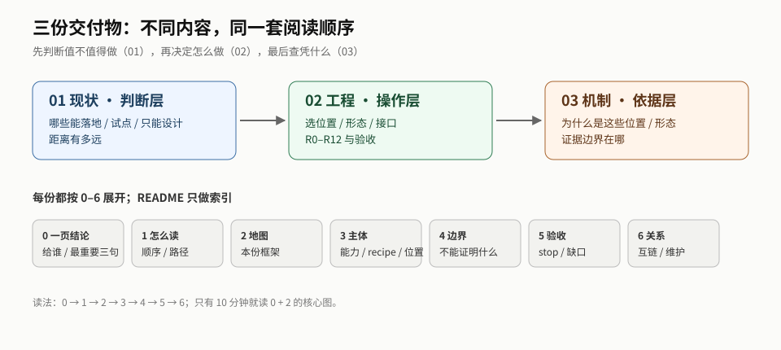

# deliverables：交付

流水线的第三个工位。把 `topics/` 里已经站得住的判断，重新组织成**对外可用的形态**：手册、Deck、图、讲稿。

> **第一次来？先读 [START.md](./START.md)**（10 分钟）：一个落差、三个词、三条判断、四份分工，以及哪些话现在不能信。
>
> **宪章**：[CHARTER](../CHARTER.md)。交付物是文档，不以可运行性为标准；示例数据/查询文本是说明材料，不是要交付的系统。
>
> **2026-11-11 证据重置**：18 篇论文 + 3 个旧网页材料已移出，9 条 E 撤回。交付物里仍有段落按被删源写成；链接指向 tombstone，但**重写完成前不得作为结论**。当前撤回清单见 [审计](../meta/audits/2026-11-11-source-purge.md)。
>
> **当前收口状态**：01 = A3/B4/C2/非本体1/gap4；02 = A3/B4/C1/gap4（不含 R0）；03/04 受影响页已加“历史/撤回”标注。指挥板见 [meta/2026-11-11-command-board](./_plans/2026-11-11-command-board.md)。

## 0. 读者与写法：deliverables 是给人的成品

- **读者**：人（落地团队、评审、决策者），不是 Agent 检索层。
- **写什么**：按任务/问题组织；通俗、步骤、产物、验收、卡住怎么办；把 `topics` 的矩阵/目录消化成读者表。
- **不写什么**：让读者自己拼 `topics`；内部术语堆叠（首次出现要解释）。
- **细节**：可以链 `topics/`，但要标“可选/出处”；**主路径必须自包含**，读者不打开 `topics` 也能完成任务。
- **完成信号**：读者不打开 `topics` 能照着做；要细节时知道去哪。



## 抽取规则

1. **主路径面向人，出处可选。** 正文不要求读者打开 `topics/`；细节/出处可在附录引 E-xx 或链 `topics/`，标“可选”。不直接引 `src/`；未经消化的材料不能以成品面貌流出。
2. **不新增判断。** 交付物里不允许出现 `topics/` 中不存在的结论。抽取时发现的缺口，回到 `src/` 或 `frontier`，不在交付物里补。
3. **每条可反查。** 交付物的每个要点都要能指回主题文档或结论编号。做不到，说明它还没被消化。
4. **标注可信度。** 已核与推测必须区分开——对外物最容易犯的错是把推测写成既成事实。
5. **定义引 N，效应引 I，线索只进 frontier。** 规范主干（标准能定义什么/不能定义什么）见 [topics/trunk.md](../topics/trunk.md)；交付物首现的定义要指 N 或标 `local`。
6. **只抽 admitted 源支撑的判断。** 每个要点必须沿 E/L → digest 追到 `admission: admitted`（含 probation）的材料；追不到的删掉或标 `推测`，不能靠“行业普遍认为”补位。源被撤回的，对应段落同步失效；当前撤回 `E-02/03/04/06/10/11/13/16/26`（见 [审计](../meta/audits/2026-11-11-source-purge.md)）。

## 四个子目录 = 3 层 + 1 条生命周期

前三层回答「判断 / 操作 / 依据」；04 把三者串成「建 → 用 → 治」的落地生命周期。四个子目录之外，还有一份共用的 10 分钟入口 [START.md](./START.md)（不属于任何一层，四份都从它进门）。

```
01-capability-status/     判断层：今天能做成什么、不能承诺什么
        │
        ▼
02-engineering-playbook/  操作层：拿本体做某件事，具体怎么做
        │
        ▼
03-mechanism-reference/   依据层：为什么是这些位置/形态，边界在哪

04-ontology-in-production/ 生命周期：建 → 用 → 治（跨三层）
```

| 子目录 | 回答什么 | 形态 | 状态 | 依据 |
|---|---|---|---|---|
| [01-capability-status](./01-capability-status/README.md) | 哪些能落地、哪些能试点、哪些只能设计；距离多远 | 判断 + 能力矩阵 | draft | E-01–E-20、C-01–C-04 |
| [02-engineering-playbook](./02-engineering-playbook/README.md) | 选位置/形态、R0–R12、开源与论文指示分级、账本/成本/上线、验收与 stop | 步骤 + 接口 + 验收 | draft | E-xx + 各派 mechanism |
| [03-mechanism-reference](./03-mechanism-reference/README.md) | 为什么是六个位置、三根分类轴怎么分、15 条边界 | 入口 + 六张位置卡 + 谱外页 + 三张横切页 + 证据台账 | draft | E-xx + [topics/README](../topics/README.md) |
| └ [附录：约束强度谱](./03-mechanism-reference/appendix-constraint-spectrum.md) | 03 的长版论证（约 0.97 万字）；位置细节以卡为准 | Markdown 长文 | draft | E-01–E-05、E-12–E-17、E-20、C-03 |
| [04-ontology-in-production](./04-ontology-in-production/README.md) | 本体怎么建到可消费、怎么查、怎么治 | 建 / 用 / 治三分册 + 验收 | draft | E-xx（含 E-21/E-22）+ 03/querying/01/access-control；未入库 signal |

> `_plans/` 是[工作底稿](./_plans/README.md)，不是交付物；不进对外阅读路径，也不构成 E。
>
> **2026-11-11 整改**：01/02/03 按 [差距评估报告](./_plans/2026-11-10-gap-assessment-report.md) 与 [整改计划](./_plans/2026-11-11-remediation-plan.md) 补了读者层（01 决策记录/术语/canonical、02 产物包/术语/canonical/读者检查、03 claim 走查/读者检查/术语）。三份仍 `draft`；M1/M2 未关，02 的 citation 正确性仍是 gap。

## 导读：先读哪份、按什么顺序

**一句话**：01 判断值不值得做；02 决定怎么做；03 查凭什么；04 从建到用再到治。

### 按任务

| 你手上是什么 | 先读 | 再读 | 不用读 |
|---|---|---|---|
| 只有一个模糊想法 | [01 §0](./01-capability-status/README.md#0-一页结论) + 本页图 | [01 地图](./01-capability-status/sections/map.md) | 02 `recipes/`、03 `positions/` |
| 有一个具体任务 | [01 地图](./01-capability-status/sections/map.md)（A/B） | [02 地图](./02-engineering-playbook/sections/map.md) → [02 主体](./02-engineering-playbook/sections/approach.md)（R0 + 一条 recipe） | 03 附录、`src/` |
| 要评审/说服别人 | [03 地图](./03-mechanism-reference/sections/map.md) + [证据边界](./03-mechanism-reference/sections/boundaries.md) | [01 验收](./01-capability-status/sections/acceptance.md) + [02 边界](./02-engineering-playbook/sections/boundaries.md) | `src/` 原文 |
| 要落地一个接缝 | [02 地图](./02-engineering-playbook/sections/map.md) → [R0 + recipe](./02-engineering-playbook/sections/approach.md) | [02 运行](./02-engineering-playbook/operations/ledger.md) + [02 验收](./02-engineering-playbook/sections/acceptance.md) | 01 全篇 |
| 要建/查/治一个本体应用 | [04 地图](./04-ontology-in-production/sections/map.md) | [04 建/用/治](./04-ontology-in-production/body/build.md) | 01/03 全篇 |
| 要查某条判断的边界 | [03 地图](./03-mechanism-reference/sections/map.md) + 对应 position | [03 证据](./03-mechanism-reference/evidence/ledger.md) | 02 全篇 |

### 按时间

| 时间 | 读什么 | 得到什么 |
|---|---|---|
| 10 分钟 | 本页图 + [01 §0](./01-capability-status/README.md#0-一页结论) + [02 §0](./02-engineering-playbook/README.md#0-一页结论) | 知道四份分工与「先做什么」 |
| 1 小时 | 01 地图 + 02 地图 + 02 主体（R0） | 能选一个接缝/一条 recipe |
| 半天 | 四份 0–6 | 能写 go/no-go 与边界评审 |

### 每份的阅读顺序

- **01**（[GUIDE](./01-capability-status/GUIDE.md)）：0 → [地图](./01-capability-status/sections/map.md) → [能力条目](./01-capability-status/capabilities/README.md)（A→B→C→D）→ [边界](./01-capability-status/sections/boundaries.md) → [验收](./01-capability-status/sections/acceptance.md) → [关系](#关系与维护)。
- **02**（[GUIDE](./02-engineering-playbook/GUIDE.md)）：0 → [地图](./02-engineering-playbook/sections/map.md) → [R0 + 一条 recipe](./02-engineering-playbook/sections/approach.md) → [边界](./02-engineering-playbook/sections/boundaries.md) → [验收](./02-engineering-playbook/sections/acceptance.md) → [关系](#关系与维护)。
- **03**（[GUIDE](./03-mechanism-reference/GUIDE.md)）：0 → [地图](./03-mechanism-reference/sections/map.md) → [位置卡](./03-mechanism-reference/positions/README.md)（context→…→commit→outside）→ [横切页](./03-mechanism-reference/across-positions/measurement.md) → [边界](./03-mechanism-reference/sections/boundaries.md) → [验收](./03-mechanism-reference/sections/acceptance.md) → [关系](./03-mechanism-reference/sections/relations.md)。
- **04**（[GUIDE](./04-ontology-in-production/GUIDE.md)）：0 → [地图](./04-ontology-in-production/sections/map.md) → [建](./04-ontology-in-production/body/build.md) → [用](./04-ontology-in-production/body/consume.md) → [治](./04-ontology-in-production/body/govern.md) → [边界](./04-ontology-in-production/sections/boundaries.md) → [验收](./04-ontology-in-production/sections/acceptance.md) → [关系](./04-ontology-in-production/sections/relations.md)。

**反向加载**：从 [01 §5.2](./01-capability-status/sections/acceptance.md#52-期待与数据需求验收规格)/[plan](./_plans/01-capability-status.md)、[02 §3.1](./02-engineering-playbook/sections/approach.md#31-十二条工程做法r0r12)、[03 §2.3](./03-mechanism-reference/sections/map.md#23-六个位置一页表) 出发，按 [meta/loading 的三条反向链](../meta/loading.md#从交付物倒查反向加载) 走；不要从 `src/papers/manifest.md` 开始扫。

## 统一阅读结构

四份交付物内容不同，但**对读者的骨架是同一套**。每份开头都有一张同样的读者卡（读者 / 回答 / 不回答），然后从同一层进入：

| 节 | 回答什么 | 01 现状 | 02 工程 | 03 机制 | 04 落地 |
|---|---|---|---|---|---|
| **0 一页结论** | 这份东西一句话是什么、给谁、最重要三句 | README §0 | README §0 | README §0 | README §0 |
| **1 导读** | 先读哪份、按任务/时间怎么走 | `GUIDE.md` | `GUIDE.md` | `GUIDE.md` | `GUIDE.md` |
| **2 地图** | 本份的核心框架（矩阵 / 五步法 / 四轴六位置 / 生命周期） | `sections/map.md` | `sections/map.md` | `sections/map.md` | `sections/map.md` |
| **3 主体** | 逐项：能力 / recipe / 位置卡 / 建用治 | `capabilities/` | `recipes/` + `sections/approach.md` | `positions/` | `body/` |
| **4 边界** | 证据等级、不能证明、反例/反模式 | `sections/boundaries.md` | `sections/boundaries.md` | `sections/boundaries.md` | `sections/boundaries.md` |
| **5 验收** | 指标、stop、缺口、期待与数据需求 | `sections/acceptance.md` | `sections/acceptance.md` | `sections/acceptance.md` | `sections/acceptance.md` |
| **6 关系与维护** | 与另外两份的关系、附录、更新规则 | [本页](#关系与维护) | [本页](#关系与维护) | [本页](#关系与维护) | [本页](#关系与维护) |

**同构不等于同文**：01 的主体是「能力条目」，02 是「recipe 条目」，03 是「位置卡」，04 是「建/用/治三分册」；前三类条目都必须有 **一句话 / 适用 / 证据等级 / 边界 / 去哪** 这五个字段。

### 目录契约

| 角色 | 01 现状 | 02 工程 | 03 机制 | 04 落地 |
|---|---|---|---|---|
| 索引 | `README.md`（只放 0/目录/关注） | `README.md` | `README.md` | `README.md` |
| 导读 | `GUIDE.md` | `GUIDE.md` | `GUIDE.md` | `GUIDE.md` |
| 分节 | `sections/`（map/boundaries/acceptance） | `sections/`（map/approach/boundaries/acceptance） | `sections/`（map/boundaries/acceptance） | `sections/`（map/boundaries/acceptance） |
| 主体 | `capabilities/` + `README.md` | `recipes/` + `README.md`；总览在 `sections/approach.md` | `positions/` + `README.md` | `body/`（build/consume/govern） |
| 支撑 | — | `operations/` | `across-positions/` | — |
| 证据 | `data/` | `appendices/traceability.md` | `evidence/` | `evidence/` |
| 附录 | — | `appendices/`（含 artifact-pack） | `appendix-constraint-spectrum.md` | — |

## 关系与维护

**一句话**：01 告诉你「值不值得做」，02 告诉你「怎么做」，03 告诉你「凭什么这么说、说到哪为止」，04 把三者串成一条能跑的链。

| 交付物 | 回答 | 读者 | 形态 |
|---|---|---|---|
| [01 现状](./01-capability-status/README.md) | 今天能做成什么、不能承诺什么 | 决策者/工程负责人 | 判断 + 矩阵 |
| [02 工程实施](./02-engineering-playbook/README.md) | 拿本体做某件事，具体怎么做 | 工程负责人/架构师 | 步骤 + 接口 + 验收 |
| [03 机制参考](./03-mechanism-reference/README.md) | 为什么是这些位置/形态，证据边界在哪 | 架构师/研究者 | 参考 + 边界 |
| [04 落地](./04-ontology-in-production/README.md) | 怎么建、怎么查、怎么治 | 落地小团队 | 生命周期 + 验收 |

**维护规则（四份共用）：**

- 新判断先回 `topics/` 的 claims/E，再改交付物；交付物不新增判断。结构性修改后跑 `python3 meta/tools/check_repo.py`。
- 01：A/B/C/D 是交付层排序，不是 E；`data/` 与 `_plans/` 是工作底稿，不构成稳定判断。
- 02：先改 `recipes/`，再回 README 索引；02 不新增 E。
- 03：canonical 在 `positions/` 与 `across-positions/`；附录是长版论证；`H`/`D` 必须始终带标记。
- 04：不重复 01 的排序、02 的 recipe、03 的机制论证；04 不新增 E。

**规则**：README 只做索引；正文按「分节 / 主体 / 支撑 / 证据 / 附录」放，不把长文塞回 README。每个目录都有 `README.md`，用同一张索引表。导航图统一在 [`_figures/`](./_figures/README.md)，用 SVG；每份 `GUIDE.md` 嵌本份图，README 不再嵌图。

## 期待 → 数据（验收规格）

四份交付物的 `sections/acceptance.md` 都有一节「期待与数据需求」：把交付物要回答的问题写成**可证伪的期待**，再倒推「支持它需要什么数据、现在有什么、缺什么」。

它的作用不是承诺结果，而是让缺口显形：**量不出「支持它需要的数据」，就说明这条期待还停在推测。** 这是交付物的验收规格（非 E），不是新结论；数据回 `topics/` 或 `frontier` 补，不在交付物里补。

01 的详细执行计划见 [plan.md](./_plans/01-capability-status.md)：覆盖审计、现有 digest 回抽、新 `src/` 来源、WBS、排期、DoD 与停止规则。

04 的 topics/src 支撑计划见 [04-ontology-in-production.md](./_plans/04-ontology-in-production.md)：4+1 intake（≥2026-07，US/China/Germany/Singapore）、2 个 topics 页面、2 条新 E、P0–P4 + P2.5/P2.6。

四份的密度与上游订货见 [reverse-gap-plan](./_plans/2026-11-09-reverse-gap-plan.md)：单源/推测/停线无出处的诊断、三条硬杠、旗舰三件（门槛表 / 反例集 / 执行矩阵）与按派/按来源类型的订单。它的目标不是让交付物更完整，是让每句话要么带出处、要么被标成缺口。

订单的对象怎么造、放哪、怎么验，见 [hard-objects-plan](./_plans/2026-11-09-hard-objects-plan.md)：H0–H3 硬度分级、六字段 schema、`topics/objects.md` 注册表、五条产线与 10 天 60–80 个对象的目标。已入库 94 个对象（H3 36 / H2 58，10 条承重 E 各 ≥3，E 级 H3 10/10）；ADR 0009 已接受方案 A，O 已接进 02 §5.1、03 反例集与执行矩阵（见 [wiring-plan](./_plans/2026-11-10-wiring-plan.md)）。

## handbook 的去留（2026-11-09）

**没有独立的 handbook。** 原《本体在 harness 里如何被执行》7 章、4–6 万字的书稿计划已废弃：

- 书稿没有独立角色——01–04 已经把「判断/操作/依据/落地」分开，再写一本会把它们混回去。
- 第四章缺一手失败复盘、第六章缺按机制分派的度量方案、第七章是案例不是对照；按仓库规则，写不动的地方是研究没做完，不应在交付物里绕过去。
- 主线「价值不在知道更多，而在让不该发生的事不发生」接近 P1a，但 E-01 的 ontology 是 `not measured`、E-04 的结构贡献未隔离；附录已把它收窄为「强端不是更好，是更窄」。

唯一保留的是**论证资产**：原第三章成为 [03 的长版附录](./03-mechanism-reference/appendix-constraint-spectrum.md)。原大纲与规划已删除，git 历史保留；不再有第四个 `handbook/` 目录。

## 质量评估（维护者用）

评估 01–04 时**只用一套口径**：[交付物质量评分卡](../meta/deliverable-quality.md)。四份的形态不同，但量的维度相同，分数才可比、趋势才看得见。

| 簇 | 维度 | 权重 |
|---|---|---|
| **A 内容** | A1 事实密度与参照物 / A2 可执行性 / A3 判断增量 | 30 |
| **B 叙事** | B1 入门坡道 / B2 主线 / B3 术语负担 | 25 |
| **C 结构** | C1 骨架与寻路 / C2 冗余与体量 / C3 一致性与单一真相 | 20 |
| **D 严谨** | D1 证据纪律 / D2 引文保真 / D3 边界与可证伪 | 25 |

**五条硬门槛**：数字有主、证据不越级、主路径自包含、链接可用、无占位正文。任何一条不过，总分不参与排序。

**两条纪律**：不设「完整度」维度（不奖励注水）；不设「原创性」维度（交付物是消化，新判断由 A3 量）。评分不自动改 `status`；报告落 `_plans/YYYY-MM-DD-quality-review.md`，同维度比上次 ±1 才写 delta。

**最近一次**：[2026-11-11 质量评估](./_plans/2026-11-11-quality-review.md)（[§11 整改复评](./_plans/2026-11-11-quality-review.md#11-整改复评2026-11-11-晚)）——基线 02/04 78、01 71、03 64；§10 冷读 04 84 / 02 80 / 01 76 / 03 74；**§11 整改后 02 86 / 04 86 / 03 84 / 01 82**。术语碰撞、四份首屏、C2 合并（102→90）、C3 单一真相已处理；02/04 首次过 85；残留 C2 与真人冷读，见 §11。

## 待做

| 交付物 | 形态 | 状态 | 依据 |
|---|---|---|---|
| 一页图：约束强度谱 | 图 | 待画 | [03 §2.4](./03-mechanism-reference/sections/map.md#24-强度覆盖率直线是摘要矩阵是操作定义) + [coverage 矩阵](./03-mechanism-reference/across-positions/coverage.md)（H/D，不是 E 结论） |
| Deck：给工程团队的 30 分钟 | 幻灯片 | 待做 | 02 §0 一页结论、§3.1 R 索引、§3.4 参考架构 |
| 案例页：一个端到端示例 | Markdown | 示意已写；真实场景待补 | [02 附录 C](./02-engineering-playbook/appendices/case.md)；标 illustrative，不是部署 |

## 交付阶段（`deliverable_status`）

| 状态 | 含义 |
|---|---|
| `draft` | 结构在改 |
| `stable` | 结构冻结，可对外 |
| `frozen` | 内容冻结，仅随新证据被动修订 |

文档本身的 `status` 仍用 `seed / draft / stabilized / superseded`；`deliverable_status` 只表示交付阶段。见 [conventions](../meta/conventions.md#字段与词汇)。

## 一条判据

交付物做不出来的地方，就是研究没做完的地方。

如果某一章反复卡住，说明 `topics/` 里对应结论还是「推测」——回去补证据，而不是在交付物里绕过去。
