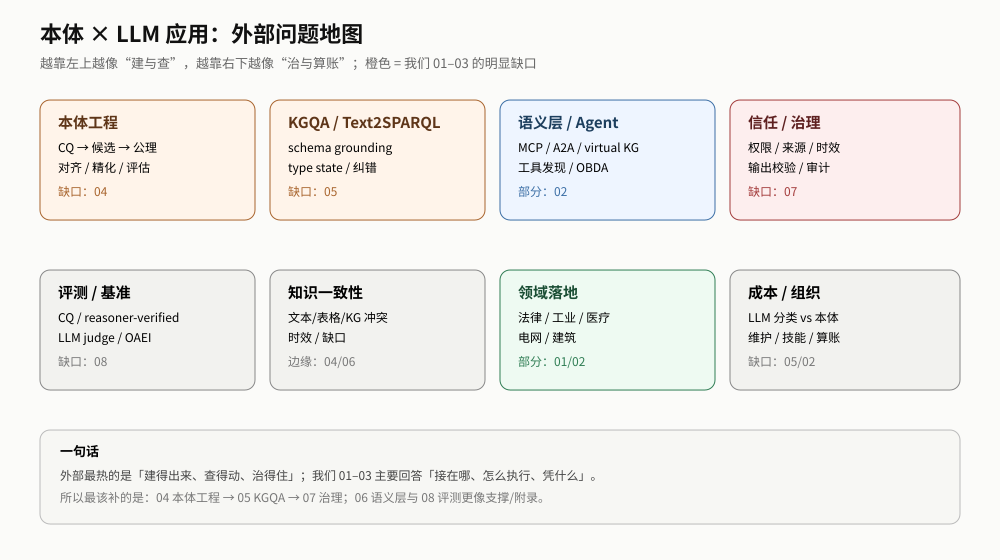

# 本体 × LLM 应用：外部到底在关心什么（2026-11 扫描）

> **工作底稿，不是结论。** 只用于候选、提问与下一轮研究；不升 E，也不改 01/02/03。来源以摘要/厂商指南为主，未做系统综述；厂商材料单独标“行业信号”。

## 0. 一句话

外部讨论的重心，已经从「本体有没有用」转向**「怎么把本体变成可执行、可消费、可治理的语义层」**。最热的三块是：**本体工程（建/修/对齐/评）**、**KGQA / Text-to-SPARQL**、**信任与治理（权限、来源、审计、输出校验）**；这三块正好是 01–03 之外最明显的空白。

## 1. 扫描方法

- arXiv API：`ontology + LLM`、`text-to-SPARQL`、`ontology learning`、`graph-agentic RAG`、`ontology evaluation` 等。
- 厂商/行业：AWS Prescriptive Guidance、Gartner（经 Stardog 转载）、Progress Semantics 博客。
- 会议/挑战：LLMs4OL、Text2SPARQL Challenge、OAEI、ISWC/ESWC 相关。
- 限制：只读摘要或指南，不保证覆盖全部；厂商材料有营销偏差，不能当效应量。

## 2. 十个被反复问的问题

| # | 大家在问 | 代表来源 | 类型 | 我们的覆盖 |
|---|---|---|---|---|
| 1 | 本体到底给 LLM 带来什么：准确、一致、可解释，还是只是“多一层文档”？ | [AWS 语义层指南](https://docs.aws.amazon.com/prescriptive-guidance/latest/semantic-layer-agentic-ai-ontology-reasoning-virtual-knowledge-graph/semantic-layer-agentic-ai-ontology-reasoning-virtual-knowledge-graph.html)、[Gartner/Stardog](https://info.stardog.com/adopt-a-data-semantic-approach-to-drive-business-value-with-genai) | 行业信号 | 01 的 A/B/C/D 已给“有条件”的判断；外部更乐观 |
| 2 | LLM 能不能自动建本体：生成类比、公理识别、对齐、精化 | [Ontology Generation](https://arxiv.org/abs/2503.05388)、[Axiom Benchmark](https://arxiv.org/abs/2512.05594)、[Agent-OM](https://arxiv.org/abs/2312.00326)、[CASTON](https://arxiv.org/abs/2610.21466) | 论文 | 05 有研究，但没有交付物 |
| 3 | 本体建出来能不能被下游消费：从文本到 KG、schema-guided extraction | [工业 KG](https://arxiv.org/abs/2609.31663)、[法律 KG](https://arxiv.org/abs/2607.24551)、[Ontology Population](https://arxiv.org/abs/2411.01612) | 论文 | 05 的“可消费性”只在 claims/frontier |
| 4 | 自然语言怎么查 KG：Text-to-SPARQL、schema grounding、纠错 | [CK25](https://zenodo.org/records/16912605)、[GGC](https://arxiv.org/abs/2607.28082)、[SAGA](https://arxiv.org/abs/2607.14494)、[SchemaForge](https://arxiv.org/abs/2508.01815) | 论文/benchmark | 02 只有 R11 OBDA；没有 NL→query 的 recipe |
| 5 | 语义层怎么接 agent：MCP/A2A、virtual KG、工具发现 | [AWS 语义层指南](https://docs.aws.amazon.com/prescriptive-guidance/latest/semantic-layer-agentic-ai-ontology-reasoning-virtual-knowledge-graph/semantic-layer-agentic-ai-ontology-reasoning-virtual-knowledge-graph.html)、[Enterprise Agentic Systems](https://arxiv.org/abs/2604.00555) | 指南/论文 | 02 有参考架构，但没有 MCP/A2A 契约 |
| 6 | 怎么防幻觉和错误传播：来源、时效、授权、可恢复 | [Graph-Agentic RAG assurance](https://arxiv.org/abs/2609.06391)、[Enterprise Agentic Systems](https://arxiv.org/abs/2604.00555) | 论文 | 03 的边界 + 02 的 R4/R5/R9，未形成治理手册 |
| 7 | 权限与安全：文档级/节点级可见性、ABAC、审计 | [VAULT](https://elib.dlr.de/214536/) | 论文 | 02 的 R8 只覆盖读路径过滤 |
| 8 | 怎么评：CQ、reasoner-verified benchmark、LLM judge | [LLM-assisted ontology evaluation](https://arxiv.org/abs/2507.14552)、[Reasoner-Verified Benchmarks](https://arxiv.org/abs/2610.00682)、[OAEI-LLM-T](https://arxiv.org/abs/2503.21813) | 论文 | 06 有尺子，但没有“评测交付物” |
| 9 | 知识不一致怎么发现：文本/表格/KG 冲突、时效 | [Kontrast](https://arxiv.org/abs/2607.25959) | 论文 | 04 记忆/边界沾边，未专门做 |
| 10 | 落地怎么算账：LLM 分类 vs 本体/分类平台、维护、技能 | [Progress 博客](https://www.progress.com/blogs/details/the-resurgence-of-ontologies-ontology-driven-ai)、[Gartner/Stardog](https://info.stardog.com/adopt-a-data-semantic-approach-to-drive-business-value-with-genai) | 行业信号 | 02 有成本模板；缺真实单价/组织数据 |

## 3. 三个最值得深挖的缺口

### 3.1 本体工程：从“建本体”到“可消费”

外部不再问“OWL 怎么写”，而是在问：

- 怎么用 CQ/user story 生成候选本体，并证明它可被消费（[2503.05388](https://arxiv.org/abs/2503.05388)）；
- 公理识别到底能做到什么程度：9 个本体、17,118 triples、2,771 axioms；subclass F1 在 FOAF 0.642、music 0.218，整体还不足以全自动（[2512.05594](https://arxiv.org/abs/2512.05594)）；
- 怎么评估：1,393 CQs，LLM 自动 CQ 验证大致接近普通用户（[2507.14552](https://arxiv.org/abs/2507.14552)）；
- 怎么对齐/精化：Agent-OM、CASTON 这类“候选 + 人审”路线（[Agent-OM](https://arxiv.org/abs/2312.00326)、[CASTON](https://arxiv.org/abs/2610.21466)）。

**对我们的含义**：05 目前只有研究页，没有“工程手册”。如果做 04，应该不是“本体导论”，而是**可消费性验收**：CQ → 候选 → 负例 → 下游消费 → 版本/来源。

### 3.2 KGQA / Text-to-SPARQL：一个独立的工程面

- 企业 Text2SPARQL 已有 benchmark：CK25 给 KG + ontology + query catalog（[Zenodo](https://zenodo.org/records/16912605)）。
- 错误不只是语法：GGC 把 query-level accuracy 从 90.23% 提到 98.33%，同时减少 45% 纠错开销（[2607.28082](https://arxiv.org/abs/2607.28082)）；SAGA 指出“type-blind grounding”会生成看起来合理但语义不兼容的 triple pattern（[2607.14494](https://arxiv.org/abs/2607.14494)）；SchemaForge 在异构 KG 上平均 +11.50pp（[2508.01815](https://arxiv.org/abs/2508.01815)）。
- Build2SPARQL：201 个 building KGs、6,136 条 SPARQL、30,680 个问题；zero-shot 0.2–20%，three-shot retrieved 56–65%（[2610.00224](https://arxiv.org/abs/2610.00224)）。
- 研究者 agent 的瓶颈仍在 predicate selection，不在 SPARQL 语法（[2608.07700](https://arxiv.org/abs/2608.07700)）。

**对我们的含义**：02 的 R11 只覆盖“本体 + 映射 → SQL”的 OBDA，不等于“自然语言 → SPARQL”。这是一个独立交付物：schema grounding、类型状态、选择性纠错、benchmark。

### 3.3 信任与治理：权限、来源、输出校验

- VAULT：ontology-driven extraction + document-level + node-level access control，16 个开源 LLM（[DLR](https://elib.dlr.de/214536/)）。
- Graph-Agentic RAG assurance：把失败链拆成 evidence → retrieval → reasoning → capability/delegation → outcome 五个接口契约，显式要求 provenance、temporal validity、authorization、uncertainty、recoverability（[2609.06391](https://arxiv.org/abs/2609.06391)）。
- Enterprise Agentic Systems：提出“非对称神经符号耦合”——企业系统通常约束输入（context/tool/governance threshold），不约束输出；主张扩展到输出侧 validation/compliance（[2604.00555](https://arxiv.org/abs/2604.00555)）。
- AWS 指南：semantic layer + OBDA + SHACL + MCP/A2A + human-in-the-loop semantic governance（[AWS](https://docs.aws.amazon.com/prescriptive-guidance/latest/semantic-layer-agentic-ai-ontology-reasoning-virtual-knowledge-graph/semantic-layer-agentic-ai-ontology-reasoning-virtual-knowledge-graph.html)）。

**对我们的含义**：R8/R9 只是“读路径/写授权”的一小段；外部把**输出校验、来源、时效、审计、权限**放在同一个治理面。03 的边界可以当反炒作，但需要 06/07 级别的操作件。

## 4. 对我们三份交付物的意义

| 我们的判断 | 外部对应 | 差异 |
|---|---|---|
| 01：本体价值有条件，A/B/C/D | 外部多讲“trust/accuracy/scale”，厂商更乐观 | 我们更保守，适合当“反炒作” |
| 02：按接缝/形态做，先 R0 | 外部讲 semantic layer、MCP/A2A、Text2SPARQL | 我们缺“语义层集成”和“NL→query” |
| 03：位置/形态/边界 | 外部有大量 benchmark，但多为单点 | 我们缺“评测交付物”，但 03 的边界仍稀缺 |

**一句话**：外部最热的是“建得出来、查得动、治得住”；我们已有的三份主要回答“接在哪、怎么执行、凭什么”。下一份最该补的是**本体工程的可消费性**，其次 **KGQA** 与 **治理**。

## 5. 候选交付物（不是承诺）

| 候选 | 回答 | 主要来源 | 为什么是我们 | 风险 |
|---|---|---|---|---|
| **04 本体工程：从 CQ 到可消费** | 怎么建/修/对齐/评，才算能被下游消费 | 2503.05388、2512.05594、2507.14552、Agent-OM、CASTON | 05 已有研究，只差工程化 | 容易写成“本体导论” |
| **05 KGQA / Text-to-SPARQL** | 自然语言怎么可靠地查 KG | CK25、GGC、SAGA、SchemaForge、Build2SPARQL | 02 的 R11 只覆盖 OBDA | 单点 benchmark 多，跨域弱 |
| **06 语义层与 agent 集成** | MCP/A2A、virtual KG、工具发现怎么接 | AWS 指南、2604.00555、2608.22974 | 02 已有参考架构 | 厂商材料多，易飘 |
| **07 信任与治理** | 权限、来源、时效、审计、输出校验 | VAULT、2609.06391、2604.00555、AWS | 01/02 的 R8/R9 只是切片 | 缺部署数据 |
| **08 评测与基准** | CQ、reasoner-verified、LLM judge 怎么选 | 2507.14552、2610.00682、OAEI-LLM-T | 06 有尺子但没交付物 | 容易变成 benchmark 清单 |

**优先级（我的判断，`推测`）**：04 > 05 > 07 > 06 > 08。04 最像“我们已有材料能直接工程化”的；05/07 是外部最热且我们最缺的；06 与 02 重叠最大；08 更适合做 03/06 的附录。

## 6. 不要做什么

- 不要写“本体 + LLM 综述”：外部已经很多，且厂商噪声大。
- 不要把 Gartner/厂商“知识图谱是 LLM 商业价值目标”当 E；它只是行业信号。
- 不要把单点 benchmark 的 +x pp 当跨域效应量；我们的 01/03 规则仍然适用。
- 不要为了“覆盖”开 04–08；每个候选都要能填一个现有 frontier 的 G。

## 7. 来源（摘要/指南级，未做全文系统综述）

### 论文/预印本

- [Ontology-Constrained Neural Reasoning in Enterprise Agentic Systems](https://arxiv.org/abs/2604.00555) — 三层企业本体、非对称耦合、1,800 runs/5 industries/3 LLMs；厂商生产系统声明。
- [Building Trustworthy Graph-Agentic RAG for Social Good](https://arxiv.org/abs/2609.06391) — 失败传播、五个接口契约、assurance-by-construction。
- [Dynamic Ontology for LLM Agents (OaK)](https://arxiv.org/abs/2608.22974) — 任务导向本体动态构建/精化。
- [Ontology Generation using LLMs](https://arxiv.org/abs/2503.05388) — CQ/user story → OWL；o1-preview + Ontogenia。
- [Ontology Learning: Axiom Identification Benchmark](https://arxiv.org/abs/2512.05594) — 9 ontologies/17,118 triples/2,771 axioms；subclass F1 0.218–0.642。
- [LLMs Assisting Ontology Evaluation](https://arxiv.org/abs/2507.14552) — 1,393 CQs；LLM CQ verification 接近普通用户。
- [Accelerating KG and Ontology Engineering with LLMs](https://arxiv.org/abs/2411.09601) — 模块化本体是中心。
- [Agent-OM](https://arxiv.org/abs/2312.00326) — LLM agent 做本体匹配。
- [CASTON refinement](https://arxiv.org/abs/2610.21466) — embedding + LLM 精化，high-confidence 6/6。
- [Industrial ontology-driven KG](https://arxiv.org/abs/2609.31663) — 法语电网事故报告，7B–32B 本地模型。
- [French legal KG](https://arxiv.org/abs/2607.24551) — 法规本体 + 闭式抽取。
- [Ontology Population](https://arxiv.org/abs/2411.01612) — 模块化本体提示，约 90% triples。
- [GGC Text-to-SPARQL](https://arxiv.org/abs/2607.28082) — selective correction；90.23→98.33%。
- [SAGA](https://arxiv.org/abs/2607.14494) — type-blind grounding；schema-aware。
- [SchemaForge](https://arxiv.org/abs/2508.01815) — 异构 KG 的 schema-slice alignment；+11.50pp。
- [Build2SPARQL](https://arxiv.org/abs/2610.00224) — 201 KGs/6,136 queries/30,680 questions。
- [Researcher Agents for KGQA](https://arxiv.org/abs/2608.07700) — predicate selection 是瓶颈。
- [Kontrast](https://arxiv.org/abs/2607.25959) — 文本/表格/KG 跨模态不一致。
- [LLMs4OL 2024](https://arxiv.org/abs/2409.10146) — 本体学习挑战。
- [OAEI-LLM-T](https://arxiv.org/abs/2503.21813) — 本体匹配幻觉 benchmark。
- [Reasoner-Verified Benchmarks](https://arxiv.org/abs/2610.00682) — OWL reasoner 验证的 MCQ。

### 行业/指南（行业信号，不是 E）

- [AWS Prescriptive Guidance: Semantic Layer for Agentic AI](https://docs.aws.amazon.com/prescriptive-guidance/latest/semantic-layer-agentic-ai-ontology-reasoning-virtual-knowledge-graph/semantic-layer-agentic-ai-ontology-reasoning-virtual-knowledge-graph.html) — ontology + symbolic reasoning + virtual KG + MCP/A2A + SHACL + human-in-loop。
- [Gartner via Stardog: Adopt a Data Semantic Approach](https://info.stardog.com/adopt-a-data-semantic-approach-to-drive-business-value-with-genai) — “knowledge graphs are the appropriate target…”（厂商转载，未读原报告）。
- [Progress: The Resurgence of Ontologies](https://www.progress.com/blogs/details/the-resurgence-of-ontologies-ontology-driven-ai) — 共享语义模型、治理、LLM 生成 vs 分类平台成本。
- [CK25 Corporate Knowledge Dataset](https://zenodo.org/records/16912605) — 企业 KG + ontology + query catalog。
- [VAULT](https://elib.dlr.de/214536/) — 文档级/节点级访问控制 + 16 LLM。
