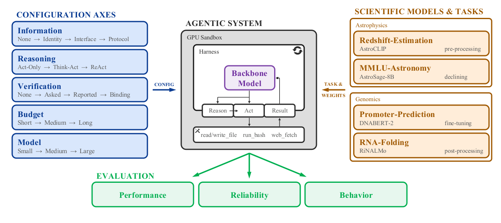
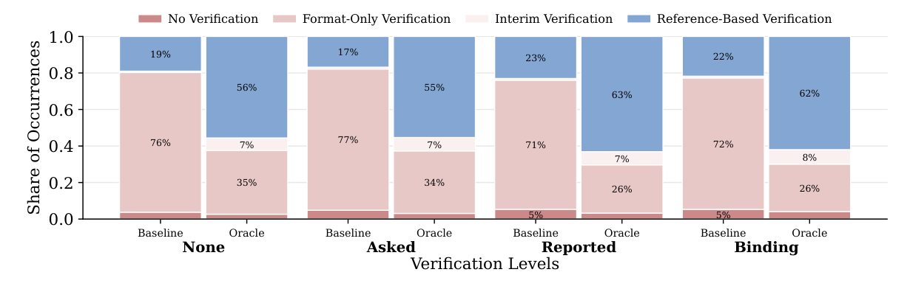

# Agents Are Systems, Not Models · 分解

> 只记**论文说了什么**。工程判断、质量评估、洞察见同目录 [digest.md](./digest.md)。

## 一句话

把 agent 当作**可配置系统**而不是固定模型：在 4 个 AI4S 任务上系统变化五个配置轴（信息 / 推理 / 验证 / 时间 / 模型），发现 **54% 的结果方差来自同一配置的重复运行**；**信息**的影响最大，超过模型大小与时间预算，并且同时降低成本和改善校准；**提示 agent 自检几乎不改变行为，给一个专用验证工具才会**。

## 问题与设定

- **问题**：agent 评测通常把 agent 当固定对象，只报一个 success rate；实际上用户可配置「告诉它什么、让它跑多久、用哪个模型」，这些选择会改变能力与可靠性。
- **任务**：4 个科学任务——redshift-estimation、mmlu-astronomy、promoter-prediction、rna-folding；agent 要找到并正确操作一个已发表的 specialist model。
- **五轴**：
  - Information：none → identity → interface → protocol
  - Reasoning：act-only → think-act → ReAct
  - Verification：none → asked → reported → binding
  - Budget：5 / 10 / 20 min
  - Model：Qwen3.5-35B-A3B / 122B-A10B / 397B-A17B
- **规模**：4×3×4×3×3 = 432 cells；每 cell 5 runs；每 task 2,160 runs；4 tasks = 8,640 runs；18,240 trajectories。
- **指标**：GAP_CLOSED `G=(S−B)/(R−B)`；completion；hurdle；outcome consistency；cost/runtime；calibration error。
- **能证明**：配置轴对结果/可靠性有系统影响；信息 > 模型/预算；轴之间有交互；验证行为靠工具而非 prompt。
- **不能证明**：其他领域/任务；memory/多 agent 等其他轴；把「验证工具」结论推广到所有行为。

## 机制

### Agent = model + harness（§1, p.2）

- model：LLM 本身，无跨调用记忆、不能行动。
- agent：把 model 包进循环（读状态→决定→执行→观察→再决定）。
- harness：运行循环的基础设施（工具调用、上下文管理、压缩）。

### 配置轴（§3.1, p.3–4）

| 轴 | 水平 | 作用 |
|---|---|---|
| Information | none / identity / interface / protocol | 告诉 agent 多少任务/模型信息 |
| Reasoning | act-only / think-act / ReAct | 是否生成推理、是否保留在上下文 |
| Verification | none / asked / reported / binding | prompt 要求自检的强度 |
| Budget | 5 / 10 / 20 min | wall-clock 预算 |
| Model | 35B / 122B / 397B | backbone 大小 |

### GAP_CLOSED（§4.1, p.5）

`G=(S−B)/(R−B)`：B 是 backbone 单独得分，R 是 specialist reference，S 是 agent 得分；G=0 表示没超过 backbone，G=1 表示追平 specialist。只对 `R>B` 的任务定义。

### 行为分类（§5, p.8–9）

- 用 judge 从轨迹抽 6 维：result、error category、model usage、verification、planning/exploration、execution quality。
- 嵌入 + HDBSCAN 聚类 + judge 归纳成 ≤8 类。
- 用于解释「为什么分数变/不变」。

## 关键数字

| 数字 | 条件 | 出处 |
|---|---|---|
| **54%** | 真实尝试的 score variance 来自同一配置的 run-to-run 噪声 | §4.2, p.5 |
| **39.4% vs 46.1%** | 不排除 hurdle 失败时，配置只解释 39.4%；排除后 46.1% | §4.2, p.5 |
| **1.00 / 2.67 / 3.00 / 3.33 / 5.00** | 轴的平均排名：Information / Model / Reasoning / Budget / Verification | Table 3, p.7 |
| **1.925 / 1.452 / 1.496** | Information 在 promoter/redshift/rna 上的 effect size | Table 3, p.7 |
| **99%** | Information 在 bootstrap 样本中排名第一的比例 | §4.2, p.6 |
| **99.8%** | mmlu-astronomy 上仍使用较弱 specialist 的 runs 比例 | §4.2, p.7 |
| **19% → 22%** | Verification none→binding 时 reference-based verification 的占比 | §5, p.9；Fig. 4 |
| **~3/4** | 无 oracle 时只做 format-only verification 的 runs 比例 | §5, p.9 |
| **4.4%** | oracle 被用于 hill-climbing 的 runs 比例 | §4.3, p.8 |
| **18,240** | 释放的 trajectories 数 | Abstract, p.1 |

## 图表索引

### 图 1：五轴与任务

> 原图：arXiv:2610.01618, p.3, Figure 1。版权归作者，研究评论用途。

**看什么**：左边五轴是用户可配置的；中间 agent = backbone + harness；右边是 specialist 任务。**评测对象不是 model，是 config**。

### 图 4：验证行为

> 原图：arXiv:2610.01618, p.9, Figure 4。版权归作者，研究评论用途。

**看什么**：左半（Baseline）prompt 从 none 到 binding，reference-based 只从 19% 到 22%；右半（Oracle）直接翻三倍。**行为靠系统提供，不靠 prompt 要求。**

## 作者自述局限

- 只 4 个任务、2 个科学域；更多任务/域才能泛化。
- 排除了 memory、multi-agent 等其他轴；未来要加。
- 「系统设计比 prompt 更有效」只在一个维度（verification）上验证，不能当普遍原则。
- 模型 FP8 量化；预算只有 3 档；任务/模型规模有限。
- 结果依赖 specialist reference；任务选择可能影响轴效应。

## 引用锚点

- 「approximately 54% of the outcome variance coming from repeating the same configuration rather than changing it.」（Abstract, p.1）
- 「the information provided to the agent has the largest effect, exceeding both time budget and model size.」（Abstract, p.1）
- 「prompting an agent to verify its answer has little effect on its verification behavior, whereas providing a dedicated verification tool changes that behavior substantially.」（Abstract, p.1）
- 「some agent behaviors ... are hard for the user to influence directly through prompting and should instead be shaped by the system's design.」（§1, p.2）
- 「Agents rarely decline a weaker specialist.」（§4.2, p.7）

## 待核

- [ ] memory / multi-agent 轴加入后，信息是否仍第一？
- [ ] 其他领域（非 AI4S）是否同样？
- [ ] 54% 方差在其他 benchmark 上是否复现？
- [ ] oracle 的 4.4% hill-climbing 是否被低估？
- [ ] 验证工具的效果能否推广到 planning/exploration 行为？
