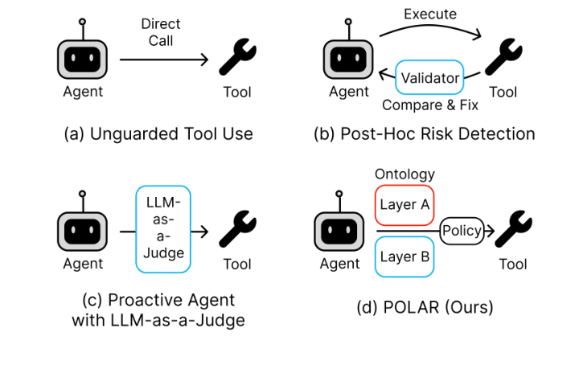
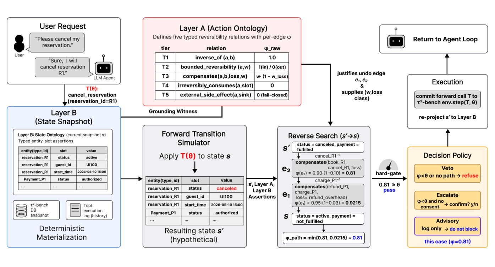
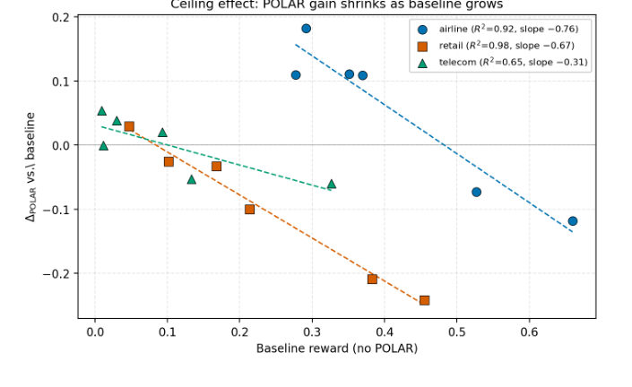

# POLAR · 分解

> 只记**论文说了什么**。工程判断、质量评估、洞察见同目录 [digest.md](./digest.md)。

## 一句话

把安全判定从「LLM 判断这个动作是否安全」换成「**是否存在可接受的逆操作序列**」：两层本体 + 反向搜索给动作打可逆性分，低于阈值在执行前剪枝；τ²-bench 18 个模型-域格只有 8 个改善，airline 的弱中模型受益，retail 与强模型回退。

## 问题与设定

- **问题**：工具调用 agent 获得写权限后，最危险的失败不是答错，而是**不可恢复的动作**；现有护栏多在事后补偿，或让 LLM 做无结构依据的 allow/block。
- **基准**：τ²-bench 三个域（airline / retail / telecom），六个 agent 模型；每格 3 trials × 50 tasks = 150 attempted runs；72 个 (model, domain, arm) 格，10,800 rollouts。
- **对照**：BASELINE（无护栏）、InferAct（两阶段 critic 适配）、SagaLite（补偿 registry 适配）、POLAR（VetoPolicy）。
- **固定**：用户模拟器 qwen3-8B；会话 reviewer 与 retail NL judge 用 gpt-4o-mini；只变 agent。
- **能证明**：在 τ²-bench 上，结构可逆性门有**条件性**任务收益；收益与基线能力反向；retail 常回退；T1-only 接近 blanket veto。
- **不能证明**：防住了多少伤害（reward 不是伤害标签）；false-veto 率；真实部署；跨域可迁移；完整逆操作执行是否成功。

## 机制

### 两层本体（§3.2, p.3–4）

| 层 | 内容 | 何时构建 | 谁维护 |
|---|---|---|---|
| Layer A | 静态动作本体：Datalog 编码，五个类型化可逆关系 T1–T5，每条边带 curator 权重 w | 域级，手写 | 域 curator |
| Layer B | 动态状态投影：`slot(entity_type, entity_id)=value`，从 τ²-bench DB + 已执行工具记录重建 | 每轮 | 系统，不让 LLM 想象 |

### 五个可逆层级（Table 1, p.4）

| tier | 关系 | 每步 φ | 带 |
|---|---|---|---|
| T1 | `inverse_of(Ta,Tb,Slot,w)` | `w` | reversible |
| T2 | `bounded_reversibility(T,Bound,w)` | `w · 1[Bound at s]` | reversible |
| T3 | `compensates(Ta,Tb,LossClass,w)` | `w · (1−w_loss)` | compensable |
| T4 | `irreversibly_consumes(T,EntitySlot)` | 0 | irreversible |
| T5 | `external_side_effect(T,SinkClass)` | 0 | irreversible（fail-closed） |

### 反向搜索（§3.3, p.4）

给定候选动作，**从最近的动作往回**枚举 Layer A 里的 undo 边，组合候选逆序列 π；T2 的 bound 与 overlap 对 Layer B 当前投影检查。成功 → 得到 π；失败 → 报告第一个不可接受步骤及原因。**不调用外部符号规划器**；判定由匹配到的注释 + Layer B 快照决定。

### 评分与策略（§3.4–3.5, p.4）

- 整条序列的分数是**最弱一步**：`φ_POLAR(π) = min φ(u)`；一步不可逆就把整条拉到 0，并报告 bottleneck。
- 阈值 τ=0.80；低于阈值或找不到完整 π → Veto。
- DecisionPolicy 分离「判定」与「执行」：APPROVE / VETO / ESCALATE。**只有 VetoPolicy 有可比的 reward 结果**；Escalate/Advisory 的归档均值与提交表冲突，作者撤回比较。
- 评分前先做 admissibility： provisional / revoked / disputed / 未接地的注释不进入序列。

### 被评估的 wrapper（p.2, p.4）

- **不模拟完整 post-action state s′**；只对可用 Layer B 当前投影检查。
- ThreeWayClassifier 与 IntentParser 不作为决策时组件。
- VetoPolicy 用静态 refusal 替换 agent message。

## 关键数字

| 数字 | 条件 | 出处 |
|---|---|---|
| **8/18** | 18 个 model–domain 格中 POLAR 平均 reward 改善的格数 | §4.2, p.6 |
| **+0.11–0.18** | airline，六个模型中四个的 Δ（airline） | Abstract, p.1；Table 3 |
| **+0.182 / +0.029 / +0.053** | llama-3.1-8b：airline / retail / telecom | Table 3, p.6 |
| **+0.111 / −0.100 / +0.038** | qwen3-8B：airline / retail / telecom | Table 3, p.6 |
| **−0.073 / −0.242 / +0.020** | gpt-oss-120B：airline / retail / telecom | Table 3, p.6 |
| **−0.119 / −0.209 / −0.060** | qwen3.5-27B：airline / retail / telecom | Table 3, p.6 |
| **slope −0.76 / −0.67 / −0.31；R² 0.92 / 0.98 / 0.65** | Δ vs baseline reward 的六点描述性拟合（airline / retail / telecom） | §4.2, p.6 |
| **36.6% / 100% / 98.7%** | τ=0.80 时候选池保留比例（airline / retail / telecom） | Table 4, p.7 |
| **0.080 [0.013,0.147]** | tier ablation full（T1,T2,T3），qwen3-8B airline | Table 5, p.8 |
| **0.087 [0.020,0.153]** | T1-only；接近 blanket veto，增益不比 full 小 | Table 5, p.7–8 |
| **0.060 [−0.007,0.127]** | no irreversible（T4/T5 以 φ=1 放行），区间跨零 | Table 5, p.8 |
| **1,745** | 被记录的 blocked decisions 总数 | §4.6, p.8 |
| **150 / 103 / 77** | 最高 block 次数：GPT-OSS-120B retail return / exchange；Nemotron-9B airline update_flights | Table 6, p.8 |

## 图表索引

### 图 1：四种安全模式

> 原图：arXiv:2610.08082, p.1, Figure 1。版权归作者，研究评论用途。

**看什么**：POLAR 的区别不在「有没有门」，而在门的判据是**结构化的逆操作搜索**，不是 LLM 的 allow/block 标签。注意 (b) 是事后补偿，(c) 是 LLM-as-judge，只有 (d) 有可审计的 Layer A/B。

### 图 2：框架

> 原图：arXiv:2610.08082, p.3, Figure 2。版权归作者，研究评论用途。

**看什么**：Layer A（静态动作本体）与 Layer B（状态投影）分开；反向搜索产出 π 与 φ，DecisionPolicy 再决定 veto/escalate/advisory。**判定与执行分离**是它可复用的设计，不是实现细节。

### 图 3：能力反向

> 原图：arXiv:2610.08082, p.6, Figure 4。版权归作者，研究评论用途。

**看什么**：Δ 随 baseline reward 下降；airline/retail 斜率约 −0.7，telecom −0.31。**这是六点描述性拟合，不是部署阈值**——作者明确说不能拿它做 zero-crossing 规则。

## 作者自述局限

- Reward 不是防伤害的直接度量；被 veto 的风险动作不体现在 reward 里。
- 不模拟完整 post-action state，也不验证逆操作真的能执行。
- 本体编写成本、语义错误、对抗鲁棒性未测；**漏掉一条不可逆关系可能造成 false approval**。
- T1-only 接近 blanket veto，无法把「结构反向组合」的贡献与「保守拒绝」分开。
- Block log 没有独立的 harm/authorization 标签，无法算 false-veto 率。
- 归档配置/本体 provenance 不完整；对照臂是适配而非复现。
- VetoPolicy 之外的 Escalate/Advisory 结果与提交表冲突，作者撤回比较。

## 引用锚点

- 「The sequence is an auditable structural hypothesis, not proof that recovery will succeed.」（p.2）
- 「Reward is not a direct measure of prevented harm.」（Abstract, p.1）
- 「T1-only ... behaves close to a blanket veto.」（p.7）
- 「the log does not independently label each blocked call as harmful.」（p.8）
- 「a missing irreversible relation can permit false approval if a positive relation remains.」（p.9）

## 待核

- [ ] T1-only 的 +0.087 与 full 的 +0.080 在统计上是否可分？作者说区间重叠、各自独立 baseline，未做配对。
- [ ] 阈值 0.80 的选取依据；Table 4 的保留率是在固定轨迹上，不是 reward 曲线。
- [ ] false-veto 率能否从 1,745 条 blocked decisions 里人工标注估计？
- [ ] 若模拟完整 s′ 并验证逆操作执行，结论会不会变？
- [ ] 本体编写一个人天/域的成本；工具/本体变更后的维护成本。
