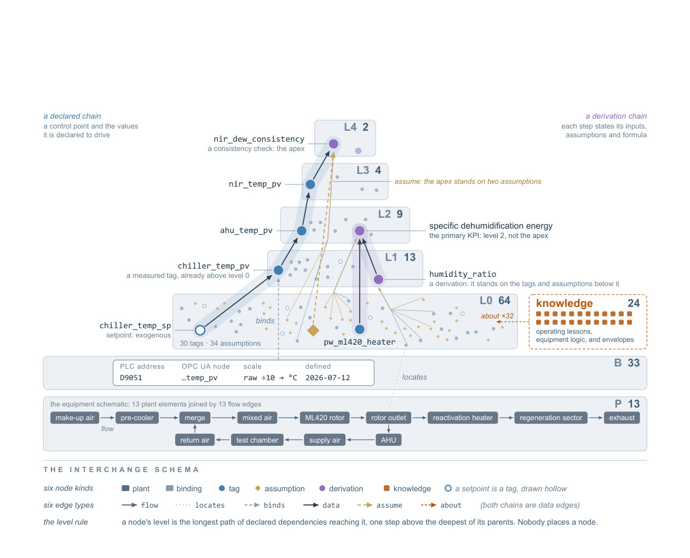
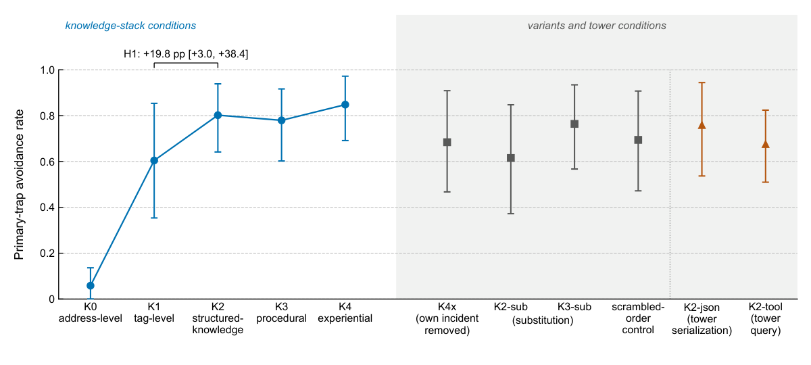
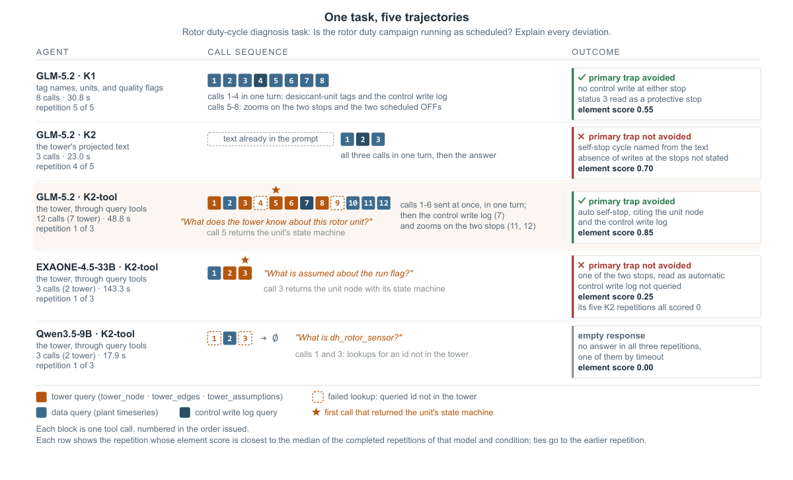

# Narrow and Deep（本体塔）· 分解

> 只记**论文说了什么**。工程判断、质量评估、洞察见同目录 [digest.md](./digest.md)。

## 一句话

把**单个设备系统**的知识做成「窄而深」的本体塔（测点 + 绑定 + 假设 + 物理推导 + 运行教训），投影成约 45k 字符文本放进 prompt；在真实低湿空气处理试验台上，9 个预注册任务、4 个 9B–750B 模型：避坑率 0.605→0.802，**投影 > 查询工具 > 文档检索**；但增益集中在「答案基本写在文本里」的任务，物理推导未被测。

## 问题与设定

- **问题**：工业设备 agent 需要的是**少数实体、深知识**（值怎么推导、依赖哪些假设、运行中发生过什么），而 Brick/SAREF 等建筑本体是**多实体、浅描述**；知识以什么形式供给 agent 没有被测过。
- **对象**：真实低湿空气处理试验台（带 PLC，商用除湿转轮/空调箱/冷水机），多个研究组每天使用。
- **任务**：9 个从运行记录回放的任务——5 个读数解释 + 4 个真实事故诊断；每个任务定义 ground-truth 元素与「最可能的误判」（primary trap）。
- **条件**：K0 地址级、K1 标签级、K2 投影文本、K3 流程摘要、K4 日志检索；另 K4x（去掉本事故记录）、K2-sub（文档检索替代投影）、K3-sub、scrambled-order、K2-json、K2-tool。
- **规模**：1,304 trials；4 个 open-weight 模型（Qwen3.5-9B / gemma-4-31B-it / EXAONE-4.5-33B / GLM-5.2 ~750B）；60 steps / 1,500 s per trial；LLM judge gpt-5.6-sol，第二 judge claude-opus-5-5，κ=0.819；作者与 judge κ=0.696。
- **预注册**：H1 结构化知识提高避坑率；H2 增益随模型容量上升；H3 本事故记录提高诊断分。H2、H3 未获支持。
- **能证明**：投影文本在**答案基本写在文本里**的工业设备任务上，对 9B–750B 模型都有效；查询工具只服务主动调用它的模型；日志里的教训很少被主动检索。
- **不能证明**：物理推导的价值（任务不需要）；多设备/多站点可迁移；投影生成自动化；长期维护成本；真实闭环控制的普遍性。

## 机制

### 本体塔（Fig. 1, p.5）

- **162 节点 / 217 边**：42 tags、34 assumptions、33 bindings、24 knowledge nodes、16 derived quantities、13 plant elements。
- **六种节点**：plant / binding / tag / assumption / derivation / knowledge；**六种边**：flow / locates / binds / data / assume / about。
- **层级由声明依赖计算**：节点的 level = 从测量到它的最长依赖路径；不是人手工摆放。塔高 = 知识离测量有多远。
- **两种加深**：
  1. **物理**：推导量（psychrometric、质量/能量平衡、风机相似律），每个推导写明输入、公式、单位、假设；16 个推导量在 L1–L4。
  2. **运行史**：运行日志里的教训写成 knowledge node，挂在相关节点上；knowledge node 停在 L0，不增加塔高。

### 供给：投影文本（§2.5, p.7）

- agent 不直接读节点/边；读的是**约 45,000 字符的文本投影**，含传感器身份/校验/已知故障、单元耦合与自动逻辑、knowledge nodes、控制点运行包络。
- 投影来自与塔相同的描述记录（sensor registry、couplings、control-point ontology、system targets）；**每条投影都能在塔里找到**。
- **推导量不在投影里**：plant 把推导放在监控软件里，不是描述记录；所以 16 个推导量与假设在塔里、不在文本里。评估只测了塔的描述性内容。
- 其他形式对照：整塔 JSON（约 99k 字符）、三个只读查询工具（lookup node / follow edges / list assumptions）、文档放检索后面。
- **关键差异**：查询工具的每条陈述能追溯到返回的节点；文本投影不能。

### 安全层（§2.6, p.8–9）

所有写命令走同一条写路径，安全检查按顺序：tag 是否在本次允许列表 → 值是否在范围 → 最近是否有人工写入 → 是否满足 plant 的 guard（绝对限、步长、每小时/累计变化、等待时间）。通过后写入、读回、记录；拒绝也记录。

### 条件表（Table 1, p.11）

| 条件 | agent 额外得到什么 | 塔的哪部分 |
|---|---|---|
| K0 | PLC 地址 + 原始整数 | 无名字的 binding |
| K1 | tag 名、单位、质量标志 | tags |
| K2 | 塔的投影文本 | tag 属性、耦合、包络、knowledge nodes；**无推导量** |
| K3 | 六个操作流程的摘要 | 塔外 |
| K4 | 日志/调查文档的检索工具 | 塔外 |
| K4x | K4 去掉本事故记录 | 塔外 |
| K2-sub | 文档检索替代投影 | K2 的来源混在文档里 |
| K2-json | 整塔 JSON | 含推导量与假设 |
| K2-tool | 三个塔查询工具 | 含推导量与假设，经查询 |

## 关键数字

| 数字 | 条件 | 出处 |
|---|---|---|
| **+54.6 pp** | K0→K1，primary-trap avoidance（命名点+单位） | §3.1, p.13 |
| **0.605 → 0.802（+19.8 pp [3.0, 38.4]）** | K1→K2，避坑率，4 模型 9 任务 pooled | §3.1, p.13；Fig. 3 |
| **0.566 → 0.777** | K1→K2，element score | §3.1, p.13 |
| **OR 5.45；Holm p=6.0×10⁻⁷** | H1 检验 | §3.1, p.14 |
| **+0.235 / +0.178 / +0.213 / +0.219** | K1→K2 element gain：9B / 31B / 33B / 750B | §3.1, p.15；Fig. 4 |
| **Holm p=0.85（H2 未支持）** | 增益是否随容量上升 | §3.1, p.15 |
| **0.737 vs 0.672** | 9B 带投影 vs 最大模型不带投影 | §3.1, p.15 |
| **+12.9 → +31.1 pp** | 避坑率增益范围：gemma-4-31B → GLM-5.2 | §3.1, p.15 |
| **0.777 / 0.685 / 0.717 / 0.597 / 0.638** | element score：投影 / 打乱 / JSON / 文档检索 / 塔查询 | Table 2, p.16 |
| **76/108** | 使用塔查询工具的试验数（GLM 27/27，EXAONE 2/27） | Table 2, p.16 |
| **−0.20（SE 0.05）** | 移除已并入的教训，element score 变化 | §3.3, p.17 |
| **4/80** | K4 诊断 trial 中调用日志检索的次数 | §3.3, p.16 |
| **12/14** | live runs 把控制变量带进目标带 | §3.4, p.19 |
| **25/61** | 到达安全层后被拒绝的命令（15 个错 setpoint、9 个累计限、1 个步长） | §3.4, p.18 |
| **24–68% / 4–19%** | 无证据支持的事实主张占比：GLM-5.2 / gpt-5.6-sol | §3.4, p.19 |

## 图表索引

### 图 1：本体塔

> 原图：arXiv:2610.11768, p.5, Figure 1。版权归作者，研究评论用途。

**看什么**：塔高不是画的，是**声明依赖算出来的**；knowledge nodes 在 L0（旁挂），不增加塔高。左边是控制链，右边是推导链；同一个 KPI（specific dehumidification energy）在 L2，不在塔顶。

### 图 3：避坑率

> 原图：arXiv:2610.11768, p.14, Figure 3。版权归作者，研究评论用途。

**看什么**：K0→K1 的 +54.6pp 比 K1→K2 的 +19.8pp 还大——**命名和单位本身就是最大的一层知识**。右侧变体显示：JSON/查询工具并不比投影差太多，但文档检索明显低。

### 图 5：一个任务、五条轨迹

> 原图：arXiv:2610.11768, p.17, Figure 5。版权归作者，研究评论用途。

**看什么**：同一个诊断任务，投影文本 3 次调用就能命名 self-stop cycle，但**没说出「停之前没有控制写入」**；查询工具要到第 5 次调用才拿到状态机，却能把陈述指回节点。**形式改变的是「用什么代价拿到哪条证据」，不是单纯的好坏。**

## 作者自述局限

- 一个 plant、九个任务、四个模型；投影的增益是在「答案基本写在文本里」的任务上测的。
- 三个预注册假设之外，其余比较、教训形式实验、live runs 都是探索性的，每格 trial 很少。
- 塔的物理推导没有被测；任务不要求推导量。
- 文本投影不能追溯来源；查询工具能，但不是所有模型都会用。
- 预注册评分规则改过一次；作者与 judge 的一致性 κ=0.696，略低于 0.7 门槛。

## 引用锚点

- 「The agent does not receive the nodes and edges of the tower; it reads a text projected from them.」（p.7）
- 「every entry of the projection appears in the tower.」（p.7）
- 「The 16 derived quantities and their assumptions are therefore in the tower but not in the projection.」（p.7）
- 「the gain was measured on tasks whose answers it largely stated.」（p.23）
- 「the journal entry ... remained available, but the search tool was called in 4 of the 24 trials.」（p.17）
- 「a statement drawn from a text in the prompt cannot be traced to its source, whereas each query to the tower names the node it read.」（p.22）

## 待核

- [ ] 投影的 45k 字符如何生成？是模板还是模型？生成/更新的自动化程度。
- [ ] 推导量若进投影，会不会改变结果？作者说未测。
- [ ] 多设备共用塔（common tower + instance tower）的抽取成本。
- [ ] 9B 带投影 > 750B 不带，这个比较是否受任务/裁判影响；作者说区间约 0.3 宽。
- [ ] 长期运行后 knowledge nodes 增长，45k 字符会不会撑爆 prompt？作者的扩展方案是 common tower，但未实现。
