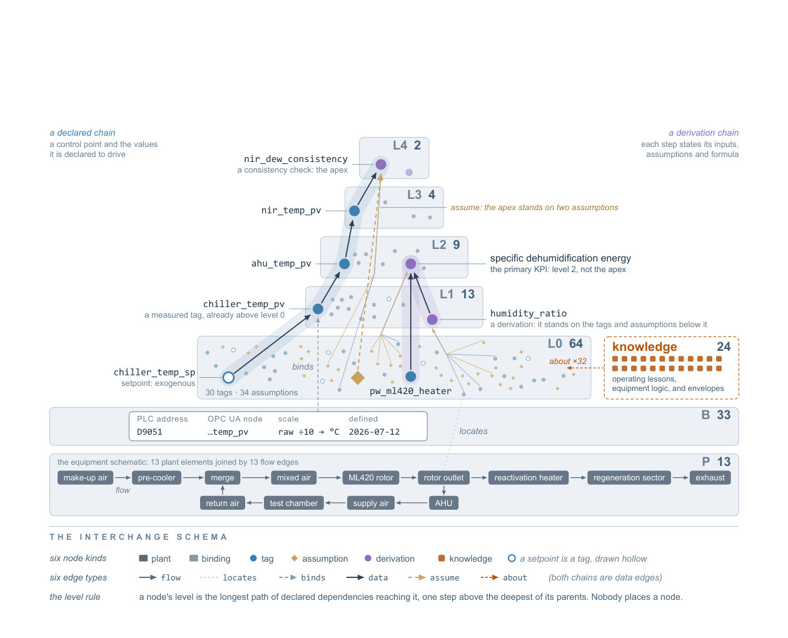

# Narrow & Deep：把一台设备的知识「窄而深」地投影给 agent

> 这篇消化不假设你读过论文。先讲清「本体塔」是什么，再看它在一个真实工业试验台上的结果、边界和工程用法。

## 0. 三句话

1. **它问什么**：工业设备 agent 需要的是「少数实体、深知识」（值怎么推导、依赖哪些假设、运行中发生过什么），而通用建筑本体是「多实体、浅描述」；知识应该以什么形式供给 agent？
2. **它怎么做**：为一台真实低湿空气处理设备建「本体塔」——测点、绑定、假设、物理推导、运行教训；把塔投影成约 45k 字符文本放进 prompt；用 9 个预注册任务、4 个 9B–750B 模型测。
3. **它发现什么**：投影文本把避坑率从 0.605 提到 0.802（+19.8 pp），element score 0.566→0.777；**pooled element score：投影 0.777 > JSON 0.717 > 查询 0.638 > 检索 0.597**（工具是事后探索性条件，Qwen 反向：工具 0.407 < 文档 0.538；这不是普适排序）；增益集中在「答案基本写在文本里」的任务，物理推导未被测。

## 1. 它解决什么问题

### 1.1 背景

工业设备 agent 要在现场读点、诊断故障、提 setpoint 变更。它需要的知识不是「世界上有哪些设备类型」，而是：

- 这个 tag 的 PLC 地址、原始比例、单位、定义日期；
- 这个值由哪些测点、什么公式、依赖哪些假设推导出来；
- 这台设备在运行中发生过什么、当时怎么处理；
- 哪些操作是允许的、边界在哪里。

通用本体（Brick、SAREF、Asset Administration Shell、ISO 15926）擅长「跨很多站点命名很多种点」，但不擅长「一台设备的深知识」。论文主张：**窄而深**——实体少，但每个实体知道得多。

### 1.2 一个具体例子

问题：「转子除湿机的除湿量为什么下降？」

- 浅知识：知道有 `rotor`、`supply_air_temp`、`return_air_dew_point` 这些 tag。
- 深知识：知道 `specific_dehumidification_energy` 由 reactivation heater 功率、 airflow、humidity ratio 推导；知道它依赖「大气压 1013 hPa」「流量计待复检」两个假设；知道运行日志里有过「auto self-stop」的教训。
- 投影：把这些写成一段可读文本，直接放进 prompt；agent 不需要自己查图/查塔。

## 2. 术语

| 术语 | 用大白话说 |
|---|---|
| **本体塔（ontology tower）** | 一台设备的窄而深知识结构；L0 放 tags、assumptions、knowledge nodes（knowledge 停在 L0、不增加塔高），derivations 沿依赖升到 L1–L4。 |
| **tag** | 控制系统里的一个命名过程点，如 supply-air temperature / setpoint。 |
| **binding** | tag 到 PLC 地址、原始比例、单位、定义日期的绑定。 |
| **assumption** | 信了但没测的东西，如大气压取 1013 hPa、流量计待复检。 |
| **derivation** | 由输入 + 公式 + 单位 + 假设推出的量；如 specific dehumidification energy。 |
| **knowledge node** | 运行日志里的教训，挂到相关节点上；停在 L0，不增加塔高。 |
| **level** | 节点离测量有多远：从测量到它的最长依赖路径；由声明依赖计算，不手工摆放。 |
| **projection** | 把塔写成约 45k 字符的文本，放进 agent 的 prompt。 |
| **K0–K4** | 累积知识条件：地址级 → tag 级 → 投影文本 → 流程摘要 → 日志检索。 |
| **primary trap** | 每个任务里「最可能的误判」；避坑率 = 没有掉进 trap 的 trial 比例。 |
| **element score** | 任务要求的关键元素得了多少分；可略超 1（有 bonus element）。 |

## 3. 它怎么做

### 3.1 塔的结构

> 原图：arXiv:2610.11768, p.5, Figure 1。版权归作者，研究评论用途。

**看什么**：塔高不是画的，是**声明依赖算出来的**；knowledge nodes 在 L0（旁挂），不增加塔高。左边是控制链，右边是推导链；同一个 KPI（specific dehumidification energy）在 L2，不在塔顶。

- 162 节点 / 217 边：42 tags、34 assumptions、33 bindings、24 knowledge、16 derived、13 plant elements。
- 六种节点：plant / binding / tag / assumption / derivation / knowledge。
- 六种边：flow / locates / binds / data / assume / about。
- 两种加深：**物理**（推导量，写明输入/公式/单位/假设）与**运行史**（knowledge nodes）。

### 3.2 投影

- agent 不直接读节点/边；读的是约 **45,000 字符**的文本投影。
- 投影来自与塔相同的描述记录（sensor registry、couplings、control-point ontology、system targets）；**每条投影都能在塔里找到**。
- **推导量不在投影里**：plant 把推导放在监控软件里，不是描述记录；所以 16 个推导量与假设在塔里、不在文本里。

### 3.3 评估条件

| 条件 | agent 额外得到什么 |
|---|---|
| K0 | PLC 地址 + 原始整数 |
| K1 | tag 名、单位、质量标志 |
| K2 | 塔的投影文本（无推导量） |
| K3 | 六个操作流程摘要 |
| K3-sub | 用完整流程文本替代摘要（预注册条件之一） |
| K4 | 日志/调查文档的检索工具 |
| K4x | K4 去掉本事故记录 |
| K2-sub | 文档检索替代投影 |
| K2-json | 整塔 JSON（含推导量/假设） |
| K2-tool | 三个塔查询工具（**事后 descriptive 比较，不在 1,304 预注册批次内**） |

- 9 个任务：5 个读数解释 + 4 个真实事故诊断；每个任务定义 ground-truth 元素与 primary trap。
- 4 个 open-weight 模型：Qwen3.5-9B、gemma-4-31B-it、EXAONE-4.5-33B、GLM-5.2（~750B）。
- 1,304 trials 覆盖 K0–K4、K4x、K2-sub、K3-sub、scrambled 九个条件；K2-json/K2-tool 是事后加入的描述性比较。60 steps / 1,500 s per trial；LLM judge gpt-5.6-sol；第二 judge claude-opus-5-5，κ=0.819（primary-trap 121 个抽样 trial）；作者与 judge κ=0.696（**仅 7 个 trial**）。

### 3.4 安全层

所有写命令走同一条写路径：tag 是否在允许列表 → 值是否在范围 → 最近是否有人工写入 → 是否满足 plant 的 guard（绝对限、步长、每小时/累计变化、等待时间）。通过后写入、读回、记录；拒绝也记录。

## 4. 结果：数字与条件

### 4.1 投影文本

| 指标 | K1（tag） | K2（投影） | 变化 |
|---|---|---|---|
| primary-trap avoidance | 0.605 | 0.802 | **+19.8 pp** [3.0, 38.4] |
| element score | 0.566 | 0.777 | +0.211 |

- H1 支持：odds ratio 5.45，Holm 校正 p=6.0×10⁻⁷。**这是修订过 trap 规则后的 rubric**；注册版 rubric 是 0.698→0.842，OR 5.25，结论相同。digest 只报改版后数字，读的时候要知道有这次修订。
- **K0→K1（命名 + 单位）已经有 +54.6 pp**；塔的投影是在这之上再加 19.8 pp。
- **任务间异质性很大**：9 个任务里 4 个在 K1 已天花板（trap 全避开，无增益空间）；3 个「答案写在文本里」的任务 +45–70 pp；2 个文本不含教训的诊断任务 +13 / −3 pp。允许增益随任务变化后，单侧 p=0.025，远弱于主检验。
- 四个模型的 element gain：+0.235（9B）、+0.178（31B）、+0.213（33B）、+0.219（750B）。
- **H2（增益随容量上升）未检出**：Holm 校正的单向检验 p=0.85；这是「未支持」，不是「证明无效应」。
- **9B 带投影 0.737 > 最大模型不带投影 0.672**。

> 出处：§3.1, p.13–15；Fig. 3/4。

### 4.2 形式与接口

| 条件 | element score（pooled） |
|---|---|
| 投影文本 | **0.777** |
| 打乱句序 | 0.685 |
| 整塔 JSON | 0.717 |
| 文档检索 | 0.597 |
| 塔查询工具 | 0.638 |

- 塔查询工具只在模型**调用并读回结果**时有用：76/108 trials；GLM 27/27，EXAONE 2/27。Qwen3.5-9B 调了 23/27 但 13/27 空答，工具得分 0.407，反而低于它的文档检索 0.538；「调用」不等于「会用」。
- 日志检索在 K4 诊断 trial 中只被调用 **4/80** 次；两个模型从未调用。文档检索工具也只在 **21/108** trials 被调用。
- 移除已并入的教训：element score −0.20（SE 0.05）。

> 出处：Table 2, p.16；§3.3, p.16–17。

### 4.3 live runs 与安全层

- 14 次 live runs（8 次 dew-point + 6 次 temperature），12/14 把控制变量带进目标带；只描述了 GLM-5.2 与 gpt-5.6-sol，且 gpt-5.6-sol 同时是 judge。两次未进带**不能说明 agent 失败**：两次都从高于平衡的腔温起步；其中一次 3 小时未发命令、另一次 41 分钟被停。论文说这两次不说明目标带是否可达。
- **61 条命令到达安全层**，25 条被拒（15 个错 setpoint、9 个累计限、1 个步长）；另有 **2 条在到达前被拒**，总数 63。25/61 是到达层的拒绝率，不是全部命令。
- agent 的事实主张 24–68%（**仅 GLM-5.2**）无证据支持；gpt-5.6-sol 4–19%；至少 4/14 次运行报告了没发生的 setpoint 变更。
- 安全层独立于 agent；live run **故意不告诉 agent 允许的 setpoint 与限值**，让它从安全层拒绝中学习。论文没有做「prompt 规则 vs 代码规则」对照，所以不能说 prompt 规则被测试且失败。

> 出处：§3.4, p.18–19。

### 4.4 这些数字之间的逻辑

- **为什么 K0→K1 是最大一层？** 没有 tag 名和单位，模型只能看到 PLC 地址和原始整数；它连「这个数是什么」都不知道。命名+单位不是装饰，是把原始信号变成可解释量。
- **为什么文本 > JSON？** 文本约 45k 字符，JSON 约 99k 且含 16 个推导量/假设；长度与内容都不同，这是事后描述性比较，不是受控实验。文本可能胜在顺序/主次，也可能是长度；GLM-5.2 的 JSON 0.900 甚至高于文本 0.891，不能一概说「文本更好」。
- **为什么查询工具只服务部分模型？** 工具把「要不要查」交给 agent；Qwen 23/27、gemma 24/27、EXAONE 2/27、GLM 27/27，没有模型为零；GLM 每次都调。投影不依赖这个决定。K4 日志检索才是两个模型从未调用。
- **为什么 H2 没支持？** 投影的收益主要来自「把归纳/绑定提前做掉」，不是「模型容量不够」；9B 能读文本，750B 不带投影也拿不到同样的知识。
- **为什么日志只有 4/80 被检索？** 日志是查询时由 agent 决定要不要读；论文测到的是「谁决定检索」（系统 vs agent），不是「agent 不做归纳」的因果。

## 5. 这些数字不能说明什么

1. **不是「本体越深越好」。** 最大的一层增益是 K0→K1 的命名+单位（+54.6 pp）；物理深度**没有被测**，不能拿它和命名+单位比较。
2. **物理推导未被测。** 任务不要求推导量；16 个推导量在塔里、不在投影里。
3. **答案在文本里才有效。** 四个任务的 trap 在 tag 名阶段就已被避开；三个任务的答案由投影文本直接给出。**这不是通用知识注入的胜利。**
4. **H2 未支持。** 未检出增益随容量上升；9B 带投影 > 750B 不带，但区间约 0.3 宽，不能当普遍规律。
5. **单 plant / 9 任务 / 4 模型。** 不能外推到多设备/多站点。
6. **H3 未支持。** 预注册 H3 是「本事故记录提高诊断分」；K4 0.644 vs K4x 0.645，没有提升。K4x 是 H3 的操纵条件，不是探索性比较。
7. **探索性比较。** K3/K4 等条件每格 trial 很少；κ=0.696 只在 7 个 trial 上算，略低于 0.7 门槛。
8. **文本不能追溯。** 投影里的陈述不能指回节点；查询工具能（每次查询返回 `node_id`），但整体只 76/108 trials 调用，EXAONE 2/27，Qwen 23/27 中 13/27 空答。可追溯是查询工具的属性，不是投影的属性。

## 6. 工程上怎么用

### 6.1 复刻顺序

1. **先做测点清单和绑定。** 每个 tag 的 PLC 地址、比例、单位、定义日期；**命名和单位是最大的一层知识**。
2. **把假设变成节点。** 「大气压 1013 hPa」「流量计待复检」不是注释，是节点；每个推导要能回答依赖哪些假设。
3. **把物理推导写成声明。** 输入、公式、单位、假设；层级由依赖计算，不手工摆放。
4. **把运行教训并入塔。** knowledge node 挂到相关节点，停在 L0；抽取时并入，不要只留在日志里。
5. **投影成文本，不要直接给 JSON 或只给查询工具。** 45k 字符文本在四个模型上都有效；JSON 0.717、查询 0.638、检索 0.597。
6. **不要把「可追溯」当采用投影的理由。** 投影文本不能指回节点；查询工具能（每次查询返回 `node_id`），但调用率因模型而异：整体 76/108，EXAONE 2/27；Qwen 调了 23/27 但 13/27 空答；日志检索 4/80。只有当目标模型稳定调用并读回时，才把工具当审计补充；否则知识陈述的审计靠离线 `statement→node_id` 映射（未验证），动作审计靠安全层日志，不靠 agent 的叙述。
7. **所有写操作走独立安全层。** 允许列表、范围、人工写入、步长/累计/等待；写入后读回、记录。
8. **评估按任务拆。** element score + primary-trap avoidance 分开；只看总分会把「答案写在文本里」的增益误当通用推理提升。
9. **记录 agent 的「说」与「做」的差。** 24–68% 是 GLM-5.2 的事实主张无证据比例（gpt-5.6-sol 4–19%）；至少 4/14 报告了未发生的变更；日志以安全层为准。

### 6.2 成本与使能

| 成本 | 一次性/每次 | 说明 |
|---|---|---|
| 塔构建 | 每系统一次性 | 42 tags / 34 assumptions / 24 knowledge / 16 derivations；人工 curator |
| 投影生成 | 每系统首次 + 更新 | 约 45k 字符（论文无推导版）；首次 2–3 人日（`推测`，含生成器与 `statement→node_id` 映射）；从描述记录生成；自动化程度未量化 |
| 日志并入 | 持续 | 新教训写成 knowledge node；否则退回检索 |
| 安全层 | 集成一次性 | 允许列表、范围、人工写入、步长/累计/等待 |
| 评估集构造 | 每系统一次性 | 9 任务的 ground-truth 元素 / primary trap / rubric（注册版 + 修订版）；领域工程师（论文里由作者做），论文未报人日 |
| 评估运行 | 每系统 | 按论文规模：1,304 trials + LLM judge；1–2 人周 + GPU（`推测`），不含上面的构造 |
| 维护 | 工具/日志变更 | 塔、投影、知识节点同步；预期 0.5–1 人日/月（`推测`） |

**使能条件**：长上下文能装下 45k 字符；open-weight 9B 以上模型能读结构化文本；设备有 PLC/描述记录；现场能接受只读工具与安全层；领域工程师能抽出时间写 ground-truth/trap/rubric（这是评估预算里最容易被漏掉的一块）。

### 6.3 何时用 / 何时别用

**用**：单设备/单系统、知识窄而深、答案主要在手册/记录里、现场只能跑 open-weight 模型。

**别用**：多站点、多设备、知识主要是检索发现；需要物理推导但没写进投影；本体没人维护；期望「上本体就提准确率」；**把「可追溯」当采用投影的理由**——投影文本不可追溯，论文只证明了查询工具可追溯，且调用率低、因模型而异（§4.2）。

### 6.4 最小落地清单

1. **先做 tag/单位审计。** 每个测点的名字、单位、比例、定义日期；这是最大的一层收益，别跳过。
2. **把假设写成节点。** 「大气压 1013 hPa」「流量计待复检」不是注释；每个推导要能回答依赖哪些假设。
3. **推导写成声明。** 输入、公式、单位、假设；层级由依赖计算，不手工摆放。
4. **把运行教训并入塔。** knowledge node 挂到相关节点；不要只留在日志里等 agent 检索。
5. **投影成文本；可追溯另算。** 45k 字符文本是主路径，但文本不能指回节点。查询工具能返回 `node_id`，但调用率因模型而异（整体 76/108；EXAONE 2/27；Qwen 23/27 中 13/27 空答），只能当已验证模型的审计补充，不能当默认能力。
6. **安全层独立。** 允许列表、范围、人工写入、步长/累计/等待；写后读回、记录。
7. **按 primary trap + ground-truth 元素评估。** 不要只看 element score；每个任务先定 ground-truth 元素、primary trap、rubric 版本，再跑。

## 6.5 工程配方（E3）

### 数据 schema（六类节点 / 六类边）

| 节点 | 必填字段 | 例 |
|---|---|---|
| plant element | id, label, type, parent | `ahu-1` |
| binding | id, tag_id, plc_address, raw_scale, unit, defined_at | `b-17` |
| tag | id, label, unit, quality_flag | `supply_air_temp` |
| assumption | id, statement, scope, review_due | `atm_pressure=1013hPa` |
| derivation | id, inputs[], formula, unit, assumptions[], level | `specific_dehumidification_energy` |
| knowledge | id, event, lesson, linked_nodes[], date | `auto_self_stop_2026_03` |

边：`flow`（设备/介质流向）、`locates`（element→空间）、`binds`（tag→binding）、`data`（derivation→tag）、`assume`（derivation→assumption）、`about`（knowledge→node）。**level 由依赖计算，不手工摆**；knowledge 停在 L0。

### 投影序列化（顺序是有效成分）

固定分节（**工程提议**，比论文投影多 ⑤ derivations；论文投影见 §3.2）：① 头部（系统名/版本/日期/覆盖范围）；② 设备与流程概览；③ tags/bindings（按 level 排序，同 level 按名字）；④ assumptions（按影响面排序）；⑤ derivations（按 level）；⑥ knowledge nodes（按日期倒序，挂相关节点）；⑦ 安全边界（允许列表/范围/人工写入/步长/累计）。

每节用自然语言小段，不堆表格。可选：每条陈述后带 `[node_id]`（`推测`，论文未报告；只给语句级锚点，不等于查询级可追溯，先小样本验证不伤分数）。**打乱句序 0.777→0.685 说明顺序本身是信息**，不要随机化。

样例（节选，**工程提议**：含推导量；论文的投影不含推导量，见 §3.2）：`Supply air temperature (supply_air_temp, °C) is measured at the AHU outlet [tag-12]. The specific dehumidification energy is derived from reactivation heater power, airflow, and humidity ratio [der-04]; it assumes atmospheric pressure 1013 hPa [asm-02] and a flow meter pending recalibration [asm-07].`

### 工具与写接口

- `describe_node(node_id)` → `{id,type,label,fields,edges}`；`query_derivation(input_tag, output_quantity)` → `{formula, inputs[], assumptions[], level}`；`list_knowledge(node_id, since)` → `[{event,lesson,date}]`。
- `propose_setpoint(tag, value, reason)` → `{accepted|rejected, checks[], readback}`；写路径载荷含 `tag,value,reason,actor,idempotency_key`；读回写入后的值/时间/操作者。
- 没有这些 schema，团队只能自创，A/B 与审计不可比。

### 任务与 rubric 构造

- 从设备运行记录选 9 个任务：5 个读数解释（选有明确 ground-truth 元素的工况）+ 4 个事故诊断（选有日志/处理结果的事故）。
- 每个任务定 ground-truth 元素（必须提到的量/关系）与 primary trap（最可能误判）；trap 由领域工程师按「数据最容易诱导的错误」写（可参考历史误判），不事后按模型答案编。
- **rubric 版本**：新厂试点用修订版（0.605→0.802）；对外审计/复现用注册版（0.698→0.842）；改版必须记录原因，不能两版混报。

### 投影生成与可追溯（工具侧）

- 从同一份描述记录生成 45k 字符文本；**论文没有说投影带 node_id 标注，且明确说文本不能指回来源**，所以可追溯不是投影的属性。生成器输出 `statement → node_id` 映射是工程提议（`推测`），需自己验覆盖率；它只做事后审计，不改 agent 看到的文本。
- 变更触发：tag/单位/假设/推导任一变更 → 重生成；版本号写进投影头。
- 论文里明确可追溯的形式是查询工具：每次查询返回 `node_id`。但整体只 76/108 trials 调用；GLM 27/27，EXAONE 2/27，Qwen 23/27 中 13/27 空答；日志检索 4/80。可追溯只在「调用并读回」时成立，不能默认所有模型会用。JSON 也带结构，但论文没测它的可追溯性。

### 评估套件

- 9 个任务（5 读数解释 + 4 事故诊断）；每个任务定义 ground-truth 元素与 primary trap。
- 评分：element score + primary-trap avoidance；**rubric 有注册版（0.698→0.842）与修订版（0.605→0.802）**，报数时必须说用哪版。
- judge：gpt-5.6-sol 主判、claude-opus-5-5 复核；两 judge 间 κ=0.819（121 个抽样 trial），作者与 judge κ=0.696（仅 7 个 trial），后者不能当强一致性。

### 成本

- 塔构建：42 tags / 34 assumptions / 24 knowledge / 16 derivations；人工 curator 约 2–4 人周（`推测`）。规模伸缩按 `build ≈ 2–4 人周 × (节点数/162)^0.7` 估（`推测`，非线性因为复用 schema/流程）。
- 投影生成：45k 字符/系统；首次 **2–3 人日**（含生成器与 `statement→node_id` 映射）+ 0.5 人日/额外 10k 字符（`推测`）。**sprint 的 D7–8 只有 2 天 = 2 人日，取下限**；描述记录要补或生成器要新写时按 3 人日算，从 D9–10 的评估窗口借 1 天，D10 只跑主比较（先砍打乱句序对照）。以上 45k/2–3 人日对应论文的**无推导**投影；若采用 §6.5 含推导量的 E3 版本，长度和工时都要重测（论文的 JSON 含推导量约 99k，可作上限参照），并先对照 60k stop 线。
- 维护：日志并入/本体同步；每月约 0.5–1 人日（`推测`）。V3 的「≤2 人周/月」是上限口径，不是预期值；预期按 0.5–1 人日/月 记账。
- 评估集构造：9 个任务的 ground-truth 元素 + primary trap + rubric（注册版/修订版）；领域工程师（论文里由作者做），**论文未报人日**；试点必须记实耗，不要按任务数线性外推（线性外推本身是 `推测`）。这是最容易被漏掉的一次性人工。
- 评估运行：9 任务 × 4 模型 × 多条件，1,304 trials + LLM judge；1–2 人周 + GPU（`推测`），**不含**上面的构造。

### stop condition

- **先做 K0→K1 命名+单位试验**：若本厂 primary trap 在 K1 就消失，则不做塔（K0→K1 +54.6 pp 大于投影再 +19.8 pp）。
- **K2 − K1 的 primary-trap avoidance < +5 pp → 停**：只发命名+单位修复，不建塔；5–15 pp 也不算成功，扩任务后再判。
- 投影 > 60k 字符仍装不下/遵守率下降 → 停，转查询工具或分域投影。
- 物理推导是核心但投影不含推导量 → 不要用本方案；先补推导或换表示。
- 目标模型查询工具调用率 <20%（EXAONE 2/27 即属此类）或空答率高 → 不把审计寄托在工具上；文本投影本身不可追溯，知识陈述的审计改用离线映射，动作审计靠安全层日志。

### 第一个 sprint（试点设计，`推测`）

2 周、1 台设备、1 curator + 1 后端 + 1 领域工程师：

1. D1–3：tag/单位/绑定审计；选 3 个「投影文本能直接回答」类型的历史任务（如 2 个读数解释 + 1 个事故诊断；答案在描述记录/教训里），写 ground-truth 元素、primary trap、rubric 版本（这三项算评估预算，不是免费项）；把现有失败案例标成「K0/K1 可解」还是「必须深知识」。若凑不出 3 个，说明投影不是本厂的主收益路径，先只做命名+单位，不进入 D4。
2. D4–6：写 3 条推导声明 + 2 条 knowledge node，做 162 节点的 1/10 版。
3. D7–8：**1 人 2 天 = 2 人日，是 §6.2 的 2–3 人日下限**；从描述记录生成 45k 字符文本投影 + `statement→node_id` 映射（未验证提议）；不给 JSON/查询工具。另 1 人并行搭 K1/K2 回放与 judge。若描述记录要补或生成器要新写，按 3 人日算（D7–9），D10 只跑主比较，打乱句序对照砍掉。
4. D9–10：3 任务 × 2 模型（9B + 一个 30B+）× K1 vs K2；主指标 primary-trap avoidance（绝对 pp），element score 分开报；加打乱句序对照（只对 K2）；记录每格 trial 数、judge、κ 抽样数（先写进预注册；论文的作者-judge κ 只基于 7 个 trial，不能照抄这个规模）；并行安全层桩。
5. **出口（先预注册，再跑）**：
   - **成功**：在「投影文本能直接回答」类型的 3 个任务上，K2 的 pooled primary-trap avoidance 比 K1 高 **≥ +15 pp**（pooled 3 任务 × 2 模型；同时逐任务、逐模型报）；且投影可由描述记录重建、用离线映射抽检 10 条陈述时 `node_id` 均可解析。
   - **失败**：**< +5 pp**，或投影 >60k 字符 → 停，只发命名+单位修复，不建塔。
   - **5–15 pp**：证据不足，不算成功，不进第二阶段；优先扩任务后再判（加 trial 只降 trial 噪声，不解决任务级功效）。
   - **投影不可重建 / 映射抽检失败**：不算成功；先修生成器或映射再判，不直接停（描述记录本身缺失除外）。
6. **功效 caveat（3 任务 × 2 模型）**：
   - 样本量 = 3 任务 × 2 模型 × 2 条件 = 12 trials/轮（6 个任务 × 模型单元，每格 1 trial）；打乱句序对照另加 6 trials/轮，不计入 15 pp 主比较。每格重复 r 次则主比较 12r trials；r 按 D9–10 的算力定并写进预注册。**有效样本量是任务数 3（模型也只有 2 个，不能推断模型总体），不是 trials**：同一任务的 trial 相关，加 r 只降 trial 噪声，不降任务间或模型间方差。
   - 3 任务等权时，一个任务从全错到全对就能把 pooled 拉约 33 pp（算术），15 pp 的线挡不住单任务驱动。
   - 论文 9 任务 / 4 模型 / 1,304 trials 的 95% CI 仍是 [+3.0, +38.4]；允许增益随任务变化后单侧 p=0.025（§4.1）。所以 15/5 只作方向性 go/no-go，不作统计结论；必须逐任务、逐模型报。
   - 先测 K1 基线：K1 已接近天花板的陷阱没有增益空间，换任务或单独报。
7. **任务构成决定阈值含义**：论文 9 任务里 4 个在 K1 已天花板（无增益空间）、3 个文本直答（+45–70 pp）、2 个文本不含教训（+13/−3 pp）。若这 3 个任务确实属于文本直答类型，15 pp 容易达到，但只证明「可答任务有效」；要外推整体，必须纳入另两类，此时 pooled 会被拉低（论文 9 任务整体 +19.8 pp，CI [+3.0, +38.4]），15 pp 仍可能达到但不能只归因于直答任务，应改为逐任务决策。

### 替代方案

- 只修命名+单位（K0→K1）：最便宜，先做。
- JSON（0.717）/查询工具（0.638）/检索（0.597）：分数低但可能更便宜；查询工具返回 `node_id`、可追溯，但调用率低且因模型而异（§4.2）；JSON/检索的可追溯性论文未测。论文没有成本对照。
- Brick/SAREF/AAS/ISO 15926：多实体浅描述，不适合单设备深知识；CMMS/知识图谱平台可买，但报价/覆盖未测，需 RFQ。

## 6.6 客户价值假设（V2/V3，`推测`）

- **受益者**：工厂运维/领域工程师；痛点：误诊、误设点、巡检/排障工时。
- **指标**：primary-trap 误判率（=1 − avoidance）、误设点事故/千次、排障工时/次、投影维护人日。
- **反事实**：不做塔 → 继续用 tag/文档检索；K1 命名+单位已能解决多少要先测。
- **V3 试点**：1 台设备、9 任务回放（5 读数解释 + 4 事故诊断）、K1 vs K2；先预注册主指标、停止线、rubric 版本；先测当前排障工时/次与误设点事故/千次作为分母；成功 = K2 的 pooled primary-trap avoidance 比 K1 高 **≥ +15 pp**（pooled 9 任务；模型数按现场定，逐任务报）且维护 ≤ 2 人周/月（上限口径；预期 0.5–1 人日/月，见 §6.2）；失败 = 同一指标提升 < +5 pp 或投影 >60k 字符；5–15 pp = 证据不足，扩任务/加 trial 后再判，不算成功；停止线 = `年省工时 × 工时价 < 维护 + 投影 + 塔构建摊销`，今天没有工时价就先测分母。9 个任务的 ground-truth/trap/rubric 先做，算进评估预算。
- **反例**：答案不在文本里、物理推导是核心、多设备/多站点、本体无人维护。

### E4 决策框架

- **TCO** = 塔构建 `2–4 人周 × (节点/162)^0.7` + 投影 `2–3 人日 + 0.5 人日/10k 字符`（论文无推导版；sprint 的 2 天取下限）+ 维护 `0.5–1 人日/月` + 安全层集成 + **评估（ground-truth/trap/rubric 构造 + 1,304 trials 运行）**；构造人日论文未报，试点必须记实耗，否则 TCO 系统性偏低。
- **收益** = `trap 误判下降 × 每次误判成本 + 排障工时下降 × 工时价`；先测当前排障工时/次、误设点事故/千次。
- **替代**：build（塔+投影）/ buy（CMMS/知识图谱平台，RFQ）/ do nothing（只做 K1 命名+单位）。
- **决策线**：12 个月收益 > TCO 才做塔；K1 已解决 trap 则只做命名+单位；无工时价先测分母。

## 7. 质量与边界

- **证据类型**：实证·真实试验台（一手正文）。
- **强项**：真实设备、预注册、多模型、task-level trap；同时比较投影/JSON/查询/检索；安全层与 live runs 是少见的工程证据。
- **主要威胁**：一个 plant、九个任务；增益集中在答案写在文本里的任务；物理推导未测；探索性比较每格 trial 少；作者-judge κ=0.696；投影生成/维护/评估集构造成本论文未量化（digest 的 2–3 人日、0.5–1 人日/月 是 `推测`；构造人日只能试点记实耗）。
- **`quality: B`**：真实环境 + 预注册 + 多模型，强于多数摘要级工作；但外部效度、物理深度、自动化程度不足。

## 8. 与仓库判断的关系

- **E-12（已核）**：投影 0.605→0.802（+19.8 pp，OR 5.45）；pooled element score 投影 0.777 > JSON 0.717 > 查询 0.638 > 检索 0.597（工具为事后探索性，Qwen 反向）；K0→K1 +54.6 pp；H2 未支持（单向 p=0.85）；9B 带投影 > 750B 不带。
- **C-04**：投影有效的前提是「答案即知识」；与 CAI 的「答案要从语料检索」形成对照。CAI 投影证据；N&D 投影领域知识。
- **P1**：强支撑：安全层独立于 agent；agent 自述不可信；约束必须由代码执行。
- **P2**：同一塔，文本/JSON/工具三种 harness，效果不同。
- **03-L7/L8**：供给形态比模型大小更决定投影增益；运行教训并入才被用。

## 9. 还没解决 / 下一步

- **推导量进投影**：任务表现会变吗？需要设计「必须用推导量」的任务。
- **多设备 common tower + instance tower**：抽取成本；能否自动从设备仓库生成？
- **投影长度**：knowledge nodes 增长，何时撑爆上下文？压缩/分层策略？
- **可用性 vs 可追溯性**：文本 + 每条陈述节点 id 能否兼得？
- **9B 带投影 > 750B 不带**：在别的域/任务上是否复现？
- **安全层的检查顺序/阈值**：25/61 拒绝率是否可接受？

## 10. 原文

- arXiv:2610.11768
- PDF：同目录 `2610.11768-narrow-and-deep.pdf`
- 代码/数据：论文未给公开仓库。
