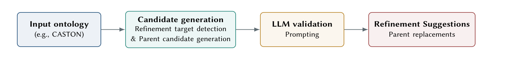

# CASTON · 分解

> 只记**论文说了什么**。工程判断、质量评估、洞察见同目录 [digest.md](./digest.md)。

## 一句话

用**微调的本体嵌入**先把「可疑的上位公理」缩到 30 条、每条给 10 个候选父类，再让 LLM 只在这些局部候选里做 yes/no/替换判断；CASTON 上 default（CASTON-fine-tuned OnT + Qwen3-8B）的 6 条高置信替换被两位专家全部接受。

## 问题与设定

- **问题**：本体里的 asserted subsumption（`A ⊑ B`）可能有隐蔽错误；让 LLM 看整个本体既不准也贵。
- **本体**：CASTON v1.0.0（2026-02-22）：270 named classes、306 axioms、292 条 atomic subsumption。
- **评估**：2 位领域专家独立打 5 分制（−2 完全错 … +2 完全对）；两人都正 → accepted；都负 → rejected；其余 mixed。
- **设置**：
  - Default：CASTON-fine-tuned OnT + Qwen3-8B。
  - Ablation：pretrained ensemble（OnT/GALEN + HiT/WordNet + SBERT）+ Qwen3-8B。
  - Auxiliary：pretrained ensemble + GPT-4o mini。
- **能证明**：在**小规模高置信**替换上，fine-tuned embedding + 局部 LLM 验证可以给出可靠修复；embedding 微调很关键。
- **不能证明**：大规模/其他本体；中等置信的可靠性；关系限制等其他公理类型；下游任务收益。

## 机制

### 两阶段（Fig. 1, p.2）

1. **Candidate generation**：
   - 对每条 `A ⊑ B`，用 embedding 给所有候选父类排序；若 asserted parent B 排名很低（`r_m(A,B)` 大），标记为可疑。
   - 取 top `k_r=30` 条可疑公理；对每个 A，取 top `k_a=10` 个替代父类（排除 A 与已断言父类）。
   - Default embedding：OnT，在 CASTON 上 fine-tune（hyperbolic，适配 EL 本体）。
2. **LLM validation**：
   - Prompt 给 child A、当前父类、候选父类、每个类的 ID/label/definition/comment/scope note，以及其他 axiom。
   - LLM 返回 JSON：每个父类的 verdict（correct/incorrect/partial）、confidence（high/medium/low）、reason、suggested_replacements。
   - 只保留 high/medium 作为候选修复。

### 关键设计

- **缩小搜索空间**：LLM 不看整个本体，只看 30 条可疑公理 + 10 个候选父类。
- **embedding 负责召回/排序，LLM 负责局部语义判断**；两者分工。
- **confidence 作为 triage**：high 可信、medium 需人审（本文 medium 全 mixed）。
- **可追溯**：每条修复对应一组候选类 + JSON reason。

## 关键数字

| 数字 | 条件 | 出处 |
|---|---|---|
| **270 / 306 / 292** | CASTON classes / axioms / atomic subsumption | §3, p.3 |
| **40** | high/medium 替换建议总数 | §1, p.2 |
| **6/6（100%）** | Default high-confidence 被两位专家接受（全 +2） | Table 1, p.4 |
| **0/2（0%）** | Default medium-confidence：全 mixed | Table 1, p.4 |
| **4/7（57.1%）** | Pretrained ensemble + Qwen3-8B high-confidence 接受率 | Table 1, p.4 |
| **1/4（25%）** | 同上 medium | Table 1, p.4 |
| **5/16（31.3%）** | GPT-4o mini + pretrained ensemble high-confidence | Table 1, p.4 |
| **−68.7 pp** | 相对 default 的高置信接受率下降 | §3, p.4 |
| **chromite_sand** | 成功案例：process → material 的父类修正 | §3, p.4 |

## 图表索引

### 图 1：两阶段流程

> 原图：arXiv:2610.21466, p.2, Fig. 1。版权归作者，研究评论用途。

**看什么**：embedding 先缩候选，LLM 只在局部验证。**不是「LLM 读整个本体」**；搜索空间被 embedding 压到 30×10。

## 作者自述局限

- 单一本体（CASTON）、单一公理类型（subsumption）、少量修复（6 条高置信）。
- 初步结果（poster）；没有大规模/跨本体评估。
- Medium-confidence 全 mixed，说明 confidence 只能粗分。
- 没有下游任务收益；没有长期维护评估。
- 失败案例显示：本体层级本身不一致时，fine-tuned embedding 也会给错。

## 引用锚点

- 「asking an LLM to inspect a whole ontology ... is not well targeted and can be computationally expensive.」（§1, p.1）
- 「all six high-confidence replacements were accepted by both domain experts.」（Abstract）
- 「high-confidence predictions under the default setting are trustworthy, whereas medium-confidence ones still require manual review.」（§3, p.3）
- 「Replacing the fine-tuned embeddings with the pretrained ensemble markedly reduces reliability.」（§3, p.3）
- 「even fine-tuned embeddings may produce incorrect superclass assignments when the existing ontology hierarchy is incomplete or structurally inconsistent.」（§3, p.4）

## 待核

- [ ] 更大本体/更多公理类型是否同样？
- [ ] medium-confidence 能否通过更强验证/人审降级？
- [ ] 跨本体 fine-tune 的迁移成本？
- [ ] 下游任务是否因修复变好？
- [ ] 多层/关系限制公理能否用同一 pipeline？
