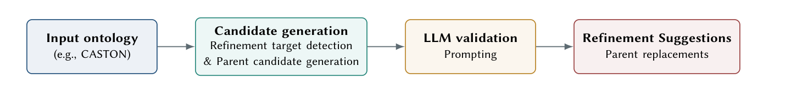

# CASTON：用 embedding 缩候选，让 LLM 只做局部判断

> 这篇消化不假设你读过论文。先讲清「本体层级精化」是什么，再看两阶段流程、CASTON 上的专家评估与边界。

## 0. 三句话

1. **它问什么**：本体里的 asserted 父类关系（`A ⊑ B`）可能有隐蔽错误；让 LLM 看整个本体既不准也贵。能不能先缩小搜索空间，再让 LLM/专家做局部判断？
2. **它怎么做**：微调的本体 embedding 给每条 `A ⊑ B` 的所有候选父类排序；取 30 条可疑公理、每条 10 个替代父类；LLM 只在这些候选里给 verdict/confidence/替换建议；专家复核。
3. **它发现什么**：CASTON 上 default（CASTON-fine-tuned OnT + Qwen3-8B）的 6 条高置信替换被两位专家全部接受（100%）；pretrained ensemble 只有 57.1%；GPT-4o mini 31.3%。**default 的 2 条 medium 全 mixed（0 接受）；pretrained 1/4、GPT-4o mini 1/5 被接受**。

## 1. 它解决什么问题

### 1.1 背景

本体里的类层级可能错：`chromite_sand` 被挂在 `green_sand_molding`（工艺）下，但它其实是材料。这类错误会影响推理和下游应用。

让 LLM 看整个本体：
- 不 targeted，贵；
- 容易漏掉局部语义；
- 难以追溯「为什么改」。

### 1.2 论文的立场

**先用 embedding 缩小搜索空间，再让 LLM 做局部判断。** 分两阶段：召回/排序 vs 语义裁决。

## 2. 术语

| 术语 | 用大白话说 |
|---|---|
| **subsumption** | 父类关系：`A ⊑ B`（A 是 B 的子类）。 |
| **asserted axiom** | 本体里显式写出的公理（不是推理出来的）。 |
| **ontology embedding** | 把类/关系编码成向量；用于排序候选父类。 |
| **fine-tuned embedding** | 在目标本体上微调过的 embedding。 |
| **candidate parent** | 替代当前父类的候选。 |
| **confidence** | LLM 自报的高/中/低置信。 |
| **acceptance** | 两位专家都给正分。 |
| **mixed** | 专家不一致或不确定。 |

## 3. 它怎么做

### 3.1 两阶段（Fig. 1）

> 原图：arXiv:2610.21466, p.2, Fig. 1。版权归作者，研究评论用途。

**看什么**：embedding 先缩候选，LLM 只在局部验证。**不是「LLM 读整个本体」**；搜索空间被 embedding 压到 30×10。

1. **Candidate generation**：
   - 对每条 `A ⊑ B`，用 embedding 给所有候选父类排序；若 asserted parent B 排名很低，标记为可疑。
   - 取 top `k_r=30` 条可疑公理；对每个 A，取 top `k_a=10` 个替代父类（排除 A 与已断言父类）。
   - Default：OnT 在 CASTON 上 fine-tune（hyperbolic，适配 EL 本体）。
2. **LLM validation**：
   - Prompt 给 child A、当前父类、候选父类、每个类的 ID/label/definition/comment/scope note，以及其他 axiom。
   - LLM 返回 JSON：每个父类的 verdict（correct/incorrect/partial）、confidence、reason、suggested_replacements。
   - 只保留 high/medium 作为候选修复。

### 3.2 一个具体例子

`chromite_sand` 原父类 `green_sand_molding`（工艺）。

- embedding 排序：`foundry_sand`（材料）排名高。
- LLM 局部判断：建议 remove `green_sand_molding`，add `foundry_sand`。
- 专家 +2/+2；语义更准确（材料 taxonomy）。
- 类似：olivine_sand、silica_sand、zircon_sand。

## 4. 结果：数字与条件

| 设置 | confidence | 建议数 | 接受 | 接受率 |
|---|---|---|---|---|
| Default（Qwen3-8B + CASTON OnT-FT） | high | 6 | 6（全 +2） | **100%** |
| Default | medium | 2 | 0 | 0%（全 mixed） |
| Pretrained ensemble + Qwen3-8B | high | 7 | 4 | **57.1%** |
| Pretrained ensemble + Qwen3-8B | medium | 4 | 1 | 25% |
| GPT-4o mini + pretrained ensemble | high | 16 | 5 | **31.3%** |
| GPT-4o mini + pretrained ensemble | medium | 5 | 1 | 20% |

- CASTON v1.0.0：270 classes / 306 axioms / 292 atomic subsumption。
- 相对 default，GPT-4o mini high-confidence 接受率低 **68.7 pp**。

### 4.1 这些数字之间的逻辑

- **为什么先缩小搜索空间？** 全本体给 LLM 既贵又不 targeted；30×10 候选让判断局部、可追溯。
- **为什么 fine-tune embedding 是主要增益？** pretrained ensemble 能召回一些候选，但 precision 不够；目标域语义要靠微调。
- **为什么 confidence 校准是模型特定的？** Qwen high 100%、GPT-4o mini high 31.3%；同一 confidence 标签在不同模型上含义不同。
- **为什么 default 的 medium 全 mixed，而 pretrained/GPT 有部分被接受？** 本体层级本身可能有争议；不是模型不够强，而是「正确答案」不确定。default 的 2 条恰好都争议；不能说所有 medium 都 mixed。
- **为什么没有下游？** 修复是否让应用变好，本文没测；这是外推边界。

## 5. 这些数字不能说明什么

1. **不是大规模。** 单一本体、单一公理类型（subsumption）、6 条高置信修复。
2. **不是「LLM 能修本体」。** 是「embedding 缩候选 + LLM 局部判断 + 专家复核」在 small set 上可靠。
3. **medium 不能一律当 mixed。** default 的 2 条全 mixed；pretrained 1/4、GPT-4o mini 1/5 被接受。confidence 只能粗分；medium 必须人审。
4. **不是通用 confidence。** Qwen high 100%，GPT-4o mini high 31.3%；换模型要重测校准。
5. **不是下游收益。** 修复是否让应用变好，没测。
6. **失败案例：本体层级本身不一致。** `semisolid_metal_processing` 的层级有争议；方法不能替代专家。

## 6. 工程上怎么用

### 6.1 复刻顺序

1. **先用 embedding 缩小搜索空间。** 对每条 `A ⊑ B` 排序；只拿 asserted parent 排名很低的 30 条。
2. **每条只给 10 个替代父类。** 不要整个本体塞给 LLM。
3. **fine-tune embedding 到目标本体。** Default 100% vs pretrained 57.1%；不是可选。
4. **LLM 只做局部 yes/no/替换判断。** 给 child、当前父类、候选父类 + label/definition/domain/other axioms；JSON 输出。
5. **用 confidence 做 triage。** High 可信；default 的 medium 全 mixed，pretrained 1/4、GPT-4o mini 1/5 被接受；medium 一律人审。
6. **不要信任模型 confidence 校准。** 换模型要重测；GPT-4o mini high 只有 31.3%。
7. **案例看语义类型。** `chromite_sand` 从工艺改材料；embedding 抓的是语义关系。
8. **本体不一致时，方法会失败。** 先修层级，再谈自动精化。

### 6.2 成本与使能

| 成本 | 一次性/每次 | 说明 |
|---|---|---|
| Embedding fine-tune | 每本体一次性 | OnT + CASTON；GPU |
| Candidate generation | 每本体 | 292 条排序；轻量 |
| LLM validation | 每可疑公理 | 30 条 × 10 候选；Qwen3-8B |
| 专家评审 | high/medium | 2 专家；5 分制 |
| 维护 | 本体版本 | 重新排序/验证 |

**使能条件**：本体 + embedding 模型；LLM；领域专家；可微调。

### 6.3 何时用 / 何时别用

**用**：中等规模本体；有 embedding/LLM；有专家可审 high/medium；目标是父类替换。

**别用**：本体很小；层级本身不一致；需要关系限制/复杂公理；没有专家；大规模跨本体。

### 6.4 最小落地清单

1. **先用 embedding 缩候选。** 每条 `A ⊑ B` 排序；只拿 asserted parent 排名很低的 30 条。
2. **每条只给 10 个替代父类。** 不要把整个本体塞给 LLM。
3. **fine-tune embedding 到目标本体。** Default 100% vs pretrained 57.1%；不是可选。
4. **LLM 局部 yes/no/替换判断。** 给 child/当前父类/候选父类 + label/definition/domain/other axioms；JSON 输出。
5. **用 confidence 做 triage。** High 可信；default 的 medium 全 mixed，pretrained 1/4、GPT-4o mini 1/5 被接受；medium 一律人审。
6. **换模型要重测校准。** GPT-4o mini high 只有 31.3%。
7. **本体不一致时先修层级。** 失败案例显示，专家都不一致时方法会错。

## 7. 质量与边界

- **证据类型**：实证·专家评估（小样本）。
- **强项**：两阶段分工清晰；fine-tune vs ensemble 对照；模型对照；案例具体；代码开源。
- **主要威胁**：单一本体；6 条高置信；preliminary；medium 只有 default 全 mixed；无下游；无跨本体。
- **`quality: B`**：机制与对照干净，专家评估可信；但样本小、单一本体、初步结果。

## 8. 与仓库判断的关系

- **05-L2（已核）**：精化可自动化到小规模；high-confidence 6/6；pretrained 57.1%；GPT-4o mini 31.3%。
- **05-L5（推测）**：精化瓶颈是定位与验证（循环引证，未闭环）；embedding 缩候选 + LLM 局部判断（已核）。
- **P3**：high/medium 分层；precision/recall 权衡。
- **05-L7**：修复是否让下游变好，未测。

## 9. 还没解决 / 下一步

- **更大本体/更多公理类型** 是否同样？
- **medium-confidence** 能否通过更强验证/人审降级？
- **跨本体 fine-tune** 的迁移成本？
- **下游任务** 是否因修复变好？
- **多层/关系限制公理** 能否用同一 pipeline？
- **专家评审能否变成可学习 reward？**

## 10. 原文

- arXiv:2610.21466
- PDF：`src/papers/2610.21466-caston-refinement/`
- 代码：https://github.com/HuiYang1997/OntRefine
