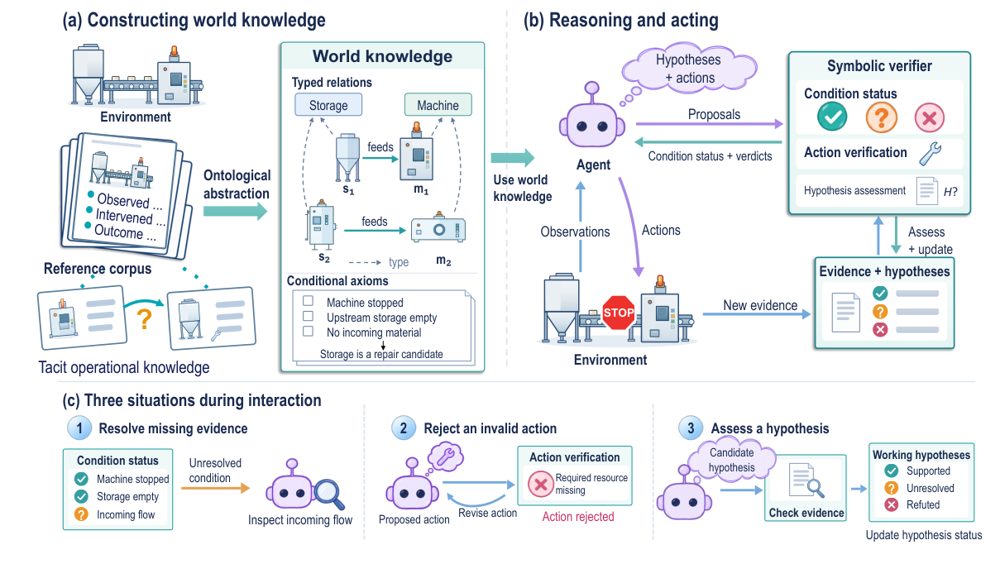
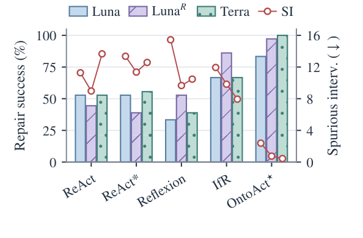

# OntoAct · 分解

> 只记**论文说了什么**。工程判断、质量评估、洞察见同目录 [digest.md](./digest.md)。

## 一句话

**「LLM 提议，本体验证」**：把继承来的运行记录抽象成类型化的世界知识（实体类型、关系、条件公理），LLM 用它提出假设与动作，符号验证器按当前证据检查条件；在 Tacit-FLE、Mars、ALFWorld 上取得最高任务表现，并大幅减少无效干预。

## 问题与设定

- **问题**：agent 要在「操作原理只部分写明」的环境里行动；继承的日志/笔记记录了「发生了什么」，但没写「为什么有用、什么时候适用」（tacit operational knowledge）。
- **两个 gap**：① 从个案恢复可迁移的模式（类型/关系角色）；② 判断这些关系/条件在当前情境是否成立。
- **Tacit-FLE**：基于 Factorio Learning Environment 的工业维护基准；现有工厂 + 隐藏故障 + 固定维护记录/运行文档；3 种任务类型（chain / conjunction / elimination）、3 个规模（small/medium/large）。
- **其他环境**：Mars（8 个改机制世界，用 7 个 modified world 平均）、ALFWorld（134 unseen tasks）。
- **能证明**：类型化抽象 + 符号验证 + 假设 revision，在三个环境上同时提高成功率、减少无效干预、减少 LLM 调用/token。
- **不能证明**：真实工厂部署；schema 学习；安全性保证（作者明确说 verifier 是 auditability，不是 safety guarantee）。

## 机制

### 世界知识（§3.1, p.3–4）

`K_W = (T, A_W, R_W)`：T 是 ontology schema（实体类型、关系、可观察属性、允许的公理形式）；A_W 是 ground assertions；R_W 是 conditional axioms（动作要求、诊断模式）。当前证据 A_t 加入后：`K_t = (T, A_W ∪ A_t, R_W)`。

### 构造：LLM 提议，本体准入（§3.2, p.4）

1. LLM 从记录批次提出候选公理 `(x_i, π_i)`（π 是来源记录）。
2. **Admissible**：schema 类型检查 + 来源非空 + 该公理类型的测试（`C_xi`）全过，才进入 A_W/R_W。
3. 最后做 corpus check。

### 推理与行动（§3.3, p.5）

- LLM 每轮提出 claims / hypotheses / action。
- claims 经 `f_admit` 检查类型、结构证据、引用模式；进入 A。
- 每个 hypothesis 有必需关系与非空条件集 Φ(h)；每个条件 `(u, p, op, z)` 在当前知识下求值：**⊤ / ⊥ / ?（缺证据）**。
- 状态：任一条件 ⊥ → refuted；全部 ⊤ → confirmed；否则 open。
- **动作验证**：违反 R_W 的条件/禁止 → block；**缺读数本身不 block**（只报 unresolved）。需要解释支持的动作要求 confirmed hypothesis；观察动作不需要。
- 被 block 时，LLM 可改 claims/hypotheses/action；新观察/干预结果更新 context 与 hypothesis。

### 关键设计

- **三值条件逻辑**（true/false/unknown）是核心；unknown 触发“去观察/干预”，不是直接拒绝。
- **hypothesis 是一等对象**：可 confirmed/refuted/open，可被后续证据推翻。
- **类型化抽象**让个案可跨实体复用；同时保留个案事实与来源。

## 关键数字

| 数字 | 条件 | 出处 |
|---|---|---|
| **78.6% / 83.3% / 90.0%** | Tacit-FLE 总成功率：small / medium / large | Table 1, p.6 |
| **64.3% / 66.7% / 65.0%** | 最强 baseline IfR 的总成功率 | Table 1, p.6 |
| **1.9 / 2.4 / 1.6** | OntoAct 平均 spurious interventions（small/medium/large） | Table 1, p.6 |
| **6.4 / 11.9 / 17.8** | IfR 的平均 spurious interventions | Table 1, p.6 |
| **11.8 / 19.4 / 17.2** | OntoAct 平均 turns | Table 1, p.6 |
| **17.4 / 31.7 / 42.6** | IfR 平均 turns | Table 1, p.6 |
| **3.36 vs 5.14 vs 9.00** | 每 episode 的 distinct candidates：OntoAct / WALL-E / IfR（medium） | Table 2, p.7 |
| **32/36 vs 17/36 vs 24/36** | 真故障在候选集：OntoAct / WALL-E / IfR | Table 2, p.7 |
| **25/36 vs 10/36 vs 4/36** | 真故障在前 3 候选 | Table 2, p.7 |
| **71.4–90.0%** | target-aligned hypotheses 保留率 | Fig. 3, p.7 |
| **95.6–99.6%** | off-target hypotheses 被 refute 率 | Fig. 3, p.7 |
| **15.92 vs 10.64** | Mars 平均 Score（7 modified worlds）：OntoAct vs ReAct* | Table 3, p.8 |
| **0.84k vs 1.54k** | Mars 每环境步 evaluation tokens | Fig. 5, p.7 |
| **98.5% vs 96.3%** | ALFWorld success：OntoAct vs WALL-E | Table 6, p.9 |
| **13.7 vs 28.8** | ALFWorld LLM calls/episode | Table 6, p.9 |
| **32.16k vs 47.70k** | ALFWorld evaluation tokens/episode | Table 6, p.9 |
| **70/70；0/136** | 共享资源条件：OntoAct 执行前重定向 70/70 违规候选；发出命令 0/136 违规 | Table 5, p.8 |
| **20/107；20/107** | IfR：只重定向 0/20；发出命令 20/107 违规 | Table 5, p.8 |

## 图表索引

### 图 1：LLM 提议，本体验证

> 原图：arXiv:2610.21983, p.1, Figure 1。版权归作者，研究评论用途。

**看什么**：(a) 从记录抽象出 typed relations + conditional axioms；(b) LLM 提议，符号验证器返回 condition status / verdicts；(c) 三种交互：缺证据→去观察、动作无效→改动作、假设待判→查证据。**核心不是「本体当知识」，而是「本体当检查器」。**

### 图 4：成功率与无效干预

> 原图：arXiv:2610.21983, p.7, Figure 4。版权归作者，研究评论用途。

**看什么**：柱是 repair success，红线是 spurious interventions。OntoAct* 的成功率最高、SI 最低；ReAct/ReFlexion 的成功率可能被重复失败掩盖。**「最终成功」不是够的指标，要看无效干预。**

## 作者自述局限

- 评估使用**预定义 ontology schema 与固定的世界机制**；schema 学习/演化是 future work。
- Tacit-FLE 是合成环境；维护记录是生成的；不是真实工厂。
- Verifier 是 **auditability 的一步，不是 safety guarantee**；作者明确不声称可部署。
- Mars/ALFWorld 的收益依赖环境与 corpus；ALFWorld 只测 134 个未见任务。
- 知识构造成本与 evaluation tokens 分开报；构造开销不低。
- 三个环境都是模拟；真实工业的传感器噪声/缺失未覆盖。

## 引用锚点

- 「The guiding principle is simple: the LLM proposes, the ontology verifies.」（§1, p.2）
- 「A symbolic verifier checks their support against current observations.」（Abstract, p.1）
- 「Missing readings alone do not block actions.」（§3.3, p.5）
- 「A blocked verdict ... requests revision while budget remains.」（§3.3, p.5）
- 「Intervention and turn rankings require at least one repair.」（Table 1 注, p.6）
- 「The verifier of OntoAct is a step toward auditability, not a safety guarantee.」（Ethics, p.10）

## 待核

- [ ] schema 学习：能否从记录自动扩展 T，而不只是实例化？
- [ ] 真实工厂的传感器噪声/缺失数据下，三值条件是否仍可用？
- [ ] 知识构造成本（LLM calls/tokens）与 evaluation 成本的比例。
- [ ] 在 elimination 任务上 IfR 匹配/超过 OntoAct；为什么？
- [ ] 条件公理的覆盖率：多少动作没有适用 axiom？
