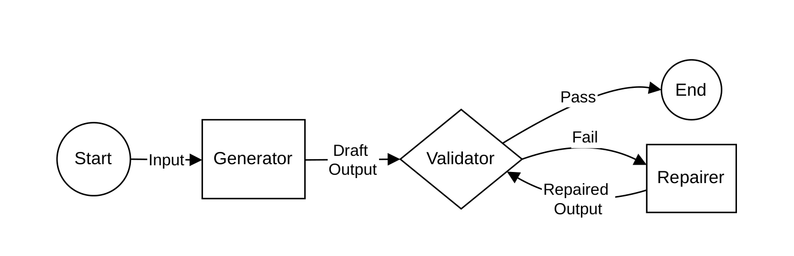

# Before Blaming the LLM, Diagnose the Workflow · 分解

> 只记**论文说了什么**。工程判断、质量评估、洞察见同目录 [digest.md](./digest.md)。

## 一句话

把 NL→本体接地 DSL 的失败从「模型弱」重新归因到**工作流**：五个角色（Input / Generator / Output / Validator / Repairer）+ 七个诊断变量，每项给问题、证据、重设计杆；用一个钻井 ABox 例子展示「语法对、语义不足」的失败。

## 问题与设定

- **问题**：ontology-grounded ABox DSL 生成中，**语法有效比语义充分容易**；失败常被归因于 generator 模型，但结构性的输入不足、上下文缺失、模板/词汇缺口、校验弱、非局部修复也会造成同样表现。
- **任务**：自然语言描述 → 本体词汇下的 ABox 断言（不是 TBox 构建）。
- **例子系统**：钻井信号 ABox DSL（DWIS/DDHub 风格）；原型本体快照约 **2,250 个类声明、200 个对象属性声明**。
- **性质**：**position paper / 经验框架**；没有量化评测，没有跨系统实验；七变量非穷尽、非正交。
- **能证明**：框架能把一个笼统的「语义不太对」拆成角色级、可改设计的具体问题。
- **不能证明**：框架能预测准确率、比较模型、或证明重设计一定有效。

## 机制

### 五角色（Fig. 1, p.4）

| 角色 | 提供/做什么 | 典型失败 |
|---|---|---|
| Input | 自然语言意图 + 上下文 | 歧义、不完整、隐含假设、不支持 |
| Generator | grounding 到目标符号，生成候选 DSL | 选错 schema/工具/关系/本体符号 |
| Output | DSL 表达式空间与产物 | 形式不规则、覆盖缺口、near-match、建模选择不当 |
| Validator | 判断输出是否可接受 | 语法过、语义错；反馈弱/局部/只能专家看 |
| Repairer | 修订/澄清/重生成/升级 | 非局部修复、重复重生成、需要扩本体 |

### 七变量（Table 1, p.6）

| 变量 | 角色 | 高摩擦证据 | 重设计杆 |
|---|---|---|---|
| Input sufficiency | Input | 缺字段、隐含假设、歧义 | intent gate + clarification |
| Context availability | Generator | 缺术语说明/示例/建模约定 | 知识库精化 |
| Grounding complexity | Generator | 太多候选名词/动词/路径/模板 | 候选排序策略 |
| Template fit | Output | 断言模式不规则/重叠 | 模板/motif 库 |
| Vocabulary coverage | Output | 缺构造、被迫 near-match | 本体扩展机制 |
| Validation strength | Validator | 语义充分性不可确定性检查 | 分层校验 + 人审 |
| Error observability | Repairer | 失败无法定位/解释 | repair trace |

### 诊断例子（§4.2, p.10–13）

输入：`Give the semantics for retrieving the Bottom Hole Depth drilling signal.`

- **实际输出**：`DynamicDrillingSignal` + `HoleBottomLocation` + `DepthDrillingQuantity` + 两条断言。
- **参考配置**：多一个 `PhysicalData`、一个 `OneDimensionalCurviLinearReferenceFrame`，用 `HasDynamicValue` 连接，把 quantity/reference frame/location 挂在 physical data 上。
- **诊断**：输入不足（没说要不要 reference frame/physical data）；context 不足；grounding 复杂；template fit 弱；词汇覆盖不是瓶颈；validation 不能判语义；error observability 差。
- **重设计**：intent gate、知识库/示例、候选排序、motif 库、本体扩展、分层校验 + 人审、repair trace。

## 关键数字

| 数字 | 条件 | 出处 |
|---|---|---|
| **≈2,250 类 / ≈200 对象属性** | DDHub 派生本体快照（原型） | §4.2, p.10 |
| **无量化评测** | 全文是框架 + 单案例 | Abstract / §5 |

> 这篇没有准确率/延迟/成本数字；它的价值在**诊断词汇**与**重设计映射**，不在效应量。

## 图表索引

### 图 1：五角色工作流

> 原图：arXiv:2610.35267, p.4, Fig. 1。版权归作者，研究评论用途。

**看什么**：Generator 只是五个角色之一；Validator 失败会进 Repairer，再回到 Validator。**把失败归给 Generator，等于只看了一个节点。**

## 作者自述局限

- 定性诊断，不预测性能、不比较模型、不证明一条 pipeline 优于另一条。
- 七变量非穷尽、非正交；低 context 会放大 grounding complexity，弱 template fit 会与 vocabulary coverage 交互。
- 没有经过严格的量化验证；需要更多 case study 看不同实践者是否给出相似 profile。
- 角色级判断可能有评估者差异。
- 假设本体至少部分可用；完全从零构建本体不在范围内。

## 引用锚点

- 「syntactic validity is often easier to achieve than semantic adequacy.」（Abstract, p.1）
- 「Failures are frequently attributed to weak generator models, but recurring sources of difficulty are also structural.」（Abstract, p.1）
- 「difficulty should be diagnosed at the workflow level rather than attributed primarily to the generator model.」（§1, p.3）
- 「an output can be syntactically valid and ontology-grounded while still using the wrong template, omitting required assertions, or choosing an inappropriate ontology construct.」（§2.3, p.5）

## 待核

- [ ] 七变量能否变成可打分的 rubric？还是只能定性？
- [ ] 不同实践者对同一 case 的 profile 一致性（inter-rater）？
- [ ] 这套诊断能否预测重设计后的效果？
- [ ] 在别的 NL→DSL 任务（SQL/API/workflow）上是否同样适用？
