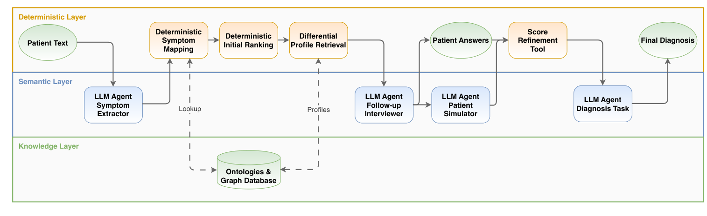
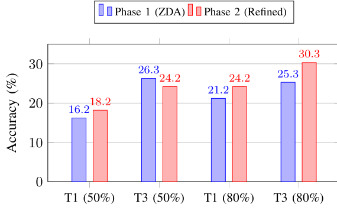

# MedMAS-DDx · 分解

> 只记**论文说了什么**。工程判断、质量评估、洞察见同目录 [digest.md](./digest.md)。

## 一句话

把鉴别诊断做成**确定性评分 + 多 agent 分工**：LLM 只做症状抽取/提问/解释，所有排序与评分由代码在 curated 医学本体（SYMP/DOID/HPO）上算；用 Yes/No 追问补缺失症状；交互 refinement 在聚合上只提升 2.5 pp，但在可解决的歧义 case 上可以把 Top-1 从 0.340 拉到 1.0。

## 问题与设定

- **问题**：单轮 QA 假设诊断所需信息已齐；真实鉴别诊断是迭代追问。LLM 直接推理不可审计、易幻觉。
- **基准**：Q4DX `PatientCases.csv`，99 cases / 29 diagnoses；80% 与 50% symptom completeness；100% 排除（没有可追问的症状）；N=198。
- **患者**：确定性 simulated patient agent，可访问完整 profile；这是**乐观估计**，不是真人。
- **评分**：SapBERT cosine ≥0.6 对 reference label；Top-1/Top-3。
- **本体**：SYMP + DOID + HPO（HPO 作 synonym bridge）；GraphDB/SPARQL；不靠 LLM 生成症状-疾病关系。
- **能证明**：确定性评分 + 本体 grounding + 追问可以小幅提升聚合准确率；在歧义 case 上可以大幅重排；错误主要来自 KG 覆盖/粒度，不是语言理解。
- **不能证明**：真人对话；开放域；跨本体；大规模临床部署。

## 机制

### 四角色（Fig. 1, p.3）

| 角色 | 做什么 | 是否参与实时诊断 |
|---|---|---|
| Symptom extractor | 自由文本 → 结构化症状（canonical + alternatives + context） | 是 |
| Follow-up interviewer | 从候选疾病 profile 里选有区分度的 Yes/No 问题 | 是 |
| Diagnosis refiner | 用回答更新评分，生成带证据的解释 | 是 |
| Patient simulator | 自动回答，驱动评估 | **否**（仅评估） |

### 确定性评分（§III-A/D, p.3–5）

1. **Specificity weight**：`1 / log2(1 + N_d(s))`；越少疾病共享的症状越有信息量。
2. **Raw score**：匹配症状的 specificity 求和。
3. **Coverage**：`match_count / total_mapped`。
4. **Composite**：`raw × (0.5 + 0.5×coverage)`；coverage 是软调整，不 domin。
5. **Discriminative weight**：`1 − diseases_with_symptom(s) / n_profiled`；用于追问后的 support/conflict。
6. **Final score**：`composite × (1 + α·support_norm − β·conflict_norm)`；α=0.6、β=0.2。
7. **Threshold**：保留领头分数的一小部分或至少匹配 2 个症状的候选；宁可多留，后面可追问。

### 追问（§III-B, p.4）

- 最多 11 个问题（引 MedDialogRubrics：准确率约 10–11 轮达峰，之后下降）。
- 只问 patient-observable、非既有、能区分候选的症状；回答限定 yes/no/unsure。
- 回答进确定性评分；不是让 LLM 自由对话。

## 关键数字

| 数字 | 条件 | 出处 |
|---|---|---|
| **91.3%** | 症状映射成功率：77.3% SYMP + 14.0% HPO fallback；8.7% unmapped | §IV-B, p.5 |
| **18.7% → 21.2%** | Top-1 accuracy：Phase 1 → Phase 2（37→42/198） | Table I, p.5 |
| **25.8% → 27.3%** | Top-3 accuracy：Phase 1 → Phase 2（51→54/198） | Table I, p.5 |
| **0.449 → 0.466** | mean similarity top-1 | Table I, p.5 |
| **0.523 → 0.537** | mean similarity top-3 | Table I, p.5 |
| **0.4589 → 0.4792** | 80% completeness：Phase 1 → 2 | Table II, p.6 |
| **0.4394 → 0.4527** | 50% completeness：Phase 1 → 2 | Table II, p.6 |
| **25.3% → 30.3%** | Top-3 at 80%：Phase 1 → 2 | Fig. 3, p.6 |
| **26.3% → 24.2%** | Top-3 at 50%：**下降** | Fig. 3, p.6 |
| **0.340 → 1.0** | Case #96（Hepatitis A）Top-1 similarity，单个 jaundice 确认 | §IV-C, p.6 |
| **2.4 vs ~10** | 问题预算：MedQDx vs MedMAS-DDx | §IV-D, p.6 |
| **44% / 37%** | MedQDx Top-1 at 80% / 50% | §IV-D, p.6 |

## 图表索引

### 图 1：三层架构

> 原图：arXiv:2610.36325, p.3, Fig. 1。版权归作者，研究评论用途。

**看什么**：Deterministic Layer 负责映射/排序/评分；Semantic Layer 只有 LLM agent 做抽取/提问/解释；Knowledge Layer 是本体+图数据库。**LLM 不做排序计算**，这是可审计性的来源。

### 图 3：追问前后

> 原图：arXiv:2610.36325, p.6, Fig. 3。版权归作者，研究评论用途。

**看什么**：Top-1 在 50%/80% 都提升；Top-3 在 80% 提升，但在 50% **下降**。追问不是均匀变好：它会把弱候选换掉，可能伤 Top-3。

## 作者自述局限

- 本体覆盖/准确性决定上限；missing/outdated 关系无法进推理。
- 本体术语 vs 数据集术语不匹配；91.3% 映射，仍有 8.7% 丢失。
- 有些 benchmark label 是症状不是疾病（Jaundice、Vertigo），系统按 ontology 无法输出为诊断，准确率恒为 0。
- KG 稀疏/诊断粒度不足（需要 lab results）。
- Yes/No/unsure 限制表达；不能捕捉 severity/temporal。
- 错误主要来自结构约束，不是语言理解；换更强 LLM 不会解决。
- 模拟患者是乐观估计；问题预算 ~10 vs MedQDx 2.4。

## 引用锚点

- 「language models handle only natural language understanding and generation, while all ranking-related computations are done by deterministic code.」（§III, p.2）
- 「diseases enter the candidate set only if explicitly linked to at least one patient symptom.」（§III-A, p.3）
- 「the contribution of interactive refinement is real but modest, and at 50% completeness it is not even uniformly positive.」（§V, p.7）
- 「constraining inference to a curated knowledge graph structurally prevents hallucinating statistically plausible but unsupported diagnoses. This trade-off caps benchmark performance.」（§V, p.8）

## 待核

- [ ] 91.3% vs 正文后文「88.4% mapping」的口径差异。
- [ ] 80%/50% 的 Top-1/Top-3 具体数（Fig. 3 与 Table I 的口径）。
- [ ] 追问的 11 问上限是否最优；问题选择策略的消融。
- [ ] 真人患者（非模拟）下 refinement 的增益。
- [ ] 本体扩展（Jaundice/Vertigo）后准确率变化。
