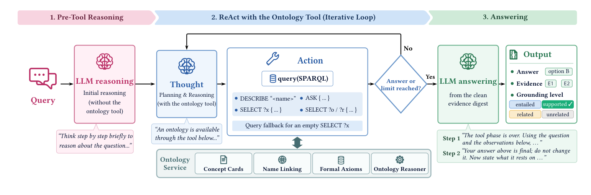
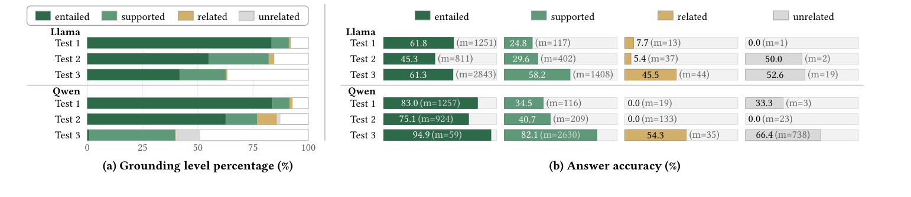

# OA-RAG · 分解

> 只记**论文说了什么**。工程判断、质量评估、洞察见同目录 [digest.md](./digest.md)。

## 一句话

把本体的**形式推理**（OWL/DL reasoner）与**非形式注释**（label/definition）接进同一个 ReAct agent：每个答案必须报告所用本体观察 + 一个 grounding level（entailed / supported / related / unrelated）；在三个大本体基准与六个医学 QA 任务上整体最优，且 grounding level 与正确率正相关。

## 问题与设定

- **问题**：RAG 常把检索到的文本当等价证据，忽略逻辑关系；LLM 的推理不受本体约束。能否让 agent 同时用本体的形式公理与文本注释，并报告「答案对本体的忠实度」？
- **三种推理模式**（Fig. 1）：formal reasoning（可由 reasoner 推出）、ontology-grounded LLM reasoning（形式+注释，需要 LLM 推理）、ontology-assisted LLM reasoning（答案不必忠实于本体，LLM 可自由推理）。
- **本体**：GO、FoodOn、SNOMED CT（三个大规模真实本体）。
- **数据**：每本体 300 MCQ + 200 OQ = 1,500 Test 1（formal）；1,477 Test 2（grounded）；Test 3 用 OntoTune 设置，6,781 题（MedQA、USMLE Step 1/2/3、MedMCQA、PubMedQA）。
- **backbone**：Llama-3-8B-Instruct、Qwen3.5-9B。
- **基线**：OntoTune sft/dpo/sft+dpo、TaxoLLaMA*；CoT、RAGdoc/RAGont、ReActont、MedRAGdoc、i-MedRAGdoc。
- **能证明**：在三类模式上，本体形式推理 + 注释 + agent 循环整体有效；grounding level 是可用信号；本体作为检索源可竞争医学教科书。
- **不能证明**：grounding level 是形式保证（模型自评）；跨本体/跨域普遍性；真实临床部署。

## 机制

### 三阶段（Fig. 2, p.3）

1. **Pre-tool reasoning**：先让 LLM 用参数知识分析问题，形成初步答案/推理状态 `h0`。
2. **ReAct loop**：给 agent 一个 ontology tool；动作是 SPARQL：
   - `DESCRIBE "A"`：返回 concept card（名字、定义、父/子、stated relations、注释）。
   - `ASK {"A" "r" "B"}`：问 reasoner 是否 `O |= A ⊑ ∃r.B`；返回 Entailed / Not Entailed。**Not Entailed ≠ false**（开放世界）。
   - `SELECT ?x {...}`：检索满足条件的类/关系；空结果触发 **query fallback**（BM25 取 top-k concept cards）。
3. **Answering**：
   - 过滤失败/空观察，得到 evidence digest `E`；有 `E` 用 `P_fin`，无 `E` 用 `P_own`（纯参数知识）。
   - 再一轮 `P_att`：模型报告引用的观察 `C` 与 grounding level `g`。

### Ontology service（§4.2, p.4）

- **Concept cards**：把每个 concept 转成固定字段的文本卡（name / definition / parents / children / stated relations / comments / annotations）。这是把 OWL 投影成 agent 可检索文本的关键工件。
- **Name linking**：精确匹配 → 多义返回候选 → 未知名字用 BM25 + 字符串相似度给 5 个候选；agent 可修 query。
- **Query fallback**：精确 `SELECT` 空结果时，用 BM25 取 concept cards，避免 open-world 下「查不到 = 不存在」。

### 四个 grounding level（§4.1.3, p.4）

| level | 含义 | 期望对应的推理模式 |
|---|---|---|
| entailed | 答案可由观察中的事实逻辑推出 | formal reasoning |
| supported | 可由观察 + 参数知识合理推断，但不是严格逻辑后承 | ontology-grounded |
| related | 观察相关但不足以确定答案 | ontology-assisted |
| unrelated | 观察与问题/答案无关 | 失败/无关 |

**注意**：作者明确说 grounding level 不提供形式正确性保证；它是模型对证据支持强度的评估。

## 关键数字

| 数字 | 条件 | 出处 |
|---|---|---|
| **50.5% / 68.1%** | OA-RAG 平均准确率（Llama / Qwen），三类 Test 平均 | §6.2, p.7 |
| **+10–15 pp** | Tests 1–2 相对最强基线：44.3 vs 28.9（Llama）；59.7 vs 49.7（Qwen） | §1, p.2 |
| **84.9% vs 66.7%** | Test 3，Qwen，同一 8k context：OA-RAG vs i-MedRAGdoc(262k 截到 8k) | §6.2, p.7 |
| **9.7k vs 96.7k tokens/问** | Test 3，Qwen：OA-RAG vs i-MedRAGdoc(262k) | §6.2, p.7 |
| **5.8 vs 22 calls/问** | 同上 | §6.2, p.7 |
| **70.0% / 53.2%** | entailed+supported 占比（Llama / Qwen） | §6.2, p.7 |
| **0.2% / 7.8%** | unrelated 占比（Llama / Qwen） | §6.2, p.7 |
| **94.9% / 82.1%** | Qwen Test 3：entailed / supported 答案的正确率 | Fig. 3b, p.7 |
| **61.7% vs 23.6%** | gold evidence 完全检索到：MCQ vs OQ（Tests 1–2 汇总） | §6.3.1, p.7 |
| **95.1–98.4%** | 检索到后，MCQ 证据被引用的比例 | §6.3.1, p.7 |
| **36.7 → 50.5；52.6 → 68.1** | pre-tool only → full OA-RAG（Llama / Qwen 平均） | Table 2, p.8 |
| **−5.8 / −2.9** | 去掉 answering step 的平均下降（Llama / Qwen） | Table 2, p.8 |
| **−1.8 / −0.4** | 去掉 query fallback 的平均下降（Llama / Qwen） | Table 2, p.8 |

## 图表索引

### 图 2：三阶段框架

> 原图：arXiv:2610.36335, p.3, Figure 2。版权归作者，研究评论用途。

**看什么**：本体不是「检索源」这么简单——它同时提供 concept cards（文本）、formal axioms（reasoner）、name linking、query fallback。**三阶段把「先想、再查、最后只依据证据回答」分开。**

### 图 3：grounding level 与正确率

> 原图：arXiv:2610.36335, p.7, Figure 3。版权归作者，研究评论用途。

**看什么**：左图是 level 分布，右图是每个 level 内的正确率。entailed/supported 的正确率明显更高；但 **level 是模型自评，不是形式保证**，且 unrelated 的样本不适合直接比较。

## 作者自述局限（正文未单列，读者整理）

- grounding level 是模型自评，不是形式保证；没有独立的校准/审计。
- Test 3 的强项依赖同 context 预算；i-MedRAG 在 262k 下仍有竞争力。
- Test 2 的 OQ 表现差；检索是主要瓶颈（gold evidence 完全检索 23.6%）。
- 本体覆盖有限；问题超出本体范围时，grounding level 会退化。
- 三个本体都是生物医学；跨域未测。

## 引用锚点

- 「For each answer, OA-RAG reports the ontology observations used as evidence and a grounding level ... that characterises the evidence's faithfulness.」（Abstract, p.1）
- 「Although it does not provide a formal guarantee of answer correctness, the reported grounding level reflects the model's assessment ...」（§4.1.3, p.4）
- 「the results suggest that retrieval, rather than reasoning over retrieved evidence, is the primary bottleneck.」（§6.3.1, p.7）
- 「when restricted to the same 8,192-token context window ... its average Test 3 accuracy drops markedly to 66.7%, compared with 84.9% for OA-RAG.」（§6.2, p.7）

## 待核

- [ ] grounding level 的校准：entailed 的 94.9% 是 Test 3 Qwen 的一个切片；整体校准曲线？
- [ ] Test 2 OQ 的 23.2% 是检索瓶颈还是推理瓶颈？作者说 retrieval primary，但未做干预。
- [ ] concept card 的字段顺序/长度对检索的影响；是否可自动生成。
- [ ] 多本体协调（作者 future work）会不会破坏 grounding 的可判定性。
