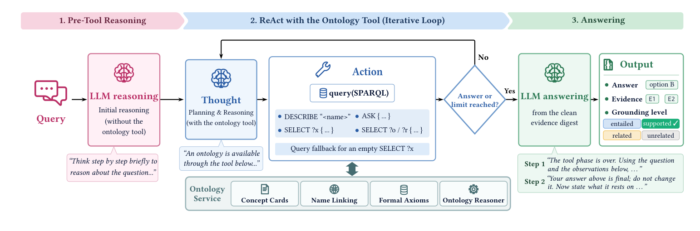

# OA-RAG：让答案带本体证据和接地等级

> 这篇消化不假设你读过论文。先讲清「本体 + agentic RAG」是什么，再看三阶段、三测试、接地等级与边界。

## 0. 三句话

1. **它问什么**：医学问答里，LLM 的答案怎么才能「有依据、可审计」？只给文本 RAG 会把「检索到」当「等价证据」，忽略逻辑关系。
2. **它怎么做**：把本体同时当形式推理器（OWL/DL reasoner）和文本注释源（concept cards）；agent 用 SPARQL 查 `DESCRIBE`/`ASK`/`SELECT`；每个答案报告所用观察 + 一个 grounding level。
3. **它发现什么**：在三个本体、六个医学 QA 任务上整体最优；Test 3 同 8k 预算 84.9% vs 66.7%，token 9.7k vs 96.7k/问。但 grounding level 是**模型自评**，不是形式保证；检索是主瓶颈。

## 1. 它解决什么问题

### 1.1 背景

RAG 把外部文本拼进上下文；但医学问题常需要：

- 概念的定义/分类（SNOMED CT 的类层级）；
- 关系是否成立（`A ⊑ ∃r.B` 能不能由本体推出）；
- 答案是否「忠实于」本体，而不是「看起来相关」。

普通 RAG 只给文本片段；LLM 的自由推理不受本体约束。OA-RAG 想把**形式推理**与**非形式注释**接进同一个 agent。

### 1.2 三种推理模式

| 模式 | 答案从哪来 | 例子 |
|---|---|---|
| Formal reasoning | 可由本体公理 + reasoner 推出 | 类包含、关系 entailment |
| Ontology-grounded LLM reasoning | 形式公理 + 注释，需要 LLM 推理 | 定义 + 上下文推断 |
| Ontology-assisted LLM reasoning | 答案不必忠实于本体，LLM 可自由推理 | 开放医学题 |

## 2. 术语

| 术语 | 用大白话说 |
|---|---|
| **OWL / DL** | 本体语言 / 描述逻辑；支持形式推理。 |
| **reasoner** | 本体推理机；判断 `O ⊨ A ⊑ B` 等。 |
| **SPARQL** | 查 RDF/本体的查询语言。 |
| **concept card** | 把一个本体概念转成固定字段的文本卡（名字/定义/父/子/关系/注释）。 |
| **grounding level** | 答案对本体的忠实度：entailed / supported / related / unrelated。 |
| **MCQ / OQ** | 选择题 / 开放题。 |
| **Test 1/2/3** | formal reasoning / ontology-grounded / ontology-assisted。 |
| **8k context** | 统一上下文预算；Test 3 对比的关键。 |

## 3. 它怎么做

### 3.1 三阶段

> 原图：arXiv:2610.36335, p.3, Figure 2。版权归作者，研究评论用途。

**看什么**：本体不是「检索源」这么简单——它同时提供 concept cards（文本）、formal axioms（reasoner）、name linking、query fallback。**三阶段把「先想、再查、最后只依据证据回答」分开。**

1. **Pre-tool reasoning**：先让 LLM 用参数知识分析问题。
2. **ReAct loop**：给 agent 一个 ontology tool；动作是 SPARQL：
   - `DESCRIBE "A"`：返回 concept card。
   - `ASK {"A" "r" "B"}`：问 reasoner 是否 entailed；**Not Entailed ≠ false**（开放世界）。
   - `SELECT ?x {...}`：检索类/关系；空结果触发 query fallback（BM25 取 top-k cards）。
3. **Answering**：过滤失败/空观察，得到 evidence digest；有证据用 `P_fin`，无证据用 `P_own`；再一轮 `P_att` 报告引用的观察与 grounding level。

### 3.2 Ontology service

- **Concept cards**：name / definition / parents / children / stated relations / comments / annotations。
- **Name linking**：精确匹配 → 多义候选 → 未知名字 BM25 + 字符串相似度给 5 个候选。
- **Query fallback**：精确 SELECT 空结果时，BM25 取 cards。

### 3.3 四个 grounding level

| level | 含义 | 期望模式 |
|---|---|---|
| entailed | 答案可由观察中的事实逻辑推出 | formal reasoning |
| supported | 可由观察 + 参数知识合理推断，但不是严格逻辑后承 | ontology-grounded |
| related | 观察相关但不足以确定答案 | ontology-assisted |
| unrelated | 观察与问题/答案无关 | 失败/无关 |

**注意**：作者明确说 grounding level 不提供形式正确性保证；它是模型对证据支持强度的评估。

### 3.4 一个具体例子

问题：`What is the causative agent of blind staggers?`

- Pre-tool：模型可能先猜「Selenium」。
- `DESCRIBE "blind staggers"` → 返回 `Selenium poisoning`，`skos:altLabel: Alkali disease; Blind staggers`。
- `ASK {"blind staggers" "Causative agent" "Selenium"}` → reasoner 返回 ENTAILED。
- Answering：引用这两条观察；grounding level = entailed；答案 C。

## 4. 结果：数字与条件

### 4.1 数据

- 3 个本体：GO、FoodOn、SNOMED CT。
- Test 1：每本体 300 MCQ + 200 OQ = 1,500 题（formal）。
- Test 2：1,477 题（grounded）。
- Test 3：6,781 题（MedQA、USMLE Step 1/2/3、MedMCQA、PubMedQA）。
- Backbone：Llama-3-8B、Qwen3.5-9B。
- 基线：OntoTune sft/dpo/sft+dpo、TaxoLLaMA*；CoT、RAGdoc/RAGont、ReActont、MedRAGdoc、i-MedRAGdoc。

### 4.2 主结果

| 指标 | OA-RAG | 最强基线 |
|---|---|---|
| 平均准确率（Llama） | **50.5%** | — |
| 平均准确率（Qwen） | **68.1%** | — |
| Tests 1–2（Llama） | **44.3%** | 28.9% |
| Tests 1–2（Qwen） | **59.7%** | 49.7% |
| Test 3 同 8k（Qwen） | **84.9%** | i-MedRAG 66.7% |
| Test 3 token/问（Qwen） | **9.7k** | i-MedRAG 96.7k |
| Test 3 calls/问 | **5.8** | i-MedRAG 22 |

### 4.3 接地等级

- entailed+supported 占 70.0%（Llama）/ 53.2%（Qwen）；unrelated 0.2% / 7.8%。
- Qwen Test 3：entailed 94.9% 正确、supported 82.1% 正确。
- **但这是切片，不是全校准曲线。**

### 4.4 检索瓶颈

- gold evidence 完全检索：MCQ **61.7%** vs OQ **23.6%**。
- 检索到后，MCQ 证据被引用 95.1–98.4%；OQ 更低。
- 作者结论：**retrieval，rather than reasoning over retrieved evidence, is the primary bottleneck.**

### 4.5 这些数字之间的逻辑

- **为什么形式 + 注释都要？** 形式公理能回答 entailment，但不能解释概念；注释能解释，但不能保证逻辑后承。两者结合，agent 才能既查关系又读定义。
- **为什么 grounding level 是自评？** 它由模型在 answering 阶段报告，不是独立 reasoner/判定器；等级与正确率正相关，但没校准。
- **为什么 Test 3 省 token？** 它把本体观察压成证据摘要，5.8 calls/9.7k tokens；i-MedRAG 用 22 calls/96.7k。
- **为什么检索是主瓶颈？** gold evidence 完全检索 MCQ 61.7% vs OQ 23.6%；检索不到，推理再强也没用。

## 5. 这些数字不能说明什么

1. **不是形式保证。** grounding level 是模型自评；没有独立校准/审计。
2. **不是所有域。** 三个本体都是生物医学；跨域未测。
3. **Test 3 的 token 优势依赖 8k 预算。** i-MedRAG 在 262k 下仍有竞争力。
4. **Test 2 OQ 仍差。** 23.2% 说明检索/覆盖是瓶颈，不是推理。
5. **不是临床部署。** 没有真实病历/对话；没有安全评估。
6. **不是「本体」单一变量。** concept card、ReAct、query fallback、answering step 都在变。

## 6. 工程上怎么用

### 6.1 复刻顺序

1. **先做 concept card。** 把每个类转成固定字段文本卡；agent 实际读的是卡，不是 OWL。
2. **三阶段分开。** 先想、再查、最后只依据证据回答。
3. **给三种查询原语。** DESCRIBE / ASK / SELECT；prompt 写明开放世界（Not Entailed ≠ false）。
4. **空结果 fallback。** BM25 取 top-k cards；否则 open-world 会误判「不存在」。
5. **名字链接要能修。** 精确匹配失败 → 5 个候选 → agent 改 query。
6. **答案带证据 + grounding level。** 但不要把它当形式保证。
7. **单独量检索。** gold evidence 是否检索到、是否被引用；否则把「检索不到」误判成「推理不行」。
8. **按 context 预算比较。** 8k/32k/262k 下结论不同。
9. **保留 answering step。** 去掉后平均掉 2.9–5.8 点。

### 6.2 成本与使能

| 成本 | 一次性/每次 | 说明 |
|---|---|---|
| Concept card 生成 | 每本体一次性 | 从 OWL 抽字段；可自动，但质量需检查 |
| Reasoner/SPARQL | 集成一次性 | ELK/HermiT 等；materialize inferred edges |
| ReAct 调用 | 每次 | 5.8 calls/问（Qwen Test 3）；9.7k tokens |
| Name linking/fallback | 每次查询 | BM25 + 字符串相似度；轻量 |
| Grounding 标注 | 每次 | 模型自评；未校准 |
| 评估 | 每本体 | 需要 gold evidence/答案 |

**使能条件**：OWL 本体 + reasoner；SPARQL endpoint；concept card 可生成；LLM 会写 SPARQL。

### 6.3 何时用 / 何时别用

**用**：有大规模 OWL 本体；问题需要概念定义/分类/关系；需要证据可追溯；context 预算有限。

**别用**：问题超出本体覆盖；没有 reasoner/SPARQL endpoint；需要形式正确性保证；多本体协调复杂；答案主要是文本阅读/计算。

### 6.4 最小落地清单

1. **先做 concept card。** 每个类转成固定字段文本卡；agent 读卡，不直接读 OWL。
2. **三阶段分开。** 先想、再查、最后只依据证据回答。
3. **三种查询原语。** DESCRIBE / ASK / SELECT；prompt 写明开放世界（Not Entailed ≠ false）。
4. **空结果 fallback。** BM25 取 top-k cards；否则 open-world 会误判「不存在」。
5. **名字链接要能修。** 精确匹配失败 → 5 个候选 → agent 改 query。
6. **答案带证据 + grounding level。** 但不要把它当形式保证。
7. **单独量检索。** gold evidence 是否检索到、是否被引用；否则把「检索不到」误判为「推理不行」。
8. **按 context 预算比较。** 8k/32k/262k 下结论不同。

## 7. 质量与边界

- **证据类型**：实证·基准（3 本体、6 医学 QA 任务、2 backbone、多基线、ablation）。
- **强项**：三类推理模式覆盖广；形式+注释都用了；证据/grounding 报告；token 效率；ablation 清楚。
- **主要威胁**：grounding 是模型自评、未校准；Test 3 与长上下文基线比较受预算影响；Test 2 OQ 仍差；三个本体都是生物医学；没有临床部署。
- **`quality: A`**：多本体、多任务、多基线、ablation、token 账都齐；grounding 未校准是主要扣分项。

## 8. 与仓库判断的关系

- **E-03（已核）**：强制报告本体观察 + 接地等级，在三个本体、六个医学 QA 任务上整体最优；grounding 与正确率正相关。
- **P1/P2**：答案必须报告观察，不是自由生成；同一本体，换 concept card + ReAct + answering，效果不同。
- **02-L2**：接地等级显式化整体最优；但等级是自评，需要校准。
- **02-L8**：grounding level 是弱信号，不是形式保证。
- **02-L9**：检索是主瓶颈（MCQ 61.7% vs OQ 23.6%）。

## 9. 还没解决 / 下一步

- **grounding 校准**：每个 level 的 precision/recall；需要独立标注/审计。
- **检索瓶颈**：concept card 字段/长度、BM25 vs dense、query fallback 策略。
- **多本体协调**：会不会破坏 grounding 可判定性？
- **concept card 自动生成/同步**：05 生产的子问题。
- **非医学域**（工业/金融/法规）是否同样有效？
- **真实临床对话/长病历** 未测。

## 10. 原文

- arXiv:2610.36335
- PDF：`src/papers/2610.36335-oa-rag/`
- 代码/数据：论文未给公开仓库。
