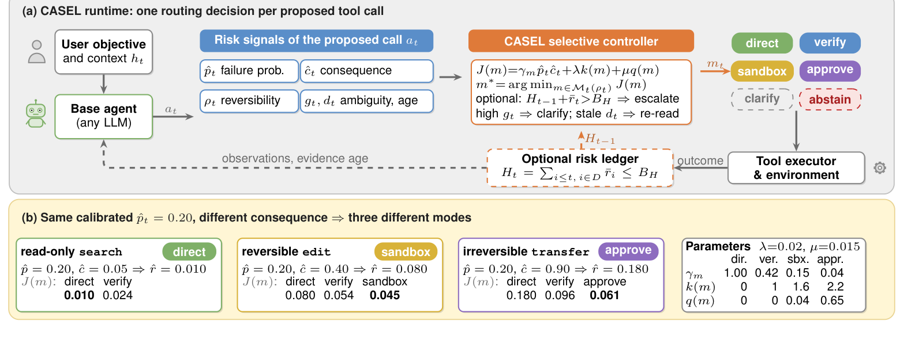
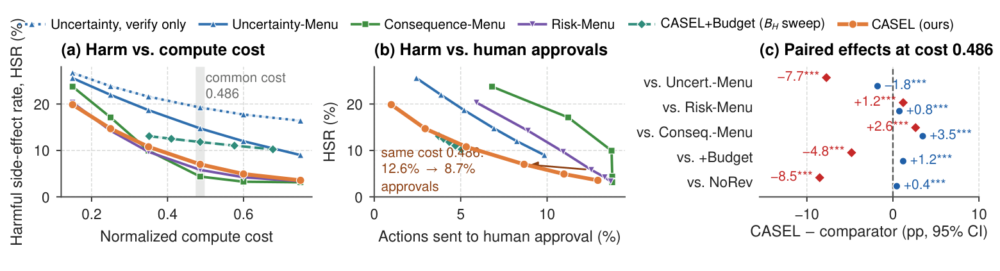

# CASEL · 分解

> 只记**论文说了什么**。工程判断、质量评估、洞察见同目录 [digest.md](./digest.md)。

## 一句话

把「执行前要不要拦」从单一不确定性分数改成**后果感知的运行时分配**：用校准失败概率 × 后果、可逆性、歧义、证据新鲜度，在 direct / verify / sandbox / clarify / approve / abstain 六种模式里按代价选一个；模拟中把有害副作用轨迹从 14.75% 降到 7.02%，但代价是审批量。

## 问题与设定

- **问题**：两个动作同样 20% 失败概率，读操作重试很便宜，不可逆转账很贵；只看不确定性或只看「是否 mutating」都会把不同后果的动作同等对待。
- **机制**：运行时层，位于任意 base agent 与工具执行器之间；每步估计 `p̂`（校准失败概率）、`ĉ`（后果）、`ρ`（可逆性）、`g`（歧义）、`d`（证据新鲜度），选模式最小化 `J(m)=γ_m·p̂ĉ + λk(m) + μq(m)`。
- **六模式**：direct / verify / sandbox / clarify / approve / abstain；实际只用了 5 个（abstain 与 staleness 分支未启用）。
- **评估**：**受控模拟**，20 seeds；每 seed 40,000 calibration + 6,000 trajectories × 20 actions = 120,000 test actions；58% read-only、28% reversible、14% irreversible；所有方法同一 intervention menu、同一 compute cost（0.486）。
- **假设**：intervention effectiveness（γ_m）是**假定常数**，不是测量；成本 k/q 也是假定。
- **能证明**：在模拟假设下，consequence-aware allocation 比 uncertainty ranking 显著降低有害副作用；reversibility routing 是主要增益来源；trajectory budget 会反噬。
- **不能证明**：真实部署效果；γ_m 的真实值；审批疲劳/信任成本；跨任务泛化。

## 机制

### 信号与代价（§III–IV, p.2–3）

- `p̂`：raw score 用 isotonic / temperature scaling 校准。
- `ĉ = clip(c_base(z_t) · M_scope(θ_t,h_t), 0,1)`；`c_base` 是审计过的 per-tool severity（写权限、特权、敏感度、金额），`M_scope` 是幅度因子。
- `ρ`：read / reversible / compensable / irreversible；它改变**可行模式集**，不是缩放 `ĉ`。
- `g`：缺失意图；`d`：证据过期。
- 模式代价：`J(m)=γ_m·r̂ + λk(m)+μq(m)`，`r̂=p̂ĉ`；可行性：sandbox 只对 reversible mutation/dry-run；approve 只对 compensable/irreversible。

### 选择性风险（§V, p.3）

- 直接执行集 `A_τ={S≤τ}`；目标：最大化 coverage s.t. selective risk ≤ ε。
- 用 Hoeffding + union bound 给出有限样本阈值规则（Eq. 5）；Proposition 1 保证在 i.i.d. calibration records 下，直接执行集的真实风险 ≤ ε。
- **trajectory ledger**：`H_t=Σ D_i r̄_i ≤ B_H`；Proposition 2 只在 `r̄` 每步都上界真实条件风险时成立——calibrated point estimate 不满足，且被干预动作的 residual harm 不在账本内。

### 实验协议（§VI, p.4）

- 真失败概率：class-dependent Beta + trajectory-level difficulty；后果 mainly [0.02,0.20]/[0.15,0.70]/[0.55,1]。
- γ_m：direct 1.00 / verify 0.42 / sandbox 0.15 / approve 0.04；k：0/1.0/1.6/2.2；q：0/0/0.04/0.65；λ:μ=0.02:0.015。
- 对照：Base、Always-Verify、Mutation-Gated、Uncertainty gate/menu、Consequence gate/menu、Risk-Menu、CASEL、CASEL-NoRev、CASEL+Budget、CASEL-Uncal。
- 指标：task success、HSR（至少一个 true consequence ≥0.45 的失败动作）、MNH（trajectory 的 ΣcF 均值）、direct coverage、cost、approvals。

## 关键数字

| 数字 | 条件 | 出处 |
|---|---|---|
| **14.75% → 7.02%** | HSR：Uncertainty-Menu → CASEL；paired −7.73 pp [−7.87,−7.60] | §VI-B, p.4；Table 2 |
| **0.184 → 0.123** | MNH：Uncertainty-Menu → CASEL | Table 2 |
| **5.82% / 0.120 / 12.6%** | Risk-Menu（p̂ĉ 排序）：HSR / MNH / approvals | Table 2 |
| **4.38% / 0.136 / 13.8%** | Consequence-Menu：HSR / MNH / approvals | Table 2 |
| **7.02% / 0.123 / 8.7%** | CASEL：HSR / MNH / approvals | Table 2 |
| **47.01% vs 48.79%** | task success：CASEL vs Uncertainty-Menu（低 1.79 pp） | Table 2 |
| **15.53% / 0.194** | CASEL-NoRev：去掉 reversibility routing | Table 2 |
| **11.82% / 0.167** | CASEL+Budget：trajectory ledger，反噬 | Table 2 |
| **8.22% / 0.129** | CASEL-Uncal：未校准 | Table 2 |
| **−94.5% / −9.3%** | isotonic 校准：ECE / Brier 变化 | Fig. 2, p.4 |
| **0.01050 / 0.00593 / 0.00533** | selective-risk AUC：p̂ / ĉ / p̂ĉ；product −49.2% vs p̂ | Fig. 3, p.5 |
| **54%** | CASEL+Budget 的直接执行步骤中 `p_t c_t > r̄_t` 的比例（ledger 前提失败） | §VI-E, p.5 |
| **9.8% / 94% / 92%** | ambiguity stress：CASEL clarify 比例 / precision / recall；HSR 19.1→8.4% | §VI-E, p.5 |
| **16.6% / 18.8% / 21.0%** | misspecification：p̂/ĉ/effectiveness 减半后的 HSR；仍低于 Uncertainty 23.4/25.9/24.3 | §VI-E, p.5 |

## 图表索引

### 图 1：运行时与三种后果

> 原图：arXiv:2610.36570, p.2, Figure 1。版权归作者，研究评论用途。

**看什么**：同一个 `p̂=0.20`，后果 0.05/0.40/0.90 分别路由到 direct / sandbox / approve。**可逆性改变可行模式集，后果改变代价权重**——这两个旋钮不能合并成一个「风险分」。

### 图 4：harm–cost–approval 前沿

> 原图：arXiv:2610.36570, p.5, Figure 4。版权归作者，研究评论用途。

**看什么**：(a) 同等算力下 consequence-aware 比 uncertainty 低一大截；(b) 但最低 HSR 是 Consequence-Menu，不是 CASEL；CASEL 的位置是「接近最低 harm、审批更少」；(c) 配对差异：vs Uncertainty −7.7 HSR，vs NoRev −8.5，vs Budget +1.2（更差）。

## 作者自述局限

- **模拟**：intervention effectiveness 是假设，不是测量；结果只排序分配规则，不证明部署有效。
- **成本假设**：γ_m、k、q 都是常数；真实系统里它们随工具/上下文变化。
- **abstain 与 staleness 分支未启用**。
- **trajectory ledger 前提失败**：54% 直接执行步骤 `p_t c_t > r̄_t`；residual harm 不在账本内。
- **审批疲劳/信任成本未建模**；approvals 只是一个比例。
- **任务 success 与 HSR 可以反向**：CASEL 的 HSR 更低，但 task success 低 1.79 pp。

## 引用锚点

- 「Uncertainty alone does not answer it. Two actions may share a 20% probability of error, yet a read-only search is cheap to retry while an irreversible transfer is costly.」（§I, p.1）
- 「CASEL matches a risk-ranked gate with fewer approvals.」（§VI-B, p.4）
- 「matching the intervention to commitment semantics accounts for most of the gain.」（§VI-D, p.4）
- 「a full ledger escalates low-risk actions late in a trajectory, where expected harm is small.」（§VI-D, p.4）
- 「Intervention effectiveness is assumed, not measured.」（Abstract, p.1）

## 待核

- [ ] γ_m 的真实值：verify/sandbox/approve 在真实工具上到底降低多少失败率？
- [ ] 审批的真实成本（时间、疲劳、信任）怎么进 J(m)？
- [ ] 多步后果：单步 c 小但组合不可逆，怎么算？
- [ ] 真实部署中，CASEL 的审批量是否可接受？8.7% vs 12.6% 的差异是否足以抵消 5.82 vs 7.02 的 HSR 差？
- [ ] trajectory ledger 是否有替代形式（只对不可逆动作记账）？
