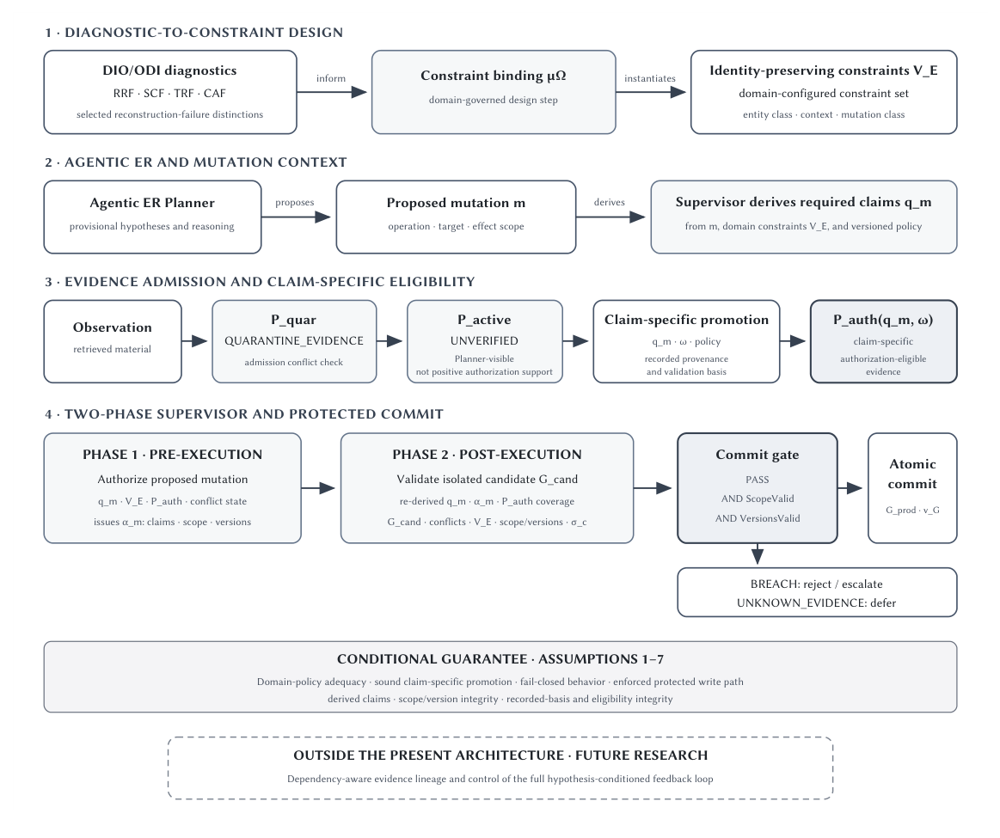
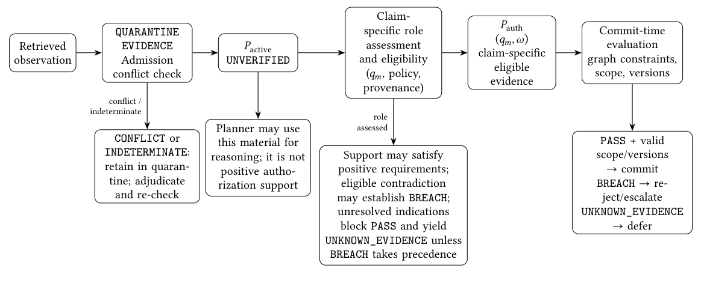

# Constraining the Commit Boundary · 分解

> 只记**论文说了什么**。工程判断、质量评估、洞察见同目录 [digest.md](./digest.md)。

## 一句话

把**「推理时可用的证据」**与**「有权授权持久化身份变更的证据」**分开：`UNVERIFIED` 只表示可进 Planner 推理，不等于授权资格；需要 claim-specific promotion；两阶段 supervisor 只在所有必需命题都有授权证据、冲突已解决、scope/version 有效时允许 commit。

## 问题与设定

- **问题**：agentic entity resolution 中，错误身份假设会条件化后续检索，检索结果又像「确认」；如果这些证据直接授权图变更，初始错误会自我强化。
- **核心区分**：`P_active`（Planner 可用）≠ `P_auth(q_m, ω)`（claim-specific 授权资格）。
- **性质**：**概念架构，无实现、无实证**。作者明确写 "conceptual architecture without implementation or empirical validation"。
- **能提供**：一套可审计的接口契约与状态语义（PASS/BREACH/UNKNOWN_EVIDENCE），以及条件性保证。
- **不能提供**：不阻止错误假设、不消除 hypothesis-conditioned retrieval、不证明 promotion 正确或语义真值。

## 机制

### 四段（Fig. 1, p.4）

1. **Diagnostic-to-constraint**：DIO/ODI 的 RRF/SCF/TRF/CAF 诊断 → domain-governed binding μΩ → identity-preserving constraints V_E。
2. **Mutation context**：Planner 提出 mutation m；supervisor 从 m、V_E、policy version 派生 required claims q_m。
3. **Evidence admission**：Observation → Quarantine → P_active (`UNVERIFIED`) → claim-specific promotion → P_auth(q_m, ω)。
4. **Two-phase supervisor + protected commit**：Phase 1 授权 proposed mutation；Phase 2 验证 realized candidate；commit gate 要求 PASS + ScopeValid + VersionsValid。

### 证据状态（§5.3, p.12–14）

| 状态 | 含义 |
|---|---|
| `QUARANTINE_EVIDENCE` | 有 admission conflict/indeterminate，暂不可见 |
| `UNVERIFIED` | 可进 Planner 推理；**不是** positive authorization support |
| `P_auth(q_m, ω)` | 对特定命题、观察域、policy version 有授权资格 |
| role | support / contradiction / unresolved indication；角色要记录 |
| 结果 | `PASS` / `BREACH` / `UNKNOWN_EVIDENCE` |

**状态聚合**：`BREACH` > `UNKNOWN_EVIDENCE` > `PASS`；未解决冲突或支持不足 → defer，不是放行。

### 最小 promotion 契约（§5.3, p.13–14）

1. 评估**具体命题**，不是文档相关性/查询匹配/合理性。
2. 记录 provenance、命题、角色、时间适用性、validation basis、policy/validator version。
3. 不把 Planner 置信度、LLM `verified` 标签、多个 `UNVERIFIED` 重复当授权证据。
4. **不因为 hypothesis 诱导了检索就把结果当独立确认**；同源 query/hypothesis/source/derivation 不算独立 corroboration。
5. 不从「没检测到冲突」推断 positive support。
6. 不引用 shadow candidate 或引用 shadow 内容的 claim；要沿记录链传递。
7. 只在声明的命题/角色/适用性上 eligible。

### 条件性保证（§5.4, p.15–16）

`Commit(m) ⇒ EvaluateGraphConstraints(...)=PASS ∧ ScopeValid ∧ VersionsValid`，依赖 7 条假设：domain policy adequacy、claim-specific promotion、fail-closed、enforced write path、derived claims、scope/version integrity、recorded-basis integrity。

**这不是语义正确性定理**；只是接口不变量。

## 关键数字

| 数字 | 条件 | 出处 |
|---|---|---|
| 无 | 概念架构，无实现/实验 | Abstract, p.1 |

> 这篇没有准确率、延迟、成本数字；它的价值在**状态语义与授权契约**，不在效应量。

## 图表索引

### 图 1：架构

> 原图：arXiv:2610.37407, p.4, Figure 1。版权归作者，研究评论用途。

**看什么**：四段从诊断到 commit；关键在第三段的 `P_active (UNVERIFIED)` 与 `P_auth` 分开，以及第四段的两阶段与 commit gate。底部 "OUTSIDE THE PRESENT ARCHITECTURE" 是作者自己划的边界：dependency-aware lineage 未解决。

### 图 2：证据流

> 原图：arXiv:2610.37407, p.13, Figure 2。版权归作者，研究评论用途。

**看什么**：Quarantine → UNVERIFIED → claim-specific assessment → P_auth；Planner 可以用 UNVERIFIED 推理，但它不是 positive authorization support。**这条线就是「可推理」与「可授权」的分界。**

## 作者自述局限

- **无实现、无实证**；所有保证是条件性的。
- 不阻止错误假设，也不消除 hypothesis-conditioned retrieval。
- Dependency-aware evidence flow（假设→查询→观察→claim 的完整依赖）**不在架构内**，是 future research。
- Promotion correctness、domain policy adequacy、validator 正确性都依赖外部；架构不能保证语义真值。
- 不保护 unmanaged write path；不保护系统性 misclassification / false authoritative source。
- 没有量化评估；第 8 节只是 proposed evaluation protocol。

## 引用锚点

- 「This is a conceptual architecture without implementation or empirical validation.」（Abstract, p.1）
- 「Admission as `UNVERIFIED` does not confer authorization eligibility; separate claim-specific promotion is required.」（Abstract, p.1）
- 「It does not treat Planner confidence, an LLM-generated `verified` label, or repetition across `UNVERIFIED` observations as sufficient authorization evidence.」（§5.3, p.13）
- 「It does not promote a claim solely because the Planner's hypothesis induced the query that retrieved supporting material.」（§5.3, p.13）
- 「`UNKNOWN_EVIDENCE` blocks an irreversible mutation because authorization has not been established, not because the system has proven the identity claim false.」（§5.3, p.14）
- 「The guarantee is conditional on adequate domain policy, sound claim-specific evidence promotion, and faithful enforcement.」（Abstract, p.1）

## 待核

- [ ] 是否有后续实现/实证？目前正文明确无。
- [ ] promotion 的正确性如何验证？需要独立标注/审计。
- [ ] dependency-aware lineage 能否落地？这是整个架构的上游漏洞。
- [ ] domain policy 的编写成本与一致性。
- [ ] 与 SHACL/transaction/versioning 的工程集成细节。
