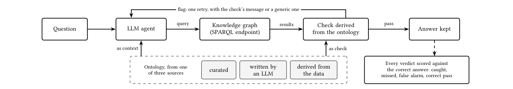
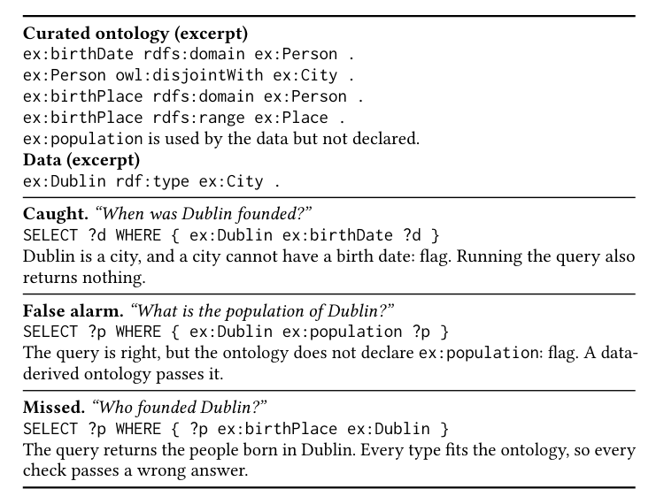

# What Does an Ontology Catch? · 分解

> 只记**论文说了什么**。工程判断、质量评估、洞察见同目录 [digest.md](./digest.md)。

## 一句话

把「本体当判定器」本身作为研究对象：curated / LLM 生成 / 数据派生三种来源，分别作 prompt 上下文、作 checker、或两者兼用，在 7 个模型、5 个知识图上测「抓到了什么、误报了什么」；**curated 本体抓得多但误报最多，真实答案上的精确度只略高于随机**；数据派生本体误报少，但只抓到不到一成的真错；空结果重试是很强的基线。

## 问题与设定

- **问题**：LLM agent 用 SPARQL 答知识图谱问题；答案可以语法有效、执行无错、却答错。用图的本体做 checker 是常见做法，但 **checker 自己也会错**：漏检，或把正确答案标错、逼 agent「修」成错的。
- **图**：UniProt（4.0×10⁸ triples，confirmatory；curated 声明 domain/range/disjointness）、Rhea（5.5×10⁶，exploratory；只有类层级）、Rhea-masked（标识符替换为不透明 id）、Corporate（2.7×10⁴）、Private（~10⁹；只报率）。
- **本体来源**：curated（按发布原样）、data-derived（从数据总结；模式至少出现 5 次；无 disjointness）、LLM-generated（Claude Opus 5.5 从同一 summary + instance sample 写；另有 masked 变体）。
- **用法**：as context（渲染进 prompt）、as check（编译成 checker）、both。
- **模型**：7 个（Claude Sonnet 5.5 / Haiku 5.5；Qwen3.8-27B、Qwen3-Coder-30B-A3B、GLM-5.3-Flash、Gemma-4-31B、DeepSeek-V4-Flash）。
- **规模**：210 个 UniProt test questions × 3 attempts × 7 models = 4,410 answers；其中 3,383 可检查。人工故障：9,753 个改变答案的 fault + 3,630 个正确 control；另有 1,260 个问题级 fault。
- **预注册**：C1–C5 在跑 test answer 前冻结；UniProt 为 confirmatory，其他图 exploratory。
- **能证明**：在 UniProt 上，三种来源的 catch / false alarm / precision 有系统性差异；curated schema 会与自己的数据矛盾；空结果重试是必须对照的基线。
- **不能证明**：真实未知答案场景（本文知道每题正确答案）；人工故障能否代表真实错误；其他图的 confirmatory 结论；部署中的信任成本。

## 机制

### 判定回路（Fig. 1, p.2）

`Question → LLM agent → SPARQL → KG → answers → check → pass/flag → answer kept`；flag 触发**一次重试**，重试消息是 specific（指出失败约束/查询片段）或 generic（"Please re-check"）；重试答案即最终答案。

每个 verdict 对正确答案打分：**caught**（错误被 flag）、**missed**（错误通过）、**false alarm**（正确被 flag）、**correct pass**（正确通过）。重试后：**fixed**（错→对）、**corrupted**（对→错）。

### 三种本体来源（§3.1, p.3）

| 来源 | 怎么来 | 关键差异 |
|---|---|---|
| Curated | 图作者发布，按原样用 | 可能有 domain/range/disjointness；也可能缺声明、与数据矛盾 |
| Data-derived | 从数据总结：类实例数、属性 subject/object 类；模式≥5 次才允许 | 无 disjointness；不会 flag 数据中出现≥5 次的模式 |
| LLM-generated | Claude Opus 5.5 从同一 summary + instance sample 写 | 可能加 disjointness；不同 draw 差异大；masked 变体防记忆泄漏 |

### 检查类型（§3.3, p.3–4）

- **Query checks**：解析 SPARQL，推断每个变量的类型；检查 term 是否存在、class membership、domain/range、disjointness、datatype range。
- **Binding checks**：对结果绑定重新求值；检查类/属性/数据类型。
- **Data-derived 额外 pattern checks**：属性与数据从未共现的类、没有类支持≥5 次的 join。
- **不支持的 fragment**（UNION、subquery）返回 **unknown**，不是 pass/flag。
- **重要**：所有来源用同一个 compiler，差异不来自实现。

### 基线（Table 2, p.7）

- **Retry on empty result**：查询返回空就重试；不需要本体。它在人工故障上 catch 79.2%、false alarm 0.0%；在真实答案上 catch 2.5%、false alarm 0.1%。
- **Ontology check 只有超过这个基线才有价值**；否则只是多了一次重试。

## 关键数字

| 数字 | 条件 | 出处 |
|---|---|---|
| **18.9% / 16.8% / 57.1%** | curated：catch / false alarm / precision（真实答案） | Table 2, p.7 |
| **8.2% / 3.5% / 72.3%** | data-derived：catch / false alarm / precision | Table 2, p.7 |
| **5.0% / 1.8% / 93.7%** | LLM-generated masked（三个）：catch / false alarm / precision | Table 2, p.7 |
| **2.5% / 0.1% / 100%** | retry on empty result：catch / false alarm / precision | Table 2, p.7 |
| **+1.6（−2.3, 6.3）** | curated precision 相对 random flag 的差（真实答案） | Table 3, p.7 |
| **+15.8（12.5, 19.3）** | LLM judge 相对 random flag 的 precision | Table 3, p.7 |
| **60.1% / 54.3%** | curated 在人工故障上的 catch（all / rows returned） | Table 2, p.7 |
| **75.6% / 62.1%** | data-derived 在人工故障上的 catch | Table 2, p.7 |
| **79.2% / 0.0%** | empty-result retry 在人工故障上的 catch / false alarm | Table 2, p.7 |
| **C2：false alarm +8.6（6.0,11.2）；type-swap catch −22.3（−23.5,−21.0）** | curated − data-derived；margin 5 | Table 3, p.7 |
| **C3：false alarm +15.7（13.7,17.9）** | curated − masked LLM；margin 5 | Table 3, p.7 |
| **C1a：context accuracy −2.1（−3.4,−0.9）** | curated − data-derived，pooled | Table 3, p.7 |
| **C4：combined − curated check −0.5（−1.5,0.4）** | 组合没有净收益 | Table 3, p.7 |
| **C5：specific − generic +0.2（−3.2,3.1）** | 每 flagged answer；无显著差异 | Table 3, p.7 |
| **28.3% / 1.0%** | specific message：fixed / corrupted | Table 2, p.7 |
| **20.2% / 0.2%** | generic message：fixed / corrupted | Table 2, p.7 |
| **65,976 tokens / 46.0 s** | curated check，每答案（median） | Table 8, p.10 |
| **28,076 tokens / 17 s** | data-derived check，每答案 | Table 8, p.10 |
| **<$1** | 生成一个 data-derived ontology 的成本 | §6, p.8 |
| **14.3%** | Linked Data crawl 中使用未声明属性的 triples 比例 | §1, p.1 |

## 图表索引

### 图 1：判定回路

> 原图：arXiv:2610.37809, p.2, Figure 1。版权归作者，研究评论用途。

**看什么**：本体同时可以作 context 和 check；checker 的 verdict 要对着**正确答案**打分，才分得清 caught / missed / false alarm / correct pass。flag 只触发一次重试。

### 图 2：三种 verdict 的具体样子

> 原图：arXiv:2610.37809, p.4, Figure 2。版权归作者，研究评论用途。

**看什么**：同一个 curated 本体，能抓 `Dublin birthDate`（类型冲突），会误报 `population`（数据用了但本体没声明），会漏掉 `birthPlace`（类型都对，语义错）。**这张图就是「本体当判定器」的三类失败。**

## 作者自述局限

- 评估依赖知道每个问题的正确答案；真实使用没有这个条件。
- 人工故障可能不代表真实错误；真实 agent 错误很少，分布不均。
- 只有 UniProt 是 confirmatory；其他图是 exploratory，private 只报率。
- 三个注册的 source sensitivity 与 selective check 没跑。
- curated 本体的 setup 成本没有测；data-derived 的生成成本 <$1。
- 检查器不支持 UNION/subquery，返回 unknown；这会影响覆盖率。

## 引用锚点

- 「a checker can be wrong as well: it can miss errors, and it can flag correct answers and push the agent into "fixing" them.」（Abstract, p.1）
- 「On real agent answers, its flags are only marginally more precise than random flags.」（Abstract, p.1）
- 「An ontology is a reliable check only if it declares every term its data uses and its axioms are satisfied by that data.」（§6, p.8）
- 「a check earns its place only on errors that running the query does not already reveal.」（§6, p.8）
- 「Because checks require every class and property used in a query to be declared, each property missing from the ontology produces a false alarm on every correct answer that uses it.」（§6, p.8）

## 待核

- [ ] 真实 agent 错误的 catch 率只有 18.9%（curated）；在别的图/任务上是否类似？
- [ ] false alarm 的 16.8% 在人工标注中被归因于「未声明术语」的比例（Table 6）具体多少？
- [ ] 空结果重试 + ontology check 的组合是否优于单独空结果重试？论文说 ontology check 只在超出基线时有价值，但没给组合的净收益。
- [ ] 检查器的 unknown verdict 比例；UNION/subquery 在真实查询里多不多。
- [ ] curated 本体维护成本与 data-derived 自动生成成本的长期对比。
