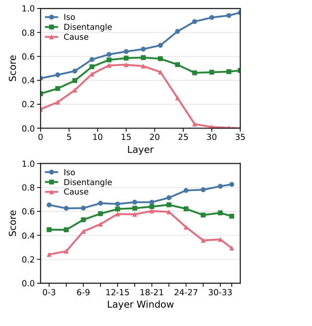
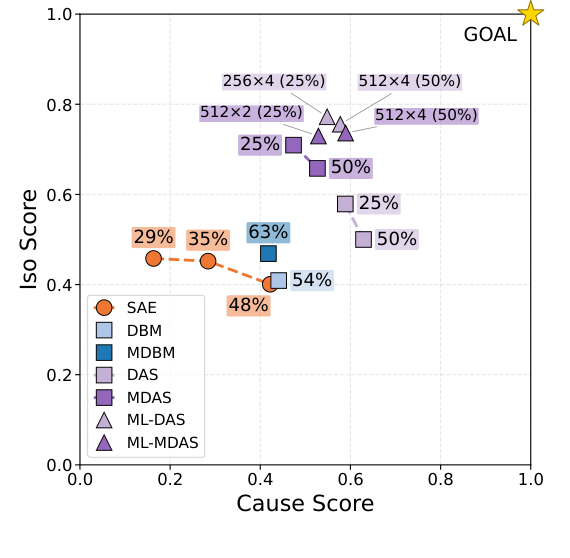

# MIOE · 分解

> 只记**论文说了什么**。工程判断、质量评估、洞察见同目录 [digest.md](./digest.md)。

## 一句话

用因果抽象/互换干预（interchange intervention）测 LLM 的「本体知识」是不是真的在内部被计算：在 entity typing 与 subsumption 两个任务上，MDAS 能把目标类答案换掉、同时尽量保留辅助属性，但**只能部分分离**；正确输出不等于内部有一个干净、模块化的本体机制。

## 问题与设定

- **问题**：现有 LLM 本体工程评估只看行为正确率；正确输出可能来自别的线索，不代表内部有对应本体关系。
- **任务**：① entity typing（`instance of`）；② subsumption prediction（`subclass of`）。
- **数据**：从 Wikidata/WordNet/schema.org 采样；instance of：54 classes、1,099 subjects、376 attributes、4,288 prompt templates；subclass of：39 classes、1,113 subjects、160 attributes、2,095 prompts。
- **模型**：Qwen3-8B、Qwen3-4B（36 层）。
- **方法**：SAE、DBM、MDBM、DAS、MDAS；单层 36 层全扫；多层连续 2/4 层窗口（256×4、512×2、512×4）。
- **指标**：Cause（目标答案是否换成 source 的类）、Iso（辅助属性是否保持 base）、Disentangle = (Cause+Iso)/2；按 prompt group 宏平均。
- **能证明**：本体预测在内部**因果可达**；distributed subspace 方法最强；多任务/多层改善平衡；类别差异大。
- **不能证明**：存在干净、可分离的本体机制；跨模型族/跨任务泛化；部署可用性。

## 机制

### 因果抽象（§Task Formulation, p.2–3）

- 高维变量：subject 的 target taxonomic value + class-specific auxiliary attributes。
- 干预：`II(M,F,x_base,x_source)`：把 base 在低层特征 F 的值替换成 source 诱导的值。
- 成功条件：Cause（目标换成 source 类）+ Iso（辅助属性保持 base）。
- **Disentangle**：两者的平均；高分意味着「换对了，又没把别的信息带过去」。

### 方法（§Experiments, p.5）

- **SAE**：稀疏自编码器分解激活；无显式辅助保持监督。
- **DBM/MDBM**：Differential Binary Masking；多任务版加 auxiliary preservation。
- **DAS/MDAS**：Distributed Alignment Search；学习分布式子空间；MDAS 是多任务版。
- **多层**：在连续 2/4 层窗口上每层一个 rank-k 子空间；`k×w` 表示 rank×window。
- 干预位置：prompt-specific subject token 的 residual stream。

## 关键数字

| 数字 | 条件 | 出处 |
|---|---|---|
| **0.592 / 0.587** | MDAS instance of：Entity / Context Disentangle | Table 2, p.6 |
| **0.513 / 0.542** | MDAS subclass of：Entity / Context | Table 2, p.6 |
| **0.584 / 0.547** | DAS instance of：Entity / Context | Table 2, p.6 |
| **0.412 / 0.371** | SAE instance of：Entity / Context | Table 2, p.6 |
| **0.425 / 0.396** | DBM instance of | Table 2, p.6 |
| **+0.081 / −0.052** | 多任务 vs 单任务：Iso 平均提升 / Cause 平均下降 | §Results, p.5 |
| **0.667 (+0.102)** | DAS 512×4 四层窗口，instance of | Table 3, p.7 |
| **0.666 (+0.074)** | MDAS 256×4 四层窗口，instance of | Table 3, p.7 |
| **0.565 (+0.052)** | MDAS 512×4，subclass of | Table 3, p.7 |
| **0.514–0.551** | subclass of 多层窗口 Disentangle 范围 | Table 3, p.7 |
| **0.03–0.65** | 类级 Disentangle 差异（具体类高、宽泛类低） | Fig. 3, p.7 |

## 图表索引

### 图 1：层剖面

> 原图：arXiv:2610.38326, p.6, Figure 1。版权归作者，研究评论用途。

**看什么**：Cause 在早期层弱、在中层/中后层最强；更后的层 Iso 高但 Cause 崩掉——**干预已经改不动输出**。多层窗口把 Cause 与 Iso 同时抬高。

### 图 2：Cause–Iso 平面

> 原图：arXiv:2610.38326, p.6, Figure 2。版权归作者，研究评论用途。

**看什么**：MDAS/ML-MDAS 在右上角（Cause 与 Iso 都较高）；SAE/DBM 偏左下。**没有方法到达 GOAL（1,1）**；最好的也只是部分分离。

## 作者自述局限

- 只测 Qwen3-4B/8B 两个模型；跨模型族未测。
- 只测 entity typing / subsumption 两个任务；更丰富的本体约束未测。
- 干预位置限于 subject-token residual stream；其他位置未测。
- 聚合分数掩盖类级差异；类级分析是描述性的。
- 「部分分离」可能是表示本身分布/纠缠，也可能是干预搜索方法不够精确；本文不能区分。
- 没有部署/下游任务评估。

## 引用锚点

- 「Correct ontological predictions do not by themselves imply a clean or modular internal mechanism for the corresponding axiom.」（Conclusion, p.7）
- 「Ontological predictions are mechanistically accessible in LLMs, although current methods do not yet isolate a cleanly disentangled causal mechanism.」（Abstract, p.1）
- 「Multi-task objectives ... improve this balance, while class-level analyses reveal substantial variation across ontology classes.」（Abstract, p.1）
- 「Later layers often obtain strong Iso, but Cause can simultaneously fall to very low values.」（§Results, p.5）

## 待核

- [ ] 跨模型族（Llama/GPT）是否同样？
- [ ] 更丰富的本体约束（disjointness/domain-range）能否用同样方法测？
- [ ] 干预位置（subject token 之外）是否改变结论？
- [ ] 「部分分离」是表示问题还是方法问题？需要更强干预/方法对照。
- [ ] 类级差异能否预测下游本体工程任务的表现？
