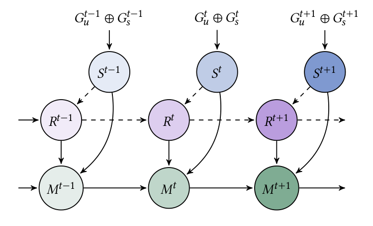
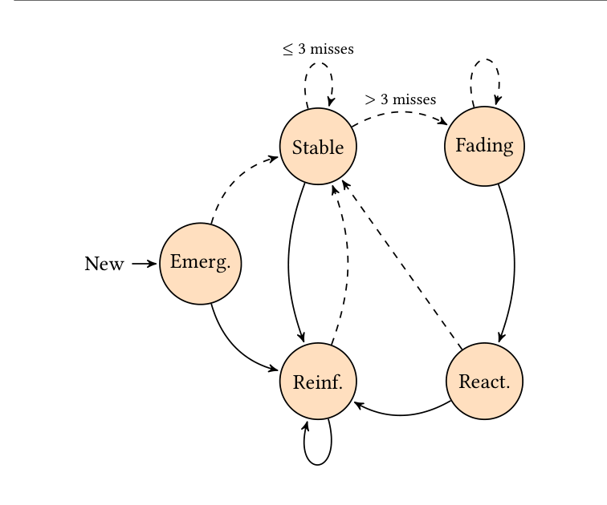

# FIRME · 分解

> 只记**论文说了什么**。工程判断、质量评估、洞察见同目录 [digest.md](./digest.md)。

## 一句话

把投资人的跨源、跨期观察锚定到**持久关系身份**：registry 保存 canonical 身份 + learned aliases，短期做产品/主题本体介导的证据融合，长期用确定性强化/衰减与五态生命周期维护关系历史；alias memory 让 final-period CMR 提升 7.8–12.1 pp。

## 问题与设定

- **问题**：同一投资人/产品/主题在不同来源、不同时期以不同名字出现；不锚定身份，关系历史会碎成多个 partial history，证据无法累积，provenance 丢失。
- **数据**：① 专有投资人通话 + 月度组合现金流：10 个月度 period，每期约 1,200 calls；final period 约 1,300 calls / 10.3K incoming edges。② S&P 500 earnings transcripts：297 家公司、3 个 reporting period；final period 约 6.3K edges；**无结构化现金流**。
- **模型**：Claude Opus 4.6、GPT-5.4-mini；judge Gemini 3.1 Pro；human audit 200 incoming units per setting。
- **对照**：RAW、spaCy-Lemma、LLM-Norm、FIRME w/o Alias Memory、Full FIRME。
- **能证明**：alias memory 在 4 个 dataset–backend 设置上提升 CMR 7.8–12.1 pp；human audit CMR +9.0–16.5、reattachment recall +22.5–29.0；alias 复用降低 semantic matching token 40.3%。
- **不能证明**：公开可复现（专有数据）；年度周期；其他域；latent preference。

## 机制

### 模式与短期融合（Table 1–2, p.3–5）

- 实体：person/org、product、topic；关系：discussed（非结构化）、cf-signal（结构化）、strong-interest（融合）。
- **Rule 1–2**：保留未印证关系。
- **Rule 3**：同一投资人、同一 product 的 discussion + cash-flow → strong-interest。
- **Rule 4**：同一投资人的 topic discussion + 本体关联 product 的 cash-flow → product strong-interest，topic 仍保持 discussed。
- **关键**：topic 与 product 身份**不合并**；融合只增加引用，不覆盖原观察；source indicator 1/2/3 保留。

### Registry（§3.2–3.4, p.4）

跨期匹配顺序：**identifier → normalized name → learned alias → LLM semantic matching**（同类型候选，score ≥0.8，取最高；否则新注册）。匹配后的 surface form 加入该 anchor 的 alias set；**错误匹配会把后续出现路由到错误历史**。

### 记忆强度与生命周期（§3.4, p.4–5）

- `σ_init=0.5`；匹配 `σ=min(1, σ+0.2)`；未匹配 `σ=γσ, γ=0.8`；低于 0.01 归零但**边不删除**。
- 每 period 每条 edge 至多一次强度/状态更新；多个观察/印证路径不重复计分。
- 五态：Emerging、Reinforced、Stable（≤3 misses）、Fading（>3 misses）、Reactivated（Fading 后再次匹配）。
- 边是 attribute vector `e_t=(u, h_t, v)`：每个观察的 id、原始 typed target、relation、source、timestamp、context、head，加 first/last seen、state、score。

## 关键数字

| 数字 | 条件 | 出处 |
|---|---|---|
| **+7.8–12.1 pp** | Full FIRME vs no-alias：final-period CMR（4 settings） | Table 3, p.7 |
| **2.3–3.7×** | Full FIRME vs LLM-Norm 的 CMR | §4.2, p.6 |
| **+9.0–16.5 pp** | human-audit CMR，vs no-alias | §4.2, p.7 |
| **+22.5–29.0 pp** | human-audit reattachment recall，vs no-alias | §4.2, p.7 |
| **85.6–97.5%** | human-audit merge precision（Full FIRME） | §4.2, p.7 |
| **30.4% / 22.2% / 8.2%** | investor calls + Opus 4.6：Full / no-alias / LLM-Norm 的 CMR | Table 3, p.7 |
| **57.4% / 46.1% / 23.9%** | S&P 500 + Opus 4.6：Full / no-alias / LLM-Norm 的 CMR | Table 3, p.7 |
| **6.20M vs 6.68M** | final-period token：Full vs no-alias（−7.2%） | Table 4, p.8 |
| **−40.3%** | semantic matching token：Full vs no-alias | Table 4, p.8 |
| **3.3% vs 6.6%** | investor calls hallucination：Opus vs GPT | Table 5, p.8 |
| **3.2% vs 7.74%** | investor calls normalization error：Opus vs GPT | Table 5, p.8 |
| **0.923–0.931** | investor calls round-trip F1 | §4.4, p.8 |
| **0.862–0.865 / 0.786–0.805** | S&P 500 round-trip F1：Opus / GPT | §4.4, p.8 |
| **293/300** | Full fusion 输出有有效 evidence path（final-period human audit） | Abstract, p.1 |

## 图表索引

### 图 1：短期 + 长期耦合

> 原图：arXiv:2610.40482, p.2, Figure 1。版权归作者，研究评论用途。

**看什么**：`S^t` 是当期非结构化+结构化融合；`R^t` 是 registry；`M^t` 是记忆图。**registry 在 S 与 M 之间做身份中介**——没有它，S 的 surface form 直接进 M，历史会碎。

### 图 2：五态生命周期

> 原图：arXiv:2610.40482, p.5, Figure 2。版权归作者，研究评论用途。

**看什么**：匹配/未匹配是两条边；`N=3` 是 Stable→Fading 的阈值。**衰减从第一次 miss 就开始，但边不删除**；Reactivated 是 Fading 后再次匹配。这套状态是可审计的「兴趣轨迹」，不是 latent preference。

## 作者自述局限

- 专有投资人数据与内部产品本体不可公开，限制复现。
- S&P 500 只有 transcript、无结构化现金流；只测抽取+时间对齐，不测完整异构融合。
- 两个 corpus 都不覆盖年度周期；seasonality/long-term 结论受限。
- human audit 是抽样（200 units/setting），不是全量；依赖 historical search/reference labeling。
- 产品-主题本体、$100K 阈值、生命周期参数都是 use-case specific；统一强化忽略关系类型/证据强度。
- **未匹配 ≠ 兴趣下降**：可能是输入缺失/没有观察机会；模型无法区分。
- 两个 backend、一个 judge；annotator 主观性。

## 引用锚点

- 「Before entering the knowledge store, new evidence must therefore be aligned across sources and matched to the correct persistent identity.」（§1, p.1）
- 「An incorrect registry match can therefore route later occurrences to the wrong anchor and history.」（§5, p.9）
- 「Missing evidence need not terminate that relationship, whose memory state may decay and later reactivate.」（§1.1, p.2）
- 「The state estimates interest evolution from observed evidence rather than measuring latent preference directly.」（§3.4, p.5）
- 「At memory update, an edge is unmatched when no current observation is successfully extracted, registry-normalized, and linked to it. This may reflect reduced engagement, missing inputs, or no observation opportunity.」（§7, p.10）

## 待核

- [ ] alias memory 与 canonical registry/semantic fallback 的分别贡献（作者说未拆分）。
- [ ] 错误匹配的长期污染：一个 false merge 会影响多少后续观察？
- [ ] 年度周期/季节性对衰减参数的影响。
- [ ] 负信号（outflow/不满意）如何进生命周期。
- [ ] 公开数据上能否复现 CMR 增益？
