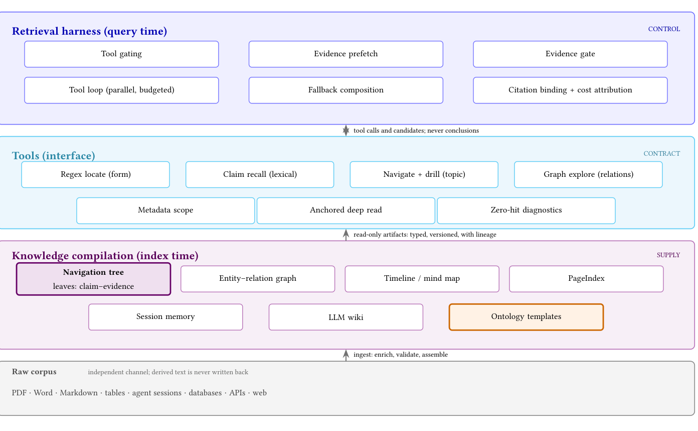
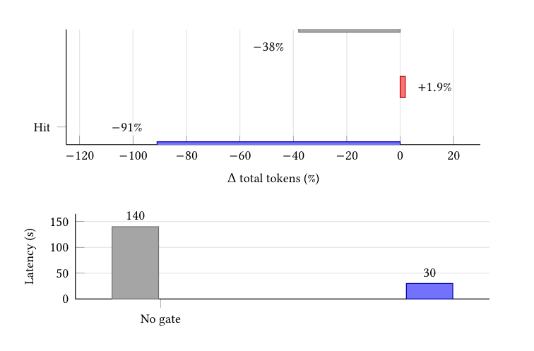

# Context as Infrastructure（CAI）· 分解

> 只记**论文说了什么**。工程判断、质量评估、洞察见同目录 [digest.md](./digest.md)。

## 一句话

把「检索前的整理」做成供给层：用便宜小模型把文档编译成**带逐字证据的 claim–evidence 叶子**，再由 harness 决定何时读、读多少；准确率不涨，token 有条件地省，但省下的 token 用检索轮次/时延换。

## 问题与设定

- **问题**：agentic 检索的瓶颈从「召回」转到「上下文」——循环会重复查询、重读文档、把窗口塞满未使用的段落；结构化工件是否值得？
- **基准**：FRAMES（多跳 Wikipedia，N=200 用于主表）；BrowseComp-Plus 只作规模检查。
- **harness**：BM25 + grep 词法检索；作答模型 MiniMax M3；抽取模型 glm-4-flash；决策门 Qwen decision model。
- **基线**：无编译的 BM25/grep harness 已达 **91.0%**（FRAMES），平均 324,479 token/问，46.7 s。
- **对照**：同一 harness 下比较 claim-leaf tree、RAPTOR 摘要树、PageIndex 大纲、实体图、LLM wiki；三种服务模式。
- **能证明**：在强词法 harness + FRAMES 上，结构化工件没有可检出的准确率增益；claim–evidence 投影有**条件性 token 收益**与**时延代价**；成本模型可算盈亏平衡。
- **不能证明**：企业语料（表格/扫描/行话）上的抽取质量；其他模型/harness 的可迁移性；部署层回报；本体对准确率的作用（本文**未测量**本体）。

## 机制

### 三层（Fig. 1）

供给（index time 编译）→ 契约（tools）→ 控制（query time harness）。箭头是上下文流，不是控制流；编译不改检索几何，只改「进入窗口的东西」与「读多少」。

### 六段流水线（§3.2, p.3）

| 段 | 做什么 | 关键点 |
|---|---|---|
| Parse | PDF/Office/HTML/表格/日志 → 规范表示 | 保留标题、列表、表格、页锚 |
| Chunk | 自然边界切块 | chunker 两臂固定，编译不与 chunking 混淆 |
| Enrich | 模型逐块产出 claim–evidence、实体、事件、本体标签、wiki | 本文抽取器 glm-4-flash |
| Validate | span 逐字比对；实体类型对本体；日期对文档；schema 对模板 | **不合法就丢弃，不让模型修** |
| Assemble | claim 聚类成树、实体成图、事件成时间线 | 内部节点是导航标签，不是摘要 |
| Register | 源版本、offset、抽取器版本、校验状态、ACL | 让 fallback / citation / audit / 增量更新成立 |

### claim 单元（§3.4, p.4）

`(c, e, s, τ)`：规范主张、逐字证据 span、源 chunk + 字符偏移、时效元数据。**没有可定位 span 的 claim 不入库**；表示有损于文、无损于出处。

### Tree 模板（Listing 1, p.5）

`extract.unit=claim_evidence`、`require_verbatim_span=true`、`validate=span_match`、`leaves=evidence_units`、`internal_nodes=embedding_clusters`、`summary_nodes=false`、`serve.default=evidence_substitution`、`fallback=raw_chunk`、`gate=qwen-decision-model-preview`。

### 三种服务模式（§4.3, p.5）

| 模式 | 做什么 | 结果/代价 |
|---|---|---|
| E1 evidence-first | 直接在证据索引上词法检索 | 优于「先找文档再下树」；少一跳 |
| E2 substitution（默认） | 照常检索原文，定位到 chunk 后用 claim–evidence 对替换 | 保留已有检索行为，只改阅读成本；省 token 但增加轮次 |
| E3 decision-gated | 小决策模型判断是否值得深读 | 控制「读不读」，不控制排序；无证据时省约 30% token |

### harness 六条不变量（§6.4, p.8）

1. Evidence before thought：第一次模型调用前先取编译证据。
2. Discard on insufficiency：不充分的块整块删掉，包括 system prompt 与 citation 表。
3. Tool gating：只暴露语料支持且在该语料上有用的工具。
4. Budgeted calls：token/时间预算下重试或降级。
5. Citations at delivery：citation id 在交付时分配，不让模型自己编号。
6. Guaranteed close：异常结束也要用已有证据组答案或显式失败。

### 工具按失败组织（§6.2, p.7）

词汇不匹配（BM25/grep/claim recall）、大规模定位（outline/tree + metadata scope）、跨源关系（entity lookup/graph expansion）、时间歧义（timeline/as-of/版本登记）、综合负担（evidence projection/wiki）、工具或语法错误（确定性 wrapper）。一个工具只对一个主失败；两个工具治同一失败，说明一个是另一个的配置。

### 本体在本文的位置（Table 1, p.4）

ontology 一行：类、属性、约束、映射；查询时用于类型化检索、查询扩展、校验；**FRAMES 结果 = not measured**；部署价值 = 词汇控制、集成、治理。作者没有声称本体提准确率，也没有给出本体在部署层的观测。

## 关键数字

| 数字 | 条件 | 出处 |
|---|---|---|
| 91.0% | 无编译 BM25/grep harness，FRAMES，MiniMax M3 | Table 4, p.10 |
| 324,479 token/问；46.7 s | 同上，未编译基线 | Table 4, p.10 |
| **−91%** | 证据充分（gate hit）时的总查询 token 变化 | Eq. 3, p.5；Table 4 |
| **+1.9%** | 证据不充分（miss）时的 token 变化 | Eq. 3, p.5；Table 4 |
| **−38%** | FRAMES 全样本平均 token 变化 | Table 4, p.10 |
| **2.0%** | 无限视野盈亏平衡充分率：0.019/(0.91+0.019) | Eq. 5, p.5 |
| **≈43%** | 实测 gate 接受率（p_h） | p.6, p.11 |
| **≈2.6c；c=10 → ≈26 问** | p_h≈0.43 时的回本查询数 | Eq. 7, p.6 |
| **3.12%** | 有限视野：Q=1,000、c=10 时 p_min；p_h=2.5% 仍亏 5.8 query-equivalent | Eq. 9, p.6 |
| **140 s → 30 s** | 有 claim-leaf tree 时，决策门对端到端时延 | Table 4, p.10 |
| **−52% / −30%** | 决策门「有证据 / 无证据」臂均值 token；不可与 −91%/−38% 直接比 | Table 4, p.10 |
| **85.0%；≈3.0×10⁶ token/问** | BrowseComp-Plus，仅 harness；与 FRAMES 不可比 | Table 4, p.10；§8.7 |
| **1 pp → φ≤2.9%；3 pp → φ≤8.6%** | false-accept rate 一阶估计；需 100–400 条标注，本文未做 | Eq. 11, p.11 |
| **≈3× 时延；token 约减半** | 配对子集，证据替换用轮次换 token | §9, p.12 |

## 图表索引

### 图 1：三层结构（供给 / 契约 / 控制）

> 原图：arXiv:2610.41172, p.4, Figure 1。版权归作者，研究评论用途。

**看什么**：三层是三种职责，不是三个模块。供给层在 index time 编译；控制层在 query time 决定「什么进窗口、什么时候停」。高亮两处：navigation tree（唯一测量的 payload）与 ontology（作者明确说价值在治理，不在 benchmark）。

### 图 2：token 与时延的不对称

> 原图：arXiv:2610.41172, p.6, Figure 2。版权归作者，研究评论用途。

**看什么**：上图是条件性 token 变化（hit −91%、miss +1.9%、平均 −38%）；下图是决策门把时延从 140 s 降到 30 s。平均 −38% 掩盖了两端，时延代价在平均值里看不见。

### 表：工件 ledger（压缩自 Table 1, p.4）

| 工件 | 加了什么 | 查询时怎么用 | FRAMES | 部署价值 |
|---|---|---|---|---|
| Claim-leaf tree | 原子 claim + 逐字 span 作叶子 | prefetch / substitution / drill | acc. neutral；token −38% | token、审计、组织 |
| RAPTOR summary tree（去 claim） | 递归摘要节点 | 定向、粗到细浏览 | acc. neutral | 语料概览、增量维护；无证据价值 |
| PageIndex outline（去 claim） | 标题层级 | 路由到文档/节、drill | neutral → 大规模负面 | 人工导航、文档 QA；无证据价值 |
| Entity–relation graph | 实体、别名、关系 | PageRank chunks、取 claim | acc. neutral | 相关源发现、合规 |
| Ontology | 类、属性、约束、映射 | 类型化检索、查询扩展、校验 | **not measured** | 词汇控制、集成、治理 |
| LLM wiki | 合成、链接文章 | 背景阅读、综合 | acc. neutral | 上手、文档 |
| Timeline / mind map / session memory | 事件时间线 / 导航布局 / 持久事实 | 时间定向 / 概念定向 / 连续回忆 | not measured | 审计追踪 / briefing / 连续性 |

> RAPTOR summary 与 PageIndex 两行是「carrier-only」：保留组织、去掉证据叶子；部署价值是组织性的，**不能当独立的上线理由**（p.4）。

## 作者自述局限

- 单基准、单 compiler 模型；无置信区间、无重复种子；91%/1.9% 是测量 operating point，不是总体估计。
- FRAMES 是英文 Wikipedia；企业语料（表格、扫描、行话）抽取质量可能更低，miss rate 更高、节省更少。
- PageIndex 的退化是 FRAMES 规模上的观察，不是普遍规律；75% routing 是解析模型，不是实测 scale sweep。
- gate 只报 `p_h`，没有测 φ；100–400 条标注审计「已规定但未跑」。
- Table 2 部署 ledger **没有任何一行达到预登记目标**；部署价值是协议，不是观测。
- harness 不变量由部署验证，不是受控用户研究。

## 引用锚点

- 「The evidence span is copied exactly from the source, and a claim without a locatable span is not stored.」（p.4）
- 「The 2% threshold is an infinite-horizon statement, and it is routinely misread as a license to compile everything.」（p.6）
- 「The harness never asks the supply side whether evidence is sufficient; that remains the gate's decision.」（p.9）
- 「Acceptance is observable without a label; sufficiency is a judgment about whether the evidence could support the answer.」（p.11）
- 「Evidence substitution buys tokens with turns: ... query tokens roughly halved while end-to-end latency roughly tripled.」（p.12）
- 「Compile evidence, not prose, and keep a verbatim pointer for every claim.」（p.12）
- 「No row of this ledger has yet met its pre-registered target in an instrumented deployment.」（p.8, Table 2 注）

## 待核

- [ ] Table 2 的部署 ledger 是否有后续版本/补充材料；当前正文明确为空。
- [ ] 2% 的推导只依赖 hit/miss 两点；miss penalty 的置信区间是否在附录给出（正文说由 miss 主导）。
- [ ] 75% routing 解析模型的假设（正文称 analytic model，未给细节）。
- [ ] CAI 的 `p_h` 是 gate 接受率；要和 N&D 的「投影」对照，需要把「证据充分率」换成「答案在投影里」的判定——两者不是同一把尺。
