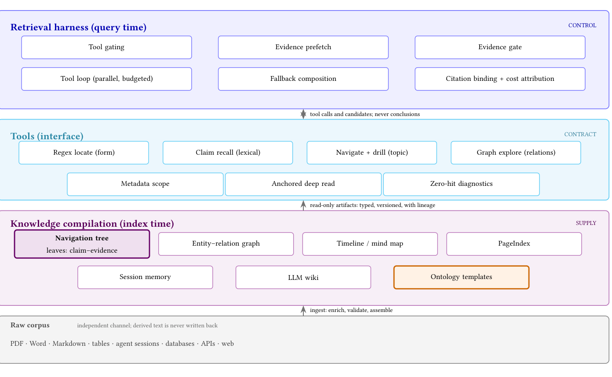
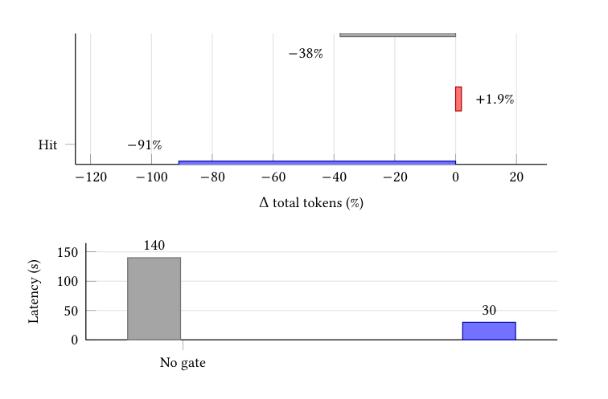

# CAI：知识编译，省的是预算不是准确率

> 这篇消化不假设你读过论文。先给结论，再解释「编译」是什么、怎么测、数字怎么读、工程上怎么用。

## 0. 三句话

1. **它问什么**：agent 在检索时反复查、反复读、把窗口塞满没用的段落；如果在检索之前先把文档「编译」成结构化工件（带证据的树、图、wiki、本体），值不值得？
2. **它怎么做**：在同一套 BM25/grep harness 下，只变工件与阅读方式；在 FRAMES 多跳问答上测准确率、token、时延；再给一个成本模型。
3. **它发现什么**：结构化工件**没有可检出的准确率增益**；唯一测出正收益的是「叶子带逐字证据」的 claim–evidence 树——平均省 38% token，但省 token 可能用检索轮次/时延换；盈亏平衡是条件性的（2% 是无限视野，有限视野更高），而且 2% 只在论文的门与语料上成立，换环境必须重标定。

## 1. 它解决什么问题

### 1.1 背景：检索已经变成 agent 循环

传统 RAG 是「一次检索 → 拼上下文 → 回答」。现在越来越多的系统是 **agentic retrieval**：模型自己写查询、读结果、改写查询、决定什么时候停。这套外围循环叫 **harness**。

harness 变强之后，准确率问题被解决了一部分：论文里的基线只用 BM25 + grep（两种词法检索），作答模型 MiniMax M3，在 BrowseComp-Plus 上 85%、多跳 FRAMES 上 91%——**没有任何向量索引、没有任何编译工件**。作者明确说这两个数不可比：token 规模约 3M/问 vs 325k/问，任务形态不同。

但新问题出现了：**上下文成本**。循环会重复查同样的东西、重读同样的文档、把窗口塞满从未被使用的段落。过程消耗 token，但不产出一个答案。

### 1.2 论文的主张

作者把「检索前的整理」叫 **knowledge compilation（知识编译）**：在查询之前，用 LLM 把源文档加工成**不含于任何单一片段的结构**——导航层级、实体图、时间线、wiki、本体、记忆。

关键立场：**编译不需要是更好的检索器**。它可以是供给层：把「读什么、读多少」的成本降下来。准确率由 harness 负责，编译负责预算。

## 2. 术语

| 术语 | 用大白话说 |
|---|---|
| **CAI** | 本文简称，指 Context as Infrastructure（把上下文当基础设施）。 |
| **agentic retrieval** | 模型在循环里自己查、读、改写、停，而不是一次检索。 |
| **harness** | 包住模型的运行框架：工具、上下文、循环、预算、停止条件。 |
| **BM25 / grep** | 两种词法检索；不依赖向量。 |
| **knowledge compilation** | 在查询之前把文档加工成结构化工件；claim–leaf 树带逐字 lineage，其他工件不一定（wiki 是 lossy provenance）。 |
| **claim–evidence pair** | 一条规范化主张（claim）+ 一段逐字证据（span）+ 源 chunk/offset + 时效。 |
| **artifact** | 编译产物：导航树、实体图、wiki、本体、时间线、记忆等。**并非都带逐字 lineage**：claim–leaf 树有；LLM wiki 是 lossy provenance。 |
| **carrier** | 承载证据的结构（如树），不是检索器；树本身不做检索。 |
| **FRAMES** | 多跳 Wikipedia 问答基准；本文主实验 N=200。 |
| **gate / p_h** | 决策门；`p_h` 是门接受（认为证据充分）的比例。**门的实现论文内部不一致**：§7 seam 说按 unit count / source diversity / entity coverage 三特征打分（像规则），§7 judge selection 又说 prefetched claims 由小模型 judge（Qwen/StartLux）判 sufficient，Listing 1 的 `gate:` 写 `qwen-decision-model-preview`。不能把「规则门」当既定事实。 |
| **shadow 标定** | 门照常计算并记录决策，但不执行；查询仍走未编译路径。被拒查询的反事实答案不可观测，所以门阈值应在 shadow 流量上标定，不能只用被拒样本调门。 |
| **非劣效边界（margin, δ）** | 预登记的「准确率最多可降多少」。Go 判据是**整臂**准确率差的 95% CI 下界 > `−δ` 且 token/时延达标；accepted 分支准确率只作 secondary。论文只说 non-inferior，没给 δ。 |
| **break-even** | 编译成本回本所需的充分率/查询次数。 |
| **arm mean** | 消融的一个分支（arm）相对未编译基线的均值；题数少，不能与 hit/miss 条件分支直接比。 |
| **query-equivalent** | 相当于一次未编译查询的 token 成本；`c` 用它作单位：`c = D×T_doc/T0`（`D` 文档数，`T_doc` 每文档编译 token，`T0` 未编译时每问 token）。**这是初始编译的一次性成本；不含变更触发的增量重抽/重聚类**（见 §6.2、§6.5）。 |

## 3. 它怎么做

### 3.1 三层结构

> 原图：arXiv:2610.41172, p.4, Figure 1。版权归作者，研究评论用途。

**看什么**：供给（index time 编译）→ 契约（tools）→ 控制（query time harness）。编译发生在检索之前，但「什么进窗口、什么时候停」仍由 harness 决定；所以编译不是「换一个检索器」。

### 3.2 六段流水线

| 段 | 做什么 | 工程要点 |
|---|---|---|
| Parse | PDF/Office/HTML/表格/日志 → 规范表示 | 保留标题、列表、表格、页锚 |
| Chunk | 自然边界切块 | chunker 两臂固定，编译不与 chunking 混淆 |
| Enrich | 模型逐块抽 claim–evidence、实体、事件、本体标签、wiki | 本文抽取器 glm-4-flash |
| Validate | span 逐字比对；实体类型对本体；日期对文档；schema 对模板 | **不合法就丢弃，不让模型修** |
| Assemble | claim 聚类成树、实体成图、事件成时间线 | 内部节点是导航标签，不是摘要 |
| Register | 源版本、offset、抽取器版本、校验状态、ACL | 让审计/fallback/增量更新成立 |

### 3.3 claim 单元与 tree 模板

`(c, e, s, τ)`：规范主张、逐字证据 span、源 chunk + 字符偏移、时效。**没有可定位 span 的 claim 不入库**；表示有损于文、无损于出处。

Tree 模板：`extract.unit=claim_evidence`、`require_verbatim_span=true`、`validate=span_match`、`leaves=evidence_units`、`internal_nodes=embedding_clusters`、`summary_nodes=false`、`serve.default=evidence_substitution`、`fallback=raw_chunk`。

### 3.4 三种服务模式

| 模式 | 做什么 | 代价 |
|---|---|---|
| E1 evidence-first | 直接在证据索引上词法检索 | 少一跳；优于「先找文档再下树」 |
| E2 substitution（默认） | 照常检索原文，定位到 chunk 后用 claim–evidence 替换 | 省 token，但增加检索轮次 |
| E3 decision-gated | 小决策模型（Qwen）判断是否值得深读 | 控制读不读；无证据时省约 30% token；与 p_h 准入门是否同一实现，论文没说清 |

**树是 carrier，不是 retriever。** 检索始终是词法的；语义步由 agent 改写查询完成。

### 3.5 一个具体例子

问题：某条法规的例外条款是什么？

- 未编译：agent 先搜文档，读整段，可能读 3–5 个 chunk 才找到条款。
- 编译后：claim–evidence 叶子直接给出「例外条款：X；证据：原文第 12 段，逐字」；E2 只把这一段替换进上下文。
- 如果证据不足：叶子为空，agent 继续检索；miss 的代价是 +1.9% token（因为还要读原文）。

## 4. 结果：数字与条件

### 4.1 被测量的结构化工件没有准确率增益

| 工件 | FRAMES 准确率 | token |
|---|---|---|
| 无编译 BM25/grep 基线 | 91.0% | 324,479/问 |
| Claim–evidence 树 | acc. neutral | 平均 **−38%** |
| RAPTOR 摘要树（去 claim） | acc. neutral | — |
| PageIndex 大纲（去 claim） | neutral at small scale；FRAMES 规模实测为负 | — |
| 实体图 | acc. neutral | — |
| LLM wiki | acc. neutral | — |
| 本体 | **not measured** | — |

条件：Table 4 为 FRAMES N=200；Table 3 的结构变体各跑一次、原文未给 N；BM25/grep harness；MiniMax M3；glm-4-flash 抽取；单次运行、无 CI/重复种子；**gate 实现未统一（三特征 vs Qwen judge）**。**ontology、timeline、mind map、session memory 在 Table 1 是 not measured，不在这个「无增益」结论里。**

**「neutral」的分辨率**：论文没给 CI，也没给非劣效边界。N=200 在 91% 附近，单臂 95% CI 约 ±4pp；两臂差值若按独立比例粗算约 ±5.6pp（论文未给逐题配对数据，配对分析可能更紧；本 digest 推算）。所以「acc. neutral」不能当非劣效证明：它既没有预登记 margin，也没有 CI；要说「差异小于 X」，得自己按 `δ` 做 A/B。

> 出处：Table 4 在 §8.3；结构变体 Table 3 在 §8.2；ontology 行在 Table 1；基线 85%/91% 在 §1 与 §8.7；token 端点 §8.3。

### 4.2 token 收益是条件性的

| 条件 | 总查询 token 变化 |
|---|---|
| 证据充分（gate hit） | **−91%** |
| 证据不充分（gate miss） | **+1.9%** |
| FRAMES 平均 | **−38%** |
| 决策门（有证据，arm mean） | −52% |
| 决策门（无证据，arm mean） | −30% |

**平均会骗人**：−38% 是 −91% 与 +1.9% 的混合；不上报 hit/miss 分布，不能做上线决策。Table 4 的 −52%/−30% 是 **arm mean**，题数更少，原文明确说不可与 −91%/−38% 直接比较。

> 出处：成本模型在 §4.4；决策门 140→30 s 在 §8.5 与 Fig. 2；3× 时延只在 7 道配对题上测（未编译臂另有 1 题失败）。

### 4.3 成本模型

- 无限视野：`p_h > 2.0%`（`0.019/(0.91+0.019)`）。
- 有限视野：`p_min = 2.0% + c/(0.929Q)`；`c` 是**首次编译**成本（query-equivalent，不含变更重抽/重聚类），`Q` 是查询次数。
- 例子（冻结语料）：`Q=1,000, c=10` → `p_min=3.12%`；若 `p_h=2.5%`，仍亏 5.8 query-equivalent。
- 回本（冻结语料）：`p_h≈0.43, c=10` → 约 26 次查询；变更语料要把 `c` 换成 `C_total`（见 §6.2）。
- **门的实现与标定**：`p_h` 不是语料属性，是「你的门 × 你的语料 × 你的抽取器 × 你的服务模式」的属性。**论文门的实现内部不一致**：§7 seam 说 prefetch admission 按 unit count / source diversity / entity coverage 三特征打分（读起来像规则），同节 judge selection 却说 prefetched claims 由 decision judge 判 sufficient，并在 Qwen 与 StartLux 中选了 Qwen；Listing 1 的 `gate:` 直接写 `qwen-decision-model-preview`。论文没交代三特征是喂给 judge 还是规则阈值，也没给 judge 的调用粒度、token、单次延迟。选型只有总数：Qwen 无 failed groups、30.5 s；StartLux 18 failed groups、560.1 s（未给组数/调用数，不能折成单次延迟）。**所以 digest 不把「规则门」当既定事实**：`p_h` 的测量对象随实现变——规则门是特征阈值通过率，judge 门是模型判定接受率；两者都叫 `p_h`，但不是同一个门，后者的成本、降级和标定都不同。
- **shadow 与 go 的 estimand**：**必须在 shadow 流量上标定门**：门计算并记录决策，但不执行；被拒查询的反事实答案不可观测，所以不能用被拒样本调门。Shadow 只能给 `p_h`、接受/拒绝构成和门成本；它给不了整臂准确率。**Go/No-go 用整臂（gate-on vs gate-off）准确率差的非劣效 CI**，accepted 分支准确率只作 secondary——它是被门选中的子集，受选择效应影响。论文的「accepted branch non-inferior」是 shadow 晋升语，不是可执行的 go 判据；要判 go，得在同一 query mix 上做 A/B。论文没写 shadow 里怎么估 accepted 分支准确率——工程上 shadow 定 `p_h`/成本，准确率非劣效放 A/B（`推测`）。
- **2.0–3.6% 只适用论文门（无论最终是规则还是 judge）**：2.0% 是名义值（无限视野）；miss penalty ±1.5pp（0.4–3.4%）使 `p_h*`（盈亏平衡阈值）在 0.4–3.6% 间移动（乐观 0.4%、悲观 3.6%）；有限视野 `Q=1,000, c=10` 时 3.12%。「2.0–3.6%」是名义到悲观这一段，只是论文门在 FRAMES 类语料上的标定带，不是可移植阈值。shadow 直接给的是 `p_h` 与接受/拒绝构成；整臂准确率和 miss 成本都要另测（A/B 或小流量执行），不能从 shadow 的拒绝样本反推。
- **`c` 的折算**：`c = D×T_doc/T0`；`T0` 是未编译时每问 token。**这是首次编译；变更率与重聚类见 §6.2，`T0` 敏感性见 §6.5。**
- 时延：**latency 比较只基于 7 道配对题**（Table 4 的 token/accuracy 是 N=200，latency 是这 7 题）；未编译臂 46.7 s → claim 臂 140 s，约 3×。140→30 s 是 **E3 读深决策门**的均值，不是未编译基线，也不是 §7 的 judge 选型总数（30.5 s/560.1 s）。

> 出处：成本模型 Eq(3)–(9) 在 §4.4；shadow 标定与「non-inferior 才晋升」在 §7（Shadow comparison, p.9）；门的三特征在 §7 seam；Qwen/StartLux 选型与 Listing 1 的 `gate:` 在 §7；有限视野例子在 §4.4。

> 原图：arXiv:2610.41172, p.6, Figure 2。版权归作者，研究评论用途。

**看什么**：上图是条件性 token 变化（hit −91%、miss +1.9%、平均 −38%）；下图是决策门把时延从 140 s 降到 30 s。平均 −38% 掩盖了两端，时延代价在平均值里看不见。

> 出处：Fig. 2, p.6；配对子集时延 3× 在 §8.4（Serving Ablations），不是 §6.4。

### 4.4 为什么结构不提高准确率

论文给了四个机制，值得记住：

1. **harness 已经是自适应的。** grep + 读，本身就是按需建索引；静态分区只有在比 agent 的下一次查询更好时才赢。
2. **结构不是证据。** 摘要/大纲只是重新描述，不增加事实；叶子没有逐字证据时，树只是导航。
3. **抽取误差会复合。** 一个大纲每个 routing 决策 95% 正确，跨 10^5 份文档、分支因子 8 时约 5–6 层决策，端到端约 75% routing 成功；这是**解析模型**，不是 scale sweep。自信的错分支比开放搜索更糟。
4. **结构增加选择负担。** agent 要决定什么时候导航；这消耗轮次与上下文。

这四条解释了为什么「编译」在准确率上中性，却在 token 上可能有条件收益：它优化的是供给，不是证据。

## 5. 这些数字不能说明什么

1. **不是「编译无用」。** 它说明在强词法 harness + FRAMES 上，结构化工件没有可检出的准确率增益；企业语料可能不同（但作者没测）。
2. **不是「本体无用/有用」。** ontology 一行的 FRAMES 结果是 `not measured`；作者把本体价值放在部署层（治理、集成），但 Table 2 的部署 ledger 没有任何一行达到预登记目标——**这是作者主张，不是观测**。
3. **不是「零效应」。** 样本量不足以区分小效应与零；「无可检出」不等于「没有」。
4. **不能外推到企业语料。** FRAMES 是英文 Wikipedia；表格/扫描/行话会降低抽取质量、抬高 miss、减少节省。
5. **PageIndex 的负面是规模观察**，不是普遍规律；75% routing 是解析模型，不是实测。
6. **`p_h` 是 gate 接受率，不是正确率。** 门放行了多少，不等于放对了多少；false-accept rate φ 没测。
7. **平均 −38% 不能当上线依据。** 必须看条件分布、时延、复用次数。
8. **2% 不是可移植门槛。** 它由论文门的 hit/miss 两端（−91%/+1.9%）和 FRAMES 语料算出；换语料、换门、换抽取器、换服务模式都要在 shadow 上重标定。2.0–3.6% 只是论文门的标定带。
9. **100–200 问估不出 `p_h`。** 在 `p_h≈2.8%` 处，n=100/200 的 95% CI 约 ±3.2/±2.3pp（点估计 2.8% 时约 0–6% / 0.5–5%），分不清 2.0 与 3.6；要 ±0.8pp 需约 1,600–2,000 问，或按生产累计（本 digest 推算，非论文数）。

## 6. 工程上怎么用

### 6.1 复刻顺序

顺序固定为：**量基线 → 小范围编译 → shadow 标定 `p_h` → A/B**。先 A/B 后补 `p_h` 会把门量在错的地方。

1. **先量基线。** 用 BM25/grep + 现有 agent 跑目标语料，记录准确率、token/问、时延、轮次。
2. **先选目标成本。** 省 token 还是省时延？两者在这篇论文里是反向的。
3. **保留原检索器。** 默认 E2；不要一上来换 dense/树路由。
4. **只编译证据，不编译散文。** 每个 claim 带逐字 span；span 对不上就丢弃。
5. **抽取器可以用小模型。** 质量由 validation 保证，不由模型大小保证。
6. **树只做 carrier。** 内部节点用聚类标签；叶子是证据。
7. **先编译一小片，再在 shadow 上标定门。** 顺序固定为：量基线 → 小范围编译 → shadow 量 `p_h` → A/B。100–200 问只够 smoke；判门要 ~1,600–2,000 条 shadow 查询。2%/3.12% 只是论文门的数；换语料/门（规则或 judge）必须重标定，judge 门还要固定模型版本与失败降级。
8. **先算账再上线。** 用标定后的 `p_h`（CI 下界）、miss penalty、`c`、`Q`、时延预算算 `p_min`；`c` 要含变更率摊薄，不只是一次性编译。
9. **整臂准确率按非劣效判，不按「不降」。** 预登记 margin `δ`；accepted 分支只作 secondary；论文没给 margin/CI，也没给无 α 控制的 stopping rule。
10. **把审计和交付门分开。** `p_h` 是接受率；φ 要单独估。
11. **按 collection 做部署测量。** shadow/A-B 用 collection hash 分桶；目标预登记；null 报 null。

### 6.2 成本与使能

| 成本 | 发生时机 | 说明 |
|---|---|---|
| Parse + chunk | 一次性 + 变更时 | 便宜；chunker 与基线固定 |
| Enrich | 一次性 + 变更时 | 小模型逐块并行；变更文档只重抽该文档的 chunk |
| Validate + register | 一次性 + 变更时 | 逐字比对；offset/版本/ACL |
| 编译 token/文档 `T_doc` | 一次性 + 变更时 | 抽取（块 × prompt+输出）+ embedding；validation 不算 LLM token |
| 重聚类 | 变更时 | claim 变更后受影响簇重算；论文未给频率/成本 |
| `$/文档` | 一次性 + 周期 | `T_doc × 单价 + 人日/文档 × 人日单价`；论文无金额 |
| 人日 | 一次性/周期 | 抽检、schema 维护、重抽运维、φ 审计；论文无工时，**无法从论文算** |
| 门（规则或 judge） | 每次有 prefetch 时 | 规则门无模型调用（只算特征/阈值）；judge 门按分组调用（每块/组一次，论文未明），token/延迟/失败降级另记；论文只给 Qwen 30.5 s、StartLux 560.1 s 总数 |
| 查询 token | 每次 | 条件性：hit −91%、miss +1.9%、平均 −38%；judge 成本不在论文的 E[Δ] 里 |
| 检索轮次/时延 | 每次 | 替代用轮次换 token；配对子集 3× |
| φ 审计 | 一次性/周期 | 100–400 条标注估 φ；工时计入「人日」；本文未跑 |
| 维护 | 变更时/周期 | registry/版本管理、抽检、schema；人日不可算 |

**`c` 只含首次编译。** 论文说工件是增量的：文档变了只重抽该文档的 chunk、替换 claim 集、更新受影响簇。工程上把这个链条记成：变更率 `r` → 重抽变更文档的 chunk → 替换 claim 集 → 重聚类；论文没给 `r`、重聚类成本或版本失效的代价。工程账本至少加 `r`（每周期变更文档比例）和 `m`（部署周期内变更轮次）：`C_total ≈ c × (1 + m·r) + 重聚类`，所以 `p_min ≈ 2% + C_total/(0.929Q)`（本 digest 推导；重聚类项论文未给，只能自测）。`r` 高时 `p_min` 上移；变更后不重抽、只靠版本失效，hit 会掉、miss 会升（`推测`），−91%/+1.9% 两端都不能直接沿用。**维护人时（抽检、schema、重抽运维、φ 审计）论文完全没有数据，只能自采工时单列，不能折进 token 的 `c`，也不能用「省下的 token × 单价」直接抵。** 因此本文能给的是 token 账，不是完整 TCO（总拥有成本）。

**使能条件**：强词法 harness + 会改写查询的 agent；便宜的小抽取器；逐字 span 校验；可增量、带 lineage 的工件注册；能观测 token/时延。

**2022 年做会卡在哪**：抽取模型更贵更弱；claim-level span 校验不成熟；agent 循环/工具调用不稳；没有「harness 固定、只变工件」的对照意识。

### 6.3 何时用 / 何时别用

**用**：语料相对稳定、查询复用高、token 是主要成本、审计要求高、文本为主可抽取。

**别用**：时延硬约束；查询视野小；表格/扫描/行话导致抽取质量差；没有审计/版本管理；`p_h` 低于 `p_min`。

### 6.4 最小落地实验：编译 → shadow `p_h` → A/B

不要一上来全量编译。顺序不能倒：没有编译工件量不了 `p_h`；没有 shadow 的 `p_h` 就不能开 A/B；100–200 问只够 smoke，不够判门。

1. **量基线。** 同一 harness、同一语料，记准确率、token/问（`T0`）、时延、轮次。N=200 在 91% 附近只界到 ±4pp（单臂 95%，正态近似；本 digest 推算）。
2. **小范围编译。** 单 collection、E2、只编译证据（claim + 逐字 span）；validation 对不上就丢弃；小抽取器即可。同时记 `T_doc`（token/文档）和 `D`（文档数），算 `c = D×T_doc/T0`。
3. **shadow 标定 `p_h`。** 标的是 prefetch 准入的 sufficiency gate，不是 E3 读深决策模型；但论文对 gate 实现内部不一致（三特征打分 vs Qwen judge，见 §4.3），先固定你实际部署的那一种并记版本。门计算并记录决策，但不执行；查询仍走未编译路径。shadow 用线上 hash 分桶（论文做法）；没有线上流量时用留出集回放，只能当离线估计。被拒查询的反事实答案不可观测，所以不能用被拒样本调门；shadow 也不能估整臂准确率，那留给第 5 步 A/B。
   - 样本（按 `p_h≈2.8%` 算）：100–200 问只能 smoke（±2.3–3.2pp）；判门要 ~1,600–2,000 条 shadow 查询（±0.7–0.8pp）。这是**固定样本量**的算法；生产累计也只能按预登记的固定条数停，边看边停要预注册序贯设计（见 §6.5 stop condition）。区间是正态近似；小比例下 Wilson/精确区间更宽，只会加强「100–200 不够」的结论。
   - 判据：`p_h` 的 95% CI 下界 > `p_min`，不是点估计。真实 `p_h` 贴近阈值时样本量会爆炸：真实 4% 要约 1,900 条才让下界刚好到 3.12%，真实 3.5% 要约 9,000 条（本 digest 推算）。
   - miss penalty 另测：给被拒查询也跑编译路径（小流量执行或离线配对回放）；不要从 shadow 的拒绝样本反推。
4. **算 `p_min` 并判。** `p_min = 2.0% + c/(0.929Q)`；若语料会变，`c` 换成 `C_total = c×(1+m·r) + 重聚类`（见 §6.2）。`c` 用第 2 步实测，`Q` 用预计查询量。`p_h` CI 下界 ≤ `p_min` → 不执行；先看 miss 能否压、`c` 能否降。
5. **A/B 执行。** 只改 E2 证据替换，其他不动；按 collection hash 分桶；预登记主指标（token、时延）与**整臂**准确率非劣效 margin `δ`。
   - **非劣效边界**：论文只说 non-inferior，没给 `δ`；`δ` 必须按业务可接受损失预登记。论文提到小样本下 5pp 的差异可能是噪声，那是分辨率提示，不是 margin。
   - **样本**（两臂、基线 91%、80% power、单侧 α=0.025、无聚类；本 digest 推算）：`δ=5pp` → 约 510/臂；4pp → 约 800/臂；3pp → 约 1,430/臂；2pp → 约 3,200/臂。公式：`n/臂 ≈ 7.84 × 2p(1−p) / δ²`（`p` 为基线准确率）。N=200/臂 时差值 95% CI 约 ±5.6pp，`δ` 小于约 5.6pp 时即使观测差为 0，CI 上界也会越过 margin。基线低于 91% 时要按 `2p(1−p)` 重算：80% 基线约翻倍，70% 基线约 2.6 倍。按 collection 整簇分桶时有聚类效应，样本要乘设计效应，上表是下限。
   - **过门**：token/时延达标且**整臂**准确率差值的 95% CI 下界 > `−δ`；否则门退回 logger，不扩量。accepted 分支准确率只作 secondary，不参与 go 判定。报告格式按论文 Table 2 的 observation 模板：collection 数、query 数、指标从 A 到 B、accuracy non-inferior、target met。
6. **估 φ。** 抽 100→400 条 accepted query 人工标 `H`；论文 Eq(11)：100 条约 4–16%，400 条约 7–13%。不要用 `p_h` 代替 φ。
7. **再扩 E1/E3。** 时延硬约束时优先 E1/决策门，不要买 token 节省。

## 6.5 工程配方（E3）

### 接口

- **编译侧**：`compile_kwd` 存在性探针（没有编译工件就不暴露导航/图/大纲工具）；chunk→claim 的锚定查表；claim 索引字段至少含 `claim_id, text, span_start, span_end, chunk_id, source_version, extractor_version, acl`。
- **服务侧**：per-tool 三档 policy：`off` / `compiled-only` / `compiled-first`；E2 替换返回 `claim + span + source`，不是整段。
- **工具面**：词法检索、claim 检索、导航/图探索、深读；工具名-参数-返回 schema 论文只给功能，不给 JSON schema，团队需自定并固定，否则 A/B 不可比。
- **评测面**：记录 `query_id, arm, hit/miss, token_in/out, latency, rounds, gate_verdict, citations`；没有这张表就算不出 p_h/φ。

### 参数

- 论文给的检索参数：`topN=20`、`k=100`、anchor depth 20（10→20 有增益，30 无进一步增益）、两条词法腿取并集、不做 count 截断。
- gate 判据：**论文内部不一致**——§7 seam 是 unit count / source diversity / entity coverage 三特征，§7 judge selection 与 Listing 1 是 Qwen/StartLux 小模型 judge（`gate: qwen-decision-model-preview`）。`p_h` 量的是 prefetch 准入的接受率；140→30 s 是 E3 读深决策模型（也是 Qwen 小模型），与 p_h 门是否同一个实现，论文没交代。**不要把「三特征规则」写成论文事实**；部署时先固定一种实现并记录 judge 版本/调用粒度/失败降级。把两个门混算，p_h 和时延都会记错。
- 论文未给：chunk 尺寸、embedding 模型、聚类分支因子；不要假装有默认值。

### 成本

论文只给 token 与相对时延，**没有金额、机时、人日**，也没给 judge 的调用成本。下面每一项都要用自己的语料/合同填；`c=10` 是论文的示例，不是你的值。

- **token/文档（`T_doc`，一次性 + 变更时）**：`T_doc = 块/文档 × (抽取 prompt + 输出 token) + claim/文档 × embedding token`。validation 是逐字比对，不算 LLM token；聚类用 embedding。抽取逐块并行、与查询无关，所以首次编译是一次性账；变更文档的重抽按变更率另记。
- **judge 调用（每次，若门是模型）**：论文只给 Qwen 30.5 s 总时延/无 failed groups、StartLux 560.1 s/18 failed groups；没有调用次数、每组 token、单次延迟、重试率。账本要记 `judge_calls/query`、`judge_tokens/call`、`judge_latency/call`、`judge_fail_rate`，以及失败后的降级（重试、跳过门读 raw chunk，还是拒绝 prefetch）。论文只说「degrades gracefully」，没给策略。若门是规则，这一项换成特征计算/打分成本（通常远小，但也要记）。
- **`c` 的折算**：`c = D × T_doc / T0`；`D` 文档数，`T0` 未编译 harness 平均每问 token（论文 FRAMES 基线 324,479/问，只作参照）。反解预算：`T_doc ≤ c·T0/D`。用论文的 `T0` 和示例 `c=10`：`D=1,000` 文档 → 3,245 token/文档；`D=10,000` → 324；`D=100,000` → 32（显然不可行）。语料越大，单文档预算越薄——这就是「只编译会被消费的部分」。**这是首次编译；若文档会变，`c` 要按 `C_total ≈ c×(1+m·r) + 重聚类` 摊到 `Q` 上（见 §6.2）。**
- **$/文档（一次性 + 周期）**：`$doc = T_doc × 单价($/1M token) + 人日/文档 × 人日单价 + 存储/向量库（可选）`。抽取与 embedding 单价可能不同，分开乘；单价按合同填，论文没有金额。人工不进 `c`（`c` 是 token 单位）；要算 $ 收益，就把两臂 token 乘同一单价、人工单列，再用 Eq(8) 的 `B(Q,c,p_h)` 摊销。
- **人日（论文无数据，不能算）**：至少四块——① 抽取抽检（每批 claim 抽 span 正确率）；② schema/本体维护；③ 增量重抽运维（变更触发；重聚类频率/版本对账/ACL 论文未给）；④ φ 审计（100→400 条 accepted query 标注 + 复核，见 Eq(11)）。论文未给任何工时；用「分钟/claim」「小时/100 条审计」「小时/次重抽」记，折成 `人日/千文档 = (抽检 + schema + 重抽运维) / (D/1000)`，审计与月度运维单列 `人日/月`。**这些只能自采，不能从论文的 token/时延数字推导；维护人时是 TCO 的缺口，不是小项。**
- **miss penalty 的不确定性主导**：±1.5pp 的 miss penalty 会让 `p_h*` 在 0.4–3.6% 间移动，而 hit saving ±1.5pp 只动 2.0–2.1%；所以先量 miss，不要先优化 hit。测 miss 时，分母按「门判 miss 的查询」单独记，不要用整体平均反推。

**`T0` 敏感性（企业情景，`推测`）**：`c = D×T_doc/T0`，`T0` 在分母，所以上下文越短，编译的相对成本越高。论文 FRAMES 的 `T0≈324,479` token/问；若企业 agent 每问只用 5k–20k token（情景假设，论文未测），同样 `D`、`T_doc` 下 `c` 会大约 16–65×（324,479/20,000≈16.2，324,479/5,000≈64.9；本 digest 推算）。以论文示例 `c=10` 为基准、`Q=1,000`：

| 场景 | `T0`（token/问） | 同 `D`、`T_doc` 下 `c` | `Q=1,000` 时 `p_min` |
|---|---|---|---|
| 论文 FRAMES | 324,479 | 10（论文示例） | 3.12% |
| 企业情景 A（`推测`） | 20,000 | ≈162 | ≈19.5% |
| 企业情景 B（`推测`） | 5,000 | ≈649 | ≈71.9% |

`T0` 是情景假设，`c`/`p_min` 是本 digest 按 `c=D×T_doc/T0` 与 Eq(9) 推算，不是论文数；`D`、`T_doc`、`Q` 保持不变。**企业短上下文场景不能引用 2%；要几十个百分点的 `p_h` 才回本**，而 `p_h` 在 FRAMES 上只有反推的 43%，企业未必更高（`推测`）。

**账本最少字段**：`D`、块/文档、`T_doc`、`T0`、`r`（变更率）、`m`（变更轮次）、`T_recluster`、抽取/embedding 单价、人日/千文档、`Q`、`c`、`p_h`、miss、`δ`；若门是 judge，再加 `judge_calls/query`、`judge_tokens/call`、`judge_latency/call`、`judge_fail_rate` 与降级策略。没有这张表，$/文档、`p_min` 和完整 TCO 都算不出来。

> 出处：增量更新（只重抽变更文档、替换 claim 集、更新受影响簇）在 §4.2（Cost）；`T0` 与 324,479 在 Table 4；Qwen/StartLux 的 30.5 s/560.1 s 与 18 failed groups 在 §7；人日论文未给。

### stop condition

- `p_h` 的 95% CI 下界 ≤ `p_min = 2.0% + c/(0.929Q)` → 不执行，先转 harness 侧（收紧读预算/改停止策略/缓存）；**按预登记样本量一次判读**，不允许用点估计过门。要分段看/提前停，必须预注册序贯设计（如 alpha spending）；否则 repeated peeking 会让未调整的 CI/第一类错误率失真（统计常识；论文未讨论）。
- 没在 shadow 上标定，或 shadow 样本 <1,600–2,000 → 门保持 logger，不判 go、不 A/B、不全量；不要「累计到显著」。
- A/B 的**整臂**准确率差值 95% CI 下界 ≤ `−δ`（非劣效不成立）→ 门退回 logger；`δ` 必须预登记，不能事后改。accepted 分支准确率只作 secondary，不参与 go 判定。
- 门实现或 judge 版本变了（规则↔judge、Qwen 版本升级）→ `p_h` 与成本重新标定，不继承旧阈值。
- `p_h` 过门但 p95 时延超预算 → 只在 token 是硬成本的一小片流量灰度；不要全量。
- φ 的 95% CI 宽于业务可接受（例如 ±5pp）→ 先扩审计样本，不自动放行。
- `T_doc` 或变更后的年化编译成本超过 `c·T0/D` 的预算 → 缩小编译范围（只编译高消费 collection）或停；编译不是免费。
- 维护人时 > 省下的 token 价值 → 停；但论文无人日数据，这条只能自采工时后算，不能从论文推导。

### 替代方案

- 改 harness：收紧读预算、改停止策略、缓存重复查询、并行检索；论文自己说准确率问题已由 harness 解决，最强竞争对手在 harness 侧。
- 查询期上下文压缩（LLMLingua 类）、结果缓存、更便宜的作答模型；论文没有与这些做头对头成本-收益。
- 直接不编译：如果 p_h 低/时延硬约束，这是合法选择。

### 失败模式

- 把 p_h 门与 E3 读深门混为一谈（论文没把两者的关系说清；两者都可能用 Qwen）；把论文门当规则门或当 judge 门而不核实现；把 arm mean 与 hit/miss 条件分支混比；把 46.7 s 当 7 题基线；把 43% 当实测（它是反推）。
- 用 100–200 问判门、用点估计过 `p_min`、不在 shadow 上标定就开 A/B。
- 用 accepted 分支准确率当 go 判据；没有序贯设计却反复看 CI 决定停/继续。
- 把论文的 5pp 噪声量级当 non-inferiority margin；不预登记 δ。
- 把 `c=10` 当自己的 `c`；把 `c` 当只算一次（忽略变更率/重抽/重聚类）；只报 token，不报 $/文档与人日。
- 只报平均 −38%，不报 hit/miss 分布。
- 抽取质量差（表格/扫描/行话）导致 miss 高；没有 φ 就自动放行。
- 编译产物被当事实；span 对不上仍入库。

## 6.6 客户价值假设（V2/V3，`推测`）

- **受益者**：agent 平台/检索团队；痛点：长程检索 token 成本高、窗口被未使用段落占满、时延不稳。
- **指标**：每千问 query-equivalent 成本、p95 时延、回答准确率、审计通过率/千条；编译侧加 token/文档、$/文档、人日/月。
- **反事实**：不做编译 → 继续用 BM25/grep + 原 harness；成本基线可测；不做的代价是 token/时延，不是准确率。
- **V3 试点**：单语料、只做 E2；顺序固定为 编译 → shadow 标定 `p_h` → A/B。100–200 问只作 smoke；判门按预登记固定样本量累计 1,600–2,000 条 shadow 查询。预注册：`p_h` 的 95% CI 下界 > `p_min`；**整臂**准确率非劣于 margin `δ`（自定；`δ=3pp` 约需 1,430/臂，`δ=5pp` 约 510/臂，本 digest 推算）；p95 时延不超预算。成功 = token 降 ≥20% 且整臂准确率非劣、时延不超；失败 = `p_h` CI 下界 ≤ `p_min`、非劣效失败或时延超；停止线 = 年省 token 价值 < 维护人时（含审计；论文无人日数据，须自采）。
- **反例**：Q 太小摊不薄编译；时延硬约束；表格/扫描语料抽取差；维护人时吃掉收益；作者自评 RAGFlow，无厂商独立复现。

## 7. 质量与边界

- **证据类型**：实证·基准 + 成本模型（一手正文）。
- **强项**：对照干净（只变工件/服务模式）；同时给反证；成本模型可复用；局限写得诚实（无 CI、单基准、部署 ledger 为空）。
- **主要威胁**：单基准、单 compiler、单 answer model；无置信区间/重复种子；FRAMES 是英文 Wikipedia；PageIndex 负面是规模观察；φ 未测；部署层无观测；**gate 实现未统一（三特征 vs Qwen judge），`p_h` 测的是哪一种门没有交代**。
- **`quality: B`**：机制与成本模型强、内部对照干净；但外部效度、复现次数、部署观测不足。

## 8. 与仓库判断的关系

- **E-01（已核）**：强 harness 下结构化工件无可检出准确率增益；PageIndex 在 FRAMES 规模实测为负（10^5 是解析模型，不是实测）。补充：基线 91%、单基准、无 CI；N=200 单臂 95% CI 约 ±4pp，两臂差值按独立比例粗算约 ±5.6pp（论文未给配对数据；本 digest 推算）；「neutral」不是非劣效证明；部署价值是作者主张。
- **E-08（已核）**：claim-leaf tree 是唯一测出正收益的工件；−91%/+1.9%/−38%；2% 是无限视野盈亏平衡，且只在论文门（实现未统一，见 §4.3）/FRAMES 语料上标定（2.0–3.6% 不可移植）；43% 是由 −38% 反推的 p_h（不是直接计数）。
- **E-14（已核）**：有限视野 `p_min=2%+c/(0.929Q)`（`c` 为首次编译；变更语料见 §6.2）；平均 −38% 不能当上线依据；时延约 3×；门要在 shadow 上标定 `p_h`，go 用**整臂**非劣效 CI（accepted 分支只作 secondary）；判 `p_h` 约需 1,600–2,000 问（本 digest 推算）。门实现论文内部不一致（规则特征 vs 小模型 judge），见 §4.3；这是 E-14 里的 `存疑` 子项，成本公式部分不受影响。
- **C-04**：CAI 投影的是**证据**（claim+span），N&D 投影的是**领域知识**（本体塔）；两者都是「投影」，但 payload 不同。
- **P1**：支撑「价值在部署/治理」——但 CAI 的部署价值是作者定位，ledger 为空；只能标「作者这么说」，不能标「已证」。
- **RQ5**：提供最可操作的「何时值得」公式。

## 9. 还没解决 / 下一步

- **企业语料的 `p_h`/miss**：FRAMES 的 43% 是反推值，不能外推；表格/扫描/行话会改变盈亏平衡。
- **门的实现与标定**：论文一处说三特征打分、一处说 Qwen/StartLux judge（Listing 1 也是 judge），没有统一；judge 的调用粒度/成本/失败降级也没给。1,600–2,000 条只够分辨 2.0 vs 3.6；真实 `p_h` 贴近 `p_min`（3.5% vs 3.12%）时约需 9,000 条。序贯/分段判读、生产累计怎么停，论文都没讨论；本文不给无 α 控制的 optional stopping，要用就预注册序贯设计。
- **非劣效 margin 与 shadow 估法**：论文只说 non-inferior，没给 `δ`，也没写 shadow 里怎么估 accepted 分支准确率；而且 accepted 分支不是 go 的 estimand（整臂才是），shadow 也估不出整臂。`δ` 是业务决定，本文没有依据。
- **成本口径**：token/文档、$/文档、人日论文都没给；`c` 只能自己实测。`c` 还只是首次编译，变更率→重抽→重聚类、`T0` 敏感性都没进论文的成本模型；人日无法从论文算，完整 TCO 缺一块。
- **φ（false-accept rate）**：`p_h` 不是正确率；需要 100–400 条标注审计。
- **时延代价**：证据替换的 3× 时延能否用并行/预算控制压下来？
- **增量维护成本**：文档频繁变更时，registry/重抽/聚类更新会不会吃掉 token 收益？论文只说增量可行，没给变更率/重聚类成本；这是 TCO 的最大未测项。
- **部署层回报**：治理/上手/审计通过率仍没有量化。
- **投影 vs 编译边界**：C-04 仍靠人工预判「答案在不在文本里」。

## 10. 原文

- arXiv:2610.41172
- PDF：同目录 `2610.41172-context-as-infrastructure.pdf`
- 代码：RAGFlow，https://github.com/infiniflow/ragflow（作者在评自己的管线）
- 实现细节在 §7 与 Listing 1；本文没有附录。
