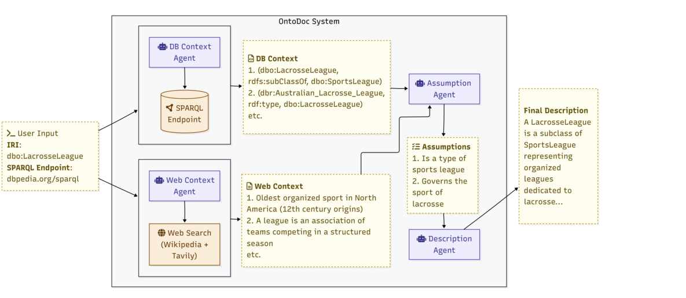

# OntoDoc · 分解

> 只记**论文说了什么**。工程判断、质量评估、洞察见同目录 [digest.md](./digest.md)。

## 一句话

给任意 IRI 自动写 `rdfs:comment` 式的自然语言说明：四阶段 pipeline（自适应 SPARQL 探索 → 网页背景检索 → **显式假设生成** → 描述生成）；在 151 个术语、3 个知识图上，完整性从 3.43 提到 3.84（5 分制），明显优于模板 verbalizer，但**没有测下游任务是否变好**。

## 问题与设定

- **问题**：大量本体术语没有 `rdfs:comment`，人工写不可扩展；模板/规则 verbalizer 只能覆盖显式公理，读不出实例数据里的语义。
- **数据**：151 IRIs：
  - BioBricks-MeSH：51 IRIs，17 classes / 21 object properties / 28 datatype properties。
  - SOCKG：70 IRIs，92 classes / 62 object properties / 10 datatype properties。
  - DBpedia：30 IRIs，790 classes / 1,167 object properties / 1,857 datatype properties。
- **评估**：4 维（accuracy / clarity / completeness / cruciality），5 分 Likert；LLM judge（kimi-k2.5）+ 11 位人工标注者。
- **baseline**：naive single-hop retrieval + LLM；模板 ontology verbalizer。
- **能证明**：多阶段证据合成显著提高 completeness，且在专业域 accuracy/clarity 不差；假设生成阶段有增益。
- **不能证明**：描述变好后下游任务是否变好；跨更多本体；长期维护；人工评估只评了 OntoDoc 输出（没和 baseline 混合盲评）。

## 机制

### 四阶段（Fig. 1, p.5）

1. **DB Context Agent**：自适应 SPARQL 探索；5 个工具（`get_iri_information`、outgoing/incoming、predicate_usage、`execute_sparql`）；预算 50 triples / 10 tool calls；四阶段：Orient → Initial scan → Targeted follow-up → Summarize；输出编号去重的 triple 列表。
2. **Web Context Agent**：从 IRI 提取 label；停用词过滤；Wikipedia + Tavily；Cohere Rerank 3.5，k=3，阈值 0.75；输出 `web_context`。
3. **Assumption Generation**：输入 DB + web context；输出 JSON `{items:[{reasoning, assumptions}]}`；**DB context 是权威，web 只作补充**；至少一条 assumption 引用 DB triple 编号。
4. **Description Generation**：以 lexicographer 角色写简洁说明；不直接命名 IRI；优先 instance-level、区分性事实；`persist_description` 记录配置。

### 关键设计

- **自适应探索 > 固定查询**：不同 class/property/instance 的形状不同，单一 SPARQL 模板抓不全。
- **假设是显式中间层**：先写 reasoning + assumptions，再写描述；相当于把「推断前提」摆到台面上。
- **DB 权威、web 补充**：避免网页噪声覆盖图内事实。
- **共享 session state**：四个 agent 不直接互调，通过 key-value state 解耦；可替换/消融。

## 关键数字

| 数字 | 条件 | 出处 |
|---|---|---|
| **3.43 → 3.84** | 平均 completeness：naive → OntoDoc（5 分制） | §5.3, p.12 |
| **3.67 → 3.97** | DBpedia completeness | Table 5, p.13 |
| **3.37 → 3.71** | BioBricks-MeSH completeness | Table 5, p.13 |
| **3.26 → 3.84** | SOCKG completeness | Table 5, p.13 |
| **4.20 vs 4.30** | DBpedia accuracy：OntoDoc vs naive（naive 略高） | Table 5, p.13 |
| **4.47 vs 4.73** | DBpedia clarity：OntoDoc vs naive（naive 略高） | Table 5, p.13 |
| **3.76 vs 3.65** | BioBricks accuracy：OntoDoc vs naive | Table 5, p.13 |
| **3.91 vs 3.90** | SOCKG accuracy | Table 5, p.13 |
| **1.20 / 1.75 / 3.18** | verbalizer completeness：DBpedia / SOCKG / BioBricks | Table 6, p.13 |
| **4.00 / 3.96 / 3.88** | OntoDoc completeness：DBpedia / SOCKG / BioBricks | Table 6, p.13 |
| **57% / 61% / 54%** | 假设阶段 win rate：DBpedia / BioBricks / SOCKG | Table 4, p.11 |
| **47.02% / 23.18% / 29.80%** | 模型选择 win rate（有假设）：GPT-4.1 Mini / Gemini / GLM | Table 3, p.11 |
| **4.43 / 4.36 / 4.36 / 4.20** | 人工评分 DBpedia：accuracy / clarity / completeness / cruciality | Table 7, p.14 |
| **4.51 / 4.49 / 4.43 / 4.34** | 人工评分 BioBricks | Table 7, p.14 |
| **3.93 / 3.65 / 3.72 / 3.74** | 人工评分 SOCKG | Table 7, p.14 |

## 图表索引

### 图 1：四阶段 pipeline

> 原图：arXiv:2611.01276, p.5, Fig. 1。版权归作者，研究评论用途。

**看什么**：DB Context 与 Web Context 并行，汇总到 Assumption Agent，再写描述。**关键工件是 middle 的 assumptions**，不是最后的文字。

## 作者自述局限

- 假设阶段是**语义瓶颈**：漏掉的关键细节后面拿不回来；可能降低 completeness。
- 没有测下游任务（用户是否更容易理解/使用）；只测描述质量。
- 151 个术语、3 个本体；跨更多本体/语言未测。
- LLM judge 可能偏好冗长；人工评估只评 OntoDoc 输出，没做 baseline 盲评。
- 描述质量 ≠ 本体质量；生成说明不能替代本体修正。

## 引用锚点

- 「We present OntoDoc, a multi-agent framework for automatically generating natural language descriptions for any Internationalized Resource Identifier (IRI).」（Abstract）
- 「The core idea is to force the model to reason explicitly before it writes.」（§4.3, p.7）
- 「the database context is designated as authoritative, whereas the web context is treated as supplementary background only.」（§4.3, p.8）
- 「this step acts as a semantic bottleneck ... any crucial detail omitted ... becomes permanently unavailable.」（§4.3, p.8）
- 「the template-driven verbalizer, limited to explicit schema axioms, misses much of the semantic information that OntoDoc recovers.」（§5.3, p.13）

## 待核

- [ ] 描述变好后，下游任务/用户理解是否变好？
- [ ] 假设阶段的信息损失：哪些类型的事实最容易被丢？
- [ ] 跨本体/多语言是否同样？
- [ ] LLM judge 与人工的偏好是否一致（本文说趋势一致，但只评 OntoDoc）？
- [ ] 生成说明的维护：本体变更后如何增量更新？
