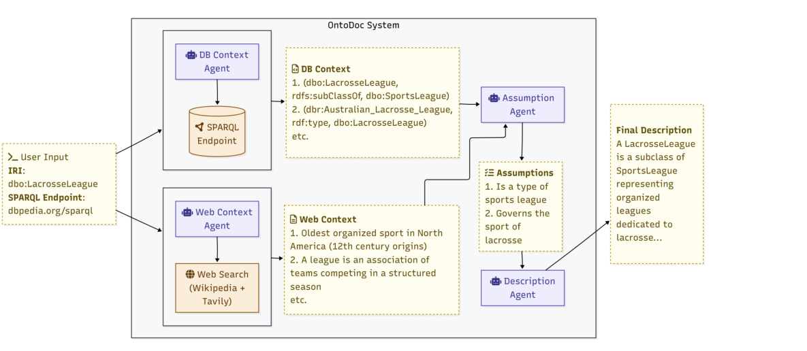

# OntoDoc：自动给本体术语写说明

> 这篇消化不假设你读过论文。先讲清「本体术语缺说明」这个问题，再看四阶段 pipeline、151 个术语上的结果与边界。

## 0. 三句话

1. **它问什么**：知识图谱/本体里大量术语没有 `rdfs:comment`；人工写不可扩展，模板 verbalizer 只覆盖显式公理、读不出实例语义。能不能自动写一条既准确又完整的说明？
2. **它怎么做**：四阶段 pipeline——自适应 SPARQL 探索 → 网页背景检索 → **显式假设生成** → 描述生成；四个 agent 通过共享 state 解耦。
3. **它发现什么**：151 个术语、3 个知识图上，completeness 从 3.43 提到 3.84（5 分制），模板 verbalizer 只有 1.2–3.2；假设阶段 win rate 54–61%。**但没有测下游任务是否变好。**

## 1. 它解决什么问题

### 1.1 背景

本体定义术语的含义，但用户/agent 看的是 `rdfs:comment` 这类自然语言说明。现实中大量术语没有说明；人工写不可扩展。

模板/规则 verbalizer 的问题：只能覆盖显式公理（`A ⊑ B`、domain/range），读不出：
- 实例数据里的语义（这个类实际装了什么）；
- 上下文（这个属性在业务里怎么用）；
- 例子（一个具体的 IRI 长什么样）。

### 1.2 论文的立场

好的说明应该**扎根于实际数据**，同时给专家和新手可读的上下文；所以先探索图，再检索网页背景，再**显式写出推断假设**，最后写描述。

## 2. 术语

| 术语 | 用大白话说 |
|---|---|
| **IRI** | 本体里的资源标识符；可以是一个类、属性、实例。 |
| **rdfs:comment** | 给 IRI 的自然语言说明；本文的目标产物。 |
| **verbalization** | 把形式公理翻译成自然语言。 |
| **SPARQL** | 查 RDF/知识图谱的查询语言。 |
| **assumption** | 从 DB + web context 推断出的中间命题；带 reasoning 和 triple 引用。 |
| **completeness** | 说明覆盖了多少关键信息（5 分制）。 |
| **cruciality** | 说明是否包含对该术语最关键的事实（5 分制）。 |
| **template verbalizer** | 用固定模板把公理转成文本的基线。 |

## 3. 它怎么做

### 3.1 四阶段

> 原图：arXiv:2611.01276, p.5, Fig. 1。版权归作者，研究评论用途。

**看什么**：DB Context 与 Web Context 并行，汇总到 Assumption Agent，再写描述。**关键工件是 middle 的 assumptions**，不是最后的文字。

1. **DB Context Agent**：自适应 SPARQL 探索；5 个工具（`get_iri_information`、outgoing/incoming、predicate_usage、`execute_sparql`）；预算 50 triples / 10 tool calls；四阶段：Orient → Initial scan → Targeted follow-up → Summarize。
2. **Web Context Agent**：从 IRI 提取 label；Wikipedia + Tavily；Cohere Rerank 3.5，k=3，阈值 0.75。
3. **Assumption Generation**：输入 DB + web context；输出 JSON `{items:[{reasoning, assumptions}]}`；**DB context 是权威，web 只作补充**；至少一条 assumption 引用 DB triple 编号。
4. **Description Generation**：以 lexicographer 角色写简洁说明；不直接命名 IRI；优先 instance-level、区分性事实。

### 3.2 一个具体例子

目标 IRI：`dbo:LacrosseLeague`。

- DB context：`(dbo:LacrosseLeague, rdfs:subClassOf, dbo:SportsLeague)`、`(dbo:Australian_Lacrosse_League, rdf:type, dbo:LacrosseLeague)`。
- Web context：最老的 lacrosse 组织在北美；联盟是团队运动协会。
- Assumptions：它是 sports league 的子类；它管理 lacrosse；它把多个联盟组织起来。
- 描述：`A LacrosseLeague is a subclass of SportsLeague representing organized leagues dedicated to lacrosse...`

## 4. 结果：数字与条件

### 4.1 完整性（LLM judge，5 分制）

| 知识图 | naive | OntoDoc | 模板 verbalizer |
|---|---|---|---|
| DBpedia | 3.67 | **3.97** | 1.20 |
| BioBricks-MeSH | 3.37 | **3.71** | 3.18 |
| SOCKG | 3.26 | **3.84** | 1.75 |
| 平均 | 3.43 | **3.84** | — |

- 平均 completeness +0.41（约 12%）；相对模板 verbalizer，最高 +2.8 分。
- accuracy/clarity：DBpedia 上 naive 略高（accuracy 4.30 vs 4.20；clarity 4.73 vs 4.47）；BioBricks/SOCKG 上 OntoDoc 略高。
- 假设阶段 win rate：DBpedia 57%、BioBricks 61%、SOCKG 54%。

### 4.2 人工评估（11 annotators，5 分制）

| 知识图 | accuracy | clarity | completeness | cruciality |
|---|---|---|---|---|
| DBpedia | 4.43 | 4.36 | 4.36 | 4.20 |
| BioBricks-MeSH | 4.51 | 4.49 | 4.43 | 4.34 |
| SOCKG | 3.93 | 3.65 | 3.72 | 3.74 |

- 人工与 LLM judge 趋势一致；但人工只评 OntoDoc 输出，没有与 baseline 盲评。
- SOCKG（农业/土壤）分数更低，符合领域术语更专业的直觉。

> 出处：Table 5, p.13（naive 对比）；Table 6, p.13（verbalizer）；Table 7, p.14（人工评估）；Table 4, p.11（假设消融）。

## 5. 这些数字不能说明什么

1. **不是下游效用。** 说明写得更完整，不等于用户/agent 更能用；本文没测。
2. **不是所有本体。** 151 个术语、3 个知识图；跨更多本体/语言未测。
3. **不是「总是更好」。** DBpedia 上 naive 的 accuracy/clarity 略高；简单图上复杂 pipeline 可能过度加工。
4. **模板 verbalizer 的 completeness 低，不代表它没用。** 它只覆盖显式公理；对形式说明更合适。
5. **LLM judge 可能偏好冗长。** 人工评估只评 OntoDoc 输出，没做 baseline 盲评。
6. **假设层是语义瓶颈。** 漏掉的关键细节后面拿不回来；作者自己指出这是 tradeoff。

## 6. 工程上怎么用

### 6.1 复刻顺序

1. **先做自适应 SPARQL 探索，不要单跳查询。** 先判 IRI 类型（class/property/instance），再按类型扫 outgoing/incoming/实例；class 少于 10 个实例就全取，并看 2–3 个实例属性。
2. **加网页背景，但只作补充。** Wikipedia 适合通用词；Tavily 适合技术/小众词；rerank + 阈值；DB context 是权威。
3. **先写 assumptions，再写描述。** 每条 assumption 带 reasoning 和 triple 引用；至少一条引用 DB triple。
4. **描述要 lexicographer 风格。** 不直接命名 IRI；优先 instance-level、区分性事实；省略通用元数据。
5. **四个 agent 用共享 state 解耦。** 每个阶段读/写固定 key；可替换/消融。
6. **评估四维分开。** accuracy / clarity / completeness / cruciality；只看一个会掩盖 tradeoff。
7. **先和 naive 比，再和模板比。** Naive 在简单图上 accuracy/clarity 可能更高。
8. **承认没有下游评估。** 说明完整 ≠ 用户/agent 更能用。

### 6.2 成本与使能

| 成本 | 一次性/每次 | 说明 |
|---|---|---|
| SPARQL 探索 | 每 IRI | 50 triples / 10 tool calls 预算；可调 |
| Web 检索 | 每 IRI | Wikipedia/Tavily + rerank；API 成本 |
| LLM 调用 | 每 IRI | 4 个 agent；GPT-4.1 Mini 默认 |
| 人工复核 | 抽样 | 11 annotators；专业域需专家 |
| 维护 | 本体变更 | 增量重生成；未实现 |

**使能条件**：SPARQL endpoint/RDF；实例数据；网页检索 API；LLM API。

### 6.3 何时用 / 何时别用

**用**：本体术语缺说明；有 SPARQL endpoint；有实例数据；需要批量补文档。

**别用**：本体很小/很简单；没有实例数据；需要形式公理说明（模板更合适）；需要下游任务保证。

## 7. 质量与边界

- **证据类型**：实证·基准（151 terms，3 KGs，11 annotators）。
- **强项**：多本体；assumption 中间层；人工评估；可复现代码；诚实写「语义瓶颈」。
- **主要威胁**：151 terms；无下游任务；LLM judge；人工只评 OntoDoc；跨语言/本体有限；描述质量 ≠ 本体质量。
- **`quality: B`**：机制清晰、多本体、有人工评估；但无下游任务、样本有限、评估口径偏描述质量。

## 8. 与仓库判断的关系

- **05-L6（已核）**：先写 assumptions 再写描述，显著提升 completeness（win 54–61%；3.43→3.84）。
- **05-L7（推测）**：说明质量 ≠ 可消费性；没有测下游任务。
- **05-L3**：生成产出候选，不是完备本体；本文同样没有证明「生成说明能被下游判定器消费」。
- **03 知识**：说明文本是投影的原料；与 concept card 相接。

## 9. 还没解决 / 下一步

- **下游任务**：描述变好后，用户理解/agent 表现是否变好？
- **假设阶段信息损失**：最容易丢哪类事实？能否量化？
- **跨本体/多语言**：是否同样？
- **LLM judge vs 人工**：需要 baseline 盲评。
- **增量更新**：本体变更后如何更新说明？
- **说明质量纳入本体发布流程？**

## 10. 原文

- arXiv:2611.01276
- PDF：`src/papers/2611.01276-ontodoc/`
- 代码/数据：论文未给公开仓库。
