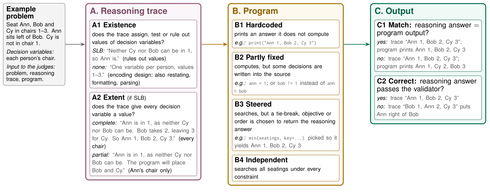
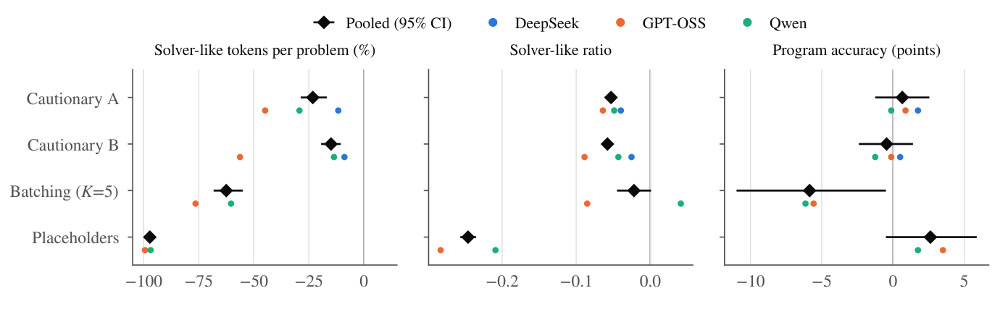

# Solver-Like Behavior · 分解

> 只记**论文说了什么**。工程判断、质量评估、洞察见同目录 [digest.md](./digest.md)。

## 一句话

LLM-as-formalizer 的推理轨迹经常**自己把求解器该做的搜索做完了**（solver-like behavior, SLB），而程序只是复述答案；只看程序输出的评估区分不出「搜索」与「复述」。2,000 条生成中 85% 轨迹有 SLB、占 24% 推理 token；把问题的值藏到运行时占位符后面，SLB 减少 97% 且不损准确率。

## 问题与设定

- **问题**：formalizer 的承诺是「LLM 写程序，solver 搜索」；如果推理轨迹已经算完答案，程序只是复述，solver 的保证就失效。输出评估看不出来。
- **数据**：4 个约束满足数据集（Calendar Scheduling、Meeting Planning、ZebraLogic、BlocksWorld），每个 100 instances；2 种形式语言（Python imperative；Z3/PDDL declarative）。
- **模型**：DeepSeek-V4-Flash、GPT-OSS-120B、Qwen3.8-27B（都是会写长 trace 的 reasoning model）。
- **规模**：2,000 generations；LLM judge（Gemma 4 31B-it）标注，与盲人标签一致率 90–98%。
- **能证明**：SLB 普遍、冗余、与准确率无关；形式语言影响最大；占位符能几乎消除 SLB。
- **不能证明**：其他任务类型（定理证明/优化）、其他语言、闭源模型（API 不返回完整 trace）；单次生成，不含采样方差。

## 机制

### SLB 本体（Fig. 2, p.4）

| 部分 | 节点 | 判据 |
|---|---|---|
| A. Reasoning trace | A1 existence | trace 是否 assign/test/rule out 决策变量的值 |
| | A2 extent | 是否给每个决策变量赋值（complete/partial） |
| | solver-like ratio | SLB 段落占 trace 的比例 |
| B. Program | B1 Hardcoded | 直接打印答案，不计算 |
| | B2 Partly fixed | 计算，但把 trace 里的一些决策写进源码 |
| | B3 Steered | 搜索，但 tiebreak/objective/order 被选成返回 trace 答案 |
| | B4 Independent | 在所有约束下搜索；trace 的 SLB 是浪费 |
| C. Output | C1 Match | 程序输出 == reasoning answer？ |
| | C2 Correct | reasoning answer 是否通过 validator？ |

**关键定义**：只有 trace 必须「求解」才算 inherited；从题面读出的限制不算。B1–B3 以 A1=SLB 为前提。

### 干预（§6, p.7–8）

- **Cautionary prompts**：在 prompt 里警告不要 precompute/substitute；只能减少约 1/4。
- **Batching**：一个 prompt 放 K 个问题；推理总量下降，但 SLB 比例几乎不变，准确率下降。
- **Placeholders**：把问题里的值替换成 `Person1`/`Day1`/`T1` 等，程序运行时才拿到 `VALUES`；模型只能写结构，不能提前算值。**SLB −97%，准确率不降。**

## 关键数字

| 数字 | 条件 | 出处 |
|---|---|---|
| **85%** | traces 含 SLB；BlocksWorld PDDL 例外 51% | §5-H1, p.5 |
| **71% / 47%** | traces 中 SLB 占 ≥10% token / ≥1,000 token | §5-H1, p.5 |
| **24%** | 全部 reasoning token 中 SLB 占比 | Abstract, p.1 |
| **77%** | SLB 段落单独就给出完整答案的 traces 比例 | §5-H1, p.5 |
| **89% / 77% / 77%** | 程序仍独立重算：DeepSeek / Qwen / GPT-OSS | §5-H1, p.5 |
| **88%（1,027/1,174）** | 独立程序输出 == reasoning answer 的比例 | §5-H1, p.5 |
| **163/1,791** | 继承 reasoning answer 的程序；47 hardcoded、88 partly fixed、28 steered | §5-H2, p.5 |
| **0/19；1/13；32%** | reasoning answer 错时：hardcoded / partly fixed / independent 的正确率 | §5-H2, p.5 |
| **+0.007 [−0.011,+0.022]** | solver-like ratio +0.1 对程序正确率的效应（H3） | §5-H3, p.6 |
| **+0.005 [−0.002,+0.013]** | +1,000 SLB tokens 的效应 | §5-H3, p.6 |
| **+0.06 / +0.20 / +0.03 / +0.16** | Python 相对 Z3/PDDL 的 SLB ratio 增量（Calendar/Meeting/Zebra/BlocksWorld） | §5-H4, p.7 |
| **0.123 vs 0.057 vs 0.008** | 解释方差：形式语言 / 数据集 / 模型 | §5-H4, p.7 |
| **−0.053 / −0.058** | Cautionary A/B 的 ratio 下降；token −689/−443（23%/15%） | §6, p.7 |
| **−97% [96,98]** | Placeholders：SLB token 2,820→78；ratio 0.25→0.005；traces 94%→15% | §6, p.8 |
| **+2.6 [−0.5,+5.9]** | Placeholders 的准确率变化（不降） | §6, p.8 |
| **−5.9 [−11.0,−0.5]** | Batching 的准确率变化；SLB token −62%，但 reasoning −61% | §6, p.8 |

## 图表索引

### 图 2：SLB 本体

> 原图：arXiv:2611.02395, p.4, Figure 2。版权归作者，研究评论用途。

**看什么**：A 看 trace，B 看程序继承了多少，C 看输出是否匹配/正确。**「程序跑对了」不等于「程序在搜索」**；B1–B3 都能通过输出评估。

### 图 6：三种干预

> 原图：arXiv:2611.02395, p.8, Figure 6。版权归作者，研究评论用途。

**看什么**：Placeholders 把 SLB token 砍到接近零、准确率不降；Cautionary prompts 只砍约 1/4；Batching 砍总量但也砍 reasoning，准确率掉 5.9 点。**最有效的办法是让模型看不到值，不是求它别算。**

## 作者自述局限

- 3 个模型、4 个 CSP 数据集、2 种 FL；定理证明/优化/其他语言未测。
- DeepSeek 每个数据集只跑一种 FL（API 模型变了），H4 主要靠 Qwen/GPT-OSS。
- 同一数据集的两种 prompt 不只差 FL（PDDL 还给了参考 problem file），H4 的 PDDL 差异可能被 prompt 混淆。
- 每个设置只生成一次，区间不含采样方差。
- LLM judge 的参考样本小（A1 110 段、A2 40 traces、B 60 programs）；A1 只检查段落，不检查整条 trace。
- B/C 覆盖非随机子集（只程序能跑、只 complete reasoning answer）。
- solver-like ratio 按整段计，混合编码/求解的段落会全算 SLB。
- H3 是观察性的；固定效应不能排除所有混杂。

## 引用锚点

- 「The trace routinely does the solver's job ... we call this solver-like behavior (SLB).」（Abstract, p.1）
- 「85% of traces contain it ... 24% of reasoning tokens ... the program usually recomputes the answer.」（Abstract, p.1）
- 「The 9% of programs that inherit the trace's answer also inherit its errors.」（Abstract, p.1）
- 「output-based evaluation cannot tell a hardcoded program from an independent one.」（§5-H2, p.5）
- 「hiding the problem's values behind placeholders ... removes 97% of it without loss of accuracy.」（Abstract, p.1）
- 「Formalizers should therefore be evaluated by how their programs are reached, not only by what they output.」（Abstract, p.1）

## 待核

- [ ] 闭源模型（Claude/GPT-5/Gemini）的完整 trace 拿不到；它们的 SLB 未知。
- [ ] 其他任务类型（定理证明/优化）是否同样普遍。
- [ ] placeholders 在不能把值与结构分离的任务上是否可用。
- [ ] batching 的准确率损失是否可通过更好的批内隔离避免。
- [ ] LLM judge 在更长/更复杂 trace 上的一致性。
