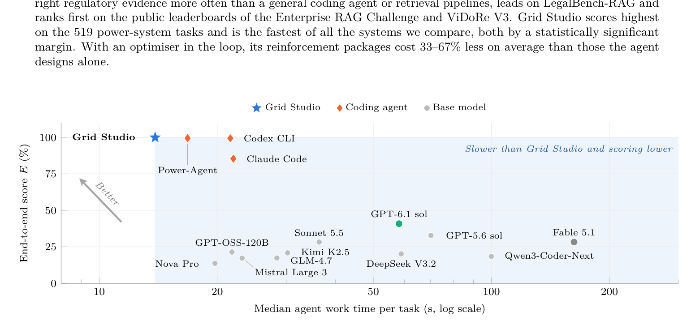
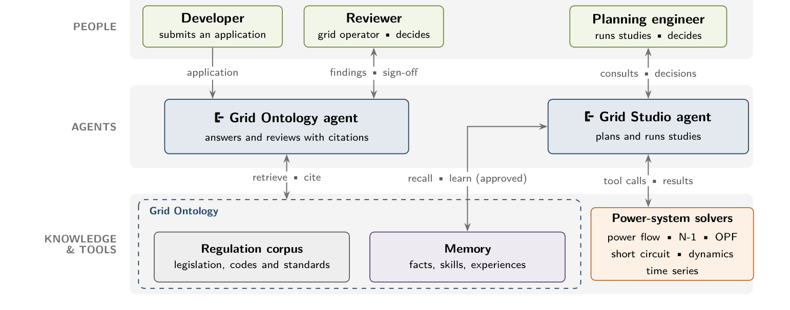

# Grid Agents · 分解

> 只记**论文说了什么**。工程判断、质量评估、洞察见同目录 [digest.md](./digest.md)。

## 一句话

面向受监管工程工作的完整 agent 系统：**答案必须引用法规证据、数字必须由成熟求解器算、人做最终决策**；Grid Ontology 做知识/记忆（27 docs/6,347 pages），Grid Studio 用领域工具+求解器跑 519 个电力系统任务；99.9% 端到端得分、中位 13.9 s，比所有 baseline 又快又准。

## 问题与设定

- **问题**：并网评估需要两种稀缺技能——按不断变化的法规核查申请；跑电力系统研究（潮流/N-1/短路）。agent 的三种失败：无来源的流畅文本；不可信的大网络算术；答案对但「背后的工作」不可验证。
- **任务**：8 个已发表电力系统 benchmark 家族，合并为 **519 tasks**；网络 4–9,241 buses；统一评分尺度。
- **系统**：
  - **Grid Ontology**：法规/标准/工程知识 + 可检索 + 记忆（semantic/procedural/episodic）；共享变更需人批准。
  - **Grid Studio**：领域工具 + 研究框架 + 求解器；optimizer 在环做 reinforcement 规划。
- **基线**：Codex CLI、Claude Code、Power-Agent、GPT-6.1 sol、Fable 5.1 等。
- **评估**：不仅看答案，还**重放 agent 的工具调用**，检查研究是否跑在正确的 network state 上（strict pass）。
- **能证明**：证据引用 + solver + 领域工具 + 工作验证，在受监管工程任务上同时提升准确率与速度；optimizer 让 reinforcement 便宜 33–67%。
- **不能证明**：真实运营商规模（>9,241 buses）；长期部署；形式安全保证；跨域泛化。

## 机制

### 三条设计原则（§3.1, p.3）

1. **Evidence before answers**：每个答案/发现都锚定到源文档或申请人提交的段落。
2. **Computation by established solvers**：模型选择/排序/解释研究，所有数字由 solver 产生。
3. **Human decision authority**：agent 准备，人决策；结论并列，决策需具名签核，研究在决策点暂停。

### Grid Ontology（§3.2, p.3–4）

- GB corpus：27 docs / 6,347 pages（含图表）。
- 检索/引用：只从找到的证据回答，必须引用。
- **Memory**：semantic（领域/operator/project 事实、规则）、procedural（skill，如 connection study）、episodic（经验/教训）；共享变更需人批准。

### Grid Studio（§3.3, p.4）

- 把电力系统研究做成工具：agent 选研究/选 network state/读结果，solver 算。
- **Reinforcement planning**：需要加固时调用 optimizer 提 least-cost package。
- **Strict pass**：重放工具调用，检查 grid state 与研究是否匹配；不是只看最终数字。

## 关键数字

| 数字 | 条件 | 出处 |
|---|---|---|
| **0.967 vs 0.856** | GB Regulation Set evidence recall：Grid Ontology vs Claude Code | §5.1, p.6 |
| **0.980 F1** | LegalBench-RAG；baseline 更低 | §5.1, p.6 |
| **124.5 vs 123.7** | Enterprise RAG Challenge；第一 | §5.1, p.6 |
| **70.23 vs 70.01** | ViDoRe V3 nDCG@10；第一 | §5.1, p.6 |
| **45/51** | 正确拒答不可回答问题 | §5.1, p.6 |
| **99.9% ± 0.1** | Grid Studio 端到端 E（519 tasks） | Table 4, p.7 |
| **516/519** | 工作被验证通过的任务数 | §5.2, p.6 |
| **13.9 s** | Grid Studio median agent work time/task | Table 4, p.7 |
| **99.4% / 21.6 s** | Codex CLI | Table 4, p.7 |
| **99.4% / 16.8 s** | Power-Agent | Table 4, p.7 |
| **85.4% / 22.0 s** | Claude Code | Table 4, p.7 |
| **40.8% / 58.2 s** | GPT-6.1 sol base model | Table 4, p.7 |
| **28.3% / 162.5 s** | Fable 5.1 base model | Table 4, p.7 |
| **108 / 106 / 90 / 74 / 0** | >2,000 bus 任务通过：Grid / Power-Agent / Codex / Claude / base | §5.2, p.7 |
| **46/519；16** | PowerMCP 工具被调用 / 单独解决的任务 | §5.2, p.7 |
| **33–67%** | optimizer 让 reinforcement package 更便宜 | §5.2, p.7；Table 5 |

## 图表索引

### 图 1：分数 vs 时间

> 原图：arXiv:2611.03534, p.1, Figure 1。版权归作者，研究评论用途。

**看什么**：Grid Studio 在左上角（高 E、低 time）；其他系统要么更慢、要么更低。**速度和准确率可以同时要，但前提是工具真的接进研究。**

### 图 2：系统设计

> 原图：arXiv:2611.03534, p.3, Figure 2。版权归作者，研究评论用途。

**看什么**：人（Developer/Reviewer/Planning engineer）在 agent 之上；Grid Ontology agent 负责引用/评审，Grid Studio agent 负责研究；知识层是 regulation corpus + memory；工具层是 solver。**「人决策」是架构的一部分，不是免责声明。**

## 作者自述局限（读者整理）

- 技术报告；系统/数据不完全公开；GB corpus 是特定法规集。
- benchmark 是单个研究任务；真实 connection study 会串联多个研究。
- 最大 9,241 buses；真实运营商可达数万。
- 没有形式安全保证；human sign-off 是流程保证，不是证明。
- 长期部署/维护成本未量化。

## 引用锚点

- 「Every answer and finding is anchored to a passage in a source document or in the applicant's submission.」（P1, p.3）
- 「The model chooses, sequences and interprets studies, and solvers produce every number.」（P2, p.3）
- 「Agents prepare the work and people decide.」（P3, p.3）
- 「we verify not only each answer but the work behind it, by replaying the agent's tool calls.」（Abstract, p.1）
- 「Its results therefore come mostly from code the agent writes for each task rather than from the domain tools.」（§5.2, p.7）

## 待核

- [ ] 真实运营商规模（数万 buses）是否保持。
- [ ] 多研究串联的 connection study 是否同样。
- [ ] 长期部署的维护/法规更新成本。
- [ ] 「人签核」的实际负担与吞吐。
- [ ] 与其他 solver/工具的集成可迁移性。
