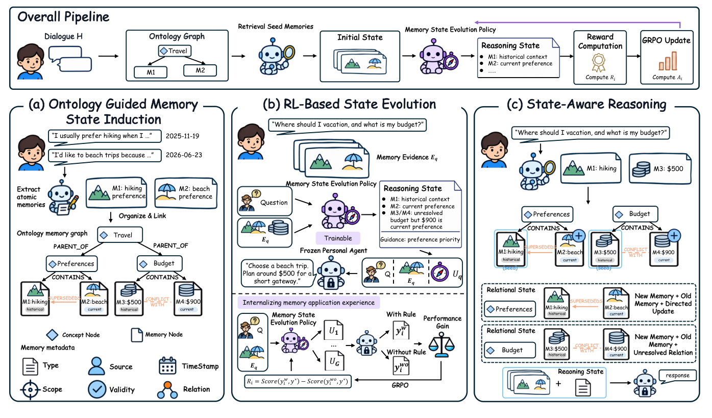
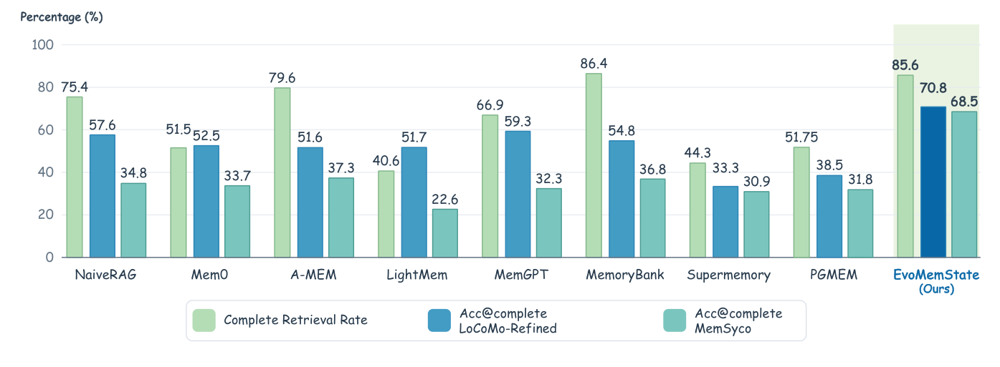

# EvoMemState · 分解

> 只记**论文说了什么**。工程判断、质量评估、洞察见同目录 [digest.md](./digest.md)。

## 一句话

把长期记忆从「独立事实集合」改成**状态**：Persistent Facts + Relational State（有效性/scope/更新/冲突）+ Reasoning State（当前请求该用哪些、什么角色、什么优先级）；Relational State 由本体引导构造，Reasoning State 由 GRPO 训练的策略生成；四个记忆基准上一致提升。

## 问题与设定

- **问题**：fact-centric 记忆把每条事实独立存；相关事实的更新/冲突/约束不在一起检索，即使全部检索到，模型也未必知道怎么用。
- **两个 preliminary findings**：① 相关记忆经常没有一起被检索（MemoryBank/LightMem/Supermemory 缺 58–62%）；② 全部检索到也不保证正确使用；固定 self-reflection 反而使平均准确率 50.5→48.9%。
- **基准**：MemSyco-Bench（记忆使用：when/how to use、preference updates、conflicts）、MemTrapBench（安全/任务边界）、LoCoMo、LoCoMo-Refined（长对话回忆/推理）。
- **baseline**：9 个（NaiveRAG、MemGPT、MemoryBank、Mem0、LightMem、A-MEM、Supermemory、SimpleMem、PGMem）。
- **模型**：Qwen3-8B、GPT-4o-mini；离线构建 DeepSeek-V4Flash；策略初始化 Qwen3-4B-Instruct，GRPO 训练。
- **能证明**：状态化记忆在多个基准上提升 retrieval completeness 与 memory-grounded accuracy；RL 生成的 reasoning state 可跨记忆系统迁移。
- **不能证明**：多模态；真实长期部署；跨域个人助手；策略训练成本/稳定性。

## 机制

### 三个组件（Fig. 4, p.4）

1. **Ontology-Guided Memory State Induction**
   - 从对话抽 Persistent Facts（单命题 + source + timestamp）。
   - 增量构建 personal memory ontology：concept/fact nodes；`PARENT_OF`、`CONTAINS`；`CREATE/MERGE/SPLIT` 修订层级；`SUPERSEDES` 表示更新，`CONFLICTS_WITH` 保留未解决冲突。
   - Relational State `r_i=(f_i, a_i, ρ_i)`：validity/scope + 概念挂载 + 与其他事实的关系。
2. **RL-Based State Evolution**
   - 策略 `πθ` 从 request + relevant facts + relational states 生成 Reasoning State `Z_q`。
   - 奖励：同一个 frozen personal agent，在有/无 Reasoning State 下的答案得分差（Eq. 10）；GRPO 优化。
   - Reasoning State 指定 applicability / role / priority；不是改写事实。
3. **State-Aware Reasoning**
   - 检索 K 个 seed facts；沿关系双向遍历 `Traverse`，把更新/冲突/约束一起拉进来。
   - 生成 Reasoning State；agent 同时用 facts + relational states + reasoning state 回答。

### 关键设计

- **事实不被覆盖**：新事实更新 relational state，不重写旧事实；冲突保留为 `CONFLICTS_WITH`。
- **检索是关系遍历，不是 top-k 独立召回**：seed + traverse 把相关记忆拉齐。
- **Reasoning State 是学出来的，不是 prompt 模板**；固定 self-reflection 反而变差。

## 关键数字

| 数字 | 条件 | 出处 |
|---|---|---|
| **57.6% / 58.9%** | MemSyco-Bench accuracy：Qwen3-8B / GPT-4o-mini；比最强 baseline +12.2 / +5.9 | §4.2, p.7 |
| **+6.1% / +7.0%** | LoCoMo-Refined LLM-judge，比最强 baseline | §4.2, p.7 |
| **79.1** | MemTrapBench overall score（Qwen3-8B） | Table 1, p.8 |
| **85.6%** | Complete Retrieval Rate（Qwen3-8B），与最好 baseline 相当 | Fig. 5, p.7 |
| **70.8% / 68.5%** | Acc@complete：LoCoMo-Refined / MemSyco；比最强 baseline +11.5 / +31.2 | §4.3, p.7 |
| **48.7 / 49.6 / 49.7** | ablations：w/o Relational State / w/o Reasoning State / w/o RL（MemSyco） | Table 2, p.8 |
| **−8.9 / −8.0 / −7.9** | 对应 MemSyco 下降 | §4.5, p.8 |
| **−6.4 / −15.0 / −16.4** | 对应 MemTrapBench 下降 | §4.5, p.8 |
| **+0.2–4.9** | 跨 6 个 memory systems 加 Reasoning State 的增益 | Fig. 6, p.8 |
| **50.5 → 48.9** | 固定 self-reflection 的平均准确率（preliminary） | §2.2, p.3 |

## 图表索引

### 图 4：两状态管线

> 原图：arXiv:2611.03743, p.4, Figure 4。版权归作者，研究评论用途。

**看什么**：左边是 ontology + relational state；中间是 GRPO 训练 reasoning-state policy；右边是 inference 时 facts + states 一起给 agent。**事实与状态分离**是核心；Reasoning State 不是摘要，是「怎么用」的指令。

### 图 5：检索与使用

> 原图：arXiv:2611.03743, p.7, Figure 5。版权归作者，研究评论用途。

**看什么**：EvoMemState 的 Complete Retrieval Rate 85.6% 与 MemoryBank 86.4 相当，但 Acc@complete 明显更高（70.8/68.5）。**提升不在「检索更多」，在「会用」——这是本文最重要的图。**

## 作者自述局限

- 只测文本交互；多模态（文档/图片/用户 artifact）未覆盖。
- 策略训练（GRPO）需要 reward/答案；真实个人助手没有这个条件。
- 四个基准都是记忆使用/对话回忆，不是开放域长期部署。
- Relational State 的本体是增量构建的；概念层级质量依赖抽取。
- Reasoning State 是自然语言/结构化规则，不是可形式验证的保证。

## 引用锚点

- 「Even when all relevant memories are retrieved, the personal agent must still determine their applicability and priority for the current request.」（§1, p.2）
- 「fixed self-reflection reduces accuracy for most systems ... from 50.5% to 48.9%.」（§2.2, p.3）
- 「complete retrieval rate of 85.6%, comparable to the best baseline ... Acc@complete reaches 70.8% ... exceeding the strongest baselines by 11.5% and 31.2%.」（§4.3, p.7）
- 「generating rules alone provides little benefit on these benchmarks.」（§4.5, p.8）
- 「Our study focuses on text-based interaction histories.」（Limitation, p.9）

## 待核

- [ ] 策略训练成本/稳定性；GRPO 在真实个人数据上的可行性。
- [ ] 本体层级（CREATE/MERGE/SPLIT）的自动质量；错误概念挂载的影响。
- [ ] 多模态扩展。
- [ ] 跨域（工作/医疗/金融）是否同样有效。
- [ ] reasoning state 的可解释/可审计性；能否形式检查。
