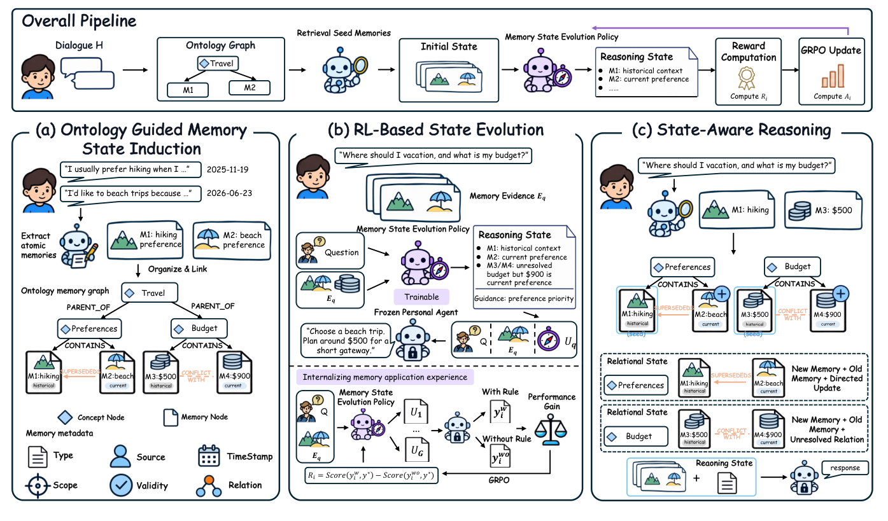

# EvoMemState：记忆是状态，不是事实集合

> 这篇消化不假设你读过论文。先讲清「个人 agent 的长期记忆」为什么不是存事实，再看两状态、训练方式、四个基准上的结果与边界。

## 0. 三句话

1. **它问什么**：长期记忆系统大多把记忆当独立事实；新事实怎么更新/约束/冲突旧事实、当前请求该用哪些事实，都没被显式表示。
2. **它怎么做**：Persistent Facts + **Relational State**（有效性/scope/更新/冲突）+ **Reasoning State**（当前请求该用哪些、什么角色/优先级）；relational state 由本体引导构造，reasoning state 由 GRPO 训练的策略生成。
3. **它发现什么**：四个记忆基准上，Complete Retrieval 85.6%（与最好 baseline 相当），但 Acc@complete 70.8/68.5（+11.5/+31.2）；增益在「会用」，不在「检索更多」。

## 1. 它解决什么问题

### 1.1 背景

个人 agent 要跨会话记住用户偏好/经历/约束。现有系统（Mem0、MemGPT、MemoryBank、A-MEM 等）主要做事实抽取、组织、更新、检索；但：

- 事实之间可能**更新/冲突/约束**；独立存储会丢关系。
- 即使全部检索到，模型也未必知道**当前请求该用哪些、什么优先级**。
- 固定 self-reflection prompt 不一定有用；preliminary 显示平均准确率 50.5→48.9。

### 1.2 论文的立场

记忆不是「事实集合」，是**状态**：事实 + 它们如何成立/相关 + 当前怎么用。

## 2. 术语

| 术语 | 用大白话说 |
|---|---|
| **Persistent Facts** | 从对话抽出的原子事实；带 source/timestamp。 |
| **Relational State** | 事实的有效性/scope、更新（SUPERSEDES）、冲突（CONFLICTS_WITH）、概念挂载。 |
| **Reasoning State** | 当前请求该用哪些事实、什么角色/优先级；由策略生成。 |
| **ontology memory graph** | 概念节点 + 事实节点；PARENT_OF / CONTAINS / SUPERSEDES / CONFLICTS_WITH。 |
| **GRPO** | 一种 RL 优化；用「有/无 reasoning state 的答案得分差」当 reward。 |
| **Complete Retrieval Rate** | 所有必需证据都检索到的比例。 |
| **Acc@complete** | 在「完整检索」子集上的答案准确率。 |
| **MemSyco / MemTrap** | 记忆使用基准：偏好更新、冲突、安全/任务边界。 |
| **LoCoMo / LoCoMo-Refined** | 长对话回忆/推理基准。 |

## 3. 它怎么做

### 3.1 三个组件

> 原图：arXiv:2611.03743, p.4, Figure 4。版权归作者，研究评论用途。

**看什么**：左边是 ontology + relational state；中间是 GRPO 训练 reasoning-state policy；右边是 inference 时 facts + states 一起给 agent。**事实与状态分离**是核心；Reasoning State 不是摘要，是「怎么用」的指令。

1. **Ontology-Guided Memory State Induction**：
   - 从对话抽 Persistent Facts（单命题 + source + timestamp）。
   - 增量构建 personal memory ontology：concept/fact nodes；`PARENT_OF`、`CONTAINS`；`CREATE/MERGE/SPLIT` 修订层级；`SUPERSEDES` 表示更新，`CONFLICTS_WITH` 保留未解决冲突。
   - Relational State `r_i=(f_i,a_i,ρ_i)`：validity/scope + 概念挂载 + 关系。
2. **RL-Based State Evolution**：
   - 策略 `πθ` 从 request + relevant facts + relational states 生成 Reasoning State。
   - 奖励：同一个 frozen personal agent，在**有/无 Reasoning State** 下的答案得分差；GRPO 优化。
3. **State-Aware Reasoning**：
   - 检索 K 个 seed facts；沿关系双向遍历，把更新/冲突/约束一起拉进来。
   - 生成 Reasoning State；agent 同时用 facts + relational states + reasoning state 回答。

### 3.2 一个具体例子

用户 2025-11 说「喜欢徒步」，2026-06 说「更喜欢海滩」。

- facts：M1 hiking（historical）、M2 beach（current）。
- relational state：`M2 SUPERSEDES M1`。
- reasoning state：`M2: current preference; M1: historical context`。
- 回答度假建议时用 M2，不用 M1；如果问「偏好怎么变」，两条都用。

预算冲突：M3 $500（historical）、M4 $900（current），`CONFLICTS_WITH` 未解决；reasoning state 标「$900 current，但冲突未解决」。

## 4. 结果：数字与条件

| 指标 | EvoMemState | 最强 baseline |
|---|---|---|
| MemSyco accuracy（Qwen3-8B） | **57.6%** | +12.2 |
| MemSyco accuracy（GPT-4o-mini） | **58.9%** | +5.9 |
| LoCoMo-Refined judge | **+6.1% / +7.0%** | — |
| MemTrap overall | **79.1** | — |
| Complete Retrieval Rate | **85.6%** | MemoryBank 86.4% |
| Acc@complete（LoCoMo-Refined） | **70.8%** | +11.5 |
| Acc@complete（MemSyco） | **68.5%** | +31.2 |

- ablation（MemSyco）：w/o Relational **48.7（−8.9）**；w/o Reasoning **49.6（−8.0）**；w/o RL **49.7（−7.9）**。
- MemTrap：−6.4 / −15.0 / −16.4。
- 跨 6 个 memory systems 加 reasoning state：+0.2–4.9。

### 4.4 这些数字之间的逻辑

- **为什么要有两个状态？** 关系状态是「事实怎么成立/冲突/更新」，推理状态是「当前请求怎么用」。混在一起，结构每次随请求变化，无法审计。
- **为什么用 GRPO？** 没有「正确 reasoning state」的标签；用「有/无 state 时 frozen agent 的答案得分差」当 reward，让策略学会「怎么用」。
- **为什么 complete retrieval 相当、acc 更高？** 检索到事实不等于会用；reasoning state 决定哪些事实适用、什么优先级。
- **为什么冲突要显式？** 新事实可能 supersede/conflict 旧事实；独立存储会丢关系，模型每轮重新推断。
- **为什么没有训练信号会退化？** reasoning-state policy 没有 reward 就只能写死 prompt；固定 self-reflection 可能帮倒忙。

## 5. 这些数字不能说明什么

1. **不是「检索更多」。** Complete Retrieval 85.6% 与 MemoryBank 86.4 相当；增益在「会用」。
2. **不是所有模态。** 只测文本；文档/图片/artifact 未覆盖。
3. **不是无训练部署。** GRPO 需要参考答案/评分器；真实个人助手没有这个条件。
4. **不是形式保证。** Reasoning State 是自然语言/结构化规则，不是可形式验证的状态。
5. **基准有限。** 四个基准都是记忆使用/对话回忆；开放域长期部署未测。
6. **本体质量依赖抽取。** 概念层级（CREATE/MERGE/SPLIT）错误会影响 relational state。

## 6. 工程上怎么用

### 6.1 复刻顺序

1. **事实与状态分开存。** Persistent Facts 保留原文/source/timestamp；Relational State 存 validity/scope/更新/冲突。
2. **增量建本体。** 每个事实挂到最具体 concept；`PARENT_OF`/`CONTAINS` 组织；CREATE/MERGE/SPLIT 修订层级。
3. **检索用关系遍历，不用独立 top-k。** 先 seed，再沿 SUPERSEDES/CONFLICTS_WITH/CONTAINS 拉齐。
4. **Reasoning State 要学，不要写死 prompt。** 固定 self-reflection 可能帮倒忙。
5. **Reasoning State 只写「怎么用」。** applicability / role / priority；不改写事实。
6. **评估分两层。** Complete Retrieval Rate 与 Acc@complete 分开。
7. **看跨系统迁移。** 同一 policy 加到 6 个 memory backend 都有增益；说明 reasoning state 可复用。
8. **承认训练前提。** 没有参考答案时，只能用弱监督/人工反馈替代。

### 6.2 成本与使能

| 成本 | 一次性/每次 | 说明 |
|---|---|---|
| 本体构建 | 持续 | 抽取事实、概念挂载、CREATE/MERGE/SPLIT |
| Relational State 维护 | 每次新事实 | 更新/冲突/约束 |
| 策略训练 | 一次性/周期 | GRPO；需要答案/评分器；GPU |
| 推理 | 每次 | 检索 + 遍历 + policy 生成 reasoning state |
| 维护 | 本体/策略变更 | 重新训练/校准 |
| 评估 | 每 benchmark | Complete Retrieval + Acc@complete + judge |

**使能条件**：长期对话数据；答案/评分器；能跑 RL；本体/概念层级可维护。

### 6.3 何时用 / 何时别用

**用**：长期个人助手；偏好/约束/经历跨会话变化；冲突需要保留；有答案/评分器可训练策略。

**别用**：单次会话；没有训练信号；多模态为主；需要形式可验证状态；实时低延迟。

### 6.4 最小落地清单

1. **事实与状态分开存。** Persistent Facts 保留原文/source/timestamp；Relational State 存 validity/scope/更新/冲突。
2. **增量建本体。** 每个事实挂到最具体 concept；PARENT_OF/CONTAINS 组织；CREATE/MERGE/SPLIT 修订层级。
3. **检索用关系遍历。** 先 seed，再沿 SUPERSEDES/CONFLICTS_WITH/CONTAINS 拉齐。
4. **Reasoning State 要学。** 固定 self-reflection 可能帮倒忙；用答案得分差做 reward。
5. **Reasoning State 只写「怎么用」。** applicability/role/priority；不改写事实。
6. **评估分两层。** Complete Retrieval Rate 与 Acc@complete 分开。
7. **承认训练前提。** 没有参考答案时，只能用弱监督/人工反馈替代。

## 6.5 工程配方（E3）

### 数据契约

| 对象 | 字段 |
|---|---|
| persistent fact | `{fact_id, text, source, timestamp, entity_ids[]}` |
| relational state | `{fact_id, validity, scope, supersedes[], conflicts[], concept_id}` |
| reasoning state | `{request_id, used_facts[], roles[], priority[]}` |
| memory graph | concept/fact nodes；`PARENT_OF/CONTAINS/SUPERSEDES/CONFLICTS_WITH` |

### 训练配方（Appendix B.3/D）

- 策略：GRPO；G=8、temperature 1.0、rollout batch 512 / global 4096、lr 1e-6、wd 0.01、KL 0.001、clip 0.2/0.28；prompt 8192 / state 512 tokens；冻结 agent Qwen3-8B；embedding bge-m3。
- 数据：约 60K 实例，FEVER/SciFact/PersonaMem 三类；含冲突记忆与干扰项。
- reward：有/无 reasoning state 的答案得分差；格式违规/答案泄露有 gate/penalty（Algorithm 1）。
- seed 数论文未定；至少 3 seeds，报 CI。

### 接口

- `ingest(dialogue|doc)` → facts + relational states；`retrieve(request)` → seed facts + graph traversal；`policy(request, facts, states)` → reasoning state；`answer(request, facts, states, reasoning)`。
- 检索预算：565 token 候选上下文（论文设置）；K 自定并记录。

### stop condition

- 没有答案/评分器 → 不训 GRPO，只做 facts/relational state + 检索评估。
- Complete Retrieval <80% → 先修检索，不训策略。
- Acc@complete 无提升或下降 → 停，检查 state 是否噪声。
- 冲突 >20% 未解决 → 停，先修冲突处理。

### 第一个 sprint

2 周，不做 GRPO：

1. facts 与 relational state 分存；建 concept/fact 图。
2. bge-m3 检索 + 关系遍历；记录 Complete Retrieval / Acc@complete。
3. 对照：固定 self-reflection vs 空 reasoning state；量「会不会用」差距。
4. 出口：Acc@complete 提升 ≥5pp 且检索率 ≥80% 才进 GRPO；否则停。
5. 记录 565 token 预算下的召回损失。

### 成本

- 本体/图构建：1–2 人周（`推测`）。
- 数据构造：60K 实例 + 冲突/干扰；1–2 人周（`推测`）。
- GRPO：单卡/多卡 A100；论文未报 GPU 时；按 60K × G=8 估（`推测`）。
- 评估：4 基准 + judge。

### 替代方案

- 固定 self-reflection prompt；MemoryBank/Mem0；只做 RAG 不做状态；人工规则。
- 论文有跨 6 个 memory backend 的迁移，但没有与这些同口径成本。

## 6.6 客户价值假设（V2/V3，`推测`）

- **受益者**：个人助手/客服/CRM；痛点：偏好更新、冲突记忆、跨会话不一致。
- **指标**：Acc@complete、冲突解决率、每请求 token/时延、人工纠错率。
- **反事实**：不做 reasoning state → 固定 prompt/独立事实；先测 Complete Retrieval 与 Acc@complete 基线。
- **V3 试点**：单域 200–500 请求；成功 = Acc@complete +10pp、冲突漏检 ≤10%、token 不增 >20%；失败 = 无提升或冲突恶化；停止线 = 年省纠错 < 训练/维护。
- **反例**：无评分器；文本 only；冲突太多；GRPO 成本高；多模态未测。

## 7. 质量与边界

- **证据类型**：实证·基准（4 基准、9 baseline、ablation、跨系统迁移）。
- **强项**：多基准；两状态分解清晰；ablation 完整；跨系统迁移；preliminary 研究揭示「检索到 ≠ 会用」。
- **主要威胁**：文本 only；GRPO 需要答案/评分器；基准多为记忆使用/对话回忆；本体质量依赖抽取；Reasoning State 不可形式验证。
- **`quality: A`**：多基准、多 baseline、ablation、迁移、开源；但训练前提与文本限制是外部效度扣分项。

## 8. 与仓库判断的关系

- **04-L1（已核）**：记忆是状态，不是事实集合；四基准提升。
- **E-05（已核）**：本体承担对齐/印证条件；Reasoning State 是策略层。
- **P1/P2**：状态结构决定怎么用；同一 memory backend，加 reasoning state 就有 +0.2–4.9。
- **04-L6**：未匹配 ≠ 关系结束；冲突/更新要保留。

## 9. 还没解决 / 下一步

- **没有参考答案时，reasoning-state policy 怎么训练？** 弱监督/偏好反馈可行吗？
- **本体层级（CREATE/MERGE/SPLIT）的自动质量如何评估？**
- **多模态扩展**：文档/图片/artifact 如何进 relational state？
- **跨域（工作/医疗/金融）是否同样有效？**
- **Reasoning State 能否形式检查/审计？**
- **训练成本 vs 收益**：多少用户/多少对话才值得？

## 10. 原文

- arXiv:2611.03743
- PDF：`src/papers/2611.03743-evomemstate/`
- 代码：https://github.com/XMUDeepLIT/EvoMemState
