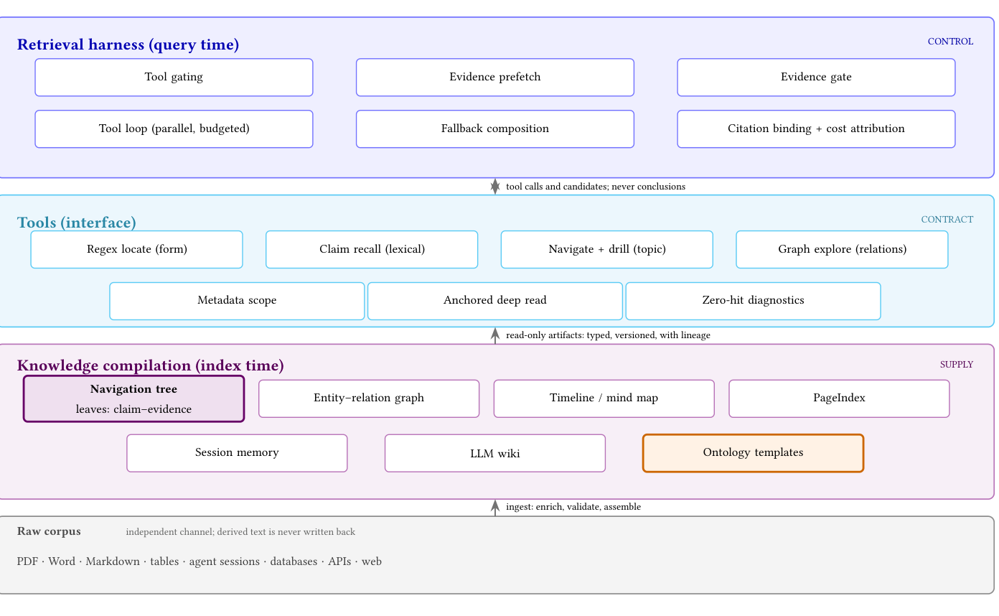

# 编译：把检索前的整理当成供给层

## 问题

agentic 检索暴露出一个与准确率无关的问题：**不受约束的循环会重复同样的查询、重读同样的文档，把窗口塞满从未被使用的段落。** 过程消耗 token，但不产出一个答案。

知识编译是应对这一点的方案：在检索之前，用 LLM 把源文档加工成不含于任何单一片段的结构——导航层级、实体图、时间线、心智图、本体、wiki、记忆。

## 机制

> 原图：CAI, p.4, Figure 1（arXiv:2610.41172）。版权归作者，研究评论用途。

**看什么**：供给（index time）、契约（tools）、控制（query time）是三种职责。编译在检索之前发生，但「什么进窗口、什么时候停」仍由 harness 决定；所以编译不是「换一个检索器」。

| 步骤 | 做什么 | 工程要点 |
|---|---|---|
| Parse | 原文件 → 规范表示 | 保留标题、表格、页锚 |
| Chunk | 自然边界切块 | chunker 与基线固定，避免混淆 |
| Enrich | 小模型逐块抽 claim–evidence | 可以用便宜模型 |
| Validate | span 逐字比对，对不上就丢 | **不让模型修**；质量靠源文 |
| Assemble | claim 聚类成树/图 | 内部节点是标签，不是摘要 |
| Register | 源版本、offset、抽取器版本、ACL | 让审计、fallback、增量更新成立 |

> 机制细节、模板、六条 harness 不变量见 [CAI card](../../../src/papers/2610.41172-context-as-infrastructure/card.md)；工程复刻清单见 [digest](../../../src/papers/2610.41172-context-as-infrastructure/digest.md)。

## 核心结论

**编译不是更好的检索器，也不需要是。** 它的收益落在预算而不是准确率：

| 指标 | 结果 |
|---|---|
| FRAMES 上结构化工件的准确率增益 | **无可检出** |
| PageIndex 式大纲在 FRAMES 规模 | **退化** |
| 「主张-证据」叶子导航树的 token 变化 | 充分时 −91%，不充分时 +1.9%，**平均 −38%** |
| 盈亏平衡的充分率 | 无限视野 2%；实测约 43% |
| 决策门对时延的影响 | 140s → 30s（但 token 节省是用检索轮次买的） |
| 证据替换的时延代价 | 配对子集 token 约减半，端到端时延约 3× |

## 成本模型

不能只用「平均 −38%」做决策。作者给出两档：

- 无限视野：`p_h > 2.0%`（`0.019/(0.91+0.019)`）。
- 有限视野：`p_min = 2.0% + c/(0.929Q)`；`c` 是编译成本的 query-equivalent，`Q` 是查询次数。
- 例子：`Q=1,000, c=10` → `p_min=3.12%`；若实测 `p_h=2.5%`，仍亏 5.8 query-equivalent。
- 回本：`p_h≈0.43, c=10` → 约 26 次查询。

**结论**：先量 `p_h`、miss penalty、`c`、`Q`、时延预算，再决定是否编译。`p_h` 低于 `p_min` 时，「编译」是负收益。

## 另一种编译：受监管知识系统 + solver（Grid Agents）

Grid Agents 把「编译」推到工业强度：Grid Ontology 是 27 documents / 6,347 pages 的法规/标准语料 + 语义/程序/情景记忆；Grid Studio 把潮流/N-1/短路/OPF 包成工具，所有数字由 solver 算。

- 519 tasks / 8 benchmark families：**99.9% 端到端**、**13.9 s** 中位；base model 最好 40.8%。
- 法规证据 recall **0.967 vs 0.856**（Claude Code）；LegalBench-RAG F1 0.980。
- **工具必须到达研究**：PowerMCP 只在 46/519 任务被调用；Grid Studio 的工具覆盖每个 study。
- **strict pass**：重放工具调用，检查 study 跑在哪个 network state；不是只看最终数字。
- optimizer 在环：加固方案便宜 **33–67%**。

**它和 CAI 的编译不是一回事**：CAI 编译的是「主张-证据叶子」用于省 token；Grid 编译的是「法规知识系统」用于合规审查与 solver 调度。共同点是**证据可追溯、数字不靠模型**。

## 何时用 · 何时别用

**用**：语料相对稳定、查询复用高、token 是主要成本、审计要求高、文本为主可抽取。

**别用**：时延硬约束；查询视野小；表格/扫描/行话导致抽取质量差；没有审计与版本管理；`p_h` 低于 `p_min`。

## 一个必须带上的限定

作者把本体、图、wiki、时间线、记忆这些工件的价值，明确放在**部署层面**：

> 治理、跨源集成、上手、时序定向、连续性——准确率基准看不见这些回报。

这句话对本仓库极其重要：它是一手证据支持 **P1（价值在约束与控制）** 的最强材料。但它同时是一个**未量化的断言**——Table 2 的部署 ledger 没有任何一行达到预登记目标，作者没有给出部署层回报的观测。

**本体在本文的 FRAMES 结果是 `not measured`。** 不能用 CAI 证明「本体提准确率」或「本体无用」；它只给出本体在 ledger 上的位置：词汇控制、集成、治理。

## 失效模式

- **平均掩盖条件。** −38% 是 −91% 与 +1.9% 的混合；不看 hit/miss 分布就上线，会在 miss 高的语料上亏。
- **省 token 换时延。** 证据替换增加检索轮次；时延硬约束时，token 节省可能不值。
- **接受率当正确率。** gate 的 `p_h` 只说放行多少，不说放对没有；false-accept rate φ 必须单独估。
- **编译产物被当成事实。** 产物本身有误差，进入后续对话后不再被质疑。
- **大纲式结构在规模上退化。** 层级越深，模型越难在层级里定位；PageIndex 的失败是规模观察，不是普遍规律。
- **树被当检索器。** 树是 carrier；检索用 flat evidence search，路由用树会多一跳且可能带偏。
- **部署价值被当成已证。** 治理/集成/上手是作者定位，Table 2 为空；引用时必须标「作者主张，未量化」。

## 与其它派的关系

- 编译服务于 [03 知识派](../README.md) 的供给；它的产物若进入判定，就归 [02 判定](../../02-judgment/README.md)。
- 「编译省预算」与 [00-harness/context](../../00-harness/context.md) 的压缩问题同源：都是**在有限窗口里决定牺牲什么**。编译的优点是牺牲发生在检索前，可审计。
- 与 [projection](../projection/README.md) 的分界：编译投影的是**证据**（claim + span）；领域知识投影的是**规则/手册**。CAI 的设计规则「compile evidence, not prose」是这条分界的操作版。

## 开放问题

- 企业语料（表格/扫描/行话）上的 `p_h` 与 miss penalty 是多少？`p_min` 会不会高到不值得编译？
- φ 的实测值：100–400 条标注审计能否给出可操作的 false-accept 上界？
- 证据替换的时延代价能否用并行/预算控制压下来，还是结构上必然用轮次换 token？
- 增量维护的真实成本：文档频繁变更时，registry/重抽/聚类更新是否会吃掉 token 收益？
- 部署层回报（上手时间、跨源引用率、审计通过率）如何量化？这是本仓库认为最关键的空缺。
