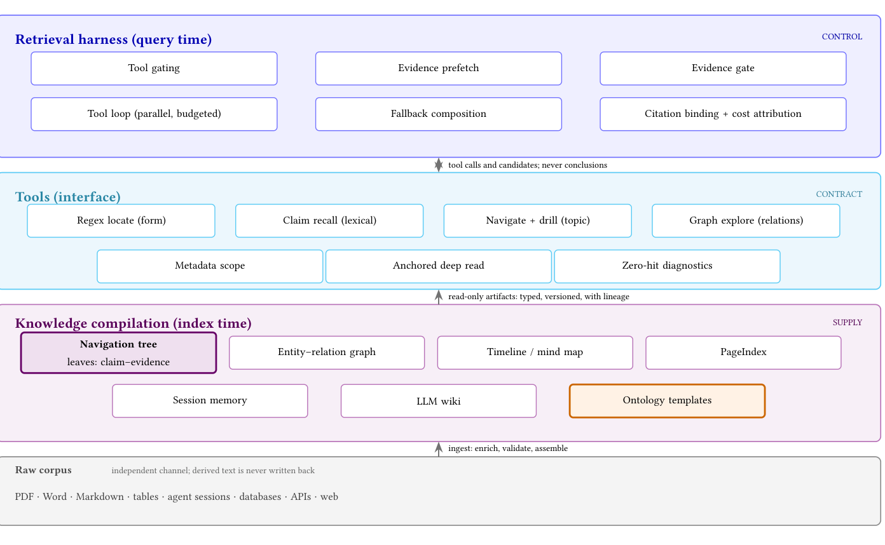

# 编译 · 机制

> 只写「它怎么跑」。判断回 [findings](./findings.md)，边界/下一步回 [frontier](./frontier.md)。

## 问题

agentic 检索会重复查询、重读文档、把窗口塞满未使用的段落；知识编译在检索前把源文档加工成不含于任何单一片段的结构（导航层级、实体图、时间线、wiki、本体、记忆）。

## 机制一：需求侧的三层（CAI）

> 原图：CAI, p.4, Figure 1（arXiv:2610.41172）。版权归作者，研究评论用途。

**看什么**：供给（index time）、契约（tools）、控制（query time）是三种职责。编译在检索之前发生，但「什么进窗口、什么时候停」仍由 harness 决定。

| 步骤 | 做什么 | 工程要点 |
|---|---|---|
| Parse | 原文件 → 规范表示 | 保留标题、表格、页锚 |
| Chunk | 自然边界切块 | chunker 与基线固定 |
| Enrich | 小模型逐块抽 claim–evidence | 可以用便宜模型 |
| Validate | span 逐字比对，对不上就丢 | 不让模型修 |
| Assemble | claim 聚类成树/图 | 内部节点是标签，不是摘要 |
| Register | 源版本、offset、抽取器版本、校验状态、ACL | 审计/fallback/增量 |

## 机制二：三种服务模式（CAI）

| 模式 | 做什么 | 代价 |
|---|---|---|
| E1 evidence-first | 直接在证据索引上词法检索 | 少一跳；优于文档→树 |
| E2 substitution（默认） | 定位 chunk 后用 claim–evidence 替换 | 省 token 但增加轮次 |
| E3 decision-gated | 小决策模型判断是否深读 | 控制读不读；arm mean 有证据 −52%、无证据 −30%（与 `p_h` 证据门不是同一个门；题数少，不可与 hit/miss 分支直接比）；gate arm 时延 140→30 s（gate arm 的均值，不是未编译基线） |

**树是 carrier，不是 retriever。** 检索始终是词法的；语义步由 agent 改写查询完成。

> 未吸收：CAI 的六条 harness 不变量与「按失败组织工具」的分类只出现在 `paper.md` §6.2/§6.4，CAI digest 未收；本页不据此下判断，见 [frontier G7](./frontier.md)。

## 机制三：受监管知识系统（Grid Agents）

Grid Ontology = 27 docs / 6,347 pages 的法规/标准 + 语义/程序/情景记忆；Grid Studio = 领域工具 + solver + optimizer。

- 答案必须引用 evidence；数字由 solver 算；人做决策；研究在决策点暂停，未签核不继续。
- **引用/拒答契约**（[F11](./findings/regulatory.md#f11)）：每条法规结论带 citation `{doc_id, version, page, span, clause_id, retrieved_at}`；不能引用就不答；拒答阈值（证据不足/引用缺失）配置并记录——45/51 是结果，不是阈值。
- **运行契约**（[F9](./findings/regulatory.md#f9)）：study 工具输入 `{study_type, network_model, state_hash, solver_config}`，输出带 `result, solver_version, provenance, warnings`；strict pass 重放工具调用，只有 **state_hash 一致 + study_type 匹配 + solver_version 已记** 才算 pass。solver 的容差/超时/版本按潮流/N-1/短路/OPF 各自配置，数值需自定并记录（digest 未给）。
- **记忆/中断契约**（[F8](./findings/regulatory.md#f8)）：memory `{kind: semantic|procedural|episodic, content, source, approved_by, version}`，共享变更需人批准；决策点 `{decision_id, findings, citations, signer, timestamp}`。
- **对最强 agent baseline 只高 0.5pp**：Grid E score 99.9%、中位 13.9 s；Codex CLI 99.4%/21.6 s；Power-Agent 99.4%/16.8 s；base model 40.8%（GPT-6.1 sol）、28.3%（Fable 5.1）。大差距只在 vs base model；0.5pp 与 2.9–7.7 s 的归因未拆分（`推测`）。
- **领域工具在回路里可能主要影响速度，不是分数的必要条件**（`推测`）：PowerMCP 只在 46/519 任务被调用；Power-Agent 靠 agent 自己写代码仍到 99.4%，但比 Grid 慢 2.9 s。作者仍把「工具必须到达研究」当设计原则（`已核`：作者立场）。
- optimizer 在环：加固方案平均便宜 33–67%。

## 失效模式

- **平均掩盖条件。** −38% 是 −91% 与 +1.9% 的混合。
- **省 token 换时延。** 证据替换增加轮次；配对子集时延约 3×（仅 7 题，`已核`）。
- **接受率当正确率。** `p_h` 只说放行多少，不说放对没有；φ 未测。
- **编译产物被当事实。** 产物有误差，进入后续对话后不再被质疑。
- **把 PageIndex 写成 neutral。** PageIndex 大纲小规模中性、**FRAMES 规模实测为负**；10^5 的 75% routing 是解析模型，不是实测，不能和 RAPTOR 摘要树并列为「都 neutral」。
- **树被当检索器。** 树是 carrier；路由用树会多一跳且可能带偏。
- **部署价值被当已证。** Table 2 部署 ledger 无一行达标（全部 `no measured effect`）；引用时必须标「作者主张，未量化」。
- **受监管客户指标被当已验证。** 申请周期/评审工时/返工率/审计发现数/每单加固成本都没有基线；有数的只有 optimizer 的加固方案平均便宜 33–67%。
- **把 45/51 当拒答阈值。** 45/51 是「正确拒答不可回答问题」的结果；阈值要按证据不足/引用缺失的判定规则配置，否则拒答率异常无法诊断（[F11](./findings/regulatory.md#f11)）。
- **把决策门 arm mean 当 hit/miss 分支。** −52%/−30% 与 140→30 s 都是 gate arm 的均值；140 s 不是未编译基线，题数也更少（[F3](./findings/economics.md#f3)）。

## 与本体 / 回路的关系

本体在编译里以 **typed artifact / constraint / evidence** 出现；约束强度弱到中（能省预算、能做审计，但不阻止动作，`推测`）。被违反时通常没有信号（`推测`）——这是它必须配 harness/判定器的原因。

## 实施与客户价值（A3/A4）

> 等级：带 `已核` 的数字/公式/契约来自 CAI、Grid 一手 digest（[F1](./findings/accuracy.md#f1)、[F2](./findings/economics.md#f2)、[F3](./findings/economics.md#f3)、[F4](./findings/deployment.md#f4)、[F5](./findings/regulatory.md#f5)、[F6](./findings/accuracy.md#f6)、[F7](./findings/economics.md#f7)、[F8](./findings/regulatory.md#f8)、[F9](./findings/regulatory.md#f9)、[F11](./findings/regulatory.md#f11)）；[F10](./findings/regulatory.md#f10) 的客户指标、组织/人日、客户价值假设为 `推测`，F11 的 citation precision 0.95 是 V3/stop 配方（`推测`）。这一节只回答：这页改变哪个决策、怎么开工、什么时候停。

### 实施决策

1. **不把编译立项成「准确率项目」。** 预算和 KPI 只挂 token、时延、审计，不挂 accuracy 提升；供应商若以「结构让回答更准」报价，要求其出示与强词法 harness 的对照。（`已核`：强 harness 下结构化工件无可检出准确率增益，F1）
2. **只买证据叶子，不买散文结构。** v1 只入库 claim + 逐字 span；摘要树、大纲、wiki、实体图不进第一版；span 对不上就丢弃，不让模型修。这条把「编译」从内容工程降级成校验工程，也是 claim-leaf 与「去 claim 的 carrier」的分界：RAPTOR 摘要树在 FRAMES 上 neutral，PageIndex 大纲在 FRAMES 规模实测为负（[F6](./findings/accuracy.md#f6)）。
3. **保留原词法检索器，树只做 carrier。** 默认 E2 substitution + raw chunk fallback；不把树/图当 router。时延是硬约束时改用 E1 或决策门，不买 E2 的 token 节省（那是用轮次换 token）。（`已核`：树是 carrier，不是 retriever；时延硬约束时不应买 token 节省）
4. **先算账再扩语料。** 用自有 `c`、`Q` 算 `p_min`，先量 `p_h` 与 miss penalty；`p_h` 的 95% CI 下界 ≤ `p_min` 就不编译，转 harness 侧（收紧读预算、改停策略、缓存重复查询、并行检索）。决策依据不是平均 −38%。（`已核`：F2/F3；标定见 [p_h 标定](#p_h-calibration)）
5. **受监管语料走另一条支线，不共用同一条预算。** 数字由 solver 算、答案必须带 citation（不能引用就拒答）、人签核、工作可重放；领域工具要在回路里，但两个 99.4% 的 baseline 说明写代码也能到同一档，别把「工具到达研究」当分数保证（`推测`）。没有 solver 与可引用语料，就不要用「编译法规」立项。（数字/契约 `已核`：F5/F11）

### 数据/接口

| 对象 | 最小字段/取值 | 用来干什么 | 出处 |
|---|---|---|---|
| claim 索引 | `claim_id, text, span_start, span_end, chunk_id, source_version, extractor_version, acl` | 替换、审计、fallback、增量 | CAI §6.5 |
| 服务策略 | per-tool 三档：`off`、`compiled-only`、`compiled-first`；E2 返回 `claim + span + source` 而非整段 | 灰度与 A/B 的开关 | CAI §6.5 |
| 评测表 | `query_id, arm, hit/miss, token_in/out, latency, rounds, gate_verdict, citations` | 没有它就算不出 `p_h` 与 φ | CAI §6.5 |
| gate 打分 | unit count / source diversity / entity coverage（规则打分，非模型） | 判「证据够不够」；必须与 E3 深读决策模型分开命名 | CAI §6.5 |
| 检索参数 | `topN=20`、`k=100`、anchor depth 20（10→20 有增益、30 无进一步增益）、两条词法腿取并集、不做 count 截断 | 复现对照 | CAI §6.5 |
| 盈亏平衡敏感度 | miss 端 ±1.5pp → `p_h*` 在 0.4–3.6% 间移动；hit 端 ±1.5pp → 2.0–2.1%（解析推导，非实测） | 定优先级：先量 miss，再优化 hit | CAI §6.5；[F7](./findings/economics.md#f7) |
| 工具面 | 词法检索、claim 检索、导航/图探索、深读四类；`compile_kwd` 存在性探针决定是否暴露导航工具 | 没工件就不暴露工具，避免空转 | CAI §6.5 |
| 未给定 | chunk 尺寸、embedding 模型、聚类分支因子 | 论文没有默认值；自定并冻结，否则 A/B 不可比 | CAI §6.5 |
| 受监管支线 | study 输入 `{study_type, network_model, state_hash, solver_config}`、输出 `{result, solver_version, provenance, warnings}`；strict-pass log `{task_id, tool_calls[], network_state_hash, study_type, solver_version, pass/fail, reason}` | 可审计、可重放；缺 `study_type`/`solver_version` 不能判 pass | Grid §6.5；[F9](./findings/regulatory.md#f9) |
| 引用/拒答 | citation `{doc_id, version, page, span, clause_id, retrieved_at}`；拒答规则（证据不足/引用缺失）配置并记录 | 每条结论可核；不能引用就不答；45/51 是结果不是阈值 | Grid §4.1 · §6.5；[F11](./findings/regulatory.md#f11) |
| 记忆/中断 | memory `{kind: semantic\|procedural\|episodic, content, source, approved_by, version}`；决策点 `{decision_id, findings, citations, signer, timestamp}` | 共享变更人批准；未签核不继续 | Grid §6.5；[F8](./findings/regulatory.md#f8) |

**协议**：A/B 按 collection hash 分桶，主指标预登记；token 端点报 hit/miss 分布而不是平均；`p_h` 只能量在证据充足性门上，判门用 95% CI 下界而不是点估计（见 [p_h 标定](#p_h-calibration)）。

### 组织/成本

- **owner**：编译工件与 harness 同属检索/上下文平台（同一个 token 预算 owner）；评测表由不写 compiler 的人维护，否则 `p_h` 自评；受监管支线的 citation 与签核归合规/评审 owner。（`推测`）
- **一次性**：parse + chunk（定性上便宜，`已核`）；enrich 用便宜小模型（论文用 glm-4-flash）；validate + register 做逐字比对与版本/ACL。最小闭环约 20 人日（`推测`：2 人 × 2 周），评测表/分桶/计算器约 5 人日（`推测`）。
- **人审**：φ 审计 100–400 条（`已核` 的审计设计；100 条 → φ 区间约 4–16%，400 条 → 约 7–13%）；按每条 2–5 分钟估，100 条约 0.5–1 人日（`推测`）。
- **运行**：论文无金额与机时，只给 token 与相对时延，需按自有单价折算。查询 token 条件性（hit −91%、miss +1.9%、平均 −38%，`已核`）；配对子集时延约 3×（仅 7 题，`已核`）；决策门 arm mean 有证据 −52%、无证据 −30%，140→30 s 是 gate arm 的均值，不是未编译基线（题数少，不可与 −91%/−38% 直接比）。
- **敏感度**：miss penalty 端 ±1.5pp 就能让 `p_h*` 在 0.4–3.6% 间移动，而 hit saving 端 ±1.5pp 只动 2.0–2.1%（`已核`：解析推导，非实测）。所以先量 miss，不要先优化 hit（[F7](./findings/economics.md#f7)）。
- **维护**：文档变更触发增量重抽、重聚类、版本对账；论文未量化（G4），按每月变更比例 × 重抽成本估人时（`推测`）。受监管支线另有：法规语料治理 4–8 人周、工具/solver 集成 4–8 人周、人签核 5–15 分钟/决策（均 `推测`，Grid §6.5）。

### stop condition

1. `p_h` 的 95% CI 下界 ≤ `p_min = 2.0% + c/(0.929Q)`（用自有 `c`、`Q`）→ 停，转 harness 侧，不要用平均 −38% 继续说服。（公式 `已核`；判门口径见 [p_h 标定](#p_h-calibration)）
2. `p_h` 的 CI 下界 > `p_min` 但 p95 时延超预算 → 只在 token 是硬成本的一小片流量灰度，不全量。（`已核` 的建议 + `推测` 的落地方式）
3. φ 的 95% CI 宽于业务可接受（例如 ±5pp）→ 扩审计样本，不自动放行。（`已核`）
4. 维护人时价值 > 省下的 token 价值 → 停；编译不是免费。（`已核`）
5. 抽样中带可定位 span 的 claim 占比低于预登记下限（举例 <50%，`推测`）→ 停：E2 的 hit 依赖可替换的叶子，抽不出来的语料不该买。
6. 走受监管支线时：strict-pass 漏报 >0（state 不匹配未被发现）→ 停，先修重放；日志缺 `study_type`/`solver_version` → 视为不可判，先补契约；citation precision <0.95 或拒答率异常 → 停，先修检索（45/51 是结果，不是阈值；阈值须配置化）。（`已核`：[F9](./findings/regulatory.md#f9) · [F11](./findings/regulatory.md#f11)）

### p_h 标定（判门用）

`p_h` 不是语料属性，是「你的门 × 你的语料 × 你的抽取器」的属性；换门、换语料、换抽取器都要重标。标定顺序固定为：量基线 → 小范围编译 → shadow 量 `p_h` → A/B 判准确率。

1. **先 shadow**：门照常计算并记录决策，但不执行；查询仍走未编译路径。被拒查询的反事实答案不可观测，不能用被拒样本调门；shadow 只给 `p_h`、接受/拒绝构成与门成本，给不了整臂准确率。
2. **100–200 问只够 smoke**：在 `p_h≈2.8%` 处，95% CI 约 ±2.3–3.2pp，分不清 2.0 与 3.6；这一档只能看管线是否跑通，不能判 go/no-go。
3. **判门要 1,600–2,000 条 shadow 查询**（约 ±0.7–0.8pp；[CAI digest](../../../src/papers/2610.41172-context-as-infrastructure/digest.md) 推算，非论文数）；按预登记样本量一次判读，不能边看边停。真实 `p_h` 贴近阈值时样本量会爆炸（真实 3.5% 约需 9,000 条，`推测`）。
4. **判据是 `p_h` 的 95% CI 下界 > `p_min`**，不是点估计；`p_min = 2% + c/(0.929Q)`，`c`、`Q` 用自有数。
5. **门实现先固定**：论文里三特征规则（unit count/source diversity/entity coverage）与 Qwen judge 两套不一致；部署前选定一种并记版本，否则 `p_h` 的测量对象会变。

> 等级：shadow 标定、CI 判门、门实现不一致来自 [CAI digest](../../../src/papers/2610.41172-context-as-infrastructure/digest.md)（`已核`）；1,600–2,000 条与 9,000 条是 digest 推算（`推测`，非论文数）。

### 第一个 sprint

2 周、单 collection、单个 harness 版本；不做全量语料，不做树/图/wiki 导航，不做 ontology（CAI 里未被测量）。**本 sprint 只出 smoke 与 shadow 采样计划，不判 go/no-go。**

| 天 | 做什么 | 产出 |
|---|---|---|
| D1–D3 | 同一语料、同一 harness 跑基线：准确率、token/问、p95 时延、轮次 | 基线报告；不可比就写明不可比 |
| D4–D6 | 建评测表并落库，能按 arm 出 hit/miss 分布 | 评测表 schema + 一份真实数据 |
| D7–D9 | compiler v0：只抽 claim + span，校验不过即丢，registry 写 `source_version/extractor_version/acl` | 可重放的编译脚本 |
| D10 | E2 开关（per-tool policy）+ collection hash 分桶 + raw chunk fallback | 灰度开关 |
| D11–D12 | 在 100–200 问上 smoke 量 `p_h`、miss penalty、`c`、`Q`，跑 `p_min`；同时启动 shadow 采样 | 算账表 + shadow 采样计划 |
| D13–D14 | 预登记主指标与判门样本量（1,600–2,000 条），写 go/no-go 模板 | 决策记录（样本未到不判） |

**交付物**：基线报告；评测表 schema 与落库；compiler v0（仅 claim + span）；E2 开关与 collection hash 分桶；`p_min` 计算器；一页 go/no-go 模板。
**出口**：能在同一 harness 上重放 A/B，并算出 `p_h` 的 95% CI 下界、`p_min`、φ 区间、p95；shadow 样本 <1,600–2,000 时只出 smoke 结论、不判 go/no-go；若 CI 下界 ≤ `p_min` 或 p95 超预算，明确写「不扩」并转 harness 侧 sprint。增量维护与 E1/E3 留到第二 sprint。

### 客户指标/V3

- **受益者**（`推测`）：agent 平台/检索团队（token 预算与 p95 的 owner）；次要受益者是受监管场景的合规/评审负责人（周期与审计）。
- **指标**：每千问 query-equivalent 成本（主）、token/问、p95 时延、轮次、准确率（护栏，不得下降）、审计通过率/千条、维护人时/月；受监管支线换成申请周期（天）、评审工时/单、返工率、审计发现数、每单加固成本、strict-pass 违规率、citation precision。其中 `每单加固成本` 只有 optimizer 的相对降幅 33–67%（不是绝对金额），`审计发现数` 没有观测，其余是记录项，不能当成功线（`推测`：[F10](./findings/regulatory.md#f10)）。
- **反事实**：不编译 → 继续 BM25/grep + 原 harness；基线可测，不做的代价是 token 与时延，**不是准确率**（`已核` F1）。这个反事实就是本页最强的对手：论文自己把 harness 侧列为替代方案。
- **V3 试点**（`推测`）：单语料、100–200 问 smoke + 1,600–2,000 条 shadow 判门、只做 E2。成功 = token 降 ≥20% 且准确率不降、p95 不超预算、φ 的 CI 在业务可接受内、`p_h` 的 95% CI 下界 > `p_min`；失败 = CI 下界 ≤ `p_min`、p95 超预算、或准确率下降；**停止线 = 年省 token 价值 < 维护人时成本**。
- **受监管支线 V3**（`推测`）：单运营商、20–50 单。成功 = 评审工时降 ≥20%、周期降 ≥10%、strict-pass 违规 0、citation precision ≥0.95；失败 = 违规 >0 或工时不降；停止线 = 年省工时 < TCO。

### 反例

1. **省的是平均，不是你的流量。** −38% 是 −91% 与 +1.9% 的混合；CAI 的 43% `p_h` 是由 −38% 反推的，不是直接计数（`已核`）。企业语料（表格/扫描/行话）抬高 miss；若 `p_h` 被压到 3% 附近（`c=10`、`Q=1,000` 时 `p_min≈3.1%`），就是净亏（`推测`：企业语料未测）。
2. **买 token 用用户等待付账。** 3× 时延只在 7 道配对题上测（`已核`）；交互式 agent 的 p95 本来就是体验瓶颈，省下的 token 可能换来更长的任务时长。若 KPI 是任务完成时间而不是账单，这笔交易不成立（`推测`）。
3. **维护吃掉收益。** 频繁变更的语料要重抽、重聚类、版本对账，成本未量化（G4）；CAI 是作者评自家 RAGFlow，单次运行、无 CI、无独立复现（`已核` 的局限）。所以「省 38%」不能直接当采购依据，只能当待验证区间。
4. **受监管那条路的收益不在「编译」本身。** Grid 相对最强 agent baseline 只高 0.5pp（99.9 vs 99.4），大差距只在 vs base model（40.8%、28.3%）；Power-Agent 仅 46/519 调用 PowerMCP 仍到 99.4%（`已核` 的数字）。所以不能把 99.9 与 40.8 的差距全归因于领域 solver/工具——通用 agent 写代码也能到 99.4（`推测`）；人签核管责任/合规、不贡献分数。只编译法规、不接 solver，得到的是一个可引用的索引，不是那个结果（`推测`：从 Grid 的 stop 条件推出）。
5. **本体在这里仍然没有证据。** CAI 的 ontology 行是 `not measured`，部署 ledger 无一达标（`已核` F4）。若立项理由是「本体提升回答质量」，本页不支持；只能按治理指标立项，而那些指标目前还没有观测。
6. **受监管客户指标还没测。** 申请周期、评审工时/单、返工率、审计发现数、每单加固成本都没有基线；Grid 的 99.9% 是任务级 E score，不是并网周期，也不是审计发现数。拿 benchmark 分数替代业务指标，是把「系统能跑对任务」当成「流程变快、返工变少」（`已核` 的边界 + `推测` 的指标映射，[F10](./findings/regulatory.md#f10)）。

## 关联

- [CAI 卡](../../../src/papers/2610.41172-context-as-infrastructure/card.md) · [digest](../../../src/papers/2610.41172-context-as-infrastructure/digest.md)
- [Grid 卡](../../../meta/audits/2026-11-11-source-purge.md#src-2611-03534) · [digest](../../../meta/audits/2026-11-11-source-purge.md#src-2611-03534)
- [findings](./findings.md) · [frontier](./frontier.md)
